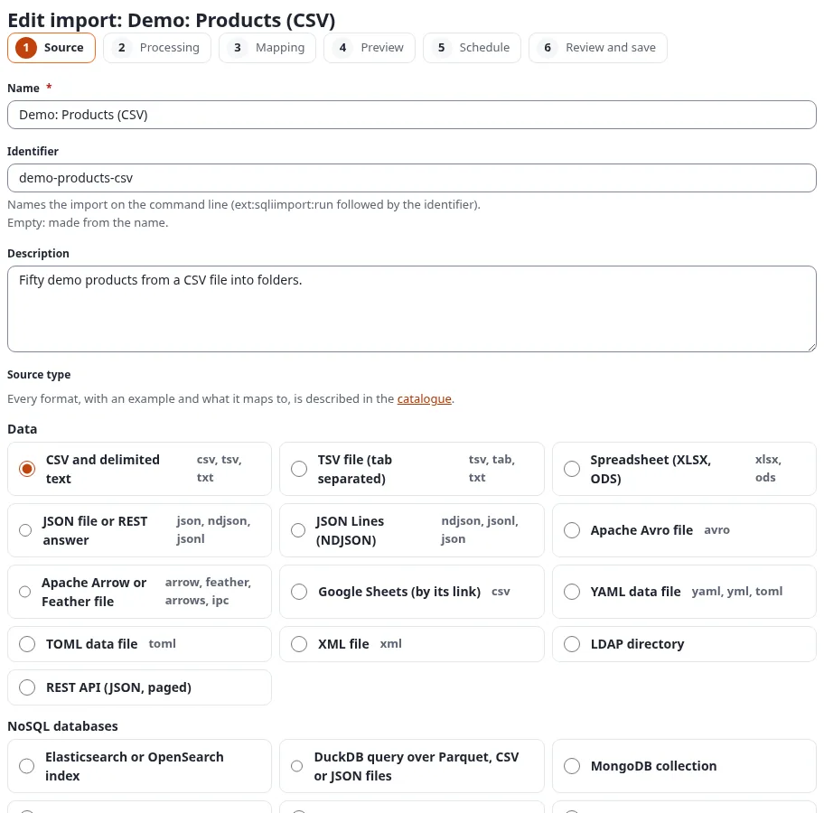
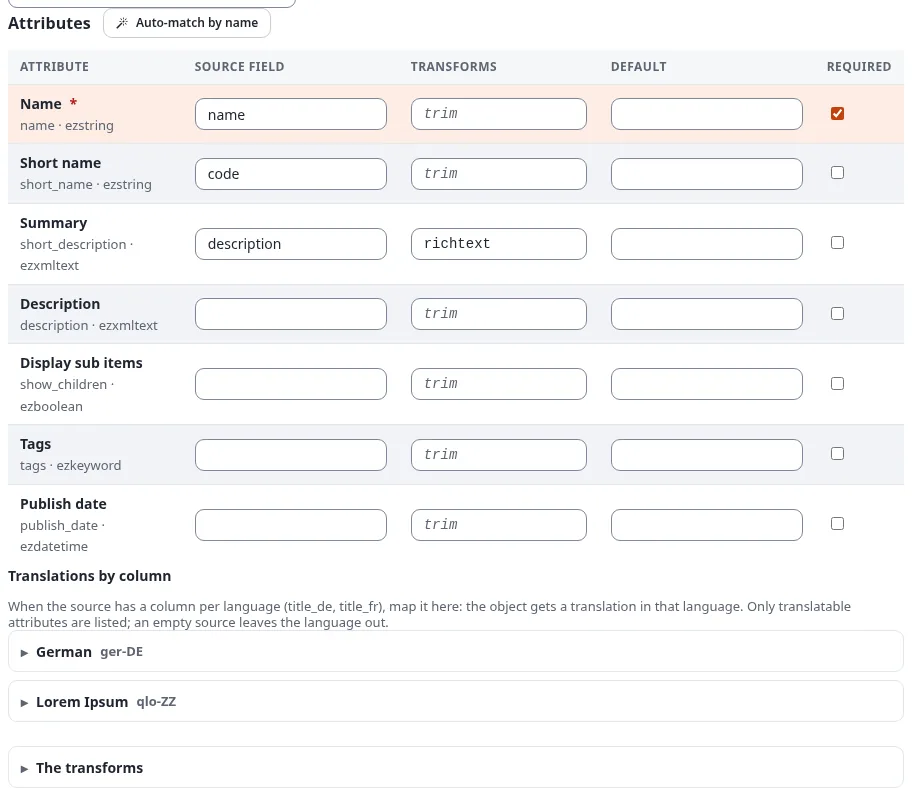
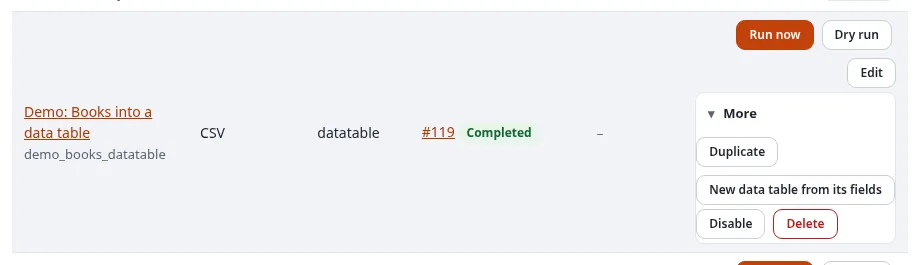

# The import editor of 7x SQLI Import

The import editor (`sqliimport/edit`) creates and changes imports in the administration, without PHP. It takes an
import through six steps. Each step is a form that is saved on its own, so nothing is lost half-way and every step
can be opened again later from the bar of steps at the top.

## Contents

1. [Opening the editor](#opening-the-editor)
2. [Step 1: Source](#step-1-source)
3. [Step 2: Processing](#step-2-processing)
4. [Step 3: Mapping](#step-3-mapping)
5. [Step 4: Preview](#step-4-preview)
6. [Step 5: Schedule](#step-5-schedule)
7. [Step 6: Review and save](#step-6-review-and-save)
8. [Copying, disabling and deleting](#copying-disabling-and-deleting)

The full reference of every field is in the extension manual: `/exphelp/viewer/ext/sqliimport/editor.md`.

## Opening the editor

- **New import** on the dashboard of the Imports tab, or in its left menu, opens `sqliimport/edit/new`.
- **Edit** next to an import in the list opens the import at its first step.
- **Edit** on the Schedules page opens the schedule step of the import.
- **Import/Export > Import into this folder…** on a folder opens a new import whose items go below that folder, and
  **Import objects of this class…** on a class page starts the mapping with that class.
- **New import** on a card of the **Catalogue** opens a new import with that source type already chosen.

The editor needs the policy **Manage imports** (`sqliimport/manage`), or `sqliimport/manageimports` of 1.x. A user
with **Run imports** (`sqliimport/run`) alone sees and runs the imports, but cannot change them.

Every step has the buttons **Save and continue** (save, then the next step), **Save** (save and stay) and **Back to
the imports**. Every value is checked on the server; a step with errors is shown again with the fields marked.

## Step 1: Source

Name, identifier (for the command line; empty: made from the name) and description, then the **source type** and
**where the data comes from**: an uploaded file, an address (`http` or `https`, read at every run), a file on the
server (when the settings allow a directory), or, for databases and services, the source itself with its options.

The source types are grouped as in the **Catalogue**: Data, NoSQL databases, Content, Platforms, Commerce and Media.
Each card of the catalogue describes the format, offers an example file to download, and has a **New import**
button. The worked example of each source is in the manual (`/exphelp/viewer/ext/sqliimport/sources.md` and the
pages `source-examples-*.md` next to it).



The options of the chosen type follow: for a CSV file the delimiter (`auto` detects it), the enclosure, the encoding
and **Key field**, the column that names a record (`id` in the products example). A new import is created when this
step is saved for the first time, disabled.

## Step 2: Processing

This step says what is made of each record and how a run behaves.


- **How the records are processed**: **Mapping to a content class (no code)**, **Rows of a data table (a
  persistent class)** (see [Data tables](../../features/6.0/data-tables.md#importing-rows-with-7x-sqli-import)), or a
  handler with its options.
- **Target**: the parent node of new content, its section and language, and the user a run runs as (`0`: the user
  who starts or schedules the run).
- **Existing content**: **Create new, update existing**, **Only create, leave existing as they are** or **Only update
  existing**.
- **When someone edited an object since the last run** (the conflict rule). The import remembers what it wrote into
  each field. When an editor changed a field after that, the rule decides:

  | Rule | What the next run does with an edited item |
  |---|---|
  | **Overwrite with the source** (default) | Writes every field from the source; the editor's change is replaced |
  | **Merge: keep the fields that were edited** | Writes only the fields nobody edited |
  | **Only fill empty fields** | Writes only fields that are empty now |
  | **Skip the object** | Leaves the item alone; the record says "edited since the last run" |

  Example: the import wrote the summary "Fresh tea" and an editor corrected it to "Fresh green tea". With **Merge**,
  the next run still updates the price from the file but keeps the editor's summary.
- **Days a run can be undone**: empty takes the setting (`[RunSettings] UndoDays`, 30 days), `0` switches undo off for
  this import.
- **Records per chunk** and **At most this many records per run** (`0`: no limit).
- **Notifications**: **Tell when a run** failed or had errors (default), failed, ended (every run) or never; **A notice
  for the user who started the run** (shown on the dashboard and in the bell of the header); **E-mail addresses**, one
  per line, who get the counts, the first errors and the link to the run. Dry runs send no mail.

## Step 3: Mapping

Choose the content class and save the step to see its attributes. Then say how a record finds its object: by a
remote ID made from the record, such as `product-{id}`, or by the value of an attribute. Each line of the grid is one
attribute:



| Column | Meaning |
|---|---|
| Source field | A field of the record, such as `title` or `author.name`; the fields of the sample are listed above the grid |
| Transforms | A chain of transforms as one line of text |
| Default | The value when the source value is empty |
| Required | The record fails when the value is still empty |

A transform chain is written with the steps separated by `|` and the arguments in parentheses:

```text
trim | date(format=d.m.Y, timezone=Europe/Berlin)
date(format=excel)
map(table={"D":"Germany","A":"Austria"}, otherwise=Other)
replace(search=",", replace=.)
```

A value with a comma, a parenthesis or a `|` is put in double quotes; a table or a list is written as JSON.
`date(format=excel)` reads the date numbers of a spreadsheet, such as `45231` for 1 November 2023. Every transform
with its arguments is listed under **The transforms** below the grid, and in the manual
(`/exphelp/viewer/ext/sqliimport/transforms.md`).

**Auto-match by name** fills the lines that have no source field yet: it compares the names of the attributes with
the field names of the sample, without case and accents, and adds `richtext`, `date`, `image` or `bool` where the
datatype needs it. It uses no external service. Check the filled lines, then save.

**Translations by column**: when the source has a column per language (`title_de`, `title_fr`), open the language
below the grid and map those columns; the item gets a translation in that language.

**Download mapping (JSON)** and **Load a mapping…** move a mapping to another import or installation.

## Step 4: Preview

The preview runs in the request; it starts no job and stores no run. It shows the first 20 records of the source as a
table, with what the source detected (the delimiter and encoding of a CSV file, the sheets of a spreadsheet), and a
dry run of them: for each record what would happen and the fields that would change, with the current value struck
through and the new one next to it.


Nothing is published and no image or file is downloaded. Change the source or the mapping and open the preview
again until it looks right.

## Step 5: Schedule

Never, once, every N minutes, hourly, daily, weekly, monthly or a cron expression, in a time zone, with e-mail
addresses for failures; the next five run times are shown after saving. Below it, the section **Started by another
system (webhook or API)** switches the import's trigger on. Both are explained in
[Schedules and cron](schedules-and-cron.md).

## Step 6: Review and save

The summary of the import (source, processing, target, schedule), what is still missing (for example a mapping
without a match rule), and **The import is enabled**. **Save** stores it; **Save and run** stores the enabled import,
starts a run at once and opens its run page.

## Copying, disabling and deleting

Next to each import in the list, users with **Manage imports** find **Edit** and, under **More**:



- **Duplicate**: a disabled copy with the source, processing and mapping, without schedules and runs, opened in the
  editor;
- **New data table from its fields** (Exponential 6.0.15, policy `setup/setup`): opens the module table wizard with
  the fields of the import ([Data tables](../../features/6.0/data-tables.md#importing-rows-with-7x-sqli-import));
- **Enable** or **Disable**: switches the import on or off;
- **Delete**: removes the import with its mapping and schedules after a confirmation. Its runs stay in the history.
  An import that runs now cannot be deleted.

To move imports from a staging installation to the live one, export them as JSON on the **Settings** page of the
Imports tab and import the file there. Uploaded source files are not part of an export; upload them again in the
source step.

Next: [Imports and runs](imports-and-runs.md).
