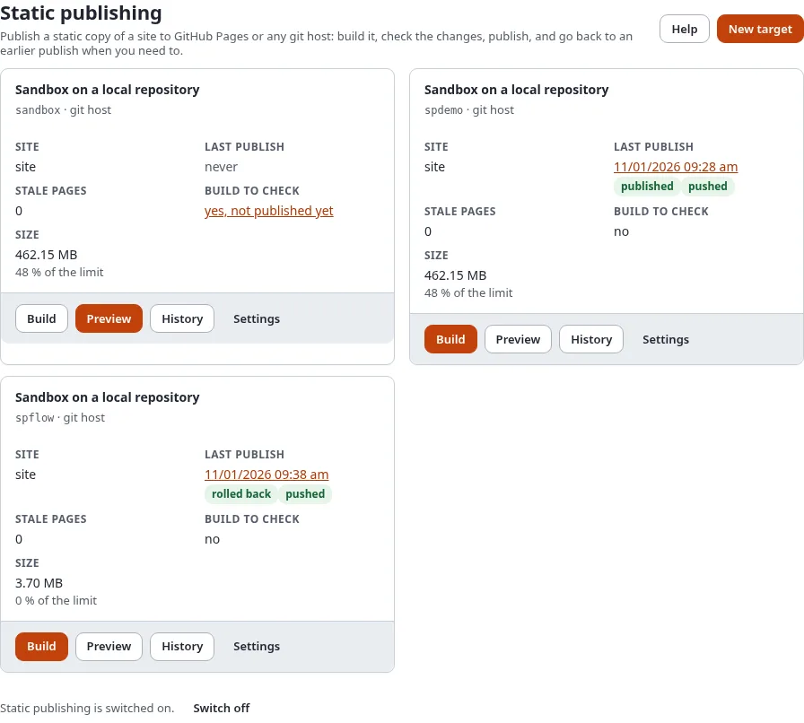
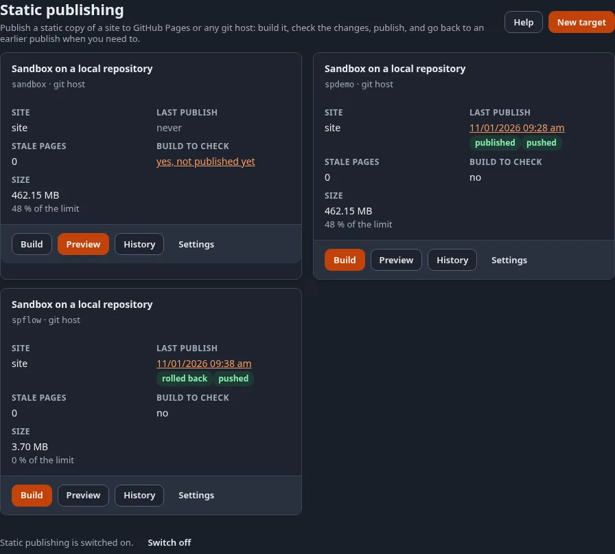

# Static publishing

**Static publishing** turns a site of your Exponential installation into a folder of plain HTML pages and files and
publishes it to a git repository: to **GitHub Pages**, where it is hosted for free, or to any other git host. Editors
keep working in Exponential as before; visitors get the static copy, which has no PHP and no database behind it, so
there is nothing on the public side to update, patch or attack.

You do it in **Setup > Static publishing**: make a target once with the wizard, then build, check what changes and
publish. Every publish is kept, so you can always go back to an earlier one.

Each target on the page shows its published **version** (the number `n` of its newest tag `static/<target>/<n>`), the
short **commit** id of that version (a link to the commit on GitHub when the repository is there) and its **last
publish** with the state of the push: pushed, push pending, failed, nothing changed or not pushed; the time opens the
page of the run. The state of the GitHub Pages build is on the **History** page, which asks GitHub for it.

## Contents

1. [Start here](#start-here)
2. [The steps](#the-steps)
3. [The pages of Setup > Static publishing](#the-pages-of-setup--static-publishing)
4. [More](#more)

## Start here

- **Make a free site now**: [Make a free website in 15 minutes](make-a-free-website-in-15-minutes.md). First time
  on GitHub? [Create a GitHub account and repository](create-a-github-account-and-repository.md).
- **Know what it is and whether it fits**: [What static publishing is](what-static-publishing-is.md),
  [Is static right for my site?](is-static-right-for-my-site.md) and the [FAQ](faq.md).
- **Set it up properly**: the tutorial [Host static sites on GitHub Pages](../../guides/host-static-sites-on-github-pages.md):
  from an existing site to a live `github.io` address.
- What it is and what it adds to the static cache: [Static publishing](../../features/6.0/static-publishing.md).
- Developers and CI: start from the template repository [exponential-static-site-starter](https://github.com/se7enxweb/exponential-static-site-starter), which
  builds a static copy with GitHub Actions and deploys it to GitHub Pages.
- See a static copy: the demo site at [https://se7enxweb.github.io/exponential-demo-site-static/](https://se7enxweb.github.io/exponential-demo-site-static/) (coming soon).

## The steps

1. **Make a target** with the wizard: which site, which repository, how the push signs in, how links are written.
   [The setup wizard](the-setup-wizard.md)
2. **Build** it: every page is fetched as a visitor who is not signed in sees it, links are rewritten and files
   copied. [Build, preview and publish](build-preview-and-publish.md)
3. **Check** the build: what changes, the report, the size against the host's limits, and the copy itself in your
   browser. [Build, preview and publish](build-preview-and-publish.md#check-the-build)
4. **Publish** it: one commit, one tag, one push, never forced.
   [Build, preview and publish](build-preview-and-publish.md#publish-or-discard)
5. **Go back** when you need to: [History and rollback](history-and-rollback.md)

Who may do which step is set with policies: [Who may publish](who-may-publish-roles-and-policies.md).

## The pages of Setup > Static publishing

| Page | Address | What it helps you do | Help |
|---|---|---|---|
| Static publishing | `/staticpublish/dashboard` | every target with its last publish, stale pages and size; switch the feature on or off | this page |
| New target, Settings | `/staticpublish/target/new`, `/staticpublish/target/<id>` | make or change a target | [The setup wizard](the-setup-wizard.md) |
| Build | `/staticpublish/build/<id>` | build in the background and follow it | [Build, preview and publish](build-preview-and-publish.md) |
| Preview and publish | `/staticpublish/preview/<id>` | the changes, the report, the limits, the preview, Publish and Discard | [Build, preview and publish](build-preview-and-publish.md#check-the-build) |
| History | `/staticpublish/history/<id>` | the publishes, tags and commits; roll back | [History and rollback](history-and-rollback.md) |
| A job's page | `/staticpublish/log/<run-id>` | one build, publish or rollback: progress and report | [Build, preview and publish](build-preview-and-publish.md#the-page-of-a-job) |
| Deploy key | `/staticpublish/keys/<id>` | make the SSH key the push signs in with | [Deploy keys](../../guides/static-publishing-deploy-keys.md) |

The **dashboard** of the administration has a block **Static publishing** with the stale pages and the last publish
of each target. Before the first target it shows one line with a link to the wizard and the tutorial; **hide this**
removes it for you. **Setup > Cache > Static content cache** links here too.

Every page has a **Help** button that opens the page of this manual about it.

## More

- The command line and CI: [Host static sites on GitHub Pages](../../guides/host-static-sites-on-github-pages.md)
  and the commands `exp:static:build`, `exp:static:publish`, `exp:static:rollback`.
- GitHub: [Connect to GitHub: token, deploy key or GitHub App](connect-to-github-token-key-or-app.md),
  [Choose branch or GitHub Actions](choose-branch-or-github-actions.md), [Use your own domain](use-your-own-domain.md)
  and [GitHub Pages limits and terms](github-pages-limits-and-terms.md).
- Repositories, tokens and pushes: [Targets and credentials](../../guides/static-publishing-targets-and-credentials.md)
- The format of a build: [The build format](../../specifications/6.0/static-publishing-build-format.md)
- Search, forms and comments: [Search, forms and comments on a static site](search-forms-and-comments-on-a-static-site.md),
  [Languages on a static site](languages-on-a-static-site.md), [SEO on a static site](seo-on-a-static-site.md) and the
  [form endpoint](../../specifications/6.0/static-publishing-form-endpoint.md).
- Without pressing a button: [Publish automatically](publish-automatically.md) and
  [Notifications and webhooks](notifications-and-webhooks.md).
- Links, files and privacy: [Links and base path](links-and-base-path.md),
  [Images, files and downloads](images-files-and-downloads.md), [Keep private content private](keep-private-content-private.md).
- Not on GitHub: [Other git hosts: GitLab, Gitea and your own server](other-git-hosts-gitlab-gitea-and-your-own-server.md).
- Something went wrong: [When a publish fails](when-a-publish-fails.md).
- From the page itself: [The website sidebar panel](the-website-sidebar-panel.md) shows whether a page is stale and
  publishes just that page.

## Next step

[Make your first target with the setup wizard](the-setup-wizard.md).
