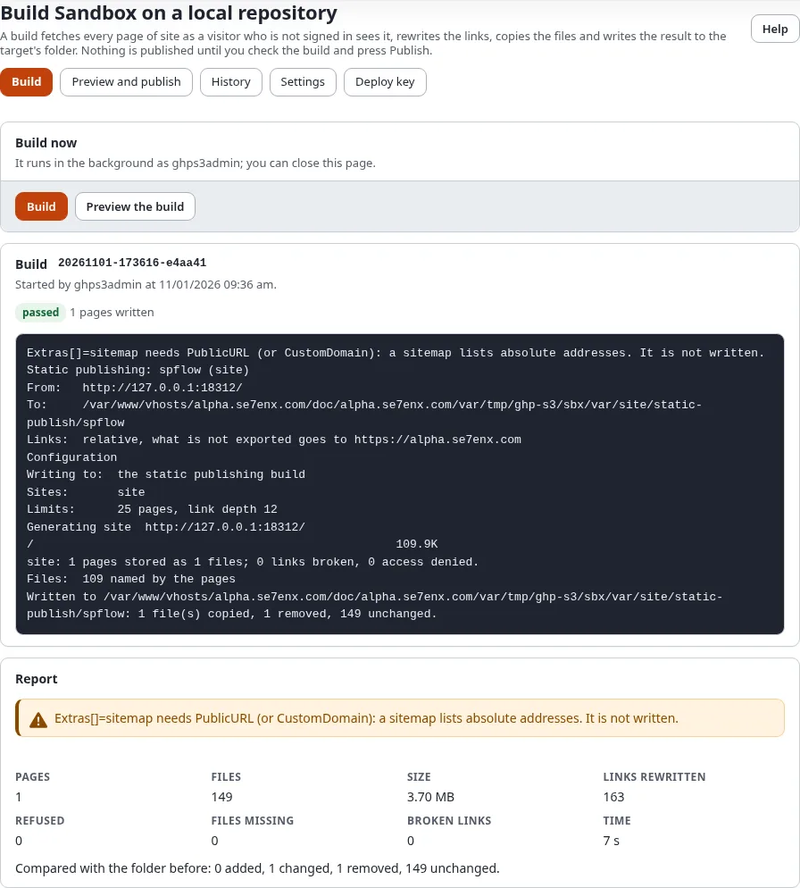

# Build, preview and publish

A target goes public in three steps: **Build** writes the static copy into the target's folder, **Preview and
publish** shows what changes and lets you look at it, and **Publish** commits, tags and pushes it. Until you press
Publish nothing leaves the server.

## What you'll have at the end

The site published to the target's repository, as a commit with the tag `static/<target>/<n>`.

## Build

Open the target's **Build** page (Setup > Static publishing > **Build**) and press **Build**. The build runs in the
background as you, so you can close the page; it goes on and the page finds it again.

While it runs the page shows the pages written so far and every line of the progress. When it has ended the page
reloads and shows the **report**: pages, files, size, links rewritten, pages refused, files that could not be
collected and broken links. A page that still carries debug output, a form token or a session id after stripping is
refused, and the build is not used.

Only one build, publish or rollback of a target runs at a time, including one started on the console.

## Check the build

**Preview and publish** compares the build with the last publish:

- **What changes**: every page and file added, changed or removed, with its size (and the size before for a changed
  one). Before the first publish every file is new.
- **Size and limits**: the build against the limit (GitHub Pages: 1 GB a site, 100 MB a file), with the largest file.
  Above 90 % the box turns yellow, above the limit red.
- **Report of the build**: the report of the last build.
- **Look at the build**: **Open the preview** serves the build from the target's folder as the host will. The link is
  signed for you and works for an hour. On the server, `./console exp:static:serve <target>` does the same.

## Publish or discard

- **Publish** (the policy `staticpublish/publish`): tick **I have checked the changes**, add a message if you like and
  press Publish. **Verify it's you** asks for your password. The publish runs in the background and its page shows it:
  one commit with the files of the build, the next tag `static/<target>/<n>`, and the push. A push is never forced;
  when it fails, the commit and tag stay and the push is tried again later.
- **Discard the build** (the policy `staticpublish/build`): the folder goes back to the last publish. The public site
  does not change.

## The page of a job

Every build, publish and rollback started here has a page, `/staticpublish/log/<run-id>`: the progress, the report
and, for a publish or rollback, its record (state, who, when, files, commit, tag, push). The history links to it.

## Next step

[History and rollback](history-and-rollback.md).
