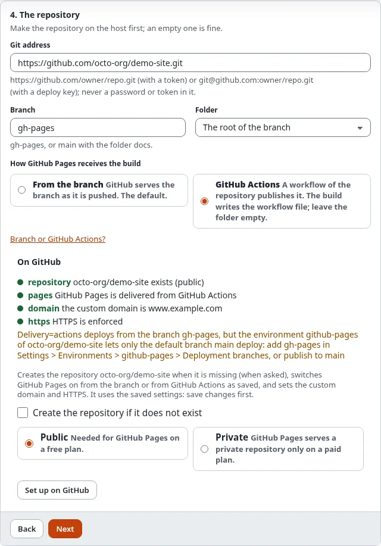

# Choose branch or GitHub Actions

Every publish pushes the build to a branch of the repository. GitHub Pages then serves it in one of two ways; the
target's setting **Delivery** chooses which.

## What you'll have at the end

GitHub Pages set to serve your target the way you chose, and the target's settings matching it.

## From the branch (the default)

GitHub Pages serves the files of the branch as they are pushed.

- **Branch** `gh-pages` with the folder at the root, or `main` with the folder `/docs` (GitHub Pages offers only these
  two folders).
- Nothing else is needed. The file `.nojekyll` (in the extras by default) stops GitHub from running Jekyll, which
  would leave out every file and folder starting with `_` or `.`.
- In the wizard: step 4, **From the branch**. Setting: `Delivery=branch`.

Take this unless you have a reason not to.

## GitHub Actions

GitHub Pages is deployed by a workflow of the repository. The build writes it for you:
`.github/workflows/static-publish-pages.yml`. It runs on every push to the branch, uploads the files as they are (it
builds nothing) and deploys them with GitHub's own `deploy-pages` action.

- The build must be at the **root of the branch** (leave **Folder** empty): GitHub reads workflows only from there.
- A token needs the **Workflows: Read and write** permission to push the workflow file.
- GitHub's environment `github-pages` allows deployments from the default branch only, unless you add others in
  **Settings > Environments**. Use the repository's default branch (often `main`), or add yours there.
- `./console exp:static:github status <target>`, the "On GitHub" box and **Set up on GitHub** in the wizard warn when
  the target's branch is not the repository's default branch.
- In the wizard: step 4, **GitHub Actions**. Setting: `Delivery=actions`.

Take this when the repository should also hold other workflows, when you want GitHub's deployment history, or when an
organization requires Actions.

## Switch GitHub Pages on

With a token or a GitHub App, **Set up on GitHub** in step 4 of the wizard (or `./console exp:static:github setup
<target>`) switches GitHub Pages on the way the target says. A branch must exist before GitHub Pages can serve it, so
for a new repository: publish once, then set up again.

By hand: repository > **Settings** > **Pages** > **Build and deployment** > **Source**: **Deploy from a branch**
(choose the branch and folder) or **GitHub Actions**.

## Check it

**History** and **Preview** show the box **On GitHub** with the delivery and the state of the last Pages build:
**built**, **building**, **queued** or **failed**, with a link to the details. `./console exp:static:github status
<target>` prints the same and says when GitHub's settings differ from the target's.

## Next step

[Use your own domain](use-your-own-domain.md), or [build, preview and publish](build-preview-and-publish.md).
