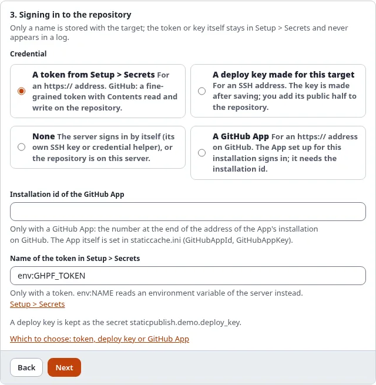

# Connect to GitHub: token, deploy key or GitHub App

A target signs in to its repository with a **credential**. The target only stores its **name**; the value stays in
**Setup > Secrets** and reaches git through the environment of the one git process (`GIT_ASKPASS` or
`GIT_SSH_COMMAND`), never through the address of the repository, a command line or a log.

## What you'll have at the end

A target that can push to GitHub, and, with a token or a GitHub App, use the GitHub steps of the wizard.



## Which one to choose

| | Token | Deploy key | GitHub App |
|---|---|---|---|
| Setting | `Credential=token:<secret>` | `Credential=sshkey:<secret>` | `Credential=app:<installation id>` |
| Address of the repository | `https://github.com/owner/repo.git` | `git@github.com:owner/repo.git` | `https://github.com/owner/repo.git` |
| Pushes | yes | yes | yes |
| Creates the repository, switches GitHub Pages on, sets the domain, shows the Pages build | yes | no | yes |
| Valid for | until it expires (you choose) | until you remove it | one hour per token, made for each push |
| Best for | one site, getting started | a server that should reach only this one repository | organizations, many sites |

Start with a **token**. Choose a **deploy key** when the server must not hold anything that reaches other
repositories, and a **GitHub App** when an organization publishes several sites.

## A fine-grained token

1. On GitHub: your picture > **Settings** > **Developer settings** > **Personal access tokens** > **Fine-grained
   tokens** > **Generate new token**.
2. **Resource owner**: the account or organization of the repository. **Repository access**: only the repository of
   the site (choose all repositories only if the wizard should create new ones).
3. **Repository permissions**: **Contents: Read and write** (to push), **Pages: Read and write** (to switch GitHub
   Pages on and set the domain), **Administration: Read and write** only to create repositories, **Workflows: Read and
   write** only with GitHub Actions (the build writes a workflow file).
4. Copy the token once and store it in **Setup > Secrets** under a name such as `github_pages_token`.
5. In the wizard, step 3: **A token from Setup > Secrets** with that name. The setting is
   `Credential=token:github_pages_token`.

`token:env:NAME` reads the token from an environment variable of the server instead (for CI).

### Sign in instead of copying a token

With an OAuth App that has the device flow switched on (its client id in `[StaticPublishSettings]
GitHubOAuthClientId`), the console signs you in and keeps the token for you:

```
./console exp:static:github signin --secret=github_pages_token
```

It prints an address and a code; open the address, enter the code and allow access. The token goes to the secret
store, never to the screen.

## A deploy key

A deploy key reaches exactly one repository. **Save** in the wizard opens the target's **Deploy key** page; **Make
the key** creates an ed25519 key, keeps its private half in Setup > Secrets and shows the public half. On GitHub:
repository > **Settings** > **Deploy keys** > **Add deploy key**, paste it and tick **Allow write access**. The
target's address must be the SSH one (`git@github.com:owner/repo.git`). Details:
[SSH deploy keys](../../guides/static-publishing-deploy-keys.md).

A deploy key only pushes: create the repository and switch GitHub Pages on in its settings yourself.

## A GitHub App

A GitHub App belongs to an account or organization and is installed on chosen repositories. Static publishing makes
a short-lived token for each push from the App's private key.

1. On GitHub: **Settings** > **Developer settings** > **GitHub Apps** > **New GitHub App**. Switch the webhook off.
   **Repository permissions**: Contents, Pages and (to create repositories) Administration, each **Read and write**;
   Workflows too with GitHub Actions.
2. **Generate a private key**: GitHub downloads a `.pem` file. Store its whole text in **Setup > Secrets**, for
   example as `github_app_key`.
3. Note the **App ID** and set, in `settings/override/staticcache.ini.append.php`:
   ```
   [StaticPublishSettings]
   GitHubAppId=123456
   GitHubAppKey=github_app_key
   ```
4. **Install App** on the repository of the site. The address of the installation ends in its **installation id**
   (`.../settings/installations/45678901`).
5. In the wizard, step 3: **A GitHub App**, with the installation id. The setting is `Credential=app:45678901`.

## Check it

- `./console exp:static:status <target>` says whether the credential can be read (never its value).
- `./console exp:static:github status <target>` signs in with it and shows the repository and GitHub Pages.

## When it does not work

| Message | What to do |
|---|---|
| `the secret ... is not set` | Store the token in Setup > Secrets under that name |
| `GitHub answered 401: Bad credentials` | The token expired or was revoked: make a new one and store it under the same name |
| `GitHub answered 403` or `404` for the repository | The token does not cover this repository, or lacks a permission listed above |
| `the GitHub steps need a token or a GitHub App` | The target signs in with a deploy key or none: use a token or an App for the GitHub steps |
| `the GitHub App is not set up` | Set `GitHubAppId` and `GitHubAppKey` |
| `the GitHub App ... gave no token` | The App is not installed on the repository, or the installation id is wrong |

## Next step

[Choose branch or GitHub Actions](choose-branch-or-github-actions.md).
