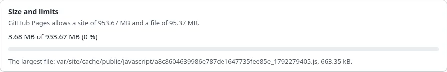

# GitHub Pages limits and terms

GitHub Pages is free, and it has limits. Static publishing knows them: the wizard states them, the preview shows the
size of the build against them, and **every push** of a GitHub Pages target is checked first.

## What you'll have at the end

A build that fits GitHub Pages, and a site that keeps to its terms.

## The limits

| | Limit | What static publishing does |
|---|---|---|
| The site | 1 GB | above 90 %: a warning; above it: not pushed |
| One file | 100 MB | above 50 MB: a warning (GitHub warns too); above 100 MB: not pushed |
| Traffic | about 100 GB a month (a soft limit) | nothing to check; GitHub writes to you when a site uses far more |
| Builds | about 10 an hour (a soft limit, branch builds) | one publish is one build |
| Repository | public on GitHub Free; private on GitHub Pro, Team or Enterprise | a private repository is a warning |

The limits checked are `MaxSiteBytes` and `MaxFileBytes` in `[StaticPublishSettings]` (1 GB and 100 MB). A push over
them stays **pending** with the reason in the job's report and in History; nothing reaches GitHub. These are
GitHub's published figures; GitHub may change them, and its own documentation is the reference.

## Make a build smaller

- **Files** in step 7 of the wizard: **Only what the pages name** (`Assets=referenced`) instead of every image of
  published content.
- **Leave out** pages or sections that need not be public (`ExcludePaths[]`, `ExcludeSections[]`).
- Large videos and downloads: link them from another host (a video platform, a release download) instead of the
  site's storage.
- The preview lists the largest files and the size against the limit before you publish.

## The terms

GitHub Pages is for project, personal and organization sites. Its terms say it is not meant to run an online
business, an e-commerce site or anything mainly for commercial transactions, and not as free file hosting. A shop,
a members' area or a site that sells should stay on your own hosting; static publishing also leaves out what cannot
work statically (search, forms, logins). Read GitHub's current terms for GitHub Pages and its acceptable use
policies before you publish: they apply to your site, not to Exponential.

A site whose content must not be public belongs in a private repository on a paid plan, or on another host: a free
plan serves only public repositories, and their files are public on GitHub too. See
[Keep private content private](keep-private-content-private.md).

## Next step

[Build, preview and publish](build-preview-and-publish.md).
