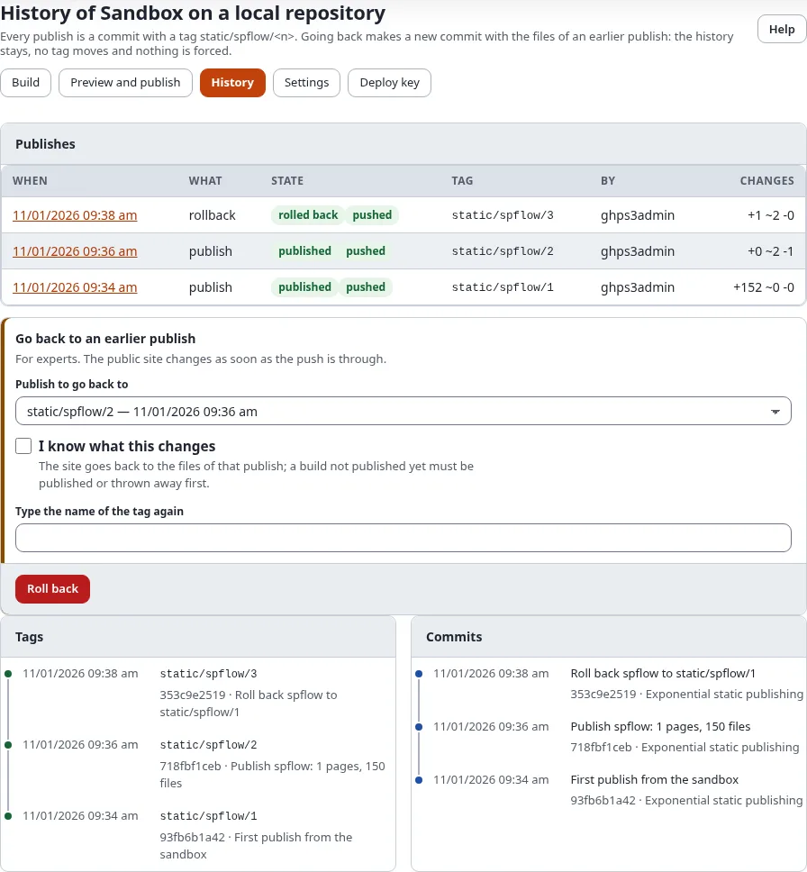
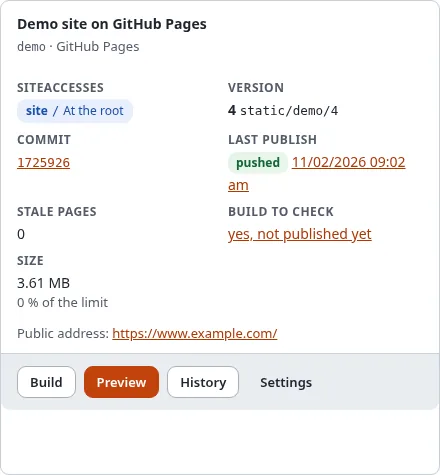

# History and rollback

Every publish of a target is a commit with its own tag, `static/<target>/<n>`, and stays in the history. Going back
does not delete anything: it makes a **new** commit with the files of an earlier publish, tags it with the next
number and pushes it. No tag ever moves and nothing is forced.

## What you'll have at the end

The public site showing an earlier publish again, with the rollback in the history.

## The history

Open **History** on the target. It lists:

- **Publishes**: every publish and rollback, newest first, with when, state, version (the number of its tag, a dash
  when it made none), short commit id (a link to the commit on GitHub when the repository is there), push state, who
  and how many files changed. The date opens the page of the run. On a narrow screen each run is a block of labeled
  lines.
- **Tags**: newest first, each with its commit (a link to the commit on GitHub when the repository is there).
- **Commits**: the last commits of the branch.

The card of the target in **Setup > Static publishing** shows the same in short: the published **Version** with its
tag, the **Commit** (a link to the commit on GitHub when the repository is there) and the badge of the **Last
publish**.

## Roll back

**Go back to an earlier publish** is for experts and needs the policy `staticpublish/publish`:

1. Choose the publish to go back to.
2. Tick **I know what this changes**.
3. Type the name of the tag again, for example `static/github-public/2`.
4. Press **Roll back** and confirm with **Verify it's you**.

The rollback runs in the background and its page opens. A build that is not published yet blocks a rollback: publish
it or throw it away first ([Build, preview and publish](build-preview-and-publish.md#publish-or-discard)).

To undo a rollback, roll back again to the publish before it, or simply build and publish.

## On the console

`./console exp:static:rollback <target> <n>` lists what would change; with `--apply` it rolls back. More in
[History and rollback on the console](../../guides/static-publishing-history-and-rollback.md).

## Next step

[Who may publish](who-may-publish-roles-and-policies.md).
