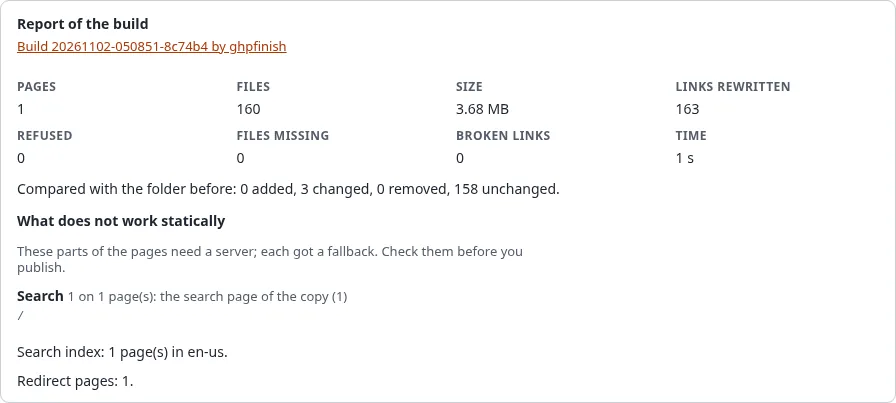

# Languages on a static site

## What you'll have at the end

Each language of the site as its own static copy, with language links that lead visitors to the right place.

## One target per siteaccess

A target publishes one front siteaccess, so it follows that siteaccess's languages and address scheme. A site with
`eng` and `ger` siteaccesses gets two targets, for example two folders of one repository (`Folder`) or two
repositories, each with its own public address.

## Language links

The `<link rel="alternate" hreflang="...">` links of every page are written as absolute addresses: to the page in this
copy when it holds it, otherwise to the live site. A language switcher whose links go to another siteaccess leads to
the live site too, because the copy does not hold that language's pages. When the other language has a target of its
own, give the live site's address of that language as the target's **Live site**, or link the copies to each other in
the design.

## Search

The search page keeps one index per language, read from the `lang` attribute of each page's `<html>`. The search page
loads the index of its own language first.

## Next step

[SEO on a static site](seo-on-a-static-site.md).
