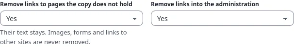

# Links and base path

## What you'll have at the end

The right link setting for your target, and no missing style sheets or broken links on the published site.

## Where a GitHub Pages site lives

| Repository | Address | Path of the site |
|---|---|---|
| `<owner>/<owner>.github.io` (a user or organization site) | `https://<owner>.github.io/` | `/` |
| any other, for example `<owner>/my-site` (a project site) | `https://<owner>.github.io/my-site/` | `/my-site/` |
| any, with your own domain | `https://www.example.com/` | `/` |

On your Exponential site, the page "About us" is `/about-us`. On a project site it must be `/my-site/about-us/`.
The build takes care of that in one of two ways (step 5 of the wizard).

## Relative links (the default)

Every link is written relative to the page it is on: from `/news/` the page `/about-us/team` becomes
`../about-us/team/`. The copy then works at any path: at `/`, below `/my-site/`, in the preview and from a folder on
your disk. Choose this unless you have a reason not to.

## Below a base path

With **Below a base path** (`Links=base-path`) every link starts with the base path, for example
`/my-site/about-us/team/`. Some tools and some hosts want absolute links. The copy then works only at that one path,
so the base path must match the repository's name exactly, with a slash at each end.

`404.html` always uses the base path: GitHub Pages serves it for a missing address at any depth, where relative links
would point to the wrong place.

## The public address

**Public address** (`PublicURL`) is the full address of the published site, such as
`https://<owner>.github.io/my-site/`. The sitemap, `robots.txt`, canonical links and social cards need it to be
absolute. Its path should be the base path.

## Links the copy does not hold

The search results page, the login, a form's target, a page with a query string or a page you left out are not in
the copy. Links to them go to your live site (`LiveURL`, by default the address of the site in Exponential). When the
site's own address is a local one, such as `localhost` on a build server, such links stay as they are and the build
warns. Links to other sites, `mailto:` and `#anchors` are never changed.

Step 7 of the wizard can take such links out instead: **Remove links to pages the copy does not hold**
(`OutsideLinks=unlink`) and **Remove links into the administration** (`AdminLinks=unlink`). With **Yes** the link
stays in place with its text and its styles, grayed out and without an address, so a menu keeps its shape but no
visitor ends up on the live site or at the login of the administration. Images, style sheets, forms and links to other
sites are never removed. Both are **No** by default.

## When it goes wrong

| Symptom | Fix |
|---|---|
| Pages show without styles below `/my-site/` | `Links=base-path` with a wrong `BasePath`: correct it, or switch to relative links |
| Links leave the site and go to your live site | the page is not in the copy (left out, beyond `MaxDepth`, or only reachable with a query) |
| The sitemap is missing | set the public address |

## Next step

[Use your own domain](use-your-own-domain.md), or [Build, preview and publish](build-preview-and-publish.md).
