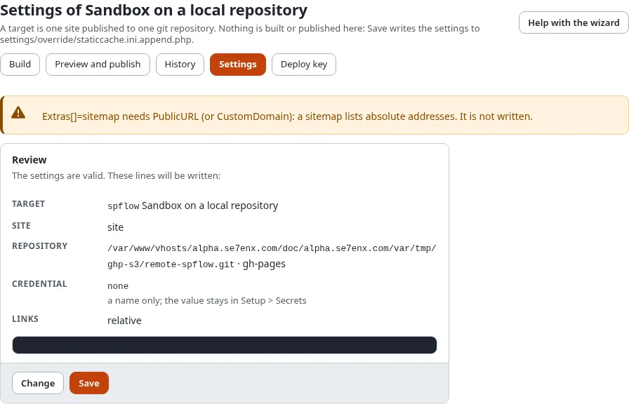
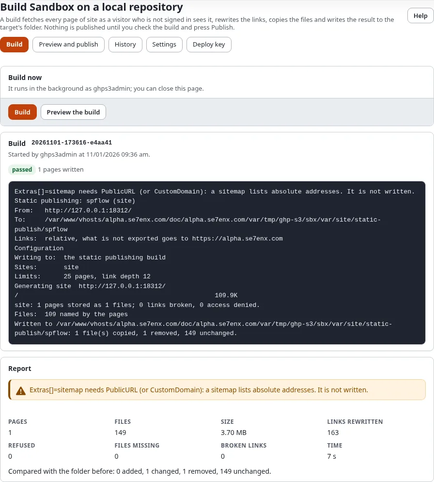
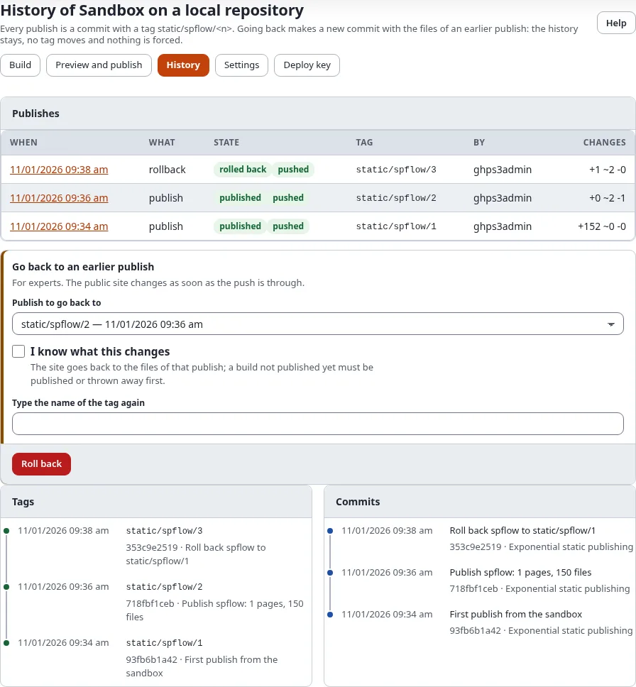

# Make a free website in 15 minutes

This tutorial takes an Exponential site you already have and puts a copy of it on the web for free, at
`https://<your-account>.github.io/<repository>/`. You keep editing in Exponential; the public copy is plain files
that GitHub Pages serves.

## What you'll have at the end

- A public website at a `github.io` address, with your pages, images and menus.
- A target in **Setup > Static publishing** that builds and publishes it again with two clicks.
- A first entry in the history, so you can always go back.

## What you need

- An administrator account in Exponential (the policy `staticpublish/setup`).
- A free GitHub account. New to GitHub? [Create a GitHub account and repository](create-a-github-account-and-repository.md)
  takes five minutes.
- A site that suits a static copy. Unsure? [Is static right for my site?](is-static-right-for-my-site.md)

## Step 1: Make a repository and a token (3 minutes)

1. On GitHub, **New repository**: name it, for example `my-site`, choose **Public** and create it empty.
2. In your GitHub settings, **Developer settings > Fine-grained tokens > Generate new token**: only the repository
   `my-site`, permissions **Contents: Read and write** and **Pages: Read and write**.
3. In Exponential, **Setup > Secrets**: add the token under a name, for example `github_my_site`. The token is never
   shown again, not even to you.

## Step 2: Run the wizard (5 minutes)

Open **Setup > Static publishing** and press **New target**.

Each step has **Next** (and **Back**); **Cancel** next to them leaves the wizard without saving anything.

1. **The site**: an id such as `github`, a name, and under **Siteaccesses to publish** tick your site's siteaccess
   (it is then **At the root**).
2. **The host**: GitHub Pages.
3. **Signing in**: **A token from Setup > Secrets**, then the name `github_my_site`.
4. **The repository**: `https://github.com/<your-account>/my-site.git`, branch `gh-pages`, folder: root.
5. **Links**: keep **Relative**. Public address: `https://<your-account>.github.io/my-site/`.
6. Skip your own domain for now.
7. **What the build holds**: leave it as it is.
8. **When it is published**: leave it as it is.
9. **Review**, then **Save**. Exponential asks **Verify it's you**.

After saving, open step 4 again and press **Set up on GitHub**: it switches GitHub Pages on for the branch. On a brand
new repository press it once more after the first publish.

## Step 3: Build (3 minutes)

The target's **Build** page opens. Press **Build** and watch the pages arrive.

## Step 4: Check (2 minutes)

**Preview and publish** shows what changes, the size against GitHub's limits and the report. Press
**Open the preview** and click through a few pages: this is exactly what visitors will see.

## Step 5: Publish (2 minutes)

Tick **I have checked the changes** and press **Publish**. A minute or two later the site is live at
`https://<your-account>.github.io/my-site/`. **Setup > Static publishing** then shows the target at **Version** 1,
with its **Commit** (a link to the commit on GitHub) and the badge of the last publish.

## When something does not work

[When a publish fails](when-a-publish-fails.md) goes through the usual symptoms. The most common one: a 404 on
`github.io` right after the first publish, because GitHub Pages has not been switched on yet (step 2, **Set up on
GitHub**).

To see a finished example, the Exponential demo site is published this way at
[https://se7enxweb.github.io/exponential-demo-site-static/](https://se7enxweb.github.io/exponential-demo-site-static/) (coming soon).

## Next step

- Your own address: [Use your own domain](use-your-own-domain.md).
- Publish without pressing a button: [Publish automatically](publish-automatically.md).
- What stays private: [Keep private content private](keep-private-content-private.md).
