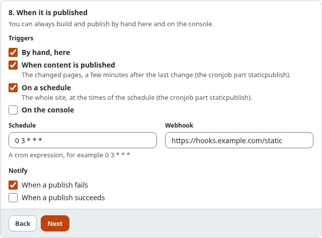

# Notifications and webhooks

Publishing often runs without anyone watching: after content publishes or on a schedule. A target can tell you how it
went, by e-mail and by a webhook.

## What you'll have at the end

An e-mail when a publish fails (and, if you like, when one succeeds), and a post to an address of your choice after
every publish and rollback.



## E-mail

In the wizard, step 8, **Notify**:

- **When a publish fails**: on by default.
- **When a publish succeeds**: only a publish that changed something is reported.

The e-mail goes to `[StaticPublishSettings] NotifyEmail` in `staticcache.ini`, or to the site's administrator
address (`site.ini [MailSettings] AdminEmail`) when it is empty. It is made like the other notices the system sends
to administrators (a sign-in from a new device, a user account waiting for approval):

- **Plain text**, from the template `design:staticpublish/notice_mail.tpl` in the layout
  `design:mail/layout_text.tpl`. Override the template in your design to change the wording.
- **Translated**: the subject and the texts are in the administration's language catalogues.
- **Sender**: `site.ini [MailSettings] EmailSender`, else `AdminEmail`.
- **Subject**: "Static publishing of *target* failed on *site*", or "... succeeded on ..." for a success. The site
  is the name of the public site, never that of the administration.
- **Mail category `admin`** (Setup > Mail preferences): an essential notice, so it is always sent and has no
  unsubscribe footer. Turn it off with **Notify** in the target, not in the mail preferences.

It names the target, the run's id, the result (failed, published, rolled back or nothing changed), the commit, the
tag, the push, the public address and any errors, never a token or key. A run that failed reads "failed", also when
it changed nothing (then "Changes: nothing changed" says so). The **Log** line links to the run's log in the
administration (`/staticpublish/log/<run id>`), built from the administration's address
(`site.ini [UserSettings] RegistrationAdminBaseURL`, else the SiteURL of the administration siteaccess); without one
the line is left out.

```text
Static publishing of Public site (github-public) failed on Example

Target: Public site (github-public)
Id: 20261101-030000-1a2b3c
Result: failed
Changes: nothing changed
Push: not pushed
Public address: https://owner.github.io/my-site/

Errors:
- not pushed: the secret github_pages_token is not set

Log: https://admin.example.com/staticpublish/log/20261101-030000-1a2b3c

--
This mail was sent by Example because the static publishing target github-public asks for it.
```

## Webhook

Enter an `https://` address in **Webhook** (plain `http://` only to the server itself). After every publish and
rollback it receives a `POST` with a JSON body:

```json
{
  "schema": "exp-static-webhook/1",
  "event": "publish.done",
  "target": "github-public",
  "name": "Public site on GitHub Pages",
  "public_url": "https://owner.github.io/my-site/",
  "run_id": "20261101-030000-1a2b3c",
  "state": "done",
  "commit": "4f1c...",
  "tag": "static/github-public/12",
  "push_state": "pushed",
  "counts": { "pages": 120, "files": 840 },
  "errors": [],
  "at": "2026-11-01T03:01:12+00:00"
}
```

`event` is `publish.done`, `publish.failed`, `rollback.done` or `rollback.failed`.

To let the receiver check that the post is yours, store a random value in Setup > Secrets and put its **name** in
`[StaticPublishSettings] WebhookSecret`. Each post then has the header
`X-Exp-Static-Signature: sha256=<hex>`, the HMAC-SHA256 of the body with that value. Only the name is in the
settings; the value never leaves the secret store, and it is not exported with packages or migrations.

A webhook or e-mail that cannot be sent is written to the debug log; it never makes a publish fail.

## Next step

[Who may publish](who-may-publish-roles-and-policies.md).
