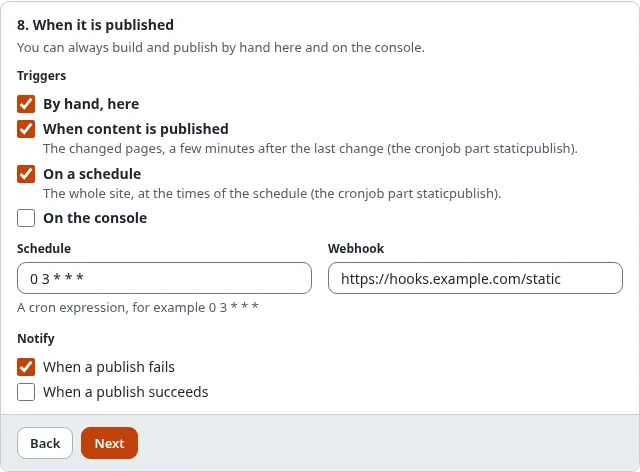

# Publish automatically

A target can publish itself: after editors publish content, or at fixed times. Both run in the cronjob part
`staticpublish`, which your installation must run every few minutes.

## What you'll have at the end

A static copy that follows the content of the site without anyone pressing **Publish**.



## Run the cronjob part

Add `staticpublish` to a cronjob part the server runs often, or run it on its own:

```
*/5 * * * * cd /path/to/exponential && php runcronjobs.php staticpublish
```

The same part also pushes again any publish whose push failed.

## After every content publish

In the wizard, step 8, tick **When content is published**. From then on:

1. Whenever content is published, moved or hidden, the pages of the nodes concerned (the same pages whose view cache
   is cleared) are marked **stale** for this target. A new page is remembered too.
2. The cronjob part waits until nothing changed for 2 minutes (`[StaticPublishSettings] PublishDebounce`), so an
   editor who publishes ten times in a row causes one publish.
3. It builds only the stale pages (more than 200 make a full build), and publishes.

The dashboard of Setup > Static publishing shows the number of stale pages of each target. A build that fails leaves
them stale; the next run tries again, and the target's notices tell you ([Notifications and webhooks](notifications-and-webhooks.md)).

## On a schedule

Tick **On a schedule** and enter a cron expression in **Schedule**, in the server's time zone:

| Expression | Means |
| --- | --- |
| `0 3 * * *` | every day at 03:00 |
| `30 6 * * 1-5` | weekdays at 06:30 |
| `0 */6 * * *` | every six hours |
| `@daily`, `@hourly`, `@weekly`, `@monthly` | the usual shortcuts |

A scheduled run is a full build and publish. When the cronjob part did not run at the exact minute it catches up
within a day, once.

## Next step

[Notifications and webhooks](notifications-and-webhooks.md).
