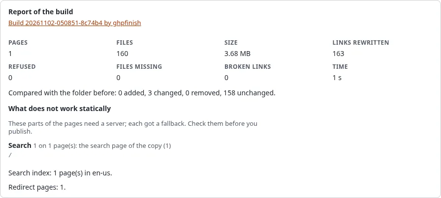

# Search, forms and comments on a static site

A static host serves files and nothing else: there is no database to search and no server that takes a form. Static
publishing finds these parts in every page it builds and gives each one a fallback, so a visitor never meets a form
that does nothing. The **report** of each build lists what it found.

## What you'll have at the end

A static copy whose search works without a server, whose contact forms reach your live site (or say where to go
instead), and a report that tells you which pages had which of these parts.

## What happens to each part

| Part of the site | On the static copy | Set in the wizard, step 7 |
| --- | --- | --- |
| Search form | Goes to the copy's own search page `search.html` | **Search page**: Yes |
| Search form, search page off | Goes to the search of the live site | **Search page**: No |
| Information collector (contact form, poll, feedback) | Posts to the live site, which collects it as usual | **Forms**: Send them to the live site |
| Information collector, forms hidden | A short text with a link to the same page on the live site | **Forms**: Hide them |
| Comments, basket, wish list | The short text with the link | always |
| Login form | Left out; the links to the login go to the live site | always |
| Scripts that call the server (ezjscore) | Reported; they call the live site or nothing | always |
| Any other form that posts | Left as it is, so it posts to the live site; reported | always |

The short text is *This form works on the live site only. Open this page there*. A site can change it with
`[StaticPublishSettings] FormFallbackText` and `FormFallbackLink` in `staticcache.ini`, and style it with the class
`exp-static-fallback`.

## The search page

With **Search page** on, every build writes:

- `search.html`, a plain page with a search field and the results;
- one index per language, `static-search/index-<language>.json`, with the title, address, a short teaser and the
  words that tell most about each page;
- a small script, `static-search/search.js`, without any library.

The site's own search forms point to `search.html` and keep their field `SearchText`, so the words a visitor typed
arrive there. The search runs in the visitor's browser and needs no server. Pages marked `noindex` are not in the
index. An index is kept below 2 MB (`SearchMaxBytes`); on a very large site it keeps fewer words per page first, then
leaves out the last pages and the report says how many.

## Forms that post to the live site

With **Forms: Send them to the live site**, an information collector on a static page posts to the form endpoint of
your installation, `/staticpublish/form`, which hands it to the normal information collection: the same
validation, the same e-mail, the same collected information in the administration.

This needs:

- the **public address** of the copy (or its custom domain) in the target, because the endpoint takes posts only from
  there;
- the **live site** to be reachable from the internet (the target's **Live site** address);
- `[StaticPublishSettings] FormEndpoint=enabled` (the default).

Each form carries a token the build signs for this target and this form. A token is valid for 400 days
(`FormTokenDays`); publishing again writes new ones. An address may send 5 posts in 10 minutes (`FormRateLimit`,
`FormRateWindow`). After a post the visitor comes back to the page with `#exp-static-form-sent` (or
`#exp-static-form-failed`) at the end of the address. The details are in the
[form endpoint specification](../../specifications/6.0/static-publishing-form-endpoint.md).

When there is no live site, choose **Hide them**: the forms then show the short text.

## The report

The report of a build, on the preview and on the page of the job, has a section **What does not work statically**:
each part found, on how many pages, what was done with it, and the first pages that have it. Check it before you
publish: a page that relies on a form you did not expect to lose is easy to spot there.

## Next step

[Publish automatically](publish-automatically.md), or read the
[dynamic features guide](../../guides/static-publishing-dynamic-features.md) for the details.
