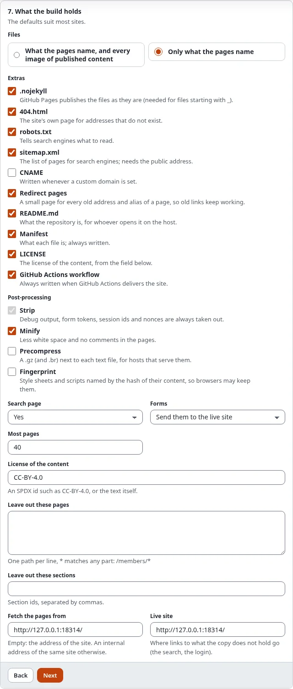

# SEO on a static site

Moving a site to static files must not cost its place in search engines. Static publishing writes the files search
engines read, keeps every old address working and can make the files smaller and faster.

## What you'll have at the end

A static copy with a sitemap, robots rules, absolute canonical links and a small page for every old address that
sends visitors and search engines on.

## The files search engines read

In the wizard, step 7, **Extras**:

- **sitemap.xml**: every page at its public address with the date its content changed. It needs the public address
  of the target.
- **robots.txt**: everything may be read, and the sitemap is named.
- **404.html**: the site's own "page not found" page.

Canonical links, `hreflang` alternates and social card images (`og:image`, `twitter:image`) are rewritten to the
public address, so they never name the address the build was made from.

## Old addresses: redirect pages

A static host has no URL aliases. Tick **redirects** and every build writes a small page for:

- each **old address** of a page (the history kept when content is renamed or moved);
- each **custom alias** that points to a page (Setup > URL translator);
- each **URL wildcard** without `*` that leads to a page of the copy.

Such a page sends the visitor on at once (a meta refresh), names the new address as canonical and asks search engines
not to index it. An address where the copy has a page or file of its own never gets one. Wildcards with `*` cannot be
expressed as files and are left out.

## Faster files

In step 7, **Post-processing**:

- **minify**: less white space and no comments in the pages (the content of `pre`, `textarea`, scripts and styles is
  left alone).
- **precompress**: a `.gz` next to every page, style sheet and script of 1 KB or more (and a `.br` when PHP has the
  brotli extension), for hosts that serve them (GitHub Pages compresses by itself).
- **fingerprint**: style sheets and scripts are named by the hash of their content (`site.3f2a9c1b.css`) and every
  link to them changes with them, so a host may let browsers keep them. Never a `?v=` query. A partial build keeps the
  names it has.

## Next step

[Languages on a static site](languages-on-a-static-site.md).
