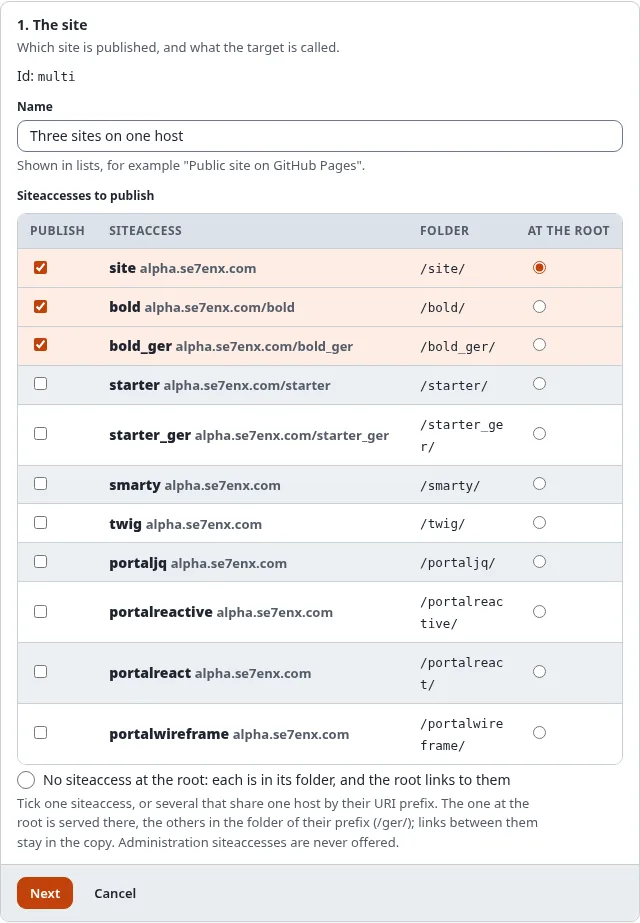
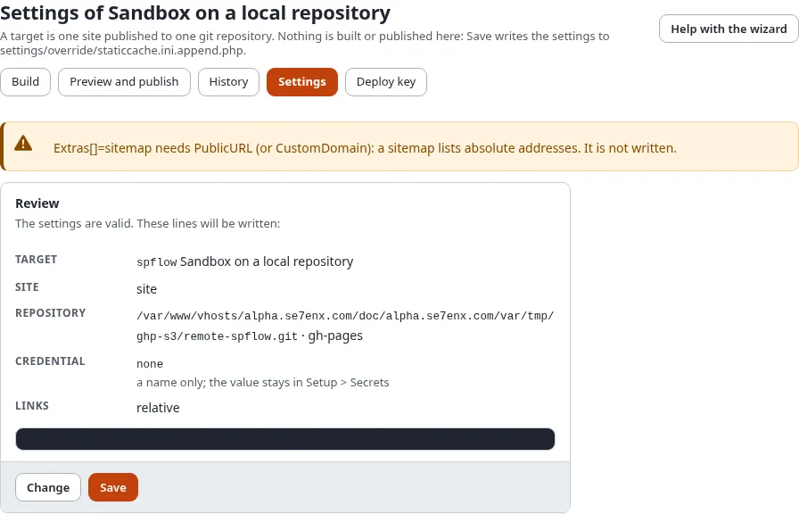

# The setup wizard

A **target** is one site of your installation published to one git repository. The wizard in **Setup > Static
publishing > New target** makes one in nine short steps; **Settings** on a target opens the same wizard with its
settings. Nothing is built or published here: **Save** only writes the settings.

## What you'll have at the end

A target with its settings in `settings/override/staticcache.ini.append.php`, ready to build.

## Before you start

- The policy `staticpublish/setup` without a Target limitation (Administrator has it).
- A repository on the host. An empty one is fine. On GitHub: **New repository**, public for a free plan.
- For a token: the token stored in **Setup > Secrets** under a name of your choice (for GitHub a fine-grained token
  with **Contents: Read and write** on that repository). For a deploy key you need nothing yet.

The step list at the top shows where you are; **Back** and **Next** move between steps, and a step can be opened
from the list. **Cancel**, next to **Next** on every step, goes back to **Setup > Static publishing** without saving
anything. Without JavaScript all steps show on one page.

## 1. The site

- **Id**: lower case letters, digits, `_` and `-`, for example `github-public`. It names the target's folder and its
  tags (`static/<id>/<n>`) and cannot be changed later.
- **Name**: shown in lists.
- **Siteaccesses to publish**: the front siteaccesses, each with its address and its folder (the URI prefix that
  selects it, `/bold_ger/`). Tick one, or several that share one host by their URI prefix; **At the root** chooses
  the one served at the root of the copy, the others go to their folders. With **No siteaccess at the root** each is
  in its folder and the root of the copy is a page that links to them. A target saved with one siteaccess opens with
  it ticked and at the root, and is saved as `SiteAccess=` as before; several are saved as `SiteAccessList[]` and
  `DefaultSiteAccess`. Administration and editing siteaccesses are never offered: a static copy is always what a
  visitor who is not signed in sees. The review, the dashboard and every page of a target list its siteaccesses with
  their folders ([Static publishing for multisite installations](../../guides/static-publishing-for-multisite-installations.md)).

## 2. The host

**GitHub Pages** or **another git host** (GitLab, Gitea, your own server). The box lists GitHub's limits: a site of
up to 1 GB, a file of up to 100 MB, about 100 GB of traffic a month, a public repository on a free plan, and no shops
([GitHub Pages limits and terms](github-pages-limits-and-terms.md)). Every push is checked against them first.

Below it the wizard says whether the **GitHub integration** can be used on this server. With it, and with a token or
a GitHub App, step 4 can create the repository and switch GitHub Pages on for you. Without it (no curl or openssl in
PHP, or `GitHubAPI=disabled`) publishing to the branch works all the same; you switch GitHub Pages on in the
repository's settings yourself.

## 3. Signing in to the repository

| Choice | For | What is stored |
|---|---|---|
| A token from Setup > Secrets | an `https://` address | `Credential=token:<name>` |
| A deploy key made for this target | an SSH address (`git@github.com:owner/repo.git`) | `Credential=sshkey:staticpublish.<id>.deploy_key` |
| A GitHub App | an `https://` address on GitHub | `Credential=app:<installation id>` |
| None | the server signs in by itself, or the repository is on this server | `Credential=none` |

Only the name is stored with the target; the token or key stays in Setup > Secrets and never appears in a log or a
report. With a deploy key, **Save** opens the target's **Deploy key** page, where **Make the key** creates it and shows
the public half to add to the repository ([Deploy keys](../../guides/static-publishing-deploy-keys.md)). A GitHub App
needs its **installation id**; the App itself is set up once for the installation. Which one to choose:
[Connect to GitHub: token, deploy key or GitHub App](connect-to-github-token-key-or-app.md).

Only a token or a GitHub App can use GitHub's API, so only they unlock the GitHub steps below. A deploy key pushes.

## 4. The repository

- **Git address**: the repository's address, never with a password or token in it.
- **Branch**: `gh-pages`, or `main` with the folder `docs`.
- **Folder**: the root of the branch or `/docs` (GitHub Pages serves one of the two).
- **How GitHub Pages receives the build**: from the branch (the default) or by a GitHub Actions workflow, which the
  build writes for you ([Branch or GitHub Actions](choose-branch-or-github-actions.md)).

**On GitHub**: once the target is saved with a GitHub address and a token or GitHub App, this step has
**Set up on GitHub**. It creates the repository when it is missing and you ticked **Create the repository if it does
not exist** (public, or private, which GitHub Pages serves only on a paid plan), switches GitHub Pages on from the
branch and folder or from GitHub Actions, and sets your own domain and HTTPS. It asks **Verify it's you** and lists each
step with its result. It works with the saved settings: save changes first. A new repository has no branch yet, so
GitHub Pages is switched on after the first publish: press **Set up on GitHub** again then.

## 5. Links and base path

A GitHub **project** site lives below `/<repository>/` (`https://owner.github.io/my-site/`). **Relative** links work
there and below any other path, so they are the default. **Below a base path** writes every link starting with the
base path. The box shows, as you type, how a link from the page `/news/` to `/about-us/team` will be written.
**Public address** is the address of the published site; the sitemap and the canonical links need it.

## 6. Your own domain

Optional: `www.example.com`. It is written to the file `CNAME`, and the site is then served at the root of the
domain, so leave the base path empty. Point the domain's DNS at the host as it explains; HTTPS can take a while.

**Check the DNS** looks the domain up and says whether it points at GitHub Pages: a subdomain needs a `CNAME` record to
`<owner>.github.io`, an apex domain the four `A` records of GitHub Pages. When something is missing or wrong it lists
the records to set at the provider of the domain. Details: [Use your own domain](use-your-own-domain.md).

## 7. What the build holds

- **Files**: what the pages name, and every image of published content (the default), or only what the pages name.
- **Extras**: `.nojekyll` (needed on GitHub Pages), `404.html`, `robots.txt`, `sitemap.xml`. The manifest is always
  written.
- **Post-processing**: debug output, form tokens, session ids and nonces are always taken out. A page that still
  carries one is refused, and nothing is published.
- **Search page** and **forms**, **most pages**, pages and sections to **leave out**, and where the pages are
  **fetched from** and where links to the **live site** go.
- **Remove links to pages the copy does not hold** and **Remove links into the administration** (`OutsideLinks`,
  `AdminLinks`, both **No** by default): with **Yes** such a link stays in place with its text, grayed out and without
  an address, instead of leading to the live site ([Links and base path](links-and-base-path.md)).

## 8. When it is published

Always by hand here and on the console; besides that, when content is published and on a schedule, both run by the
cronjob part `staticpublish`, with notifications and a webhook afterwards ([Publish automatically](publish-automatically.md)).

## 9. Review and save

**Review** (next to **Cancel**) checks every setting and shows the lines that will be written. Fix what it lists and press Review again.
When static publishing is still switched off, **Switch static publishing on** is ticked for you. **Save** writes the
settings (with a backup of the file and an entry in the audit log) and asks **Verify it's you**. Then the target's
**Build** page opens.

## Next step

[Build, preview and publish](build-preview-and-publish.md).
