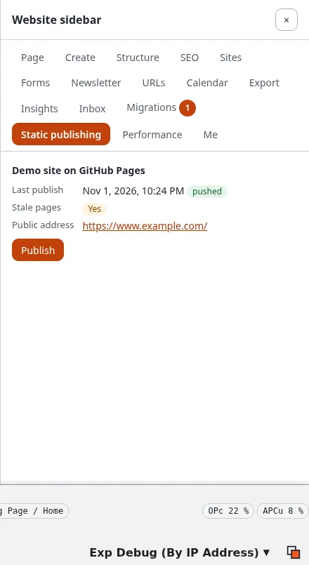

# The website sidebar panel

The website sidebar (the extension expwt) has a **Static publishing** panel: on any page of the site you see how that
page stands in static publishing, and you can publish just that page without going to Setup > Static publishing.

## What you'll have at the end

A page you just changed published to its static copy, from the page itself.

**Who sees the panel:** users who may use the sidebar (`expwt/use`) and have `staticpublish/read` for at least one
target. Without that policy, or on a kernel without static publishing, there is no tab.

## What the panel shows

For every target you may read (the Target limitation of `staticpublish/read` decides which):

- **Last publish**: when, and whether it was **pushed**, **not pushed**, **failed** or changed nothing; **never**
  before the first publish.
- **Stale pages**: **Yes** when content of this page was published after the page was built for the target, so the
  static copy shows an older version; **No** when it is current; **Not in the build.** when the last publish has no
  page of it (a page that is excluded, or one the crawl did not reach).
- **Public address**: the address of this page on the target, from its public address or own domain.
- A job of the target that is going on, with who started it and a link to its page.

With static publishing switched off, the panel says so. With no target yet it says "No target yet."; users who may
set targets up (`staticpublish/setup`) get **Make a target** and **Read the tutorial**.

## Publish this page

**Publish** is there for the targets where you have `staticpublish/publish`:

1. Press **Publish** under the target.
2. "Verify it's you" asks for your password (or passkey) in a small window, as Publish in Setup > Static publishing
   does, unless you confirmed it a moment ago.
3. The job starts in the background, as you: an **incremental build** of this page's node into the last build (the
   rest of the site stays as it was published), then one commit, one tag and one push, never forced. The panel says
   "It runs in the background as ..." and links the job's page in the administration
   ([The page of a job](build-preview-and-publish.md#the-page-of-a-job)).
4. When it has ended, the panel shows the new publish and **Stale pages: No**.

While a job of the target is going on, there is no Publish; wait for it to end. Every publish of this kind is in the
history like any other, so you can go back to an earlier one ([History and rollback](history-and-rollback.md)).

On the console the same is `./console exp:static:publish <target> --nodes=<node id>`.

## Next step

[Who may publish](who-may-publish-roles-and-policies.md): give editors `staticpublish/read` and `publish` for one
target so they can use the panel.
