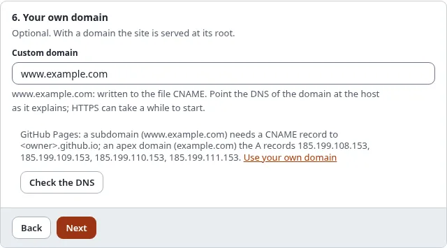
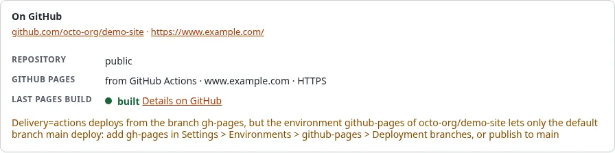

# Use your own domain

A GitHub Pages site lives at `https://<owner>.github.io/<repository>/`. With your own domain it is served at
`https://www.example.com/` instead, with a free HTTPS certificate from GitHub.

## What you'll have at the end

Your site at your own domain, over HTTPS.





## 1. Set the domain on the target

In the wizard, step 6, **Custom domain**: `www.example.com`. The build writes it to the file `CNAME`, which GitHub
Pages reads. The site is then served at the root of the domain, so in step 5 leave the **base path** empty (relative
links work anyway) and set the **public address** to `https://www.example.com/`.

Take `www.example.com` rather than `example.com` when you can: a subdomain needs one DNS record and follows GitHub if
its addresses ever change. Set both, and GitHub redirects the one to the other.

## 2. Point the DNS at GitHub Pages

At the provider of the domain (where you bought it, or where its DNS is managed):

| Domain | Record | Value |
|---|---|---|
| a subdomain, `www.example.com` | `CNAME` | `<owner>.github.io` (your account or organization, never the repository) |
| the apex, `example.com` | `A` (all four) | `185.199.108.153`, `185.199.109.153`, `185.199.110.153`, `185.199.111.153` |
| the apex, optional | `AAAA` | `2606:50c0:8000::153`, `2606:50c0:8001::153`, `2606:50c0:8002::153`, `2606:50c0:8003::153` |

Remove other `A` or `AAAA` records of the same name (an old host), or visitors reach either one at random.

## 3. Check the DNS

**Check the DNS** in step 6 of the wizard looks the domain up and says whether it points at GitHub Pages. When it
does not, it lists the records to set. On the console:

```
./console exp:static:dns www.example.com
./console exp:static:dns example.com --owner=octo-org
```

The owner comes from the target whose custom domain it is, or from `--owner`. DNS changes can take up to a day to be
seen everywhere (the records' TTL).

## 4. Tell GitHub, and HTTPS

With a token or a GitHub App, **Set up on GitHub** in step 4 (or `./console exp:static:github setup <target>`) sets
the domain on GitHub Pages and switches on **Enforce HTTPS**. GitHub issues the certificate once it sees the DNS
records, which can take up to 24 hours; until then the setup lists HTTPS as planned. Run it again later.

By hand: repository > **Settings** > **Pages** > **Custom domain**, then **Enforce HTTPS** when it can be ticked.

Verify the domain for your account or organization on GitHub (**Settings** > **Pages** > **Verified domains**), so
nobody else can take it for their site if your repository is ever removed.

## When it does not work

| What you see | What to do |
|---|---|
| The DNS check lists records to set | Set them at the provider of the domain and wait for the TTL |
| `... is a CNAME to <owner>.github.io/repo` | A CNAME names the account (`<owner>.github.io`), never the repository |
| The site answers 404 at the domain | The file `CNAME` is missing: set the custom domain on the target, build and publish again |
| The browser warns about the certificate | GitHub has not issued it yet; wait, then set up again |
| CSS and images are missing at the domain | The target still has a base path: empty it, build and publish |

## Next step

[GitHub Pages limits and terms](github-pages-limits-and-terms.md).
