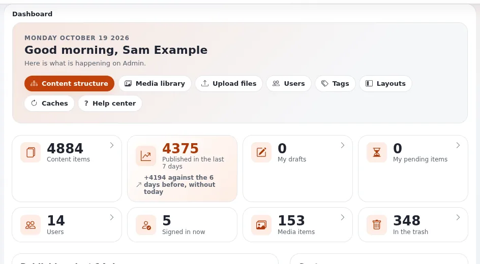

# Lesson 1.2: Signing in and out

Every working day starts with signing in, and most support calls of new editors are about it. In this lesson
learners sign in with their own training account, meet the messages they may see, learn what **Forgot your
password?** does, and sign out the right way.

> **Note**
> Each learner needs an account of their own on the training installation. Never hand out the administrator account
> of the installation, and never use real people's e-mail addresses on a training site: use addresses at
> `example.invalid`.

## At a glance

| | |
|---|---|
| Course | [Editors 101](../README.md) |
| Module | [Module 1: Signing in and the tour](README.md) |
| Duration | 45 minutes (15 presenting, 30 exercise) |
| Level | Beginner |
| Audience | New editors and authors |
| Prerequisites | [Lesson 1.1](what-exponential-is-for-editors.md); a training account with the Editor role, prepared by the trainer |

## Learning objectives

After this lesson, learners can:

- open the address of the administration or of the Editor and sign in with a username or e-mail address;
- recognize the message for a wrong password and the message for a missing permission, and say what to do for each;
- explain what **Forgot your password?** does and how long its link works;
- sign out with the **Logout** button and explain why it is grayed out while an item is open for editing.

## Trainer's notes

### Preparing the accounts

Before the class, on the training installation (for example one installed with `php bin/php/console exp:install --apply`,
see [7. The console install](../../../../install/07-console-install.md)), sign in as the administrator whose
password the installer printed and create one user per learner below **Users**, in the editors' user group, with
the **Editor** role. Give each a name like `learner01` and an e-mail address such as `learner01@example.invalid`.
Write the usernames and passwords on cards, one per learner. Check one account by signing in with it before the
class starts.

### How to present it

1. **The address** (3 minutes). The administration is a part of the installation of its own, reached at its own
   address: usually `/admin` after the site's address, or a host name of its own such as `admin.example.com`.
   Many installations also have the **Editor**, a simpler administration for people who write and publish, for
   example at `edit.example.com`. Show both on the projector if your installation has both. Source:
   [Logging into the admin](../../../logging-into-the-admin.md#the-address),
   [Logging into the Editor](../../../logging-into-the-editor.md#the-address).
2. **The form** (3 minutes). Sign in on the projector: **Username** (or the e-mail address of the account; both
   work with the shipped settings), **Password** (the eye button shows what was typed), **Sign in**. The line
   under the title names the part of the installation, for example *Administration of Editor*.
3. **The messages** (4 minutes). Type a wrong password on purpose and show the message: *The system could not log
   you in. Make sure that the username and password is correct. All letters must be entered in the correct case.*
   The page never says which of the two was wrong. Then explain *Access denied! You do not have permission to
   access ...*: the password was right, but the role may not use this part of the installation.
4. **Forgot your password?** (2 minutes). Explain the steps without doing them: the e-mail address of the account,
   **Generate new password**, a mail with a link that works once and, by default, for one hour, and a second mail
   with the new password. A training installation usually cannot send mail, so do not demonstrate it.
5. **Two-step sign-in** (1 minute). Mention that with it on, a second page **Confirm it is you** asks for a code
   from an app or an e-mail. Module 8 shows where it is turned on.
6. **Signing out** (2 minutes). The last button of the header, an arrow leaving a box, is **Logout**. While an
   item is open for editing it is grayed out: store or discard the draft first.

### Common questions

**Can I use my e-mail address instead of my username?** Yes, on most sites: the shipped setting accepts both,
because every account's e-mail address is unique
([Logging into the admin](../../../logging-into-the-admin.md#sign-in)).

**Am I signed in to the site too?** No. A sign-in belongs to one browser and to one part of the installation:
being signed in to the Editor does not sign you in to the administration or the public site.

**How long do I stay signed in?** While you work. A session that is not used for a long time ends (three days with
the shipped settings), and you sign in again.

**My browser asked for a user name and password in a small window before the page appeared.** That is an extra
password of the web server, common on test and staging servers. It is not an Exponential account; ask whoever gave
you the address.

### Pitfalls

- **Caps lock.** Letters must be entered in the correct case. Point at the caps lock key when someone fails twice.
- **Blocked cookies.** If a learner lands back on the sign-in form with no message, their browser blocks the session
  cookie. Allow cookies for the site or use a private window.
- **Lockout.** An installation can lock an account after a number of wrong passwords (the shipped value never
  locks). If yours is set to lock, reset the learner's failed sign-ins as the administrator, on the user's page under
  **Configure user account settings** > **Reset**.
- **Shared accounts.** Never let two learners share one account: drafts belong to their creator, and the exercises
  of the next modules assume that each learner sees only their own drafts.

## Hands-on exercise

Use the training installation the trainer prepared and the account card you were given.

1. Open the address of the administration (or of the Editor) that the trainer wrote on the board.
2. In **Username**, type your username. In **Password**, type a wrong password on purpose and press **Sign in**.
3. Read the message that appears and write it down.
4. Now type your real password. Press the eye button in the password field to check what you typed, then press
   **Sign in**.
5. On the **Dashboard**, find the greeting with your name at the top.
6. Sign out with the last button of the header (**Logout**).
7. Sign in again, this time typing your account's e-mail address (from your card) in **Username**.
8. Open the sign-in page in a second browser tab of the same browser: notice that you are still signed in.
9. Sign out again and check that the address now shows the sign-in form.
10. On the sign-in form, find **Forgot your password?** (where the site offers it) and open it, but do not send the
    form: read what it asks for and go back.

## Expected result

- Step 3: the learner has written down the message *The system could not log you in ...*.
- Step 5: the dashboard greets the learner by name (for example *Good morning, ...*), followed by the dashboard's
  blocks such as **My drafts** and **My pending items**.
- Step 7: signing in with the e-mail address works (unless the installation changed `AuthenticateMatch`; then the
  trainer explains that the site accepts the username only).
- Step 10: the page asks for the e-mail address of the account and offers **Generate new password**.
- The trainer checks by asking each learner to show their dashboard greeting.

## Quiz

1. You see *Access denied! You do not have permission to access ...* after typing the right password. What is the
   most likely cause?
   A. A wrong password B. Your role may not use this part of the installation C. Caps lock D. The site is down
2. How long does the link of a **Forgot your password?** mail work with the shipped settings?
3. The **Logout** button is grayed out. What do you do?
4. True or false: signing in to the Editor also signs you in to the public site.
5. You are sent back to the sign-in form after signing in, with no message. What should you check first?

Answers

1. **B.** The account is right, but its role has no permission to sign in here
   ([Logging into the Editor](../../../logging-into-the-editor.md#when-signing-in-does-not-work)).
2. Once, and for one hour by default ([Logging into the admin](../../../logging-into-the-admin.md#forgot-your-password)).
3. An item is open for editing: store or discard the draft first, then sign out.
4. **False.** A sign-in belongs to one browser and one part of the installation.
5. Whether the browser blocks cookies for the site; signing in needs one.

## Further reading

- [Logging into the Editor](../../../logging-into-the-editor.md): every message of the Editor's sign-in.
- [Logging into the admin](../../../logging-into-the-admin.md): the administration, lockout and safety.
- [Your account and signing in](../../../accounts-and-sign-in.md): passwords and two-step sign-in.
- [7. The console install](../../../../install/07-console-install.md): how the trainer sets up a training
  installation.

## Related pages

- [Module 1: Signing in and the tour](README.md)
- [Editors 101: course overview](../README.md)
- [Trainers: start here](../../trainers-start-here.md)
- [Free documentation](../../../free-documentation.md): this page is free to copy, translate and improve under the GNU FDL 1.3.

<!-- exp-partner-block:start -->
**Become an Exponential Partner.** Partners share their information, provide funding, contribute back and
develop the products with us, and that is how Exponential grows. A partner website and dashboard are planned for
mid-2027: please become a partner today to speed up our growth rate and land new features faster. Start with
[Partners: start here](../../../partners/partners-start-here.md) and [How to apply](../../../partners/how-to-apply.md).
<!-- exp-partner-block:end -->
