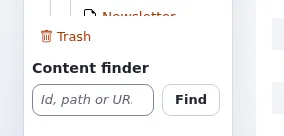

# Lesson 2.3: Getting around fast

Experienced editors rarely click through the tree folder by folder. They type a number or an address into the
**Content finder**, open an item's menu straight from the tree, and use the keyboard. This lesson teaches those three
shortcuts; they also make the administration usable without a mouse.

## At a glance

| | |
|---|---|
| Course | [Editors 101](../README.md) |
| Module | [Module 2: The content tree and navigation](README.md) |
| Duration | 30 minutes (10 presenting, 20 exercise) |
| Level | Beginner |
| Audience | New editors and authors; also useful for editors who work with the keyboard only |
| Prerequisites | [Lesson 2.1](the-tree-and-an-items-page.md), [Lesson 2.2](tabs-and-sub-items.md) |

## Learning objectives

After this lesson, learners can:

- open an item with the **Content finder** from its node number, its path or its address on the site;
- open the menu of an item in the tree and name its main entries;
- move through the tree with the arrow keys and open an item with `Enter`;
- use `/`, `Esc` and the first `Tab` of a page (**Skip to main content**).

## Trainer's notes

### How to present it

Sources: [Searching](../../../searching.md#open-an-item-by-its-number-or-address),
[A tour of the administration](../../../admin-tour.md#the-left-column) and
[Keyboard shortcuts](../../../keyboard-shortcuts.md).

1. **The Content finder** (3 minutes). Below the tree in the left column. It takes the **node** number (shown as
   *Node* on the item's page), a path such as `media/images`, or the full address of the page on the site. Type and
   press **Find**. Show all three on the projector, the last one by copying an address from the public site.
2. **The item menu** (3 minutes). Click the icon in front of a name in the tree (the tree announces it as *Actions
   for ...*). The menu has entries to edit, copy, move, remove, create here, add to bookmarks and more, and an
   **Advanced** group. Only show it; lesson 3.4 and module 6 use the entries.
3. **The keyboard** (4 minutes). Move into the tree with `Tab`, then `↓` and `↑` between items, `→` to open a folder,
   `←` to close it or go to the parent, letters to jump by name, `Enter` to open, `Shift+F10` or the menu key for
   the item's menu. `/` jumps to the search, `Esc` closes a menu, and the first `Tab` on a page shows **Skip to main
   content**.

### Common questions

**Where do I find a page's node number if I only know its address?** You do not need it: paste the address into the
**Content finder**.

**Does the item menu offer the same as the buttons on the item's page?** Mostly, and a few more entries, such as
**Copy subtree**. Entries your role may not use are not offered or are grayed out.

**Do the keys work in every design?** They work in the **Admin 4** design; the other designs have most of them
([Keyboard shortcuts](../../../keyboard-shortcuts.md)).

### Pitfalls

- **Typing in the wrong field.** `/` is ignored while the cursor is in another field. Ask learners to click on an
  empty part of the page first.
- **Menu entries that change content.** The item menu has **Remove** and **Move** close to the harmless entries.
  In this lesson, open the menu and close it again with `Esc`.
- **Addresses of another site.** The Content finder knows the addresses of this installation only.

## Hands-on exercise

Use the training installation and your Editor training account. Nothing in this exercise changes content.

1. Open an article on the public site of the training installation and copy its address from the browser.
2. In the administration, open **Content structure**. Paste the address into the **Content finder** below the tree
   and press **Find**. The article's page opens.
3. Write down its **Node** number. Open the **Dashboard**, then type the node number into the **Content finder** and
   press **Find**. The same article opens.
4. Type `media/images` into the **Content finder** and press **Find**.
5. In the tree, click the icon in front of the name of any folder. Read the entries of its menu and close it with
   `Esc`.
6. Click on an empty part of the page and press `Tab` until a tree item is focused. Move with `↓` and `↑`, open a
   folder with `→` and close it with `←`.
7. With an item focused, press `Shift+F10` to open its menu; close it with `Esc`.
8. Press `Enter` to open the focused item.
9. Reload the page and press `Tab` once: **Skip to main content** appears. Press `Enter`.
10. Press `/` and type a word; press `Esc` to leave the field without searching.

## Expected result

- Steps 2 and 3 opened the same article, once by address and once by node number.
- Step 4 opened the **Images** folder of the media library (if the training site's folder has another path, the
  trainer gives the right one).
- The learner opened and closed an item menu with the mouse and with `Shift+F10`, and moved through the tree with the
  arrow keys.
- The trainer checks by asking a learner to open an item named by the trainer, using the keyboard only.

## Quiz

1. Name the three things the **Content finder** accepts.
2. Which key opens the menu of the item focused in the tree?
   A. `F2` B. `Shift+F10` C. `Ctrl+M` D. `Alt+Enter`
3. In the tree, what does `←` do on an open folder?
4. What appears on the first `Tab` of a page?
5. True or false: you need to know a page's node number to open it with the Content finder.

Answers

1. The node number, a path such as `media/images`, or the full address of the page on the site
   ([Searching](../../../searching.md#open-an-item-by-its-number-or-address)).
2. **B.** `Shift+F10` or the menu key ([Keyboard shortcuts](../../../keyboard-shortcuts.md#the-content-tree)).
3. It closes the folder.
4. **Skip to main content**.
5. **False.** The address works too.

## Further reading

- [Keyboard shortcuts](../../../keyboard-shortcuts.md): every key of the administration.
- [Searching](../../../searching.md): the Content finder and the search.
- [Content finder](../../../../features/6.0/content-finder.md): what the finder accepts, in detail.

## Related pages

- [Module 2: The content tree and navigation](README.md)
- [Editors 101: course overview](../README.md)
- [Trainers: start here](../../trainers-start-here.md)
- [Free documentation](../../../free-documentation.md): this page is free to copy, translate and improve under the GNU FDL 1.3.

<!-- exp-partner-block:start -->
**Become an Exponential Partner.** Partners share their information, provide funding, contribute back and
develop the products with us, and that is how Exponential grows. A partner website and dashboard are planned for
mid-2027: please become a partner today to speed up our growth rate and land new features faster. Start with
[Partners: start here](../../../partners/partners-start-here.md) and [How to apply](../../../partners/how-to-apply.md).
<!-- exp-partner-block:end -->
