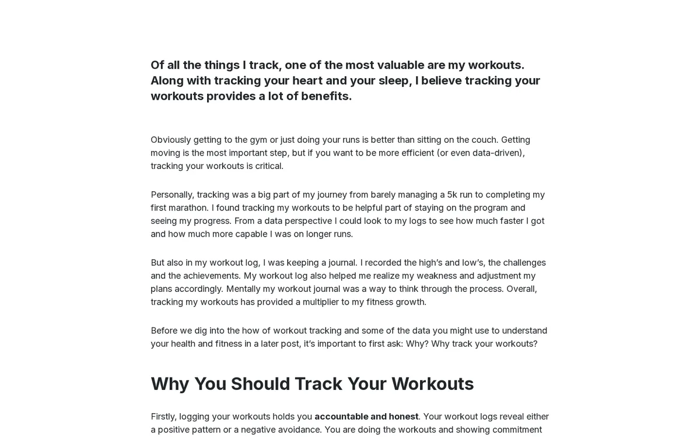

# Lesson 4.2: Links and anchors

Links connect a text to the rest of the site and the web. Exponential links to items of the site by their place in
the tree, so a link keeps working when an item is renamed. This lesson teaches the link dialog, anchors, and what the
editor reports when a link is broken.

## At a glance

| | |
|---|---|
| Course | [Editors 101](../README.md) |
| Module | [Module 4: The Online Editor](README.md) |
| Duration | 45 minutes (15 presenting, 30 exercise) |
| Level | Beginner |
| Audience | New editors and authors |
| Prerequisites | [Lesson 4.1](rich-text-basics.md); a few items on the training site to link to |

## Learning objectives

After this lesson, learners can:

- link text to another item of the site with the **Browse**, **Search** or **Bookmarks** tab of the link dialog;
- link text to an external web address and to an e-mail address;
- place an anchor and link to it;
- remove a link;
- read the messages shown above the edit form when a link had to be repaired or removed.

## Trainer's notes

### How to present it

Source: [The online editor on TinyMCE 8](../../../../features/6.0/online-editor-tinymce8.md#what-the-tinymce-8-engine-does)
and [Link checks when the text is saved](../../../../features/6.0/online-editor-tinymce8.md#link-checks-when-the-text-is-saved).

1. **Internal links** (5 minutes). Select a word and press the link button. The ezoe link dialog has the tabs
   **Browse**, **Search** and **Bookmarks** (your own bookmarks) to choose an item of the site. Pick an item and
   confirm. Explain that such a link points to the item, not to a typed address, so renaming the item does not
   break it.
2. **External and e-mail links** (3 minutes). Type an address starting with `https://`, or `mailto:` followed by an
   e-mail address. Use `example.invalid` addresses in class.
3. **Anchors** (3 minutes). Put the cursor at a place in a long text and press the anchor button; give it a short
   name. Then link to it from the top of the text.
4. **Removing a link** (1 minute): the unlink button next to the link button.
5. **Link checks** (3 minutes). When the text is saved, every link is checked. A link to an item that is gone is
   kept, and a message above the form says how to repair it (it names the link by its text and, when the target is
   in the trash, says so). A script link (such as `javascript:`) is removed, and so is a `mailto:` link with an
   invalid address; both are reported. The message appears above the edit form, for example *The draft was only
   partially stored*.

### Common questions

**Should I link to the address I copied from the site, or use Browse?** Use **Browse** or **Search**: an internal
link follows the item when it moves or is renamed; a copied address may break.

**What happens to my link when someone removes the linked page?** The link stays in your text, and the next time the
text is saved the editor reports it with its text, so you can repair it.

**Can a link open in a new window?** That depends on the link dialog's options on your installation; check it on your
own training site before promising it.

### Pitfalls

- **Linking whole sentences.** Link text should say where it goes. "Read the opening hours" is better than
  "click here".
- **Test addresses.** Never put real customers' or colleagues' e-mail addresses into training content. Use
  addresses at `example.invalid`.
- **Restoring from the trash does not repair a link by node number.** The feature page notes that a restored item
  gets a new location, so a link to its old node stays broken. Re-link it with **Browse**.

## Hands-on exercise

Use the training installation and your article *My first article*.

1. Open your article and press **Edit**. Go to **Body**.
2. Type the sentence `Read my news about the course.` Select the words `my news`.
3. Press the link button. In the dialog, open the **Browse** tab and find your article *News one (updated)* in your
   course folder (lesson 3.4). Choose it and confirm.
4. Type the sentence `The documentation of Exponential is online.` Select `documentation` and link it to the
   address the trainer gives you (an `https://` address).
5. Type `Write to the course team.` Select `course team` and link it to `mailto:course@example.invalid`.
6. Scroll to the heading *What I want to learn* (lesson 4.1). Put the cursor at its start and press the anchor
   button. Name the anchor `learn`.
7. At the very top of **Body**, type `Jump to my goals` and link it to the anchor `learn`.
8. Select the word `course team` again and press the unlink button. Then undo it with `Ctrl+Z`.
9. Press **Store draft and exit**. Check the top of the page for any message about links.
10. Open the draft again from **My drafts** and press **Send for publishing**.
11. Press **View on site** and try every link.

## Expected result

- On the site, *my news* opens the learner's news article, *documentation* opens the external address, *course
  team* opens a new mail to `course@example.invalid`, and *Jump to my goals* jumps to the heading.
- No message about links appeared, because all links were valid.
- The trainer checks by trying one learner's links on the projector.

## Quiz

1. Name the three tabs of the link dialog for choosing an item of the site.
2. Why is a link chosen with **Browse** better than a pasted address of the same page?
3. What happens to a `javascript:` link when the text is saved?
   A. It is kept B. It is removed and reported C. It becomes an anchor D. It is turned into an e-mail link
4. A linked page was removed. What does the editor do with your link the next time the text is saved?
5. Which e-mail domain do you use for example addresses in training content?

Answers

1. **Browse**, **Search** and **Bookmarks**
   ([The online editor on TinyMCE 8](../../../../features/6.0/online-editor-tinymce8.md#what-the-tinymce-8-engine-does)).
2. It points to the item, so it keeps working when the item is renamed or moved.
3. **B.** Script links are removed and reported.
4. It keeps the link and shows a message above the form that names it and says how to repair it.
5. `example.invalid`.

## Further reading

- [Link checks when the text is saved](../../../../features/6.0/online-editor-tinymce8.md#link-checks-when-the-text-is-saved):
  every message, in detail.
- [Bookmarks](../../../../guides/bookmarks.md): your bookmarks also appear in the link dialog.
- [Creating and editing content](../../../editing-content.md#rich-text): rich text fields.

## Related pages

- [Module 4: The Online Editor](README.md)
- [Editors 101: course overview](../README.md)
- [Trainers: start here](../../trainers-start-here.md)
- [Free documentation](../../../free-documentation.md): this page is free to copy, translate and improve under the GNU FDL 1.3.

<!-- exp-partner-block:start -->
**Become an Exponential Partner.** Partners share their information, provide funding, contribute back and
develop the products with us, and that is how Exponential grows. A partner website and dashboard are planned for
mid-2027: please become a partner today to speed up our growth rate and land new features faster. Start with
[Partners: start here](../../../partners/partners-start-here.md) and [How to apply](../../../partners/how-to-apply.md).
<!-- exp-partner-block:end -->
