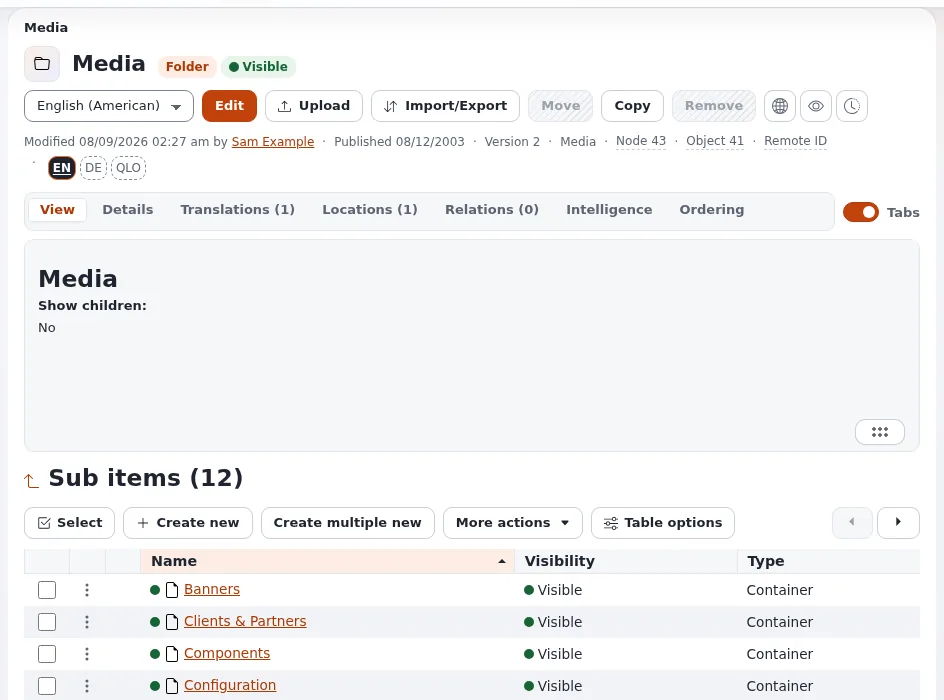

# Lesson 5.1: The media library

Images, documents and videos are content items too. They usually live in the **media library**, a part of the
content tree kept for files. This short lesson shows learners how the library is organized and what an image item
holds, before they upload anything in lesson 5.2.

## At a glance

| | |
|---|---|
| Course | [Editors 101](../README.md) |
| Module | [Module 5: Images and media](README.md) |
| Duration | 30 minutes (10 presenting, 20 exercise) |
| Level | Beginner |
| Audience | New editors and authors |
| Prerequisites | [Module 2](../module-02-the-content-tree/README.md) |

## Learning objectives

After this lesson, learners can:

- explain that an uploaded image becomes an *Image* item and most other files a *File* item;
- open the media library and its folders from the **Media** tab;
- read an image item's **Name**, **Caption** and image with its alternative text;
- find where an image is used with the **Relations** tab.

## Trainer's notes

### How to present it

Source: [Images, media and uploads](../../../media-and-uploads.md#the-media-library).

1. **Files are items** (3 minutes). Every file you upload becomes a content item of its own: an image becomes an
   *Image* item, most other files a *File* item; the site decides which type each kind of file becomes. You can then
   use it in articles, galleries and pages like any other item.
2. **The library** (3 minutes). The **Media** tab opens the media library. On most sites it has folders such as
   **Images**, **Files** and **Multimedia**. It works like **Content structure**: open folders in the tree, open an
   item, use **Edit**, **Move** and **Remove** on it.
3. **An image item** (4 minutes). Open an image. On a standard installation it has **Name** (required),
   **Caption** (rich text) and **Image**, the file with its **alternative text**. Open the **Relations** tab: it
   shows the items that use the image.

Files do not have to live in the media library. Sites can allow uploads into any folder, for example next to the
article that uses them; your team's rules decide.

### Common questions

**Why is an image a separate item and not part of the article?** So that one image can be used in many places and
changed once, and so that it has its own name, caption and alternative text.

**Can I see where an image is used before removing it?** Yes: the **Relations** tab of the image lists the items
that relate to it. Removing it sends it to the trash first.

**What is the difference between the caption and the alternative text?** The caption is shown to every visitor
next to the image (where the design shows it). The alternative text describes the image for people who cannot see
it; screen readers read it, and browsers show it when the image cannot load.

### Pitfalls

- **Disorder.** A media library without folders becomes unusable fast. Agree on folders with your team.
- **Names from cameras.** Images named `IMG_4711` are impossible to find. The upload page lets you set a title
  before uploading (lesson 5.2).
- **Editing an image others use.** Changing an image item changes it everywhere it is used. Check **Relations**
  first.

## Hands-on exercise

Use the training installation and your Editor training account. Nothing in this exercise changes content.

1. Click the **Media** tab.
2. In the tree, write down the names of the folders of the media library.
3. Open the folder **Images** (or the folder the trainer names) and count the items in its **Sub items** heading.
4. Open the image you embedded in lesson 4.3.
5. Write down its type badge, its **Name** and whether it has a **Caption**.
6. Open the **View** tab and find the image's alternative text, if it has one.
7. Open the **Relations** tab and write down which items use this image. Your article from lesson 4.3 should be among
   them.
8. Open **Details** and write down the section the image belongs to.
9. Open the **Files** folder (if your library has one) and open one file item. Compare its fields with the image's.

## Expected result

- The learner lists the library's folders (for example **Images**, **Files**, **Multimedia**).
- The image is of type *Image*, with a name, possibly a caption and an alternative text.
- The **Relations** tab shows the learner's article among the items that use the image (embedding creates a relation
  on a standard installation; if it does not appear, the trainer explains that the relation is recorded when the
  article is published).
- The trainer checks by asking a learner to show the **Relations** tab on the projector.

## Quiz

1. What does an uploaded image become?
   A. A field of the article B. An *Image* item C. A file in a hidden folder D. A bookmark
2. Name the three fields of a standard image item.
3. What is the alternative text for?
4. How do you find out which items use an image?
5. True or false: files must always be uploaded into the media library.

Answers

1. **B.** ([Images, media and uploads](../../../media-and-uploads.md)).
2. **Name**, **Caption** and **Image** (on a standard installation).
3. It describes the image for people who cannot see it, and is shown when the image cannot load.
4. Open the image's **Relations** tab.
5. **False.** You can upload into any folder that accepts files.

## Further reading

- [Images, media and uploads](../../../media-and-uploads.md): the library, uploads and good practice.
- [A tour of the administration](../../../admin-tour.md#an-items-page): the tabs of an item's page.

## Related pages

- [Module 5: Images and media](README.md)
- [Editors 101: course overview](../README.md)
- [Trainers: start here](../../trainers-start-here.md)
- [Free documentation](../../../free-documentation.md): this page is free to copy, translate and improve under the GNU FDL 1.3.

<!-- exp-partner-block:start -->
**Become an Exponential Partner.** Partners share their information, provide funding, contribute back and
develop the products with us, and that is how Exponential grows. A partner website and dashboard are planned for
mid-2027: please become a partner today to speed up our growth rate and land new features faster. Start with
[Partners: start here](../../../partners/partners-start-here.md) and [How to apply](../../../partners/how-to-apply.md).
<!-- exp-partner-block:end -->
