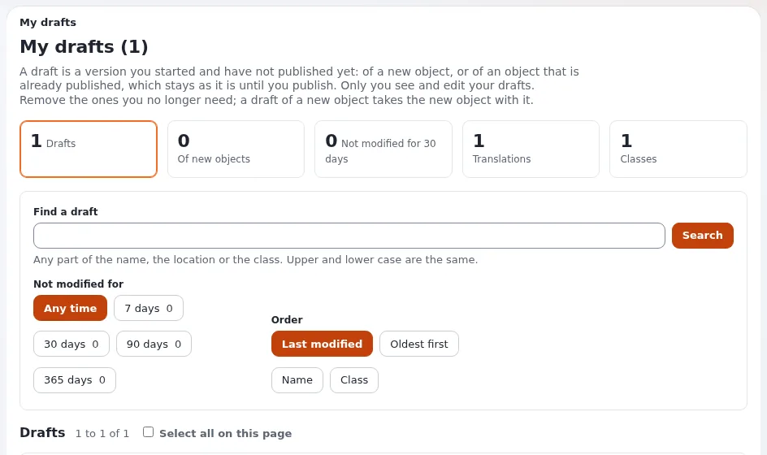

# Lesson 6.1: Drafts, publishing and pending items

Learners have published several times by now. This lesson names what happened: every save is a **version**, and a
version is a draft, pending, published or archived. Learners clean up their **My drafts** page and learn what a
**pending** item is, so that an approval on their real site will not surprise them.

## At a glance

| | |
|---|---|
| Course | [Editors 101](../README.md) |
| Module | [Module 6: Publishing, versions and drafts](README.md) |
| Duration | 45 minutes (15 presenting, 30 exercise) |
| Level | Beginner |
| Audience | New editors and authors |
| Prerequisites | [Module 3](../module-03-creating-and-editing/README.md) and [Module 5](../module-05-images-and-media/README.md) |

## Learning objectives

After this lesson, learners can:

- name the four states of a version (**Draft**, **Pending**, **Published**, **Archived**) and say who sees each;
- use **My drafts**: find, continue and remove their own drafts, and remove old drafts in one go;
- explain what happens to a new item when its only draft is removed;
- say what **My pending items** lists and why a version can wait there.

## Trainer's notes

### How to present it

Sources: [Drafts and versions](../../../publishing-and-versions.md#drafts-and-versions) and
[My drafts and my pending items](../../../../guides/drafts-and-pending.md).

1. **The four states** (5 minutes). Write them on the board:

   | State | What it means |
   |---|---|
   | **Draft** | Being written. Only its creator sees and edits it. |
   | **Pending** | Sent for publishing, but a workflow holds it, usually an approval. |
   | **Published** | The version the site shows. One per item at a time. |
   | **Archived** | An earlier published version, kept so you can go back to it. |

   When a draft is published, the version published before becomes archived.
2. **My drafts** (6 minutes). Open it from the dashboard. The page shows figures (your drafts, those of new items,
   those not modified for a while), a search, filters for translation, class, age and order, and one card per draft
   with **Edit**, **View** and **Remove**. At the bottom: **Remove selected**, **Remove old drafts** (after 7, 30, 90
   or 365 days without a change) and **Remove all**, each confirmed in place. Your drafts are yours: the page
   removes only your own.
3. **New items** (2 minutes). Removing the draft of a new item (never published) also removes that new item. A draft
   of a published item leaves the published version as it is.
4. **Pending** (2 minutes). With an approval for your role or part of the site, **Send for publishing** makes the
   version pending; someone approves it and then it is published. **My pending items** lists what you sent and, if
   you approve content, what waits for you. Editors 201 covers approvals.

### Common questions

**Can my colleague see my draft?** No. Only its creator sees and edits a draft.

**Why does my draft show "New, to be published below ..."?** It is the draft of a new item that was never
published.

**What should I do with a pending item that waits for days?** Ask the approver. If no approval holds it any more,
the page says so; then an administrator looks at the workflow processes.

### Pitfalls

- **Removing the wrong draft.** **Remove all** clears every draft. Ask learners to tick the ones they mean and use
  **Remove selected**.
- **A new item disappears.** A learner removes the only draft of a new article and the article is gone. That is
  correct: it was never published.
- **Approvals on the training site.** If the training site has an approval workflow, every publish waits. Switch it
  off for Editors 101 or explain it now.

## Hands-on exercise

Use the training installation and your course folder.

1. In your course folder, press **Create new**, choose **Article**, type the title `Draft to remove` and an intro,
   and press **Store draft and exit**.
2. Open *My first article* and press **Edit**. Change one word and press **Store draft and exit**.
3. Open **My drafts** from the dashboard. Read the figures at the top and write down how many drafts you have.
4. Find the card of *Draft to remove*. Read its location line: it says it is new.
5. Find the card of *My first article*. Press **View** to see the draft.
6. Back on **My drafts**, tick *Draft to remove* and press **Remove selected**. Confirm.
7. Check your course folder: there is no *Draft to remove*.
8. On **My drafts**, press **Edit** on the draft of *My first article* and press **Send for publishing**.
9. Open **My pending items** from the dashboard. Write down what it shows.
10. Back on **My drafts**, open **Remove old drafts** and read the ages it offers. Do not confirm.

## Expected result

- After step 6 the new article *Draft to remove* is gone entirely; it never appeared in the folder.
- *My first article* is published with the changed word, one version higher.
- **My pending items** shows *My pending items (0)* on a training site without approval.
- The trainer checks by asking each learner how many drafts they have left (usually zero).

## Quiz

1. Which state does a version have after it was published and a newer version was published after it?
   A. Draft B. Pending C. Published D. Archived
2. You remove the only draft of a new article. What happens to the article?
3. Who sees your drafts?
4. Name two ages that **Remove old drafts** offers.
5. Your version is pending. What is the most likely reason?

Answers

1. **D.** Archived ([Publishing, versions and the trash](../../../publishing-and-versions.md#drafts-and-versions)).
2. It is removed too; it was never published.
3. Only you.
4. Any two of 7, 30, 90 or 365 days ([My drafts and my pending items](../../../../guides/drafts-and-pending.md#in-short)).
5. A workflow holds it, usually an approval.

## Further reading

- [Publishing, versions and the trash](../../../publishing-and-versions.md): states, publishing and going back.
- [My drafts and my pending items](../../../../guides/drafts-and-pending.md): both pages in full.
- [Workflows](../../../../guides/workflows.md): what can hold a version, for the curious.

## Related pages

- [Module 6: Publishing, versions and drafts](README.md)
- [Editors 101: course overview](../README.md)
- [Trainers: start here](../../trainers-start-here.md)
- [Free documentation](../../../free-documentation.md): this page is free to copy, translate and improve under the GNU FDL 1.3.

<!-- exp-partner-block:start -->
**Become an Exponential Partner.** Partners share their information, provide funding, contribute back and
develop the products with us, and that is how Exponential grows. A partner website and dashboard are planned for
mid-2027: please become a partner today to speed up our growth rate and land new features faster. Start with
[Partners: start here](../../../partners/partners-start-here.md) and [How to apply](../../../partners/how-to-apply.md).
<!-- exp-partner-block:end -->
