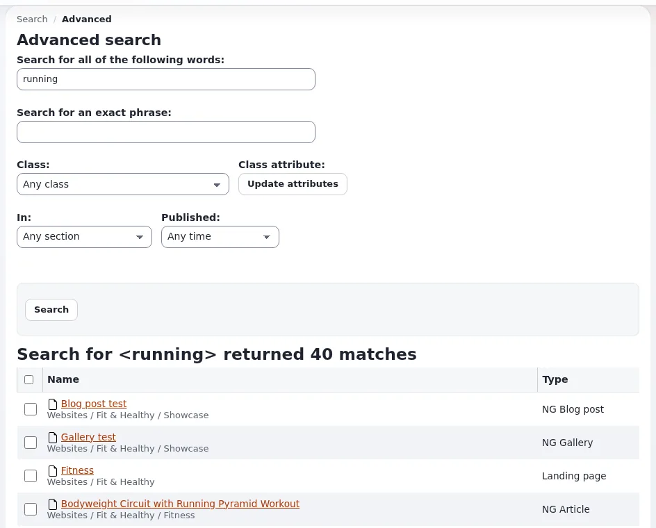

# Lesson 7.2: The advanced search

Sometimes a word is not enough: "the image published last week", "articles with this phrase in the title". The
**Advanced search** combines words, a type, one field of that type, a section and a time span. This lesson teaches
the form.

## At a glance

| | |
|---|---|
| Course | [Editors 101](../README.md) |
| Module | [Module 7: Finding content](README.md) |
| Duration | 30 minutes (10 presenting, 20 exercise) |
| Level | Beginner |
| Audience | New editors and authors |
| Prerequisites | [Lesson 7.1](the-quick-search.md) |

## Learning objectives

After this lesson, learners can:

- open the **Advanced search** from **Search scope** or the results page;
- search for all of several words, or for an exact phrase;
- limit a search to one type with **Class**, and to one field with **Class attribute** after **Update attributes**;
- limit a search to a section with **In:** and to a time span with **Published:**.

## Trainer's notes

### How to present it

Source: [The advanced search](../../../searching.md#the-advanced-search).

1. **Opening it** (1 minute). **Advanced search** in **Search scope**, or *For more options try the Advanced search*
   under the search form on the results page.
2. **The fields** (6 minutes). Walk down the form:
   - **Search for all of the following words:** every word must appear;
   - **Search for an exact phrase:** the words in this order;
   - **Class:** only items of one type, such as *Article* or *Image* (*Any class* by default);
   - **Class attribute:** only one field of that type; press **Update attributes** after choosing the class, so the
     list shows that type's fields;
   - **In:** one section (*Any section* by default);
   - **Published:** **Any time**, **Last day**, **Last week**, **Last month**, **Last three months** or **Last
     year**.
3. **An example** (3 minutes). Find the images published in the last week: **Class:** *Image*, **Published:**
   **Last week**, and a word all the learners' image titles share.

### Common questions

**Why is the Class list so long?** It lists every content type of the installation, including those of extensions.
Type the first letters of a name to jump to it.

**Why does Class attribute show nothing useful?** Press **Update attributes** after choosing the class.

**Can I save a search?** The form does not save searches; bookmark the results page in your browser if you need it
again.

### Pitfalls

- **Forgetting Update attributes.** The field list then belongs to the previous class.
- **Too many limits at once.** A search with a phrase, a class, a field, a section and a date often finds nothing.
  Add one limit at a time.

## Hands-on exercise

Use the training installation and the items you created in this course.

1. Open **Search scope** with the funnel button in the search field and choose **Advanced search**.
2. In **Search for an exact phrase:**, type `My first article` and search. Write down the number of matches.
3. Clear the phrase. In **Search for all of the following words:**, type `Training` (or the word your image titles
   share from lesson 5.2).
4. In **Class:**, choose *Image*. In **Published:**, choose **Last week**. Search.
5. Check that your three images from lesson 5.2 are in the results.
6. Change **Class:** to *Article* and press **Update attributes**. In **Class attribute:**, choose **Title**.
7. Type `News` in **Search for all of the following words:** and search: only articles with *News* in the title are
   found.
8. Set **In:** to *Media* and search again. Write down what changed and why.

## Expected result

- Step 2 found every learner's *My first article* (one per learner on a shared site).
- Step 5 listed the learner's images.
- Step 7 found the news articles of the class, by title.
- Step 8 found nothing, because articles are not in the *Media* section on a standard installation.
- The trainer checks by repeating step 7 on the projector.

## Quiz

1. What is the difference between **Search for all of the following words** and **Search for an exact phrase**?
2. You chose *Article* in **Class:**. What must you press before **Class attribute:** shows the article's fields?
3. Which time spans does **Published:** offer? Name three.
4. True or false: the advanced search finds drafts.
5. A search with five limits finds nothing. What do you do?

Answers

1. All the words must appear, in any order, versus the words together in this order.
2. **Update attributes** ([Searching](../../../searching.md#the-advanced-search)).
3. Any three of **Any time**, **Last day**, **Last week**, **Last month**, **Last three months**, **Last year**.
4. **False.** It finds published content you may read.
5. Remove limits and add them back one at a time.

## Further reading

- [Searching](../../../searching.md#the-advanced-search): the advanced form.
- [Sections](../../../../guides/sections.md): what the sections in **In:** are.

## Related pages

- [Module 7: Finding content](README.md)
- [Editors 101: course overview](../README.md)
- [Trainers: start here](../../trainers-start-here.md)
- [Free documentation](../../../free-documentation.md): this page is free to copy, translate and improve under the GNU FDL 1.3.

<!-- exp-partner-block:start -->
**Become an Exponential Partner.** Partners share their information, provide funding, contribute back and
develop the products with us, and that is how Exponential grows. A partner website and dashboard are planned for
mid-2027: please become a partner today to speed up our growth rate and land new features faster. Start with
[Partners: start here](../../../partners/partners-start-here.md) and [How to apply](../../../partners/how-to-apply.md).
<!-- exp-partner-block:end -->
