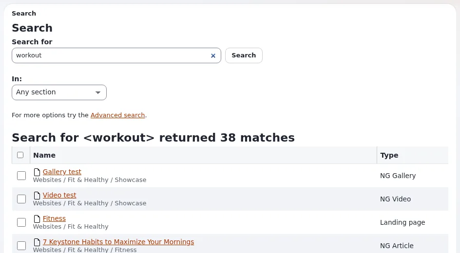

# Lesson 7.1: The quick search

On a site with thousands of items, the tree is too slow. The **Search...** field in the header finds any item an
editor may read in a few seconds. This lesson covers the quick search, its scope, and the results page.

## At a glance

| | |
|---|---|
| Course | [Editors 101](../README.md) |
| Module | [Module 7: Finding content](README.md) |
| Duration | 30 minutes (10 presenting, 20 exercise) |
| Level | Beginner |
| Audience | New editors and authors |
| Prerequisites | [Module 6](../module-06-publishing-and-versions/README.md); the learners' articles from earlier modules |

## Learning objectives

After this lesson, learners can:

- search all content with the **Search...** field or the `/` key;
- read a results page: the number of matches, the name, path and type of each;
- limit a search to a section or to the current place with **Search scope**, and to a section with **In:**;
- edit several results together with **Edit selected**;
- list three reasons why an existing item may not be found.

## Trainer's notes

### How to present it

Source: [Searching](../../../searching.md#the-quick-search).

1. **The field** (2 minutes). Click **Search...** in the header or press `/` anywhere (not while typing in another
   field). Type one or more words and press Enter.
2. **The results page** (3 minutes). The page **Search** says *Search for <word> returned n matches* and lists each
   match with its **Name**, path and **Type**. Click a name to open the item. Tick results and press **Edit selected**
   to edit several of them in one form (lesson 3.4).
3. **Narrowing** (3 minutes). The funnel button in the search field opens **Search scope**: **Section** (search only
   in one section, such as *Media* or *Users*), **Where** (everywhere, or only below the place you are looking at:
   **Current location**), and **Advanced search**. On the results page, **In:** limits the search to a section too.
4. **Not found?** (2 minutes). Search finds whole words; try a shorter or different word. New items are usually found
   within moments, on some sites after a few minutes. An item may also be hidden from you by your role, be in the
   trash, or be only a draft.

### Common questions

**Does the search find drafts?** No. It finds published content you may read. Your drafts are under **My drafts**.

**Why does a word inside a longer word not match?** Search finds whole words. Search for the whole word, or use a
different one.

**What is a section?** A label that groups content for permissions and design, such as *Standard*, *Media* or
*Users*. Editors 201 covers sections.

### Pitfalls

- **Typing into the wrong field.** `/` is ignored while the cursor is in another field.
- **A forgotten scope.** A search limited to **Current location** finds nothing outside it. Check the scope when a
  search finds less than expected.
- **Search index delay.** On some training installations the index is updated in the background. Publish the
  articles you search for a few minutes before the lesson.

## Hands-on exercise

Use the training installation and your Editor training account.

1. Press `/` anywhere on the dashboard and type a word from the title of your article *News one (updated)*. Press
   Enter.
2. Read the heading of the results page and write down the number of matches.
3. Find your article in the list. Read its path and type.
4. Open **Search scope** with the funnel button. Choose the section *Media* and search for the same word again. Write
   down what changed.
5. Open your course folder. Open **Search scope** again, choose **Current location** for **Where**, and search for
   `News`.
6. On the results page, tick your two news articles and press **Edit selected**.
7. In the form, check that both articles are there, then press **Discard** (nothing is changed).
8. On the results page, use **In:** to choose *Any section* and search for a word that is certainly not on the site
   (for example `zzqx`). Read what the page says.

## Expected result

- Step 2: a heading such as *Search for <word> returned n matches*, with the learner's article in the list.
- Step 4: the search limited to *Media* no longer found the article (articles are not in the Media section on a
  standard installation).
- Step 5: only items below the course folder were found.
- Step 6: the multi-item form opened with both news articles.
- The trainer checks by asking one learner to repeat step 5 on the projector.

## Quiz

1. Which key jumps to the search field?
2. A search limited to the section *Media* does not find your article. Why?
3. Name three reasons why an existing item may not be found.
4. What does **Current location** in **Search scope** do?
   A. Searches everywhere B. Searches only below the place you are looking at C. Searches the trash D. Searches
   drafts
5. How do you edit five search results in one form?

Answers

1. `/` ([Searching](../../../searching.md#the-quick-search)).
2. The article is in another section (usually *Standard*), so the limit excludes it.
3. Any three of: the word is not a whole word of the item, the index has not caught up yet, your role hides it, it is
   in the trash, it is only a draft ([Searching](../../../searching.md#tips)).
4. **B.**
5. Tick them on the results page and press **Edit selected**.

## Further reading

- [Searching](../../../searching.md): the quick search, scope and tips.
- [Keyboard shortcuts](../../../keyboard-shortcuts.md#everywhere-in-the-administration): `/` and `Esc`.

## Related pages

- [Module 7: Finding content](README.md)
- [Editors 101: course overview](../README.md)
- [Trainers: start here](../../trainers-start-here.md)
- [Free documentation](../../../free-documentation.md): this page is free to copy, translate and improve under the GNU FDL 1.3.

<!-- exp-partner-block:start -->
**Become an Exponential Partner.** Partners share their information, provide funding, contribute back and
develop the products with us, and that is how Exponential grows. A partner website and dashboard are planned for
mid-2027: please become a partner today to speed up our growth rate and land new features faster. Start with
[Partners: start here](../../../partners/partners-start-here.md) and [How to apply](../../../partners/how-to-apply.md).
<!-- exp-partner-block:end -->
