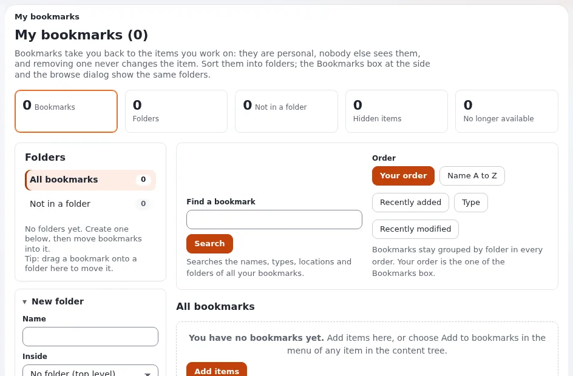

# Lesson 8.2: Bookmarks

Most editors work on the same few dozen items again and again. Bookmarks keep them one click away. They are
personal: nobody else sees them, and removing one never changes the item. This lesson covers adding bookmarks,
putting them into folders and finding them again.

## At a glance

| | |
|---|---|
| Course | [Editors 101](../README.md) |
| Module | [Module 8: Dashboard, bookmarks and your account](README.md) |
| Duration | 45 minutes (15 presenting, 30 exercise) |
| Level | Beginner |
| Audience | New editors and authors |
| Prerequisites | [Lesson 8.1](the-dashboard.md) |

## Learning objectives

After this lesson, learners can:

- add a bookmark with **Add to bookmarks**, from the item menu or with **Add items** on **My bookmarks**;
- create bookmark folders and move bookmarks into them;
- find a bookmark with **Find a bookmark** and change the order of the list;
- read the marks *Hidden*, *Not found* and *No access* on a bookmark;
- use a bookmark in the online editor's link dialog.

## Trainer's notes

### How to present it

Source: [Bookmarks](../../../../guides/bookmarks.md).

1. **Adding** (3 minutes). **Add to bookmarks** in the **Bookmarks** box of the right column adds the item you are
   looking at. The item menu in the tree adds bookmarks too. On **My bookmarks**, **Add items** opens a browser.
2. **The page** (4 minutes). Open **Dashboard** > **My bookmarks**: the overview figures, **Folders**, **Find
   bookmarks** with **Find a bookmark**, and **All bookmarks**, one card per bookmark grouped by folder, with **View**,
   **Edit** (when you may edit) and, in your own order, **Move up** and **Move down**.
3. **Folders** (4 minutes). Under **Folders**, type a **Name**, choose where it goes in **Inside** (*No folder (top
   level)* for the top) and press **Create folder**. To move bookmarks, tick them, choose the folder and press
   **Move**; with a mouse you can also drag a bookmark onto a folder.
4. **Marks** (2 minutes). **Hidden** or **Hidden by a parent**: visitors do not see the item. **Not found**: it was
   removed, is in the trash or is not in a language of this site. **No access**: you may no longer read it.
5. **Bookmarks elsewhere** (2 minutes). The **Bookmarks** tab of the link dialog (lesson 4.2) lists your bookmarks,
   so linking to items you use often is quick.

### Common questions

**Can I share my bookmarks with a colleague?** No. Bookmarks are personal.

**What happens to a bookmark when its item is removed?** It stays and shows **Not found**, so you notice. Remove the
bookmark if you no longer need it.

**How are bookmarks ordered?** In your own order (set with **Move up** and **Move down**), by name, recently added,
type or recently modified. They always stay grouped by folder.

### Pitfalls

- **Removing the item instead of the bookmark.** **Remove selected** on **My bookmarks** removes only bookmarks; the
  **Remove** button on an item's page removes the item. Point out the difference.
- **Bookmarks for everything.** A list of 200 bookmarks is as slow as the tree. Encourage folders by project.

## Hands-on exercise

Use the training installation and your course folder.

1. Open your course folder. In the right column's **Bookmarks** box, press **Add to bookmarks**.
2. Open *My first article* and add it to your bookmarks the same way.
3. In the tree, open the item menu of the media library's **Images** folder and add it to your bookmarks.
4. Open **My bookmarks** from the dashboard's left column. Read the overview figures.
5. Under **Folders**, type `Course` in **Name**, keep *No folder (top level)* in **Inside**, and press **Create
   folder**.
6. Tick the bookmarks of your course folder and of *My first article*, choose the folder **Course** and press
   **Move**.
7. In **Find a bookmark**, type `first` and search. Then clear the search.
8. Press **Add items**, choose your article *News one (updated)* in the browser and confirm.
9. Open *My first article* with **Edit**, select a word in **Body**, press the link button and open the
   **Bookmarks** tab of the dialog: your bookmarks are listed. Close the dialog and press **Discard draft**.

## Expected result

- **My bookmarks** shows four bookmarks: two in the folder **Course**, the **Images** folder and *News one (updated)*
  outside it.
- **Find a bookmark** found *My first article*.
- The link dialog's **Bookmarks** tab listed the learner's bookmarks.
- The trainer checks by asking a learner to show their folder **Course** on the projector.

## Quiz

1. Who sees your bookmarks?
2. Name two ways to add a bookmark.
3. A bookmark shows **Not found**. Name one possible reason.
4. True or false: **Remove selected** on **My bookmarks** removes the bookmarked items.
5. Where else do your bookmarks appear while you write?

Answers

1. Only you ([Bookmarks](../../../../guides/bookmarks.md#in-short)).
2. Any two of: **Add to bookmarks** in the right column, the item menu in the tree, **Add items** on **My bookmarks**.
3. The item was removed, is in the trash, or is not in a language of this site.
4. **False.** Only the bookmarks are removed.
5. In the **Bookmarks** tab of the online editor's link dialog.

## Further reading

- [Bookmarks](../../../../guides/bookmarks.md): the page, folders, orders and every action.
- [Bookmark folders](../../../../features/6.0/bookmark-folders.md): the feature in brief.

## Related pages

- [Module 8: Dashboard, bookmarks and your account](README.md)
- [Editors 101: course overview](../README.md)
- [Trainers: start here](../../trainers-start-here.md)
- [Free documentation](../../../free-documentation.md): this page is free to copy, translate and improve under the GNU FDL 1.3.

<!-- exp-partner-block:start -->
**Become an Exponential Partner.** Partners share their information, provide funding, contribute back and
develop the products with us, and that is how Exponential grows. A partner website and dashboard are planned for
mid-2027: please become a partner today to speed up our growth rate and land new features faster. Start with
[Partners: start here](../../../partners/partners-start-here.md) and [How to apply](../../../partners/how-to-apply.md).
<!-- exp-partner-block:end -->
