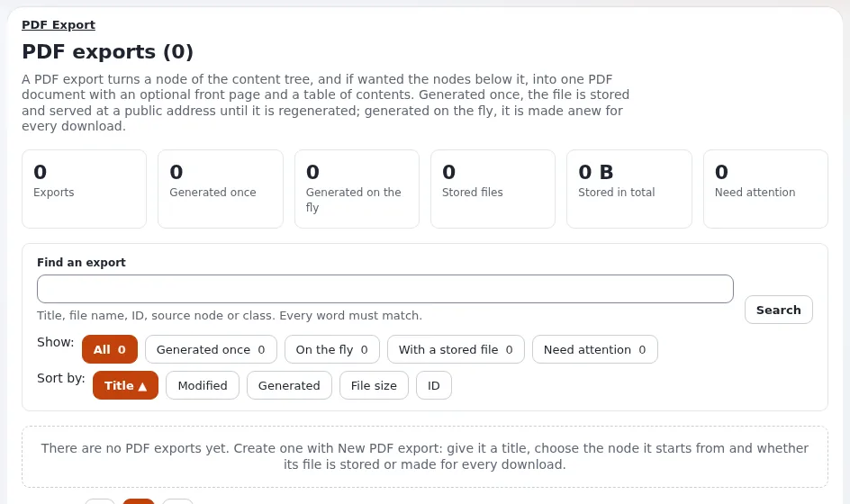

# Lesson 6.3: PDF exports

Some content has to leave the site as a document: a handbook, a price list, a printed newsletter. A **PDF export**
makes one PDF from a part of the tree. This lesson shows editors how an export is set up and kept current.

## At a glance

| | |
|---|---|
| Course | [Editors 201](../README.md) |
| Module | [Module 6: Addresses, feeds and PDF](README.md) |
| Duration | 45 minutes (15 presenting, 30 exercise) |
| Level | Intermediate |
| Audience | Editors who produce documents from site content |
| Prerequisites | [Lesson 6.2](rss-feeds-for-editors.md); a role with the `pdf/edit` policy for the exercise |

## Learning objectives

After this lesson, learners can:

- explain what a PDF export contains: a source node, and for a tree the nodes below it of the ticked classes;
- choose between **Generate once** and on the fly and explain the trade-off;
- create an export with **New PDF export**, download it and **Regenerate** it;
- explain why a stored PDF is public and what that means for its content and file name.

## Trainer's notes

### How to present it

Source: [PDF exports](../../../../guides/pdf-exports.md).

1. **What it makes** (3 minutes). One PDF of a **source node**: its name as the first heading, then its fields. A
   **tree** export adds the nodes below it, at every level, but only those of the **classes** you tick. A node of an
   unticked class is left out with everything below it, so tick the folders as well as the articles.
2. **Once or on the fly** (3 minutes). **Generated once**: the PDF is written when the export is saved and again with
   **Regenerate**; fast, but it shows the content as it was then. **On the fly**: made anew at every download; always
   current, slower for a large tree.
3. **The page** (4 minutes). **Setup** > **PDF export** (`/pdf/list`), with the `pdf/edit` policy (Administrator has
   it): *PDF exports (n)*, **Overview**, **Find an export**, cards with **Download**, **Regenerate** and **Edit**,
   **New PDF export** and **Remove selected**.
4. **The form** (3 minutes). **Title** (not printed), **Content** (source node with **Browse**, **Node** or **Tree**
   and the classes), **Frontpage** (optional first page), **Footer text**, **Export type** and **File name**; then
   **OK**. Errors are listed at the top with a link to their field.
5. **Public files** (2 minutes). A stored PDF is public at its address, for anybody. Use **on the fly** for content
   that is not for everybody, and never a file name you would not want guessed.

### Common questions

**Why does my PDF contain only the first page?** A tree without classes, or the folders between the source and the
articles are not ticked.

**Why does my stored PDF show old content?** It was generated once; press **Regenerate**.

**Can visitors download an on-the-fly PDF?** Only users with the `pdf/edit` policy, through the download address.

### Pitfalls

- **Missing permission.** Editors usually lack `pdf/edit`. Give the training role the policy or demonstrate.
- **Private content in a stored PDF.** It becomes public. Do not export members-only content as a stored PDF.
- **Large trees on the fly.** They time out; switch them to generated once.

## Hands-on exercise

Use the training installation with a role that has the `pdf/edit` policy (the trainer arranged it, or follows the
steps on the projector).

1. Open **Setup** > **PDF export**. Read the **Overview**.
2. Press **New PDF export**.
3. **Title**: `Course folder <your name>`.
4. Under **Content**, press **Browse** and choose your course folder. Choose **Tree** and tick *Folder* and *Article*.
5. Under **Frontpage**, type a large line `My course` and a smaller line with today's date.
6. Choose **Generate once** and the file name `course-<your-first-name>.pdf`. Press **OK**.
7. On the list, read your card: the badges, the source node, **Contains**, the stored file with its size.
8. Press **Download** and open the PDF. Find your articles.
9. Change the title of one article in your course folder and publish. Download again: the PDF still has the old
   title. Press **Regenerate** and download again.
10. Tick your export and press **Remove selected**; read the confirmation (it names the stored file) and confirm.

## Expected result

- A PDF with a front page and the learner's folder and articles was created, downloaded and regenerated.
- Step 9 showed the difference between the stored file and the current content.
- The export and its file are removed after step 10; the content is untouched.
- The trainer checks by downloading one learner's PDF on the projector before step 10.

## Quiz

1. What does a **Tree** export contain?
2. What is the difference between generated once and on the fly?
3. Your stored PDF shows an old title. What do you press?
   A. **Download** B. **Regenerate** C. **Edit** D. **Remove selected**
4. Why should members-only content not be exported as a stored PDF?
5. Which policy does the PDF export page need?

Answers

1. The source node and the nodes below it of the ticked classes ([PDF exports](../../../../guides/pdf-exports.md)).
2. Generated once writes a stored file when saved (fast, can be out of date); on the fly makes the PDF at every
   download (always current, slower).
3. **B.**
4. A stored PDF is public at its address for anybody.
5. `pdf/edit`.

## Further reading

- [PDF exports](../../../../guides/pdf-exports.md): the page, the form and the problems.
- [PDF export](../../../../features/6.0/pdf-export.md): what changed in this release.

## Related pages

- [Module 6: Addresses, feeds and PDF](README.md)
- [Editors 201: course overview](../README.md)
- [Trainers: start here](../../trainers-start-here.md)
- [Free documentation](../../../free-documentation.md): this page is free to copy, translate and improve under the GNU FDL 1.3.

<!-- exp-partner-block:start -->
**Become an Exponential Partner.** Partners share their information, provide funding, contribute back and
develop the products with us, and that is how Exponential grows. A partner website and dashboard are planned for
mid-2027: please become a partner today to speed up our growth rate and land new features faster. Start with
[Partners: start here](../../../partners/partners-start-here.md) and [How to apply](../../../partners/how-to-apply.md).
<!-- exp-partner-block:end -->
