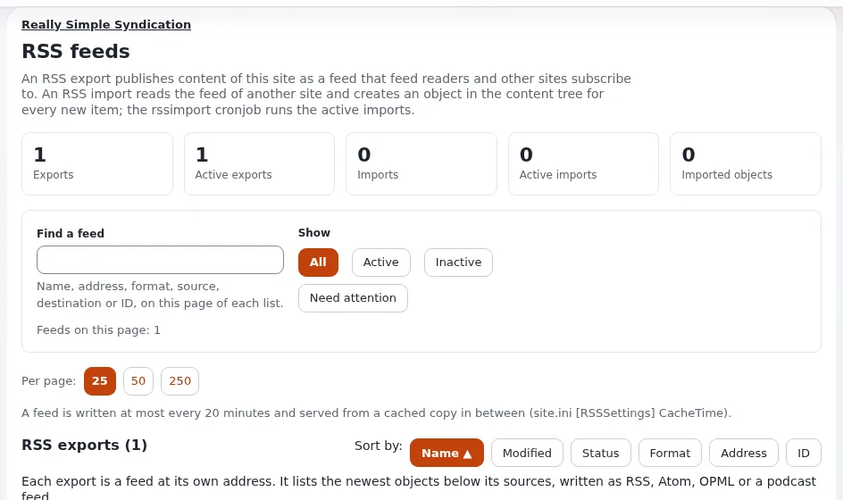

# Lesson 6.2: RSS feeds from the editor's side

A site's feeds let readers and other sites follow new content. Editors do not usually set feeds up, but what they
publish ends up in them: the title, the description, the image. This lesson shows editors how their content reaches a
feed and how to check it.

## At a glance

| | |
|---|---|
| Course | [Editors 201](../README.md) |
| Module | [Module 6: Addresses, feeds and PDF](README.md) |
| Duration | 30 minutes (15 presenting, 15 exercise) |
| Level | Intermediate |
| Audience | Editors of news, blogs and podcasts |
| Prerequisites | [Lesson 6.1](url-aliases-of-an-item.md) |

## Learning objectives

After this lesson, learners can:

- explain what an RSS export is: a feed of the newest items below its sources;
- name which fields of their content become a feed item's title and description;
- open a feed's address and find their own article in it;
- read an export card (**Open feed**, sources, items, last written) where their role allows.

## Trainer's notes

### How to present it

Source: [RSS feeds](../../../../guides/rss-feeds.md).

1. **Exports** (4 minutes). An export is a feed this site publishes at `/rss/feed/<address>`. It lists the newest
   items below its **sources** (places in the tree, each with a class and optionally their sub items), as RSS 1.0,
   RSS 2.0, Atom, OPML or an Apple Podcasts feed. An **import** is the other way: it reads another site's feed and
   creates items (a cronjob does the reading).
2. **What editors control** (4 minutes). For each source, the export names which field becomes the item's title,
   description, category and enclosure (for example the article's **Title** and **Intro**). Good titles and intros
   make good feed items. A new article appears in the feed when it is published below a source, within the feed's
   cache time.
3. **The page** (5 minutes). Administrators (role with `rss/edit`) open **Setup** > **RSS**: *RSS feeds* with an
   **Overview**, **Find a feed**, **Show** (**All**, **Active**, **Inactive**, **Need attention**), the **RSS exports**
   and **RSS imports** with **Open feed**, **Edit**, **New export**, **New import** and **Remove selected**. The Editor
   siteaccess does not offer the RSS module. Show the page on the projector if learners may not open it.

### Common questions

**Why is my new article not in the feed yet?** The feed is cached for a time set by the site; or the article is not
below one of the feed's sources, or of another class.

**Can I make a feed for my folder?** Administrators can; the item menu has **Create RSS/ATOM feed** for roles that may.

**Does removing an export remove content?** No. Its address stops answering; the content stays.

### Pitfalls

- **Raw XML in the browser.** Some browsers show a feed as code. That is fine; learners look for their title in it.
- **Missing permission.** Most editors cannot open **Setup** > **RSS**; plan the demonstration.
- **Empty intros.** A feed item without a description looks broken in newsreaders; remind learners to write intros.

## Hands-on exercise

Use the training installation. The trainer created an RSS 2.0 export whose source is the folder **Training** with
sub items, class *Article*, title from **Title** and description from **Intro**.

1. The trainer opens **Setup** > **RSS** on the projector and shows the export's card: its address, sources and
   **Open feed**. Write down the feed's address.
2. Open the feed's address in your browser.
3. Find the titles of the articles in the feed. Is one of your articles there?
4. Publish a new article `Feed test` with a one-sentence intro in your course folder (below **Training**).
5. Open the feed again (wait for the cache time the trainer names, if any). Find `Feed test` and its description.
6. If you have a newsreader app, subscribe to the feed's address and look at your article there.
7. Hide `Feed test` and check the feed again after the cache time.

## Expected result

- The feed lists the newest articles below **Training**, with titles and intros as descriptions.
- `Feed test` appeared after publishing (within the cache time) and disappeared from the feed after it was hidden
  (hidden content is not shown to visitors).
- The trainer checks by opening the feed on the projector and finding one learner's article.

## Quiz

1. What is an RSS export?
2. Which two article fields typically become a feed item's title and description?
3. Your new article is not in the feed. Name two possible reasons.
4. True or false: removing an export deletes the articles it listed.
5. Which page lists the site's feeds, and who may open it by default?

Answers

1. A feed this site publishes, listing the newest items below its sources ([RSS feeds](../../../../guides/rss-feeds.md)).
2. **Title** and **Intro** (as the export maps them).
3. Any two of: the feed's cache time; the article is not below a source; its class is not the source's class; it is
   hidden or not published.
4. **False.**
5. **Setup** > **RSS**, for roles with the `rss/edit` policy (administrators).

## Further reading

- [RSS feeds](../../../../guides/rss-feeds.md): exports, imports and the page.
- [RSS, podcasts and the feed list](../../../../features/6.0/rss-podcast-and-feed-list.md): the formats.

## Related pages

- [Module 6: Addresses, feeds and PDF](README.md)
- [Editors 201: course overview](../README.md)
- [Trainers: start here](../../trainers-start-here.md)
- [Free documentation](../../../free-documentation.md): this page is free to copy, translate and improve under the GNU FDL 1.3.

<!-- exp-partner-block:start -->
**Become an Exponential Partner.** Partners share their information, provide funding, contribute back and
develop the products with us, and that is how Exponential grows. A partner website and dashboard are planned for
mid-2027: please become a partner today to speed up our growth rate and land new features faster. Start with
[Partners: start here](../../../partners/partners-start-here.md) and [How to apply](../../../partners/how-to-apply.md).
<!-- exp-partner-block:end -->
