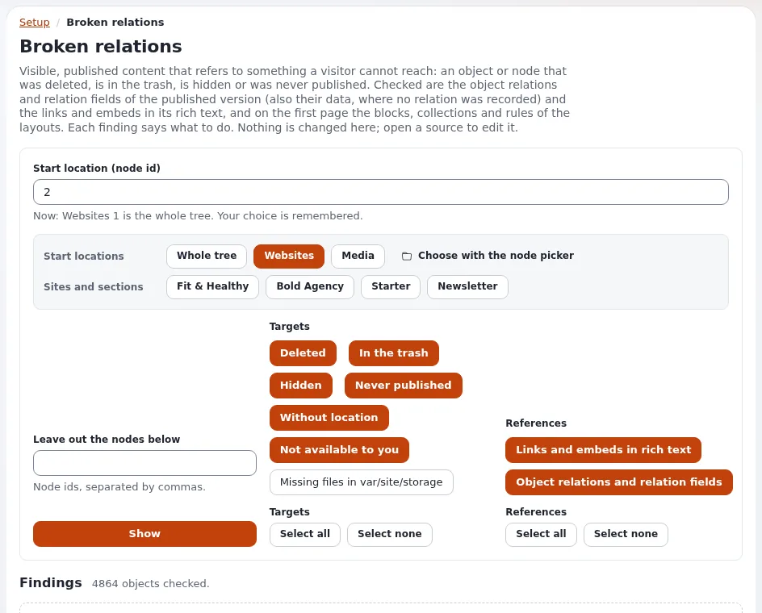

# Lesson 8.1: Content checks: broken relations and unreferenced files

Over the years a site collects broken references (links to removed pages, embeds of trashed images) and files nobody
uses. Exponential's **content checks** find both. They are administration pages, usually for administrators and
senior editors; this lesson teaches how to read and act on them.

## At a glance

| | |
|---|---|
| Course | [Editors 201](../README.md) |
| Module | [Module 8: Quality and accessibility](README.md) |
| Duration | 45 minutes (15 presenting, 30 exercise) |
| Level | Intermediate |
| Audience | Senior editors and administrators who keep content tidy |
| Prerequisites | [Module 2](../module-02-relations-locations-and-embedding/README.md); a role with the `contentcheck` policies |

## Learning objectives

After this lesson, learners can:

- open **Broken relations** and **Unreferenced objects** for a part of the tree from the item menu;
- choose a start location and filters, and read the findings;
- repair a broken reference by editing the source item;
- move unused assets to the trash with **Move ticked objects to the trash**, knowing what the check cannot know.

## Trainer's notes

### How to present it

Source: [The content checks](../../../../features/6.0/content-checks.md).

1. **Where** (2 minutes). In the item menu: **Advanced** > **Broken relations in subtree** and **Unreferenced
   objects in subtree**; also in the Setup menu. They work in the administration siteaccesses only, and a new
   installation gives their policies (`contentcheck`: unreferenced, trash, brokenrelations) only to Administrator.
2. **Broken relations** (5 minutes). Visible, published content that refers to an item that was deleted, is in the
   trash, is hidden or was never published. **Filter**: **Start location** (**Whole tree**, **Websites**, **Media**,
   a site, or **Choose with the node picker**), **Targets** (**Deleted**, **In the trash**, **Hidden**, **Never
   published**, **Without location**, **Not available to you**, **Missing files in var/site/storage**) and
   **References** (**Links and embeds in rich text**, **Object relations and relation fields**), then **Show**. Each
   finding names the source, the field, the target, its state and what to do, with a link to edit the source. The
   page only reads; it changes nothing.
3. **Unreferenced objects** (5 minutes). Published assets (images, files, media) below the start location that
   nothing uses: no other item, layout, setting, template, role, shop or newsletter entry. Filter by **Classes**,
   **Order by** and **Direction**, then tick and **Move ticked objects to the trash** after a confirmation. Pages,
   folders and users are never listed.
4. **What the check cannot know** (3 minutes). A file linked from outside the site (a printed address, another site)
   counts as unused. That is why it moves to the trash, not to deletion: restore if someone complains.

### Common questions

**Why can I not open the checks?** The role lacks the `contentcheck` policies, or you are in the Editor siteaccess.

**Is it safe to trash everything the list shows?** Look first. Anything used from outside the site is invisible to the
check.

**How often should we run them?** Agree in the team; a monthly look at **Broken relations** for your area is a good
start.

### Pitfalls

- **Big start locations.** The whole tree on a large site takes time; start with your own folder.
- **Trashing shared images.** An image may be used outside the site (newsletters sent, social posts). Keep a list of
  what you trashed.
- **Empty results on a fresh training site.** Prepare a broken reference and an unused image (see the module
  overview).

## Hands-on exercise

Use the training installation with a role that has the `contentcheck` policies (or follow on the projector). The
trainer prepared, in each learner's course folder, an article that embeds an image which is now in the trash, and an
image nobody uses.

1. In the tree, open the item menu of your course folder and choose **Advanced** > **Broken relations in subtree**.
2. Check that the start location is your folder. Under **Targets**, keep all; under **References**, keep both. Press
   **Show**.
3. Read the finding: the source article, the field, the target image, its state (*In the trash*) and the suggested
   action.
4. Follow the link to edit the source article. Remove the embed (or embed another image) and publish.
5. Press **Show** again on the check: the finding is gone.
6. From the item menu, choose **Advanced** > **Unreferenced objects in subtree** for your course folder.
7. Read the list: the unused image is there with its **Class**, **Size**, **Last modified** and **Location**.
8. Tick it and press **Move ticked objects to the trash**; read the confirmation and confirm.
9. Open **Trash** and check that the image is there.

## Expected result

- The broken reference was found, repaired, and is no longer listed.
- The unused image was listed and moved to the trash, where it can be restored.
- The trainer checks by running **Broken relations** for the **Training** folder on the projector: no findings left.

## Quiz

1. Name three target states the **Broken relations** check can look for.
2. True or false: **Broken relations** changes content when you press **Show**.
3. Which items does **Unreferenced objects** list?
   A. Every item B. Folders and pages C. Published assets that nothing uses D. Users
4. Why does **Unreferenced objects** move to the trash rather than delete?
5. Who has the content check policies on a new installation?

Answers

1. Any three of: deleted, in the trash, hidden, never published, without location, not available to you, missing
   files ([The content checks](../../../../features/6.0/content-checks.md#in-short)).
2. **False.** The page only reads.
3. **C.**
4. The check cannot know uses from outside the site; the trash allows restoring.
5. Only Administrator.

## Further reading

- [The content checks](../../../../features/6.0/content-checks.md): every check, what counts as a reference, and
  missing files.
- [Removing and hiding: the check of reverse relations](../../../../features/6.0/reverse-relation-check.md):
  preventing broken references.

## Related pages

- [Module 8: Quality and accessibility](README.md)
- [Editors 201: course overview](../README.md)
- [Trainers: start here](../../trainers-start-here.md)
- [Free documentation](../../../free-documentation.md): this page is free to copy, translate and improve under the GNU FDL 1.3.

<!-- exp-partner-block:start -->
**Become an Exponential Partner.** Partners share their information, provide funding, contribute back and
develop the products with us, and that is how Exponential grows. A partner website and dashboard are planned for
mid-2027: please become a partner today to speed up our growth rate and land new features faster. Start with
[Partners: start here](../../../partners/partners-start-here.md) and [How to apply](../../../partners/how-to-apply.md).
<!-- exp-partner-block:end -->
