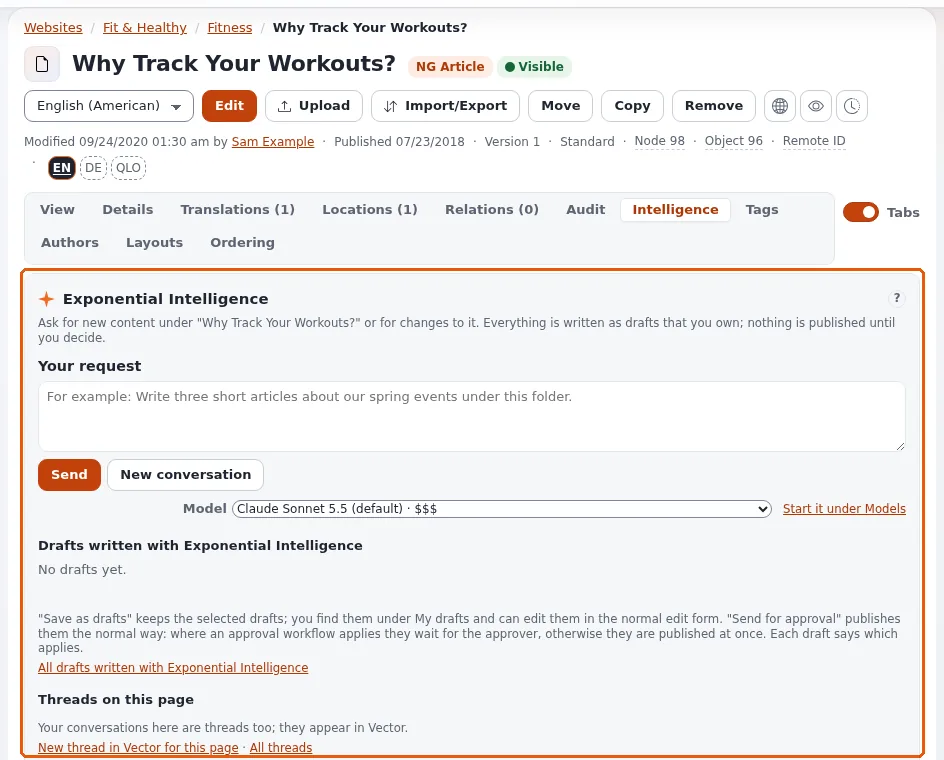

# Lesson 2.1: A first conversation in the Intelligence tab

The **Intelligence** tab of an item's page is where editors talk to the assistant about that place in the tree. In
this lesson every learner sends a first request below their own course folder and reads what comes back.

> **Note**
> This lesson sends requests to the model provider of the training installation. Use neutral topics, no personal data,
> and the training account's limits.

## At a glance

| | |
|---|---|
| Course | [Exponential Intelligence](../README.md) |
| Module | [Module 2: The Intelligence tab](README.md) |
| Duration | 45 minutes (15 presenting, 30 exercise) |
| Level | Beginner |
| Audience | Editors |
| Prerequisites | [Module 1](../module-01-introducing-exponential-intelligence/README.md); a course folder where the learner may create articles |

## Learning objectives

After this lesson, learners can:

- start a request from **Start writing** on the dashboard or in the **Intelligence** tab of an item;
- write a brief that names what, how many, where, for whom and how long;
- send it with **Send** (or Ctrl+Enter) and follow the working indicator and the steps;
- read the answer and the list **Drafts written with Exponential Intelligence**.

## Trainer's notes

### How to present it

Source: [expai: For editors](../../../../features/6.0/extensions/expai.md#for-editors) and the Intelligence tab page
under **EI: Help** (`extension/expai/doc/full-view-panel.md`).

1. **Two ways in** (3 minutes). On the dashboard page, **Start writing**: a location (**change**), *What should
   Exponential Intelligence write?*, a model, **Write**. **Write** opens the item's page with the **Intelligence** tab
   and fills the request in; you still press **Send**. Or open an item and click its **Intelligence** tab directly.
2. **The tab** (3 minutes). **Conversation**: the history, the field **Your request** (with an example such as *Write
   three short articles about our spring events under this folder.*), **Send**, and **New conversation**. A
   conversation belongs to one user and one item.
3. **A good brief** (4 minutes). Write on the board: *what* (two articles), *about what* (spring planting), *where*
   (below this folder), *for whom* (beginners), *how long* (about 150 words), *what to leave out* (no prices). Short
   briefs give generic drafts.
4. **While it works** (3 minutes). *Exponential Intelligence is working...*: it looks up what it needs (each lookup is
   a step) and writes drafts. One step at a time: a second request in another tab is refused while one runs.
5. **The result** (2 minutes). The answer in words, and the drafts listed under **Drafts written with Exponential
   Intelligence** with links to view and edit them. Lesson 2.2 decides what to do with them.

### Common questions

**Why did it ask me a question instead of writing?** The brief was unclear; answer in the field and send again.

**Why did it not add images?** It cannot upload images or set relations; it says so. Add them in the edit form.

**How long does a request take?** From seconds to minutes, depending on the model and the work; a local model on an
ordinary server can take minutes per step.

### Pitfalls

- **Requests below someone else's folder.** The assistant writes where the editor may create; make sure learners open
  their own folder.
- **Personal data in the brief.** Never names, addresses or customer details (module 6).
- **Impatience and double clicks.** One step at a time; wait for the answer.

## Hands-on exercise

Use the training installation and your course folder.

1. Open the dashboard page **Exponential Intelligence**. In **Start writing**, press **change** and choose your course
   folder.
2. In *What should Exponential Intelligence write?*, type a brief, for example: `Write two short articles (about 120
   words each) for beginners about planting spring bulbs, below this folder. No prices, no brand names.`
3. Keep the default model and press **Write**. Your folder's page opens with the **Intelligence** tab and your request
   in the field.
4. Read the request once more and press **Send**.
5. Watch the working indicator and the steps. Write down how many lookups it made.
6. Read the answer.
7. Under **Drafts written with Exponential Intelligence**, find the drafts. Open one with its view link and read it.
8. Do not save or send yet; lesson 2.2 continues here.

## Expected result

- The learner's conversation shows the request, the steps and the answer.
- Two drafts below the learner's course folder are listed in the tab (they are not published).
- The trainer checks by opening one learner's tab on the projector and showing that the site is unchanged.

## Quiz

1. Name the two ways to start a request.
2. What happens when you press **Write** in **Start writing**?
   A. The drafts are published B. The request is filled into the Intelligence tab; you still press Send C. Nothing
   D. The request is e-mailed
3. Name four elements of a good brief.
4. Why is a second request refused while one runs?
5. Where are the drafts of the conversation listed?

Answers

1. **Start writing** on the dashboard page, or the **Intelligence** tab of an item.
2. **B.**
3. Any four of: what, about what, where, for whom, how long, what to leave out.
4. One step at a time per conversation, so tools do not run twice.
5. Under **Drafts written with Exponential Intelligence** in the tab (and under **My drafts**).

## Further reading

- [expai: For editors](../../../../features/6.0/extensions/expai.md#for-editors)
- The usage guide and the Intelligence tab page under **EI: Help**.

## Related pages

- [Module 2: The Intelligence tab](README.md)
- [Exponential Intelligence: course overview](../README.md)
- [Trainers: start here](../../trainers-start-here.md)
- [Free documentation](../../../free-documentation.md): this page is free to copy, translate and improve under the GNU FDL 1.3.

<!-- exp-partner-block:start -->
**Become an Exponential Partner.** Partners share their information, provide funding, contribute back and
develop the products with us, and that is how Exponential grows. A partner website and dashboard are planned for
mid-2027: please become a partner today to speed up our growth rate and land new features faster. Start with
[Partners: start here](../../../partners/partners-start-here.md) and [How to apply](../../../partners/how-to-apply.md).
<!-- exp-partner-block:end -->
