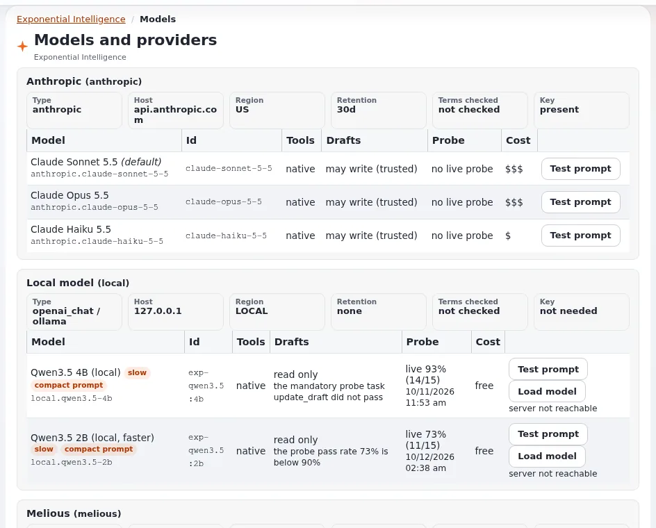

# Lesson 7.1: Providers and models

Which companies (or local servers) answer the assistant's requests, and which models may write drafts, are decisions
of the administrator. This lesson reads the **Models and providers** page and explains the rules behind it: providers,
keys, the probe and the write gate.

## At a glance

| | |
|---|---|
| Course | [Exponential Intelligence](../README.md) |
| Module | [Module 7: Administration](README.md) |
| Duration | 45 minutes (20 presenting, 25 exercise) |
| Level | Advanced |
| Audience | Administrators who run the assistant |
| Prerequisites | Modules 1 to 6; the policy `expai/model_manage` |

## Learning objectives

After this lesson, learners can:

- read **EI: Models** (**Models and providers**): providers, models, key presence, probe and test results;
- explain region, retention and "terms checked" of a provider;
- explain the write gate: only models with native tool calling that passed the probe (or are trusted) write drafts;
- run a **Test prompt** and read its result;
- decide which models editors may choose (`expai/model_use`, the allowed models).

## Trainer's notes

### How to present it

Sources: [expai: For administrators](../../../../features/6.0/extensions/expai.md#for-administrators) and the providers,
probe and local models pages under **EI: Help** (`extension/expai/doc/providers.md`, `extension/expai/doc/probe.md`,
`extension/expai/doc/local-models.md`).

1. **Providers** (4 minutes). The extension speaks to Anthropic, to any OpenAI-compatible service and to a local
   open-weight model through Ollama. Each provider has a region (`us`, `eu`, `local`), a retention and the date its
   terms were checked (`TermsCheckedAt`; the page shows "not checked" until set). The shipped values are a starting
   point, not a legal statement.
2. **The page** (4 minutes). Setup > **EI: Models**: one section per provider with its models (**Model**, **Id**,
   **Tools**, **Probe**, **Test**, **Drafts**, **Cost**), the local model server (actions such as **Start the server**,
   **Stop the server**, **Pull the model**, **Remove the model**, **Refresh the status**, sent to a root-owned helper
   with **Send to the helper**), **Load model**, **Test prompt**, and **MCP tools**. Keys are never shown; only whether
   one is present.
3. **The write gate** (5 minutes). A model may create and change drafts only with native tool calling and either
   `WriteGate=trusted` or a live probe with a pass rate of at least 90 percent and every mandatory task passed (among
   them a prompt injection task). Otherwise it reads only: editors see "reads only". The probe is run from the command
   line (`extension/expai/bin/php/expaiprobe.php`).
4. **Who may use which model** (3 minutes). The site default model is always available; other providers' models need
   `expai/model_use` (limitation Provider), except providers listed as open. Users may choose among allowed models
   where the site lets them.
5. **Fallback** (2 minutes). When the chosen model cannot answer, the site default answers and the editor sees one line
   saying so.

### Common questions

**Which provider should we use?** That depends on your data protection rules, region, retention and budget; the
documentation names no preferred one. Read the providers' terms and record the date.

**Is a local model good enough?** For short tasks; on an ordinary server a local model takes minutes per step and may
only read (it must pass the probe to write).

**Where are keys stored?** In `settings/override/expai.ini.append.php` or an untracked key location, never committed;
lesson 7.2.

### Pitfalls

- **Opening the gate by hand** for a model that failed the probe's injection task. Do not.
- **Leaving "terms not checked".** Read the terms and set the date.
- **Testing with real content.** **Test prompt** sends a request; use a neutral prompt.

## Hands-on exercise

Use the training installation with an administrator account (or follow on the projector).

1. Open Setup > **EI: Models**. Write down each provider with its region and retention, and whether its terms were
   checked.
2. For each model, read **Tools** and **Probe**: which may write drafts, which read only, and why?
3. Find the key status of each provider (present or missing). Confirm that no key is visible on the page.
4. Run **Test prompt** on the cheapest model with a neutral prompt (as the page offers) and read the result: time to the
   first token, tokens per second, total.
5. Open the result's link in **EI: Log** (action `test`).
6. On the dashboard page **Exponential Intelligence**, open **Details** and read what an administrator with
   `expai/settings` sees about the default model.
7. Write down which models you would allow editors to choose, and why.

## Expected result

- The learner's notes list providers with region, retention and terms state, models with their write gate state, and a
  test prompt result.
- The learner can explain why a model reads only.
- The trainer checks two learners' model choices and reasons.

## Quiz

1. What three things are recorded per provider for the data policy and the summary?
2. When may a model write drafts?
3. What do editors see next to a model that may not write?
   A. Nothing B. "reads only" C. "blocked" D. Its key
4. Which policy lets an editor choose models of a provider outside the open list?
5. What happens when the chosen model cannot answer?

Answers

1. Region, retention and the date the terms were checked.
2. With native tool calling and either a trusted write gate or a live probe with a high enough pass rate and every
   mandatory task passed.
3. **B.**
4. `expai/model_use` (limitation Provider).
5. The site default model answers (where the fallback is on), and the editor sees a line saying so.

## Further reading

- [expai: For administrators](../../../../features/6.0/extensions/expai.md#for-administrators)
- The providers, probe, local models and provider support pages under **EI: Help**.

## Related pages

- [Module 7: Administration](README.md)
- [Exponential Intelligence: course overview](../README.md)
- [Trainers: start here](../../trainers-start-here.md)
- [Free documentation](../../../free-documentation.md): this page is free to copy, translate and improve under the GNU FDL 1.3.

<!-- exp-partner-block:start -->
**Become an Exponential Partner.** Partners share their information, provide funding, contribute back and
develop the products with us, and that is how Exponential grows. A partner website and dashboard are planned for
mid-2027: please become a partner today to speed up our growth rate and land new features faster. Start with
[Partners: start here](../../../partners/partners-start-here.md) and [How to apply](../../../partners/how-to-apply.md).
<!-- exp-partner-block:end -->
