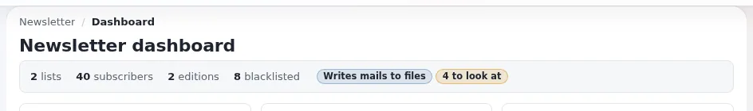

# Lesson 1.2: Preparing a safe training installation

A newsletter goes to many people at once and cannot be called back. In a classroom that risk is multiplied by the
number of learners. This lesson is the rule of the whole course: before anyone writes an edition, every mail the
installation could send is written to a file instead, and every test subscriber has an address that cannot exist.

> **Note**
> Run this lesson yourself before the course, and again with the administrators in the room. Never use a live site
> or a copy of a live database with real subscribers for training.

## At a glance

| | |
|---|---|
| Course | [Newsletters with CJW Newsletter](../README.md) |
| Module | [Module 1: Getting started](README.md) |
| Duration | 60 minutes (25 presenting, 35 exercise) |
| Level | Intermediate |
| Audience | Trainers, administrators who prepare training or test installations |
| Prerequisites | [Lesson 1.1](what-a-newsletter-system-does.md); shell access to the training installation; an admin account |

## Learning objectives

After this lesson, learners can:

- name the two places where mail transports are set: the kernel's `site.ini [MailSettings]` and the newsletter's
  `cjw_newsletter.ini [NewsletterMailSettings]`;
- set all four transports to `file` in `settings/override/`;
- explain why the shipped `TransportMethodPreview=sendmail` is the trap of a fresh installation;
- check the result in the administration and on the command line;
- choose test addresses at `example.invalid` and explain why.

## Trainer's notes

### How to present it

Sources: [10.4 Mail: the file transport and real sending](../../../../install/10-after-installing.md#104-mail-the-file-transport-and-real-sending),
[10.5 Notifications and newsletters](../../../../install/10-after-installing.md#105-notifications-and-newsletters) and the
[rehearsal section of the feature page](../../../../features/6.0/extensions/cjw_newsletter.md#rehearse-the-whole-thing-without-sending-a-single-mail).

1. **Two transport systems** (5 minutes). The kernel sends password mails, registrations and form mails through
   `site.ini [MailSettings] Transport` (shipped: `sendmail`). The newsletter has its own three methods in
   `cjw_newsletter.ini [NewsletterMailSettings]`:

   | Key | Used for | Shipped value |
   |---|---|---|
   | `TransportMethodCronjob` | the editions cron sends | `file` |
   | `TransportMethodPreview` | test sends of an edition | `sendmail` |
   | `TransportMethodDirectly` | subscription confirmations and info mails | `file` |

   Point at the middle row: on a fresh installation a **test send really goes out**. That is why we override it.
2. **The console install** (3 minutes). An installation made with `exp:install`
   ([chapter 7](../../../../install/07-console-install.md)) sets up mail as sendmail; change it after the install.
3. **The override files** (7 minutes). Show both files on the projector (exercise steps 2 and 3). Explain
   `FileTransportMailDir=var/log/mail`: one `.eml` file per recipient, named `<date>-<id>-<recipient>.eml`. The
   directory must be writable by the web server user and by the cron user.
4. **Checking** (5 minutes). Caches, then the settings view (**INI Settings** in the newsletter's left menu opens
   `cjw_newsletter.ini` in the settings viewer), then `ext:cjw_newsletter:status`. The dashboard shows the hint
   "Mails are written to files": in training that is exactly what we want.
5. **Test addresses** (5 minutes). The top-level domain `.invalid` is reserved and can never be delivered. Use
   `anna@example.invalid`, `ben@example.invalid` and so on. Even if a transport was wrong, such a mail would bounce
   at the first server instead of reaching a person.

### Common questions

**Is setting the newsletter methods enough?** No. The subscribe form's info mails and kernel mails such as password
reminders use other paths. Set the kernel's `Transport=file` too.

**Can I use `DebugSending` instead?** `[MailSettings] DebugSending=enabled` redirects kernel mail to one address,
but it still sends. For training, files are safer.

**Where does the kernel's file transport write?** To `var/log/mail/` by default, one `<time>-<random>.mail` file per
message ([10.4](../../../../install/10-after-installing.md#104-mail-the-file-transport-and-real-sending)).

**Do I need a mail server for this course?** No. That is the point of the file transport.

### Pitfalls

- **A value set somewhere else.** Settings are merged from the extension, the siteaccess and the override
  directories, and a file you did not know about can surprise you. Always check the *resolved* value in the
  settings viewer, not only the file you edited.
- **The INI cache.** After editing settings, clear the INI cache (exercise step 4). Without it the old value stays.
- **Permissions.** If the cron user cannot write `var/log/mail`, the send ends with an error result, not a silent
  loss. Check with `ls -ld var/log/mail`.
- **Copying a real database.** Never fill a training installation with a copy of real subscribers, even for one day.

## Hands-on exercise

Use your own training installation, for example one installed with `php bin/php/console exp:install`
([chapter 7](../../../../install/07-console-install.md)), with `cjw_newsletter` active. Work from the installation's
root directory.

1. Read the current values first:

   ```bash
   grep -n "^Transport" settings/site.ini
   grep -n "TransportMethod\|FileTransportMailDir" extension/cjw_newsletter/settings/cjw_newsletter.ini
   ```

2. Open (or create) `settings/override/site.ini.append.php` and make sure it has:

   ```ini
   [MailSettings]
   Transport=file
   ```

3. Open (or create) `settings/override/cjw_newsletter.ini.append.php` and make sure it has:

   ```ini
   [NewsletterMailSettings]
   TransportMethodCronjob=file
   TransportMethodPreview=file
   TransportMethodDirectly=file
   FileTransportMailDir=var/log/mail
   ```

   Both override files start with `<?php /*` and end with `*/ ?>` like every other file in `settings/override/`.
4. Clear the INI cache and the content cache:

   ```bash
   php bin/php/ezcache.php --clear-tag=ini
   php bin/php/ezcache.php --clear-id=content
   ```

5. Make sure the mail directory exists and is writable by the web server and cron users:

   ```bash
   mkdir -p var/log/mail
   ls -ld var/log/mail
   ```

6. In the administration, open **Newsletter** and press **INI Settings** in the left menu. Tick **Only settings
   changed from the default** and find `[NewsletterMailSettings]`. All three methods must read `file`.
7. Run the status command and read the transport line:

   ```bash
   php bin/php/console ext:cjw_newsletter:status
   ```

8. Open the newsletter **Dashboard** and read **Problems and hints**. Note the hint about mails written to files.
9. Write a list of six test subscribers for the course, all at `example.invalid`, and keep it for module 3.

## Expected result

- Both override files contain the values above, and the settings viewer shows `file` for the three newsletter methods.
- The status command reports the file transport and the outbox directory.
- The dashboard lists the hint that mails are written to files.
- `var/log/mail` exists and is writable.
- The trainer checks each learner's settings viewer page and the list of test addresses before module 2 starts.



## Quiz

1. Which newsletter transport method ships with `sendmail`, and what is it used for?
2. In which file do you put your own value of `TransportMethodPreview`?
   A. `extension/cjw_newsletter/settings/cjw_newsletter.ini` B. `settings/override/cjw_newsletter.ini.append.php`
   C. `settings/site.ini` D. `var/log/mail`
3. Why do test subscribers use addresses at `example.invalid`?
4. You changed the override file but the settings viewer still shows `sendmail`. What did you forget?
5. Which setting of `site.ini` makes kernel mails (for example password mails) go to files?

<details>
<summary>Answers</summary>

1. `TransportMethodPreview`, used for test sends of an edition ([10.5](../../../../install/10-after-installing.md#105-notifications-and-newsletters)).
2. **B.** Never edit the extension's own file; overrides go in `settings/override/` ([feature page](../../../../features/6.0/extensions/cjw_newsletter.md#settings-you-will-use)).
3. The `.invalid` top-level domain is reserved and can never be delivered, so no real person can receive the mail.
4. Clearing the INI cache (`php bin/php/ezcache.php --clear-tag=ini`), see [Caches](../../../../guides/caches.md).
5. `[MailSettings] Transport=file` ([10.4](../../../../install/10-after-installing.md#104-mail-the-file-transport-and-real-sending)).

</details>

## Further reading

- [10.4 Mail: the file transport and real sending](../../../../install/10-after-installing.md#104-mail-the-file-transport-and-real-sending):
  the kernel's mail settings.
- [10.5 Notifications and newsletters](../../../../install/10-after-installing.md#105-notifications-and-newsletters):
  the newsletter transports and cron parts.
- [7. The console install](../../../../install/07-console-install.md): making a training installation.
- [Caches](../../../../guides/caches.md): which cache to clear after a settings change.

## Related pages

- [Module 1: Getting started](README.md)
- [Newsletters with CJW Newsletter: course overview](../README.md)
- [Trainers: start here](../../trainers-start-here.md)
- [Free documentation](../../../free-documentation.md): this page is free to copy, translate and improve under the GNU FDL 1.3.

<!-- exp-partner-block:start -->
**Become an Exponential Partner.** Partners share their information, provide funding, contribute back and
develop the products with us, and that is how Exponential grows. A partner website and dashboard are planned for
mid-2027: please become a partner today to speed up our growth rate and land new features faster. Start with
[Partners: start here](../../../partners/partners-start-here.md) and [How to apply](../../../partners/how-to-apply.md).
<!-- exp-partner-block:end -->
