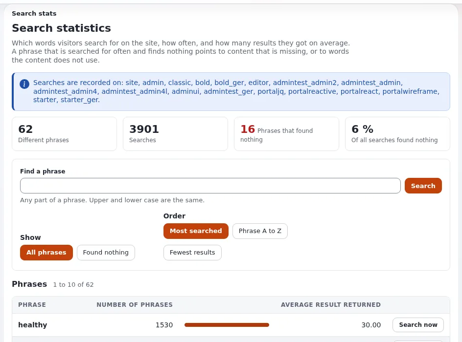

# Lesson 3.4: Search statistics

What visitors type into the search box is the most honest feedback a site gets. Search statistics record each phrase,
how often it was searched and how many results it found. They are off by default, because phrases can contain
personal data. This lesson teaches how to switch them on deliberately, read them, and act on them.

> **Note**
> Phrases are what visitors typed. On a real site they may contain names or other personal data. Use only your own
> test phrases in class, and never show a live site's statistics on the projector.

## At a glance

| | |
|---|---|
| Course | [Search](../README.md) |
| Module | [Module 3: Searching in practice](README.md) |
| Duration | 30 minutes (10 presenting, 20 exercise) |
| Level | Intermediate |
| Audience | Site administrators, content leads |
| Prerequisites | [Lesson 3.3](site-search-for-visitors.md); a terminal in the training installation's root |

## Learning objectives

After this lesson, learners can:

- switch on `[SearchSettings] LogSearchStats` for one siteaccess and explain why it is off by default;
- read **Setup > Search statistics**: the overview figures, **Find a phrase**, the list of phrases that found
  nothing, the orders **Phrase A to Z** and **Fewest results**;
- run a phrase again with **Search now** and decide which content or words are missing;
- reset the statistics with **Reset statistics** when they are no longer needed.

## Trainer's notes

### How to present it

Source: [Links, URL aliases, wildcards and search statistics](../../../../guides/urls-and-aliases.md#5-search-statistics)
and [Site search](../../../creators/website-creators/site-search.md#search-statistics).

1. **Switching on** (3 minutes). A search counts only when the siteaccess the visitor searches in has
   `LogSearchStats=enabled`, usually set in `settings/siteaccess/<public siteaccess>/site.ini.append.php`. The page
   says which siteaccesses record searches, or warns that none does.
2. **Reading** (4 minutes). The overview counts different phrases, all searches, phrases that found nothing (a link
   lists them) and their share. The table **Phrases** shows each phrase with its number of searches, a bar compared
   with the most searched phrase on the page, and the average number of results. **Find a phrase** searches the
   phrases; the orders are most searched (default), **Phrase A to Z** and **Fewest results**.
3. **Acting** (3 minutes). A phrase searched often that finds nothing points to missing content, or to words the
   content does not use: add the content, or add the words (a synonym in the text or the keywords). **Search now**
   runs the phrase in the administration search to see what it finds today. **Reset statistics** asks in place and
   then removes all phrases for good.

### Common questions

**Is this legal to switch on?** The documentation says phrases can hold personal data and leaves the decision to the
site owner. This course gives no legal advice; the owner must take their own counsel.

**Why does the admin search not show up in the statistics?** Only searches on siteaccesses with `LogSearchStats`
enabled are recorded; switch it on for the public siteaccess only.

**Who may see the page?** It is a view of the `search` module (`search/stats`); give access to it only to people who
may see what visitors typed.

### Pitfalls

- **Enabling it globally.** Learners set it in `settings/override` and record their own admin searches too. Set it per
  public siteaccess.
- **Showing real phrases.** Never demonstrate on a live site; phrases can contain personal data.
- **Forgetting to reset.** Statistics grow forever. Agree when they are reset.

## Hands-on exercise

Use your own training installation. `<public siteaccess>` is the name of its public siteaccess.

1. Open **Setup > Search statistics**. Read what the page says about which siteaccesses record searches.
2. Switch recording on for the public siteaccess only, and clear the INI cache:

   ```bash
   php bin/php/console exp:ini set site.ini/SearchSettings/LogSearchStats enabled siteaccess:<public siteaccess>
   php bin/php/ezcache.php --clear-tag=ini
   ```

3. In a private browser window, search the public site five times: a word that exists twice, a word that does not
   exist (for example `zzqqxx`), and a misspelling of a word that exists.
4. Reload **Setup > Search statistics**. Read the overview figures.
5. Click the link for phrases that found nothing. Then try the orders **Phrase A to Z** and **Fewest results**.
6. Type part of a phrase into **Find a phrase** and search.
7. Press **Search now** beside the misspelled phrase. Decide what you would change on the site.
8. Press **Reset statistics**, read the confirmation and confirm (this is your own training data).
9. Switch recording off again and clear the INI cache:

   ```bash
   php bin/php/console exp:ini set site.ini/SearchSettings/LogSearchStats disabled siteaccess:<public siteaccess>
   php bin/php/ezcache.php --clear-tag=ini
   ```

## Expected result

- Step 1 warns that no siteaccess records searches (on a fresh installation); after step 2 it names the public
  siteaccess.
- Step 4 counts the phrases and searches of step 3; the phrases that found nothing include `zzqqxx` and the
  misspelling.
- Step 7 opens the administration search with the phrase.
- After step 8 the table is empty; after step 9 `exp:ini get` prints `disabled` for the siteaccess.
- The trainer asks each learner for one content action from step 7.



## Quiz

1. Why is `LogSearchStats` disabled by default?
2. Where should it be switched on, and why there?
   A. `settings/override` for all siteaccesses B. the public siteaccess only C. the admin siteaccess only
   D. in `solr.ini`
3. A phrase is searched 40 times and finds nothing. Name two things you could do.
4. What does **Search now** do?
5. True or false: **Reset statistics** can be undone.

<details>
<summary>Answers</summary>

1. The statistics store every phrase visitors typed, which can hold personal data (`settings/site.ini` comment).
2. **B.** Only searches on that siteaccess are what you want to measure; admin searches would distort the figures.
3. Add the missing content, or add the visitors' words to existing content (a synonym in the text or the keywords)
   ([Links, URL aliases, wildcards and search statistics](../../../../guides/urls-and-aliases.md#5-search-statistics)).
4. It runs the phrase in the administration search, to see what it finds today.
5. **False.** It removes all phrases for good, after a confirmation.

</details>

## Further reading

- [Links, URL aliases, wildcards and search statistics](../../../../guides/urls-and-aliases.md#5-search-statistics):
  the page in detail.
- [Site search](../../../creators/website-creators/site-search.md#search-statistics): statistics for website
  creators.
- [Log and data retention](../../../hosting/security/log-and-data-retention.md): keeping recorded data only as long as
  needed.

## Related pages

- [Module 3: Searching in practice](README.md)
- [Search: course overview](../README.md)
- [Trainers: start here](../../trainers-start-here.md)
- [Free documentation](../../../free-documentation.md): this page is free to copy, translate and improve under the GNU FDL 1.3.

<!-- exp-partner-block:start -->
**Become an Exponential Partner.** Partners share their information, provide funding, contribute back and
develop the products with us, and that is how Exponential grows. A partner website and dashboard are planned for
mid-2027: please become a partner today to speed up our growth rate and land new features faster. Start with
[Partners: start here](../../../partners/partners-start-here.md) and [How to apply](../../../partners/how-to-apply.md).
<!-- exp-partner-block:end -->
