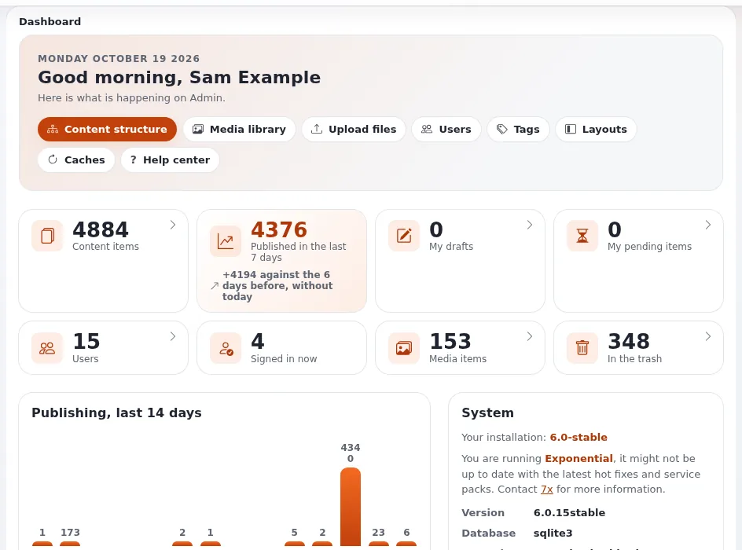

# Lesson 1.1: What a site administrator does

Editors write content; a site administrator keeps the site that holds it healthy, safe and usable. This first lesson
draws the line between the two jobs, names the areas the course covers, and makes sure every learner has a working
training installation with an administrator account before anything else happens.

> **Note**
> Every exercise in this course runs on the learner's own training installation. Never practise administration on
> a live site: most of the pages in this course can change how the whole site behaves.

## At a glance

| | |
|---|---|
| Course | [Site administration](../README.md) |
| Module | [Module 1: Getting oriented as a site administrator](README.md) |
| Duration | 30 minutes (10 presenting, 20 exercise) |
| Level | Intermediate |
| Audience | New site administrators, intranet administrators, support staff |
| Prerequisites | Editors 101 or equivalent editing experience; a terminal on a machine with PHP 7.4 or later |

## Learning objectives

After this lesson, learners can:

- list the main duties of a site administrator and the course module that covers each;
- tell the public, administration and editor siteaccesses of an installation apart;
- install and start a training installation with `exp:install` and `exp:velocity start`;
- sign in to the administration of their training installation as an administrator.

## Trainer's notes

### How to present it

Source: [Operating a site](../../../../guides/operating-a-site.md) and
[The console install](../../../../install/07-console-install.md).

1. **Two jobs** (3 minutes). An editor creates, changes and publishes content. An administrator decides who may do
   that (users, roles), how the site behaves (settings, siteaccesses, sections), and keeps it running (caches,
   cronjobs, logs, backups, upgrades, security). In small organizations one person does both; the course still
   keeps them apart, because the permissions are different.
2. **The duties and the modules** (4 minutes). Put the table below on the projector and leave it there while the
   learners install.

   | Duty | Module of this course |
   |---|---|
   | Finding your way, settings | 1 |
   | Users and groups | 2 |
   | Roles and policies | 3 |
   | Sections, siteaccesses, object states, languages | 4 |
   | Caches | 5 |
   | Cronjobs, workflows, notifications | 6 |
   | Logs and the audit trail | 7 |
   | Security | 8 |
   | Backups and maintenance | 9 |
   | Upgrades, extensions and packages | 10 |

3. **Three ways in** (3 minutes). An installation made with `exp:install` has three siteaccesses: the public site
   (`site`), the administration (`admin`) and the editor (`editor`), an administration for content editing only.
   With URL matching, the default, they are reached by the paths `/`, `/admin` and `/editor`. Setup pages exist only
   in the administration.

### Common questions

**Do I need to be root on the server to administer a site?** No. Most of this course happens in the browser. Some
tasks (clearing caches, cronjobs, `exp:ini`) are done in a terminal in the installation root, as the user that owns
the files. When you work as `root`, the PHP scripts need `--allow-root-user`.

**Which password does the administrator have on a new installation?** `exp:install` uses `--password=` when it is
long enough and not a well-known word; otherwise it generates one, prints it at the end and writes it to
`var/log/initial-admin-password`. See [The default administrator password](../../../default-administrator-password.md).

**Can I use the editor siteaccess for this course?** No. The editor siteaccess is made for content editing and has no
Setup area.

### Pitfalls

- **Wrong port or URL.** A site installed with one `--url` and opened on another address gives broken links. Install
  with the address you will open, for example `--url=http://localhost:8088`.
- **The install runs as root.** Files then belong to root and the web server cannot write to `var/`. Install as the
  user that will run the site.
- **Learners keep the generated password only on screen.** Ask them to store it in their password manager at once.

## Hands-on exercise

Each learner builds a training installation on their own machine (see
[The console install](../../../../install/07-console-install.md)) or uses the one the trainer prepared.

1. In a terminal, go to the root of the Exponential code (the directory that holds `index.php`).
2. See what the installer would do, without changing anything:

   ```bash
   php bin/php/console exp:install --url=http://localhost:8088 --dry-run
   ```

3. Read the summary: the database (SQLite unless you chose another), the site package, and the siteaccesses
   `site`, `admin` and `editor`.
4. Run the same command without `--dry-run`. Note the administrator password it prints at the end in your password
   manager.
5. Start the site with Velocity:

   ```bash
   php bin/php/console exp:velocity start
   ```

6. Open `http://localhost:8088/` (the public site), then `http://localhost:8088/admin` (the administration).
7. Sign in as `admin` with the password from step 4.
8. Note the entries of the top menu, then open **Setup** and read the headings of the Setup page.
9. Open `http://localhost:8088/editor`, sign in with the same account, and compare the top menu.
10. On paper, write three tasks you expect to do as an administrator in the next month, and next to each the module
    of this course that covers it.

## Expected result

- The installation answers on `http://localhost:8088/`, and the administration on `/admin`.
- Signed in as `admin`, the administration shows the **Setup** entry in the top menu; the Setup page has the groups
  **Content model**, **Site and URLs**, **Workflows**, **Users and messages** and **System** (the admin4 design;
  installations with extended features show further groups).
- The editor siteaccess shows no Setup area.
- The trainer checks by asking two learners to show their Setup page and their list of tasks.



## Quiz

1. Name three duties of a site administrator that are not part of an editor's job.
2. Which three siteaccesses does `exp:install` create by default?
   A. `site`, `admin`, `editor` B. `public`, `admin`, `setup` C. `site`, `setup`, `editor` D. `www`, `admin`, `edit`
3. What does `--dry-run` do with `exp:install`?
4. Where does `exp:install` write a generated administrator password?
5. True or false: the Setup area is available in the editor siteaccess.

<details>
<summary>Answers</summary>

1. For example: managing users and roles, changing settings, clearing caches, running cronjobs, reading logs,
   taking backups, upgrading ([Operating a site](../../../../guides/operating-a-site.md)).
2. **A.** The paths can be changed with `--site-access`, `--admin-access` and `--editor-access`
   ([The console install](../../../../install/07-console-install.md)).
3. It shows what would be installed and checks the options, without writing anything.
4. To `var/log/initial-admin-password`, readable by the owner only; delete it once the password is stored safely
   ([The default administrator password](../../../default-administrator-password.md)).
5. **False.** The editor siteaccess is an administration for content editing only.

</details>

## Further reading

- [Operating a site](../../../../guides/operating-a-site.md): the day-to-day routine this course teaches.
- [The console install](../../../../install/07-console-install.md): every option of `exp:install`.
- [Serving the site](../../../../install/08-serving-the-site.md): Velocity and the other web servers.
- [A tour of the administration](../../../admin-tour.md): the header, columns and dashboard.

## Related pages

- [Module 1: Getting oriented as a site administrator](README.md)
- [Site administration: course overview](../README.md)
- [Lab quick card](../../lab-quick-card.md)
- [Trainers: start here](../../trainers-start-here.md)
- [Free documentation](../../../free-documentation.md): this page is free to copy, translate and improve under the GNU FDL 1.3.

<!-- exp-partner-block:start -->
**Become an Exponential Partner.** Partners share their information, provide funding, contribute back and
develop the products with us, and that is how Exponential grows. A partner website and dashboard are planned for
mid-2027: please become a partner today to speed up our growth rate and land new features faster. Start with
[Partners: start here](../../../partners/partners-start-here.md) and [How to apply](../../../partners/how-to-apply.md).
<!-- exp-partner-block:end -->
