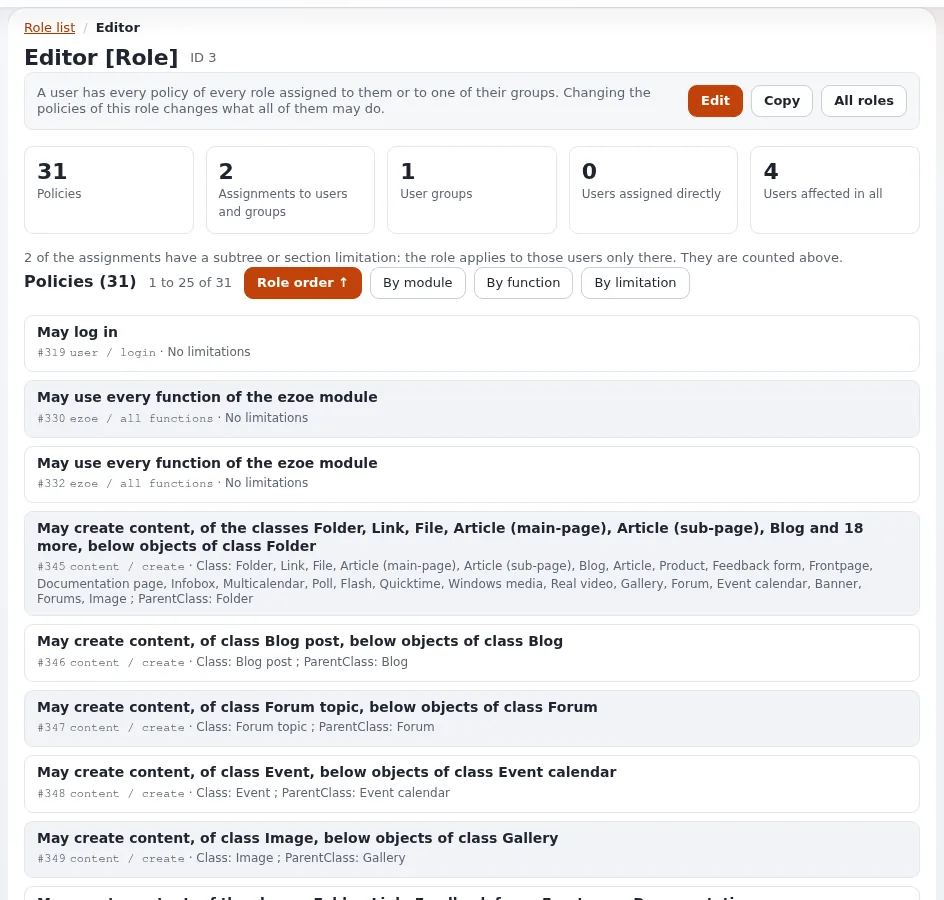

# Lesson 3.2: Building a role with limited policies

Most organizations need a few roles of their own: editors who may only touch news, contributors who may create but not
publish, a team that manages its own subtree. This lesson builds such a role step by step in the role editor and its
three-step policy wizard.

## At a glance

| | |
|---|---|
| Course | [Site administration](../README.md) |
| Module | [Module 3: Roles and policies](README.md) |
| Duration | 45 minutes (15 presenting, 30 exercise) |
| Level | Intermediate |
| Audience | Site administrators |
| Prerequisites | [Lesson 3.1](roles-policies-and-limitations.md) |

## Learning objectives

After this lesson, learners can:

- create a role and add policies with the wizard's steps Module, Function and Limitations;
- choose between full and limited access for a function;
- change the limitations of a policy later;
- reorder policies and explain why the order does not change access;
- save or cancel a role draft, and copy a role.

## Trainer's notes

### How to present it

Source: [Create a role with limited policies](../../../../guides/roles-and-policies.md#3-create-a-role-with-limited-policies)
and [Roles: policy IDs, sorting and order buttons](../../../../features/6.0/role-policy-order.md).

1. **The draft** (2 minutes). Every change in the role editor is made in a draft. Nothing changes for anyone until
   **Save**; **Cancel** throws the draft away. The editor says **Unsaved changes** while there are any.
2. **The wizard** (6 minutes). On the role list, **New role**, type a name, then **New policy**:
   - Step 1, Module: choose `content`. *Grant access to all functions* adds the whole module at once.
   - Step 2, Function: choose `read`. *Grant full access* adds it without limitations; *Grant limited access* goes on.
   - Step 3, Limitations: pick values (Ctrl or Cmd for several), *Any* leaves a limitation out; nodes and subtrees are
     picked in the content browser. **OK**.
3. **What a typical editor role needs** (4 minutes). Besides `content` functions, an editor needs to sign in to the
   administration (`user/login` with the SiteAccess limitation) and usually reads more than it edits. Compare with
   the shipped **Editor** role rather than inventing from scratch.
4. **Order and copy** (3 minutes). Policies can be dragged by their grip, moved with the arrow keys or with the
   **up** and **down** buttons. The order only helps readers: each policy grants on its own. **Copy** makes
   "Copy of <name>" with the same policies and no assignments.

### Common questions

**Which limitations does each function offer?** The wizard only offers the limitations the function supports. For
example `content/read` accepts Section, Class, Owner, Node, Subtree, State and more; `user/login` accepts SiteAccess.

**I added a policy I am not allowed to grant, and it vanished.** With `PreventPrivilegeEscalation=enabled` a policy
you do not hold yourself is taken out again and the page says *The policy was not added*. Administrators may grant
anything.

**Is it better to edit the shipped Editor role or to copy it?** Copy it. An upgrade or a site package may expect the
shipped roles as they are, and a copy can be removed without harm.

### Pitfalls

- **Forgetting Save.** A learner closes the tab with **Unsaved changes**; nothing was stored. Point to the notice.
- **Every module by mistake.** Choosing *Every module* with all functions is full access; the page warns first. Read
  the warning aloud.
- **No login policy.** A role for administration users without `user/login` on the admin siteaccess cannot sign in
  there. Lesson 3.4 shows the symptom.

## Hands-on exercise

On your training installation, signed in as an administrator:

1. Open **Users > Roles and policies** and press **New role**.
2. Type the name `News editors`.
3. Press **New policy**. In step 1 choose the module `content`, in step 2 the function `read`, then
   **Grant limited access**.
4. In step 3 choose the Section **Standard** and press **OK**. Read the sentence the editor shows.
5. Add a second policy: `content` / `create`, limited to the Class **Article** and **Folder**.
6. Add a third policy: `content` / `edit`, limited to the Owner *Self* (only their own content), if your version
   offers it; otherwise to the Class **Article**.
7. Add a fourth policy: `user` / `login`, limited to the SiteAccess `admin`.
8. Note the **Unsaved changes** notice, then press **Save**.
9. On the role page, read the four sentences. Order them **By module**.
10. Press **Edit**, move the `user / login` policy to the top, and press **Save**.
11. On the role list, press **Copy** on `News editors`, read the page, and make the copy. Then remove the copy again
    with the list's remove selection and confirm.

## Expected result

- A role `News editors` with four policies, not yet assigned (badge *Not assigned* on the list).
- The role page shows sentences such as "May read content, in section Standard" and "May log in, on the siteaccess
  admin".
- After step 11 only the original role remains.
- The trainer checks the role page on one learner's screen and asks why the role gives nobody anything yet.

## Quiz

1. What are the three steps of the policy wizard?
2. What happens to your changes in the role editor if you close the browser before **Save**?
3. Does moving a policy to the top give it priority? Why?
4. What does **Copy** copy, and what does it leave out?
5. Which choice in step 1 and step 2 together gives full access?
   A. `content` with all functions B. *Every module* with all functions C. `user` / `login` D. `role` / `assign`

Answers

1. Module, Function, Limitations.
2. They are lost: changes are made in a draft that only **Save** keeps.
3. No. Each policy grants on its own; the order only helps people read the role
   ([Put the policies in order](../../../../guides/roles-and-policies.md#4-put-the-policies-in-order)).
4. The policies; the copy has no assignments.
5. **B.** The page warns before adding it.

## Further reading

- [Roles, policies and unactivated users](../../../../guides/roles-and-policies.md): the editor and wizard in detail.
- [Roles: policy IDs, sorting and order buttons](../../../../features/6.0/role-policy-order.md): ordering and sorting.
- [Role and policy checks in templates](../../../../features/6.0/role-and-policy-template-operators.md): how designs
  ask about permissions.

## Related pages

- [Module 3: Roles and policies](README.md)
- [Site administration: course overview](../README.md)
- [Trainers: start here](../../trainers-start-here.md)
- [Free documentation](../../../free-documentation.md): this page is free to copy, translate and improve under the GNU FDL 1.3.

<!-- exp-partner-block:start -->
**Become an Exponential Partner.** Partners share their information, provide funding, contribute back and
develop the products with us, and that is how Exponential grows. A partner website and dashboard are planned for
mid-2027: please become a partner today to speed up our growth rate and land new features faster. Start with
[Partners: start here](../../../partners/partners-start-here.md) and [How to apply](../../../partners/how-to-apply.md).
<!-- exp-partner-block:end -->
