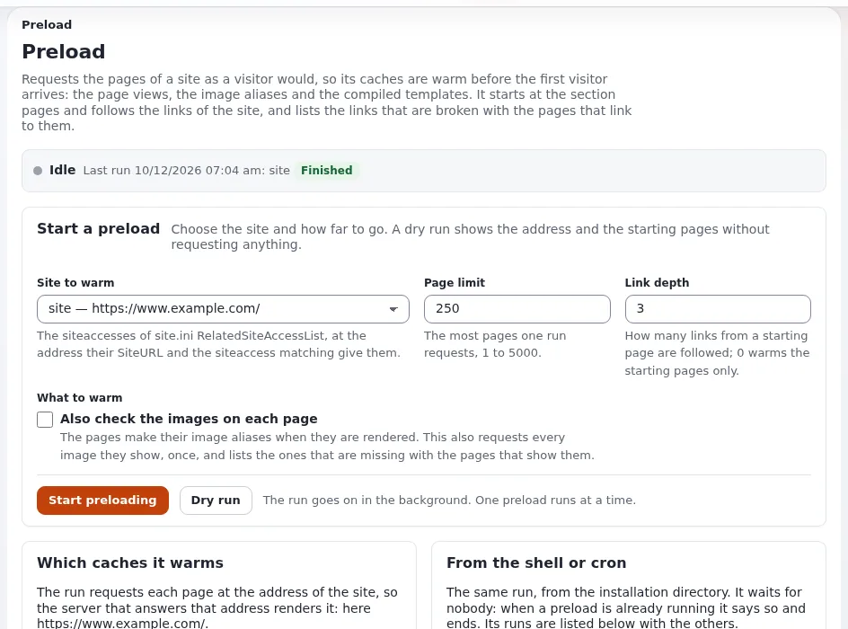

# Lesson 5.4: Preloading caches

After a full cache clear or a deployment, the first visitors pay for the empty caches. The preloader requests the pages
of a site as an anonymous visitor would, so the caches are warm before visitors arrive, and lists the broken links it
finds on the way. This lesson runs it from the page and from the shell.

## At a glance

| | |
|---|---|
| Course | [Site administration](../README.md) |
| Module | [Module 5: Caches](README.md) |
| Duration | 35 minutes (10 presenting, 25 exercise) |
| Level | Intermediate |
| Audience | Site administrators |
| Prerequisites | [Lesson 5.3](clearing-caches-from-the-command-line.md) |

## Learning objectives

After this lesson, learners can:

- start a dry run and read the address and starting pages it would use;
- start a preload with a page limit and a link depth, and follow it;
- read the result: pages warmed, image aliases made, broken links and the pages that link to them;
- run the same from the shell and write a cron line;
- explain what a preload warms and what it does not.

## Trainer's notes

### How to present it

Source: [Preloading caches](../../../../guides/preloading-caches.md).

1. **What it warms** (3 minutes). The page view cache, the image aliases the pages show and the compiled templates,
   as files shared by Apache with PHP-FPM and Velocity. Not pages for signed-in users (the run is anonymous), and not
   Velocity's response cache for long (it keeps a page for about 30 seconds by default).
2. **The page** (4 minutes). **Setup > Preload Sites**: the status bar (**Idle** or **Running**), **Start a preload**
   with **Site to warm**, **Page limit** (250, 1 to 5000), **Link depth** (3, 0 to 10) and
   **Also check the images on each page**, then **Start preloading** and **Dry run**, and the last runs.
3. **One run at a time** (1 minute). A second run, from the page, the shell or cron, is refused while one runs.
4. **The shell** (2 minutes). `php bin/php/preload.php --siteaccess=site`, with `--dry-run`, `--max-pages`,
   `--max-depth`, `--images`, `-q`. Its last three lines summarize the run; exit code 0 means finished.

### Common questions

**Why does the address in the dry run look wrong?** The run uses the siteaccess's `SiteURL` and its matching prefix.
A lab installed with another `--url` than the one it is served at gives a wrong address; fix `SiteURL`.

**Does a preload replace the static cache?** No. It warms the caches behind the page rendering; the static cache
stores pages as files (lesson 5.5).

**Are broken links an error?** They are a finding: the run still finishes with exit code 0, and lists each broken
address with the pages that link to it.

### Pitfalls

- **A huge page limit on a live site.** Thousands of requests in a row load the server. Start small.
- **Warming the administration.** The administration siteaccess is not offered: it warms nothing a visitor sees.
- **Missing curl extension.** The command needs the PHP curl extension.

## Hands-on exercise

On your training installation, signed in as an administrator, with a terminal in the root:

1. Clear the content caches: **Setup > Cache management**, **Clear content caches…**, confirm.
2. Open **Setup > Preload Sites**. Read the status bar.
3. Under **Start a preload**, choose the site `site`, **Page limit** 50, **Link depth** 2, and press **Dry run**.
4. Read the dry run: the siteaccess, the address, the starting pages and the shell command.
5. Press **Start preloading** and follow the output until the run finishes.
6. Read the figures: pages warmed, image aliases made, broken links. Open a broken link row if there is one.
7. In the terminal, run a small preload with the image check:

   ```bash
   php bin/php/preload.php --siteaccess=site --max-pages=20 --max-depth=1 --images
   ```

8. Read its last three lines.
9. On the page, find the run from step 7 in the list of last runs.
10. Copy the crontab line the page proposes. Do not install it on the lab.

## Expected result

- Step 4 shows the lab's address and the starting pages; nothing is requested.
- Step 5 finishes with a number of pages warmed of at most 50.
- Step 8: `Preload finished in ...`, `Pages warmed ...`, `Image aliases made ...`.
- The list of last runs shows both runs, one from the page and one from the shell.
- The trainer checks the last runs list on one learner's page.



## Quiz

1. Which caches does a preload warm?
2. Why are pages for signed-in users not warmed?
3. What happens when a second preload starts while one runs?
   A. Both run B. The first stops C. The second is refused D. They merge
4. What does the dry run show?
5. A run finds broken links. What is its exit code?

<details>
<summary>Answers</summary>

1. The page view cache, the image aliases and the compiled templates
   ([Preloading caches](../../../../guides/preloading-caches.md#in-short)).
2. The run requests pages as an anonymous visitor.
3. **C.** One run at a time.
4. The siteaccess, the address, the prefix, the limits, the starting pages and the shell command.
5. 0: broken links are a finding, not a failure.

</details>

## Further reading

- [Preloading caches](../../../../guides/preloading-caches.md): the page, the command and the address of a siteaccess.
- [Preload Sites](../../../../features/6.0/preload-sites-view.md): the feature reference.
- [Cache clearing and warming](../../../hosting/performance/cache-clearing-and-warming.md): the host's view.

## Related pages

- [Module 5: Caches](README.md)
- [Site administration: course overview](../README.md)
- [Trainers: start here](../../trainers-start-here.md)
- [Free documentation](../../../free-documentation.md): this page is free to copy, translate and improve under the GNU FDL 1.3.

<!-- exp-partner-block:start -->
**Become an Exponential Partner.** Partners share their information, provide funding, contribute back and
develop the products with us, and that is how Exponential grows. A partner website and dashboard are planned for
mid-2027: please become a partner today to speed up our growth rate and land new features faster. Start with
[Partners: start here](../../../partners/partners-start-here.md) and [How to apply](../../../partners/how-to-apply.md).
<!-- exp-partner-block:end -->
