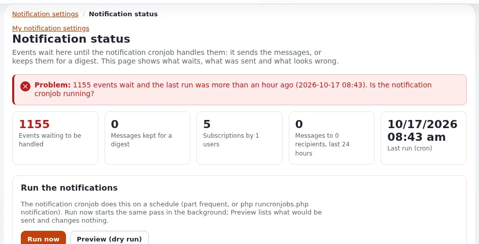

# Lesson 6.4: Running notifications

Users can follow content and get a mail, at once or in a digest, when something new is published. Nothing is sent
until a notification run happens, normally through the `frequent` cronjob part. This lesson teaches the
administrator's side: the status page, a safe rehearsal that sends no mail, and the cleanup of old events.

> **Note**
> Never test notifications on a live site with the real mail transport. Every exercise here either changes nothing
> (dry run) or writes the mail to files.

## At a glance

| | |
|---|---|
| Course | [Site administration](../README.md) |
| Module | [Module 6: Cronjobs, workflows and notifications](README.md) |
| Duration | 40 minutes (15 presenting, 25 exercise) |
| Level | Intermediate |
| Audience | Site administrators, support staff |
| Prerequisites | [Lesson 6.1](cronjob-parts-and-the-crontab.md); an administrator account and a shell on the training installation |

## Learning objectives

After this lesson, learners can:

- describe the path from a published article to a sent notification: event, handlers, messages, run;
- read the figures and lists of **Setup > Notification**;
- preview a run with **Preview (dry run)** and with `exp:notification:run --dry-run`;
- rehearse a real run that writes the mail to files instead of sending it;
- remove old events safely, dry run first.

## Trainer's notes

### How to present it

Source: [Notifications: running them, reading the status page and fixing problems](../../../../guides/notifications-administrator.md),
sections 1 to 5. What users see is in [Notifications](../../../../features/6.0/notifications.md).

1. **How it works in one minute** (4 minutes). Publishing writes an *event*. A *run* hands every pending event to
   the handlers, which find the followers and write a *message* for each, sent now or kept for a *digest*. Nothing
   is sent until a run happens: the cronjob, **Run now**, or `exp:notification:run`.
2. **The status page** (5 minutes). **Setup**, then **Notification** in the left column (`/notification/status`,
   policy `notification/administrate`). Show **Run the notifications**, **Recent runs**, **Events** (waiting),
   **Subscriptions** and **Mail and handlers**.
3. **Safe rehearsal** (4 minutes). A dry run works inside a transaction that is rolled back and hands nothing to
   the mail transport; addresses are masked. `--mail-file-dir=` makes a real run but writes every mail to a file in
   that directory, for that process only.
4. **Cleanup** (2 minutes). **Remove handled events with nothing left to send**, and **Remove events older than**
   with a period. On the console, `exp:notification:events cleanup --dry-run` first.

### Common questions

**Do I need a separate crontab line for notifications?** No, if the crontab already runs `frequent`: the
notification script is in that part. Do not add a second line.

**Two runs at the same time?** The cronjob lock and the notification service's own lock make a second run be
refused, not queued.

**Where does the mail go?** `site.ini [MailSettings] Transport` decides: `sendmail`, `smtp` or `file`. With
`file` the mail is written to `var/log/mail` and nothing leaves the machine.

**How late can a digest be?** A digest is sent at the first run after its hour, so the run frequency sets the delay.

### Pitfalls

- **Run now is real.** It asks for confirmation and then sends the messages that are due. In class, use **Preview
  (dry run)** and the console with `--mail-file-dir=`.
- **A copy of a production database.** It contains real subscribers. Set the file transport, or
  `[MailSettings] DebugSending=enabled` with your own `DebugReceiverEmail`, before any run.
- **Thousands of waiting events.** A training site that never ran the cronjob shows a large **Events** figure. That
  is the lesson: nothing was ever sent.

## Hands-on exercise

Use your own training installation. In a terminal at the installation root; all test accounts use addresses at
`example.invalid`.

1. In the administration, open **Setup**, then **Notification**. Write down the number of waiting events and of
   subscriptions.
2. Press **Preview (dry run)** and read the output in the console box on the page. Nothing is sent.
3. In the terminal, run the same preview:

   ```bash
   php bin/php/console exp:notification:run --dry-run
   ```

4. Make sure a test account follows a training folder (as that user, open the folder and use the site's follow or
   notification option; your trainer shows where), then publish a short article in that folder.
5. List the events:

   ```bash
   php bin/php/console exp:notification:events list
   ```

6. Rehearse a real run that writes mail to files instead of sending it:

   ```bash
   php bin/php/console exp:notification:run --apply --mail-file-dir=var/tmp/notification-mail
   ```

7. Open the directory `var/tmp/notification-mail` and read one file, if a message was made: recipient, subject and
   body.
8. Preview a cleanup without removing anything:

   ```bash
   php bin/php/console exp:notification:events cleanup --older-than=30d --dry-run
   ```

9. Reload **Setup > Notification** and compare the figures with step 1. Find your run under **Recent runs**.

## Expected result

- Steps 2 and 3 listed what would be sent and ended without sending anything.
- Step 6 ended with a line starting with `PASS:` and the numbers of events handled and messages made.
- Step 7: a `.mail` file addressed to the test account at `example.invalid`, if the account follows the folder and
  wants mail at once; with a digest setting, the message is kept for the digest instead.
- Step 8 printed *Would remove* lines and changed nothing.
- The trainer checks the **Recent runs** list of one learner on the projector.



## Quiz

1. A site's users get no notifications at all. What is the most likely cause?
2. What does `--mail-file-dir=` do to a run?
   A. Nothing; it only sets a log file B. Writes the mail to files instead of sending it C. Sends the mail and keeps a
   copy D. Turns the run into a dry run
3. Which button on the status page sends real mail?
4. Your crontab already runs the `frequent` part. Should you add a line for the `notification` part?
5. Why mask addresses in a dry run?

<details>
<summary>Answers</summary>

1. No notification run happens: the cronjob part that holds `notification.php` is not scheduled
   ([Notifications, section 1](../../../../guides/notifications-administrator.md#1-how-it-works-in-one-minute)).
2. **B.** It makes a real run, but the mail is written to files for that process only.
3. **Run now**, after its confirmation.
4. No; `frequent` already includes it. A second line would only meet the lock.
5. So a screen or a log shared in class or in a ticket does not show real people's addresses; add `--addresses` only
   when you need them.

</details>

## Further reading

- [Notifications: running them, reading the status page and fixing problems](../../../../guides/notifications-administrator.md):
  every figure, the problem list and troubleshooting.
- [Notifications](../../../../features/6.0/notifications.md): what users see and set.
- [Notification commands](../../../../specifications/6.0/notifications-cli.md): every option of the console commands.
- [Mail delivery for hosts](../../../hosting/operations/mail-delivery.md): transports and delivery on a server.

## Related pages

- [Module 6: Cronjobs, workflows and notifications](README.md)
- [Site administration: course overview](../README.md)
- [Trainers: start here](../../trainers-start-here.md)
- [Free documentation](../../../free-documentation.md): this page is free to copy, translate and improve under the GNU FDL 1.3.

<!-- exp-partner-block:start -->
**Become an Exponential Partner.** Partners share their information, provide funding, contribute back and
develop the products with us, and that is how Exponential grows. A partner website and dashboard are planned for
mid-2027: please become a partner today to speed up our growth rate and land new features faster. Start with
[Partners: start here](../../../partners/partners-start-here.md) and [How to apply](../../../partners/how-to-apply.md).
<!-- exp-partner-block:end -->
