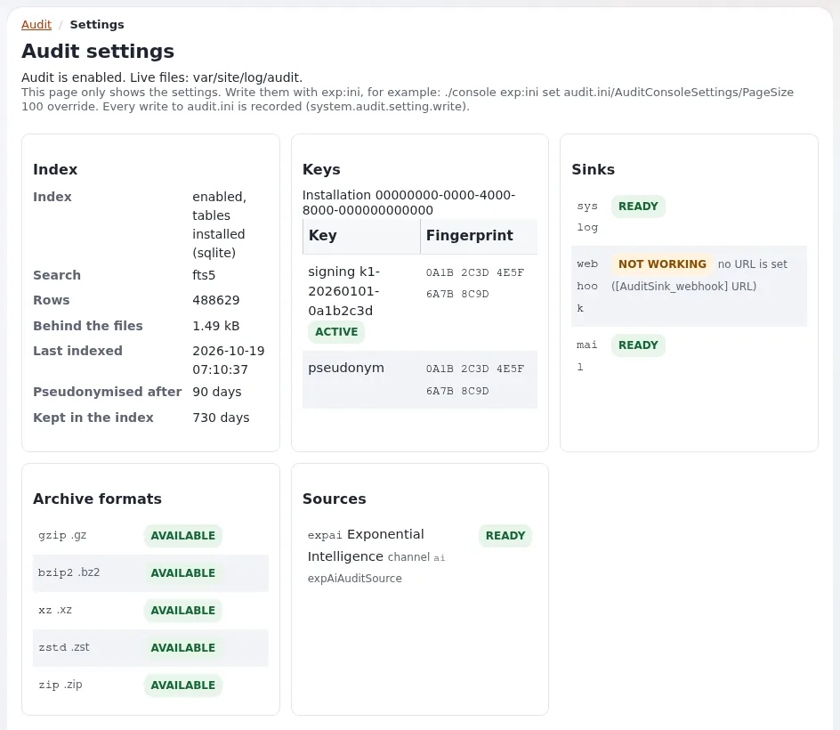

# Lesson 7.5: Investigating with the audit trail

Lesson 7.4 showed what the audit trail records. This lesson uses it the way an administrator does after an incident:
something disappeared, a setting changed, or an alert fired. Learners follow an event to its cause, read the alert
rules, hand an auditor a filtered export, and create an auditor role that may read the audit and nothing else.

## At a glance

| | |
|---|---|
| Course | [Site administration](../README.md) |
| Module | [Module 7: Logs and the audit trail](README.md) |
| Duration | 35 minutes (10 presenting, 25 exercise) |
| Level | Intermediate |
| Audience | Site administrators, security officers |
| Prerequisites | [Lesson 7.4](the-audit-trail.md); roles and policies from Module 3 of this course; an administrator account |

## Learning objectives

After this lesson, learners can:

- find who removed a piece of content and when, from the audit console;
- search the audit from a shell by event name, result and text;
- read the alert rules and the list of fired alerts;
- export the events of a filter for an auditor;
- give an auditor role the policy `audit/read` without any other administration rights.

## Trainer's notes

### How to present it

Sources: [The audit trail](../../../../features/6.0/audit-trail.md), sections "Who may look", "From the command
line", "Sinks, alerts and archives" and "Exports and the channels of extensions";
[Security and audit](../../../../guides/security-and-audit.md).

1. **An incident in five steps** (3 minutes). What happened (the visible effect), when (roughly), which channel,
   filter the console, open the event and follow its parent or request. A subtree removal is one parent event with
   one child per node below it.
2. **Alerts** (2 minutes). Rules watch brute-force sign-ins, an administrator role being granted, settings written
   out of hours, mass deletes, the audit being switched off and a broken chain. Recipients: the rule's own, else the
   alert settings, else the site's `AdminEmail`.
3. **Exports** (2 minutes). **Export audit events** offers **Download now** (streamed at once) and **Export in the
   background** (a content job; the file is offered on the export page to the user who asked).
4. **The auditor role** (3 minutes). `audit/read`, optionally limited by **Channel**. A user without it sees no tab
   and a typed address is refused and recorded.

### Common questions

**Can the export contain personal data?** Yes: logins and truncated addresses. Treat it like any personal data and
delete it when the request it answers is done.

**Can an auditor change anything?** Not with `audit/read` alone. `audit/manage` adds archives, settings and **Verify
now**; do not give it to an auditor who should only read.

**Are location changes recorded?** Removing a location is recorded by default. Adding a location and changing the
main location are recorded once switched on in `settings/override/audit.ini.append.php`.

### Pitfalls

- **Alert mail in class.** Alerts can send mail to `AdminEmail`. Keep the training installation on the file mail
  transport (Module 6), and never set a real address as a recipient.
- **Searching in the wrong time zone.** On the command line `--from` and `--to` without an offset are UTC; in the
  console they are site time.
- **Giving the auditor the Administrator role.** It holds every policy. Build a role of its own.

## Hands-on exercise

Use your own training installation. Every test account uses an address at `example.invalid`.

1. Create a folder `Audit test` with one article inside, publish both, then move the folder to the trash.
2. Open the **Audit console**, set **Channel** to `content` and press **Filter**. Find the removal of the folder and
   open the event. Read who did it, when and which node.
3. From the shell, search for content events:

   ```bash
   php bin/php/console exp:audit search --name='content.*' --limit=10
   ```

4. Search for refused actions: `php bin/php/console exp:audit search --name='access.*' --result=refused --limit=5`.
5. Open the **Audit dashboard**, then **Alerts**. Read the **Rules** and, if any, **Fired alerts**.
6. List the rules from the shell: `php bin/php/console exp:audit alerts list`.
7. In the **Audit console**, filter by **Channel** `content` and today's date, then open **Export**. Choose a
   **Format** and use **Download now**. Open the file and check it holds only the filtered events.
8. Open **Users > Roles and policies** and create a role `Training auditor` with one policy: module `audit`,
   function `read`. Assign it to a test user group.
9. In a private window, sign in as a member of that group. Open the audit dashboard address (`/audit/dashboard` in the
   administration siteaccess) and then **Setup**.
10. Back as administrator, filter the console by the event name `access.permission.refused` and find the test user's
    refused attempt, if one was recorded.

## Expected result

- Step 2 finds a content removal event with the training login, the time and the node.
- Step 7 gives a file in the chosen format with the filtered events only.
- Step 9: the auditor sees the audit pages but is refused where no other policy allows access.
- Step 10 lists the refusals of the test user.
- The trainer checks the role of one learner: exactly one policy, `audit/read`.



## Quiz

1. An article disappeared yesterday. Which channel and which filters do you use first?
2. Which policy should an external auditor get?
   A. `audit/manage` B. `audit/read` C. `setup/logs` D. The Administrator role
3. Who receives alert mail when no recipient is configured?
4. What is the difference between **Download now** and **Export in the background**?
5. A user without `audit/read` types the audit address. What happens?

<details>
<summary>Answers</summary>

1. The `content` channel, with **From** and **To** around yesterday, and the event name of a removal or a text search
   for the article's name.
2. **B.** Optionally limited by channel ([The audit trail, Who may look](../../../../features/6.0/audit-trail.md#who-may-look)).
3. The site's `AdminEmail`.
4. **Download now** streams the file at once; **Export in the background** runs a content job and offers the file on
   the export page later, only to the user who asked.
5. The request is refused and recorded as `access.permission.refused`.

</details>

## Further reading

- [The audit trail](../../../../features/6.0/audit-trail.md): sinks, alerts, archives and exports.
- [The audit guide](../../../../bc/6.0/audit.md): the event catalogue, to find the right event name.
- [Roles, policies and unactivated users](../../../../guides/roles-and-policies.md): building the auditor role.
- [Log and data retention for hosts](../../../hosting/security/log-and-data-retention.md): how long to keep records.

## Related pages

- [Module 7: Logs and the audit trail](README.md)
- [Site administration: course overview](../README.md)
- [Trainers: start here](../../trainers-start-here.md)
- [Free documentation](../../../free-documentation.md): this page is free to copy, translate and improve under the GNU FDL 1.3.

<!-- exp-partner-block:start -->
**Become an Exponential Partner.** Partners share their information, provide funding, contribute back and
develop the products with us, and that is how Exponential grows. A partner website and dashboard are planned for
mid-2027: please become a partner today to speed up our growth rate and land new features faster. Start with
[Partners: start here](../../../partners/partners-start-here.md) and [How to apply](../../../partners/how-to-apply.md).
<!-- exp-partner-block:end -->
