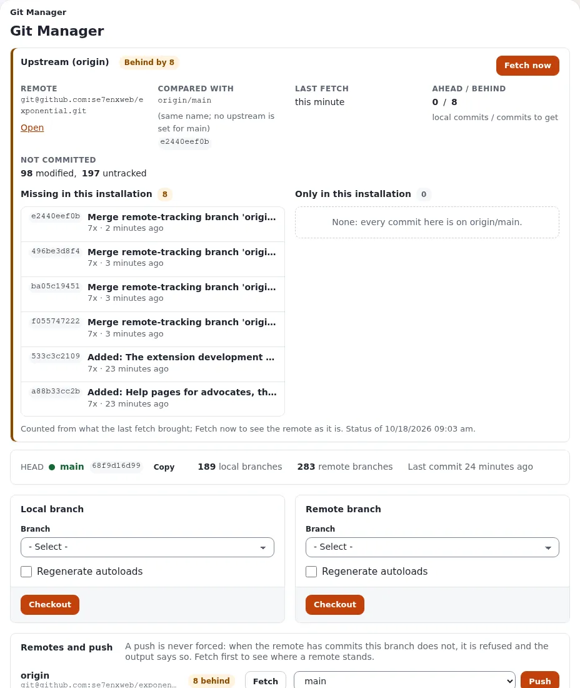

# Update with Git: stay in sync with GitHub

An update of a site made of Git clones ([Develop with Git](develop-with-git.md)) is always two moves, in this order:

1. **Git** brings the **kernel** up to date: the new commits from GitHub are merged into your site's branch. That
   changes the kernel's files, and with them `composer.json`, the list of extensions and their versions.
2. **Composer** brings the **extensions** up to date to match the new `composer.json`: new extensions are cloned,
   existing clones move to their new release tags.

Both moves can be made on the **command line** (Track A) or in the **administration** (Track B). This page describes
both tracks side by side with the same seven steps, says what each can and cannot do, and how to mix them.

## Command line or administration?

| | Track A: command line | Track B: administration |
|---|---|---|
| **For** | developers and administrators with a shell on the server (SSH) | administrators without a shell, or who prefer pages and buttons |
| **Needs** | Git, Composer and PHP on the server, as the user that owns the files | the extensions `git_manager` and `ezupdate` active, a role with their policies (see [the table in Track B](#track-b-the-administration)) |
| **Kernel (Git)** | `git merge` of anything: the newest **release tag**, `origin/main`, another branch or one commit | **Git Manager** checks out a **branch** and pulls it (`git pull origin <branch>`); it cannot merge a release tag |
| **Extensions (Composer)** | `composer update`, run by you | **Updates and packages** runs Composer for you, in the background on the server, as the user the web server's PHP runs as: a full update (**Preview**, then **Run it for real**) or the packages you tick (**Install updates**). Off until `[UpdateSettings] AllowUpdate` is switched on |
| **Database update of a release** | the release's SQL file with your database's own client (`mysql`, `psql`, `sqlite3`) | **DS Editor**: run SQL or import the file, on the live database |
| **Caches and code reload** | `php bin/php/ezcache.php --clear-all`, or `php bin/php/console exp:velocity deploy` on a Velocity site (caches, PHP-FPM, Velocity restart) | **Cache management**: every cache and Velocity's response cache; it cannot restart Velocity, which a code update needs on a Velocity site |
| **Conflicts and local changes** | you see them and resolve them (`git merge --abort`, `git stash`, a commit) | Git Manager shows Git's output; resolving a conflict or committing changes needs a shell |
| **Automatic, on a schedule** | yes: [Let it update itself](#let-it-update-itself) | no |

**In short:** Track A can do everything. Track B covers a routine update of a site that follows a branch (`main`, or
your own branch that you merge releases into) without opening a shell, but a release tag, a merge conflict and the
Velocity restart still need the command line.

## Choose how closely you follow

| You want | Follow | Good for |
|---|---|---|
| every change as soon as it is pushed | `main`, the development line: check **hourly** or **daily** | development machines, staging sites, people who test and contribute |
| changes in batches | `main`, checked **weekly** or **monthly** | sites that change often but want quiet weeks |
| only finished, tested versions | the newest **release tag** (`v6.0.14`, ...) | live sites (Track A) |

Release tags are on the history of `main`, so you can start with releases and move to `main` later, or the other way
round once the next release has caught up.

## The seven steps

| Step | What | Track A: command line | Track B: administration |
|---|---|---|---|
| 1 | Back up, start the maintenance window | [A1](#a1-back-up-and-start-the-maintenance-window) | [B1](#b1-back-up-and-start-the-maintenance-window) |
| 2 | See what is waiting | [A2](#a2-see-what-is-waiting) | [B2](#b2-see-what-is-waiting) |
| 3 | Update the kernel with Git | [A3](#a3-update-the-kernel-with-git) | [B3](#b3-update-the-kernel-with-git-manager) |
| 4 | Update the extensions with Composer | [A4](#a4-update-the-extensions-with-composer) | [B4](#b4-update-the-extensions-with-updates-and-packages) |
| 5 | Check files and database, apply the database update | [A5](#a5-check-and-update-the-database) | [B5](#b5-check-and-update-the-database) |
| 6 | Clear the caches, reload the code | [A6](#a6-clear-the-caches-and-reload-the-code) | [B6](#b6-clear-the-caches) |
| 7 | Check the site, leave the window | [A7](#a7-check-the-site-and-leave-the-window) | [B7](#b7-check-the-site-and-leave-the-window) |

## Track A: the command line

Run every command in the root of the installation, as the user that owns the files (not as root: as root, the
scripts of `bin/php/` ask for `--allow-root-user`). The pictures are the real output of the commands in a test
installation: a kernel clone on the branch `my-site`, made from release `v6.0.13` with every extension a Git clone,
updated to `main`. The captures were made as root, so they show `--allow-root-user`; the two-line warning that root
gets from every script is left out.

### A1. Back up and start the maintenance window

Back up the database (with your database's dump tool) and the folder. Then take the public site offline:

```bash
php bin/php/maintenance.php on --message="Updating, back at 06:00" --until=1h
php bin/php/maintenance.php status
```


`maintenance.php` is part of 6.0.15 (`main`); on an older release skip this step or switch maintenance on in the
administration ([B1](#b1-back-up-and-start-the-maintenance-window)), which works as soon as the new code is in place.

### A2. See what is waiting

```bash
git status --short --untracked-files=no
git fetch origin --tags
git log --oneline HEAD..origin/main | head -5
git log --oneline HEAD..origin/main | wc -l
git tag -l 'v6.*' --sort=version:refname | tail -3
```


`git status` must print nothing: changes you did not commit can stop the merge. `HEAD..origin/main` lists what the
development line would bring; for a release, `HEAD..v6.0.14` does the same. Always sort tags by version (by name,
`v6.0.10` comes before `v6.0.8`). `composer outdated 'se7enxweb/*'` names the extensions that have a newer release.

### A3. Update the kernel with Git

Following the development line:

```bash
git merge --no-edit origin/main
```

Following releases only, the newest release tag:

```bash
git merge --no-edit "$(git tag -l 'v6.*' --sort=version:refname | tail -1)"
```


`git merge` keeps your own commits on `my-site` and adds the new ones. When one of your commits and the update change
the same lines, Git stops with `CONFLICT`; `git merge --abort` puts everything back.

On a clone without a branch of its own (`HEAD detached at v6.0.14`), switch to the new release instead:
`git switch --detach "$(git tag -l 'v6.*' --sort=version:refname | tail -1)"`.

### A4. Update the extensions with Composer

```bash
composer update
composer status -v
```


`composer update`, not `composer install`: the kernel's `composer.json` changed, and your lock file (it is not part of
the kernel's repository) has to follow it. From `v6.0.13` to `main` this added 39 packages and updated 11, each new
`se7enxweb/*` package as a Git clone thanks to the `preferred-install` setting of
[Develop with Git](develop-with-git.md#step-1-tell-composer-to-prefer-clones). The class maps are regenerated at the
end.

What Composer does with clones:

- An update keeps the way a package was first installed: a clone stays a clone, an archive stays an archive, even with
  `--prefer-source`. `composer reinstall <package>` turns an archive into a clone
  ([Develop with Git](develop-with-git.md#the-extensions)).
- It never overwrites your work: a clone with uncommitted changes, or with commits on a branch that exists only on your
  machine, stops it with a message ([When Composer refuses](develop-with-git.md#when-composer-refuses)). Fix the cause
  and run `composer update` again to finish.

### A5. Check and update the database

```bash
php bin/php/checkmanifest.php --all
ls update/database/mysql/6.0/
```


`checkmanifest.php --all` compares every file with the release's checksums; after a clean Git update it reports that
they match. A release can need a **database update**: [Upgrading](../install/11-upgrading.md#step-2-apply-the-database-update)
names the file for each release and engine (`update/database/<engine>/6.0/...`). Apply it once, whole, in order, with
your database's client, for example:

```bash
mysql -u USER -p DATABASE < update/database/mysql/6.0/dbupdate-6.0.0-6.0.15.sql
```

(the test installation has no database, so there is no picture of this step).

### A6. Clear the caches and reload the code

```bash
php bin/php/ezcache.php --clear-all
```


On a site served by Exponential Velocity, run `php bin/php/console exp:velocity deploy` instead: it regenerates the
class maps, clears the caches, lets PHP-FPM see the new code and restarts Velocity, in the right order
([Velocity engines](../bc/6.0/velocity-engines.md)).

### A7. Check the site and leave the window

```bash
git log --oneline ORIG_HEAD..HEAD | wc -l
php bin/php/console --version
php bin/php/maintenance.php off
```


After a merge, `ORIG_HEAD` is where you were before it: `git log --oneline ORIG_HEAD..HEAD` lists what the update
brought. Open the front page and the administration, and read the logs (`var/log/error.log`, or **Setup** > **Log
files** > **Error digest** in the administration) before switching maintenance off. To go back instead:
`git reset --hard ORIG_HEAD`, then `composer update` (from `main` back to `v6.0.13` that removes the 39 added
packages and moves 11 back), and restore the database from the backup if a database update ran.

## Track B: the administration

The same seven steps on the pages of the administration. The screenshots are of the **Admin 4** design with a test
administrator; host names, server paths and addresses are replaced by examples. Each page needs a policy
(`module/function`); the Administrator role has them all.

| Step | Page | Policy |
|---|---|---|
| B1 | **Setup** > **Backup** (`git_manager/backup`), **Setup** > **Maintenance** (`setup/maintenance`) | `git_manager/backup`, `setup/administrate` |
| B2, B3 | **Setup** > **Git Manager** (`git_manager/dashboard`) | `git_manager/git_manager` (`git_manager/push` to push) |
| B4 | **Setup** > **Updates and packages** (`update/dashboard`) | `update/ezupdate` to look, check and preview; `update/manage` to install, switch updating on and change servers |
| B5 | **Setup** > **Upgrade check** (`setup/systemupgrade`), **Setup** > **DS Editor** (`dse/dashboard`) | `setup/setup`, `dse/dse` |
| B6 | **Setup** > **Cache management** (`setup/cache`) | `setup/managecache` |
| B7 | **Setup** > **Log files** (`setup/logs`) | `setup/logs` |

Git Manager, Updates and packages and the DS Editor are extensions (`git_manager`, `ezupdate`, `sevenx_dse`); they
appear in the menu when they are active.

### B1. Back up and start the maintenance window

Make a backup: **Setup** > **Backup**, type **DB + Files caption**. Then open **Setup** > **Maintenance**. While the
site is online, the page shows a green **The site is online** banner and a plan in three steps:

1. **Message for visitors** (optional; left empty, the page says "We are working on the site and will be back
   shortly.").
2. **Expected duration**: type the minutes or choose **15 min**, **30 min**, **1 h**, **2 h** or **4 h**. Maintenance
   does not end by itself.
3. **Who still gets in**: the administration under `/admin` always; tick **Let my own address still see the site** to
   check your work while everyone else gets the maintenance page.

Tick **I understand that the public site goes offline for every visitor not listed above, until I switch maintenance
off again.** and press **Take the site offline**. The **Preview** shows the page visitors get.


### B2. See what is waiting

Open **Setup** > **Git Manager** and press **Fetch now** in the **Upstream (origin)** card. It runs `git fetch --prune`
and nothing else. The card then shows the remote, the branch it is compared with, **AHEAD / BEHIND** (local commits /
commits to get), the files **NOT COMMITTED**, and **Missing in this installation**: the commits the update brings,
each with its author and a link. Files you changed and did not commit can make the next step fail; commit them from a
shell first.



**Updates and packages** > **Overview** > **Check for updates** shows which extensions have a newer release; it changes
nothing.

### B3. Update the kernel with Git Manager

Under **Local branch**, choose the branch the site runs on (the one shown after **HEAD**, for example `main` or
`my-site`), tick **Regenerate autoloads**, and press **Checkout**. Git Manager checks out that branch and runs
`git pull origin <branch>`: it fetches the branch of the same name on GitHub, merges it and regenerates the class maps.
Git's output is shown on the page; the badge then says **Up to date** and **AHEAD / BEHIND** shows `0 / 0`.

Git Manager follows **branches**. It cannot merge a release tag into your branch; for release-only updates use
[A3](#a3-update-the-kernel-with-git). The **Commits log** further down lists the history, 50 commits to a page, with a
filter by author and date; a commit can be checked out by its hash (to go back).

### B4. Update the extensions with Updates and packages

**Updates and packages** runs Composer for you: in the installation's folder, in the background, as the user the web
server's PHP runs as, with a time limit. It does what `composer update` does in [A4](#a4-update-the-extensions-with-composer).
Updating is **Switched off** until you choose otherwise (`[UpdateSettings] AllowUpdate`), because Composer rewrites
`vendor/` and the files of every package it updates.

1. **Fetch from**: `auto`, `dist (archives)` or `source (git, with history)`. Choose `source` so that new extensions
   arrive as Git clones; packages already installed keep the way they were installed.
2. **Preview (dry run)** runs `composer update --dry-run` and shows what would change. It opens the run's page.
3. To change anything, updating must be on: **Switch on updates** (it writes `AllowUpdate=enabled` into
   `settings/override/ezupdate.ini.append.php`).
4. A **full update**, the one that follows the kernel's new `composer.json`: on the dry run's page (with updating switched on, it offers **Run it for real** next to **Run again**), tick **A backup of
   files and database exists** and press **Run it for real**. **Install updates** on the Overview instead updates only
   the packages you tick after **Check for updates**.
5. The page follows Composer's output as it runs. Afterwards the class maps are regenerated and the INI, template and
   content caches cleared. A notice says *The installation is up to date!* or what changed. Switch updating off again.


The other tabs help you check before and after:

- **Installed packages** puts side by side what `composer.json` requires, what `composer.lock` resolved, what is on
  disk and which extensions are switched on; **Needs attention** shows what does not agree, **Git clones** which
  packages are clones.
- **Find packages** searches packagist.org and marks what is installed.
- **Package servers** lists the Composer servers (packagist.org can be switched off) and the `.ezpkg` package servers.
- **Funding** lists who is behind the installed packages and how to support them.


### B5. Check and update the database

**Setup** > **Upgrade check** has two checks; both only read. **Check file consistency** compares every file with the
release's checksums (after a clean Git update, every file matches). **Check database consistency** compares the tables
with the schema of the new code and shows the SQL that would bring the database in line; **Download SQL** saves it.


A release can need a **database update**: [Upgrading](../install/11-upgrading.md#step-2-apply-the-database-update)
names the file. Without a shell, **Setup** > **DS Editor** opens the site's database in AdminNeo after a warning page you
confirm (**I have taken a full backup and accept full responsibility.**, **Proceed to the database**); there you can
run SQL or import the release's file. It works on the live data, past every check of the administration. Run **Check
database consistency** again afterwards.


### B6. Clear the caches

**Setup** > **Cache management**: **Clear all caches…** and confirm. On a site served by Exponential Velocity, also
**Clear Velocity's response cache** (group **Pages, queries and the server**). The administration cannot restart
Velocity: after an update that changes PHP code, Velocity's workers keep the old classes until
`php bin/php/console exp:velocity restart` (or `exp:velocity deploy`) runs on the command line; the page says so where
it matters. A site served by Apache or nginx with PHP-FPM normally picks up the new code by itself (OPcache revalidates the files).


### B7. Check the site and leave the window

Open the front page and a few typical pages (with **Let my own address still see the site** ticked you see the site,
everyone else the maintenance page), and an item in the administration. Then **Setup** > **Log files**: **Error
digest** lists the distinct errors and warnings of the last 24 hours, most frequent first; **Log health** shows the
logs that grow fastest and the files the web server cannot write. New errors since the update are the ones to look at.


Only when everything passes: **Setup** > **Maintenance** > **Bring the site back online**. If something does not pass,
go back first: in Git Manager, check out the commit the site ran before from the **Commits log**, run the full update
in Updates and packages again, and restore the database from the backup if a database update ran.

**Checklist**

- [ ] Backup made (**Setup** > **Backup**)
- [ ] Maintenance on (**Setup** > **Maintenance** > **Take the site offline**)
- [ ] Kernel updated (**Git Manager**: **Fetch now**, **Checkout** of the site's branch with **Regenerate autoloads**; badge **Up to date**)
- [ ] Extensions updated (**Updates and packages**: **Preview (dry run)**, **Run it for real**; updating switched off again)
- [ ] **Upgrade check**: files and database consistent; the release's database update applied
- [ ] Caches cleared (**Cache management** > **Clear all caches…**; Velocity's response cache, and a Velocity restart from a shell)
- [ ] Front page, a few pages and the administration work
- [ ] **Log files** > **Error digest**: no new errors
- [ ] Maintenance off (**Bring the site back online**)

## Mixing the two tracks

The tracks work on the same files, so they can be mixed, for example Git Manager for the kernel and Composer on the
command line for the extensions. The rules:

1. **Always in the order of the steps: Git first, then Composer, then the database, then the caches.** Composer reads
   the `composer.json` the kernel has, so running it before the kernel moved updates to the old list.
2. **One Composer at a time.** Do not start `composer update` on the command line while a run of Updates and packages
   is still going (its Overview shows it under **Recent runs**), or the other way round.
3. **The same user.** Updates and packages runs Composer as the web server's user; on the command line, run Git and
   Composer as that same user (`sudo -u www-data composer update`, with your web server's user) so that the files do
   not end up owned by two users, which the web server then cannot overwrite.
4. **Restart Velocity from the command line** after either track changed PHP code on a Velocity site.

Safe combinations:

| Kernel | Extensions | Notes |
|---|---|---|
| Git Manager (B3) | `composer update` on the command line (A4) | Run Composer only after Git Manager's checkout finished; then `ezcache.php` or `exp:velocity deploy` (A6) |
| `git merge` on the command line (A3) | Updates and packages (B4) | The way to take a **release tag** and still update the extensions in the administration |
| Either | Either | Maintenance, the upgrade check, the database update and the caches can be done in either track |

## Let it update itself

When you have done the update by hand a few times and trust it, a small script can do it on your schedule. Test it by
hand on a staging copy first, and keep the live site on releases. An automatic update never runs database updates,
and it stops instead of guessing when something needs a person.

Save this as `/usr/local/bin/exp-update` and make it executable (`chmod +x /usr/local/bin/exp-update`):

```sh
#!/bin/sh
# exp-update: bring an Exponential installation made of Git clones up to date.
#   exp-update release   the newest release tag of the 6.x line (v6.*)
#   exp-update main      the development line, origin/main
# Stops without changing anything when the kernel has uncommitted changes or the merge needs a hand.
set -eu
SITE=${EXP_SITE:-/var/www/exponential}
MODE=${1:-release}
cd "$SITE"
if [ -n "$(git status --porcelain --untracked-files=no)" ]; then
    echo "exp-update: the kernel has uncommitted changes; commit or stash them first" >&2
    exit 1
fi
git fetch --quiet origin --tags
if [ "$MODE" = main ]; then
    TARGET=origin/main
else
    TARGET=$(git tag -l 'v6.*' --sort=version:refname | tail -1)
fi
if git merge-base --is-ancestor "$TARGET" HEAD; then
    echo "exp-update: already up to date with $TARGET"
    exit 0
fi
if ! git merge --no-edit "$TARGET"; then
    git merge --abort
    echo "exp-update: merging $TARGET needs a hand; nothing was changed" >&2
    exit 1
fi
composer update --no-interaction --no-progress
php bin/php/ezcache.php --clear-all
echo "exp-update: now at $(git describe --tags --always)"
```

Set `EXP_SITE` to your installation's folder. What it does, as tested:

| Situation | What `exp-update` does |
|---|---|
| nothing new | prints `already up to date with v6.0.14` (or `origin/main`) and stops |
| something new | merges it, runs `composer update` and clears the caches, then prints `now at ...` |
| the kernel has uncommitted changes | changes nothing and exits with an error |
| a merge conflict with your own commits | aborts the merge, changes nothing and exits with an error |
| Composer refuses an extension (local changes, unpushed commits) | stops with Composer's message; run `composer update` by hand once the cause is fixed |

On a site served by Velocity, replace the `ezcache.php` line with `php bin/php/console exp:velocity deploy`.

### With cron

Edit the crontab of the user that owns the files (`crontab -e`) and add **one** of these lines:

```text
# every hour, the development line
5 * * * *   EXP_SITE=/var/www/exponential /usr/local/bin/exp-update main >> $HOME/exp-update.log 2>&1
# every day at 04:15, the development line
15 4 * * *  EXP_SITE=/var/www/exponential /usr/local/bin/exp-update main >> $HOME/exp-update.log 2>&1
# every Monday at 04:15, the development line
15 4 * * 1  EXP_SITE=/var/www/exponential /usr/local/bin/exp-update main >> $HOME/exp-update.log 2>&1
# on the first of every month at 04:15, the development line
15 4 1 * *  EXP_SITE=/var/www/exponential /usr/local/bin/exp-update main >> $HOME/exp-update.log 2>&1
# every day at 04:15, but only when a new release has been published
15 4 * * *  EXP_SITE=/var/www/exponential /usr/local/bin/exp-update release >> $HOME/exp-update.log 2>&1
```

Checking daily in `release` mode updates only on the day a new release appears; on every other day it prints
`already up to date`.

### With a systemd timer

Two files in `/etc/systemd/system/`. `exp-update.service`:

```ini
[Unit]
Description=Update the Exponential installation from GitHub
Wants=network-online.target
After=network-online.target

[Service]
Type=oneshot
User=www-data
Environment=EXP_SITE=/var/www/exponential
ExecStart=/usr/local/bin/exp-update release
```

and `exp-update.timer`:

```ini
[Unit]
Description=Update the Exponential installation from GitHub, daily

[Timer]
OnCalendar=daily
RandomizedDelaySec=30min
Persistent=true

[Install]
WantedBy=timers.target
```

Use the user that owns your files in `User=`, and `main` in `ExecStart=` to follow the development line.
`OnCalendar=` takes `hourly`, `daily`, `weekly` (Mondays), `monthly` (the first of the month) or a time such as
`*-*-* 04:15:00`; `systemd-analyze calendar weekly` shows when it would run. Then:

```bash
systemctl daemon-reload
systemctl enable --now exp-update.timer
systemctl list-timers exp-update.timer
journalctl -u exp-update.service
```

The last two show when it runs next and what it said last time.

## Where to go next

- [Develop with Git](develop-with-git.md): installing as clones, working on a branch, sending fixes back.
- [Contribute extensions back](contribute-extensions-back.md): publish your own extensions so everyone can use them, and what the GPL requires when you distribute one.
- [Upgrading](../install/11-upgrading.md): the database and settings steps of each release.
- [The upgrade check](../guides/upgrade-check.md) and [git_manager](../features/6.0/extensions/git_manager.md).
- The project on GitHub: [se7enxweb/exponential](https://github.com/se7enxweb/exponential) and its
  [releases](https://github.com/se7enxweb/exponential/releases).

<!-- exp-partner-block:start -->
**Become an Exponential Partner.** Partners share their information, provide funding, contribute back and
develop the products with us, and that is how Exponential grows. A partner website and dashboard are planned for
mid-2027: please become a partner today to speed up our growth rate and land new features faster. Start with
[Partners: start here](partners/partners-start-here.md) and [How to apply](partners/how-to-apply.md).
<!-- exp-partner-block:end -->
