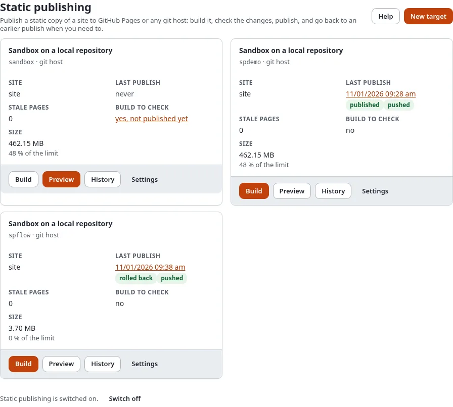

# New in 6.0.15: static publishing

Exponential 6.0.15 can publish your site as a **static copy**: plain HTML pages and files that GitHub Pages hosts for
free, or that any other git host or plain web server can serve. Your editors keep working in Exponential; the public
site needs no PHP, no database and no server of yours.

## What you'll have at the end

An idea of what static publishing brings and where to start.

## What it brings

- **Free hosting** on GitHub Pages, at `https://<you>.github.io/<site>/` or your own domain with free HTTPS.
- **Nothing to attack** on the public side: no login, no database, no PHP version to keep up.
- **Fast pages** from GitHub's network.
- **A wizard** in Setup > Static publishing that sets up the target and, with a token, the repository and GitHub Pages.
- **Check before you publish**: what changes, the size against the limits, a preview of the copy.
- **Every publish kept**: a commit and a tag each, and a rollback in one step.
- **Publishing on its own** when content is published or on a schedule, with e-mail and a webhook.
- **Search, forms and redirects** that keep working on a static host.
- **For developers**: `exp:static:*` commands, a GitHub Actions workflow and the starter repository
  [exponential-static-site-starter](https://github.com/se7enxweb/exponential-static-site-starter).

See it: the Exponential demo site as a static copy at
[https://se7enxweb.github.io/exponential-demo-site-static/](https://se7enxweb.github.io/exponential-demo-site-static/) (coming soon).

## Where to start

| You want to | Read |
|---|---|
| Put your site online for free now | [Make a free website in 15 minutes](static-publishing/make-a-free-website-in-15-minutes.md) |
| Know what it is first | [What static publishing is](static-publishing/what-static-publishing-is.md) |
| Decide whether it fits | [Is static right for my site?](static-publishing/is-static-right-for-my-site.md) |
| Read the whole manual | [Static publishing](static-publishing/README.md) |
| Set it up from the command line | [Host static sites on GitHub Pages with Exponential 6.0.15+](../guides/host-static-sites-on-github-pages.md) |
| Know every setting and command | [The feature page](../features/6.0/static-publishing.md) |

## Upgrading

Nothing changes until you switch it on: static publishing is off by default. The upgrade creates its two tables.
Details: [Static publishing and compatibility](../bc/6.0/static-publishing.md).

## Next step

[Make a free website in 15 minutes](static-publishing/make-a-free-website-in-15-minutes.md).
