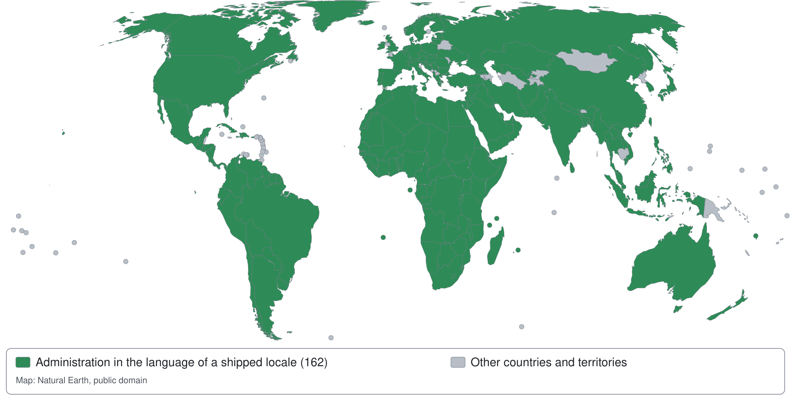

# Languages in Exponential

This page sums up the languages Exponential 6.0.15 ships with: what is supported and how well, the totals of a
default installation and a map of the countries and territories whose language the administration speaks. It
explains how to choose, switch and add a language and how to report a translation problem, and it holds the
reference tables of every locale and every administration translation.

## What Exponential supports

| Area | What ships with 6.0.15 | More |
|---|---|---|
| **Administration translations** | One catalogue per language in `share/translations/<code>/`, for the kernel and its designs, with the catalogues of the bundled extensions ezoe and ezjscore. Each translates at least 99% of the current strings. `eng-US` is the language of the source texts and `ger-DE` was translated by hand; every other translation is machine-assisted and open to review. | [Section 4](#4-every-administration-translation) |
| **Locales** | One `share/locale/<code>.ini` per language and country, holding the names, date and time formats, numbers, currency, the first day of the week and the text direction. Each locale can be chosen as a content language and as the locale of a siteaccess. Locales are plain INI files and need no PHP extension at run time. | [Sections 3](#3-every-locale), [7](#7-adding-a-locale), [10](#10-no-php-extension-at-run-time) |
| **Right to left** | The locales of Arabic, Hebrew, Persian, Urdu, Pashto, Sindhi, Kashmiri, Uyghur, Central Kurdish, Syriac, Yiddish, N’Ko, Dhivehi and others are marked right to left. The administration turns right to left in those languages, and content in them is shown right to left inside any page. | [Section 9](#9-right-to-left-languages) |
| **Fallbacks** | A locale without a catalogue of its own shows the catalogue of its language, for the kernel and for each extension separately: `fre-CA` shows `fre-FR`, every Arabic country `ara-SA`. Configurable in `i18n.ini`. | [Section 13](#13-translation-fallbacks) |
| **Content languages** | Content can be written in any locale's language. An installation holds up to 62 content languages (30 on 32-bit PHP). | [Section 11](#11-the-limit-of-62-content-languages), [Content languages](guides/content-languages.md) |
| **Help and documentation** | English is the original and German the first translation. The help follows the interface language and shows the English page wherever a translation is missing. | [Reading the help in your language](help/reading-help-in-other-languages.md) |
| **Test language** | Lorem Ipsum (`qlo-ZZ`), for testing content translations. It is never added by default. | [Section 12](#12-test-languages-lorem-ipsum) |

There are three levels of support (details in [section 2](#2-support-levels)). At the first, the administration
shows a language from a translation of its own. At the second, it shows the translation of the same language
through a fallback. At the third, content only, the interface stays English while content, dates, numbers and
currency follow the locale. In a default installation of 6.0.15, every shipped language reaches the first or the
second level; the table below counts them.

## The totals of a default installation

<!-- generated: exp:i18n coverage 2026-10-29 (start) -->
**At a glance, on 29 October 2026.** A default installation (the shipped `share/locale`, `share/translations`
and `settings/i18n.ini`, no extension) has:

| What | How many |
|---|---:|
| Languages of the administration: translations in `share/translations` | **155**, 155 of them complete |
| Locales: `share/locale/*.ini` files | **368**: 361 languages and countries, 1 test language, 6 variants |
| Known languages: the language codes of the locales (variants and the test language left out) | **150** |
| of them shown translated by the administration (own translation, fallback or English) | **150** |
| of them not translated ([list](#the-languages-not-translated-yet)) | **0** |
| Countries and territories of the locales | **247** |
| of them with the administration in their language (green on the map) | **247** |
| Codes of ISO 3166-1 (`settings/country.ini`) without a locale | **4**, all of them by design: uninhabited or withdrawn (list below the map) |
| Locales written right to left | **43** |



A country is green when a locale ships for it whose language the administration shows translated: with a
translation of its own or the first translation of its fallback chain (`i18n.ini [TranslationSettings]`,
`FallbackMode=first`, see [section 13](#13-translation-fallbacks)). English counts as translated: it is the
language of the source texts. The map as a vector image: `doc/eng-us/images/languages/coverage-map.svg`; outlines: Natural Earth, public domain.

The uninhabited territories without a locale by design are green too: Antarctica (`AQ`), Bouvet Island (`BV`) and Heard Island and McDonald Islands (`HM`).
Exponential serves these territories in every language; no local conventions exist.

<details><summary>The 247 countries and territories in green</summary>

| Country or territory | Code | Locales and the translation they show |
|---|---|---|
| Afghanistan | AF | `fas-AF`, `pus-AF` |
| Åland | AX | `swe-AX` → `swe-SE` |
| Albania | AL | `sqi-AL` |
| Algeria | DZ | `ara-DZ` → `ara-SA`, `fre-DZ` → `fre-FR`, `kab-DZ` |
| American Samoa | AS | `eng-AS` (source texts) |
| Andorra | AD | `cat-AD` → `cat-ES` |
| Angola | AO | `por-AO` → `por-PT` |
| Anguilla | AI | `eng-AI` (source texts) |
| Antigua and Barbuda | AG | `eng-AG` (source texts) |
| Argentina | AR | `esl-AR` → `esl-ES` |
| Armenia | AM | `hye-AM` |
| Aruba | AW | `dut-AW` → `dut-NL` |
| Australia | AU | `eng-AU` |
| Austria | AT | `ger-AT` → `ger-DE` |
| Azerbaijan | AZ | `aze-AZ` |
| Bahamas | BS | `eng-BS` (source texts) |
| Bahrain | BH | `ara-BH` → `ara-SA` |
| Bangladesh | BD | `ben-BD` |
| Barbados | BB | `eng-BB` (source texts) |
| Belarus | BY | `bel-BY`, `rus-BY` → `rus-RU` |
| Belgium | BE | `dut-BE` → `dut-NL`, `fre-BE` → `fre-FR`, `ger-BE` → `ger-DE` |
| Belize | BZ | `eng-BZ` (source texts) |
| Benin | BJ | `fre-BJ` → `fre-FR` |
| Bermuda | BM | `eng-BM` (source texts) |
| Bhutan | BT | `dzo-BT` |
| Bolivia | BO | `esl-BO` → `esl-ES` |
| Bonaire, Sint Eustatius and Saba | BQ | `dut-BQ` → `dut-NL` |
| Bosnia and Herzegovina | BA | `bos-BA` |
| Botswana | BW | `eng-BW` (source texts) |
| Brazil | BR | `por-BR` |
| British Indian Ocean Territory | IO | `eng-IO` (source texts) |
| Brunei Darussalam | BN | `msa-BN` → `msa-MY` |
| Bulgaria | BG | `bul-BG` |
| Burkina Faso | BF | `fre-BF` → `fre-FR` |
| Burundi | BI | `fre-BI` → `fre-FR`, `run-BI` |
| Cabo Verde | CV | `por-CV` → `por-PT` |
| Cambodia | KH | `khm-KH` |
| Cameroon | CM | `fre-CM` → `fre-FR` |
| Canada | CA | `eng-CA` (source texts), `fre-CA` → `fre-FR` |
| Cayman Islands | KY | `eng-KY` (source texts) |
| Central African Republic | CF | `fre-CF` → `fre-FR` |
| Chad | TD | `ara-TD` → `ara-SA`, `fre-TD` → `fre-FR` |
| Chile | CL | `esl-CL` → `esl-ES` |
| China | CN | `bod-CN`, `chi-CN`, `uig-CN` |
| Christmas Island | CX | `eng-CX` → `eng-AU` |
| Cocos (Keeling) Islands | CC | `eng-CC` → `eng-AU` |
| Colombia | CO | `esl-CO` → `esl-ES` |
| Comoros | KM | `ara-KM` → `ara-SA`, `fre-KM` → `fre-FR` |
| Congo | CG | `fre-CG` → `fre-FR` |
| Congo, The Democratic Republic Of The | CD | `fre-CD` → `fre-FR`, `lin-CD` |
| Cook Islands | CK | `eng-CK` (source texts) |
| Costa Rica | CR | `esl-CR` → `esl-ES` |
| Côte d'Ivoire | CI | `fre-CI` → `fre-FR` |
| Croatia | HR | `cro-HR` |
| Cuba | CU | `esl-CU` → `esl-ES` |
| Curaçao | CW | `dut-CW` → `dut-NL` |
| Cyprus | CY | `ell-CY` → `ell-GR`, `tur-CY` → `tur-TR` |
| Czechia | CZ | `cze-CZ` |
| Denmark | DK | `dan-DK` |
| Djibouti | DJ | `ara-DJ` → `ara-SA`, `fre-DJ` → `fre-FR` |
| Dominica | DM | `eng-DM` (source texts) |
| Dominican Republic | DO | `esl-DO` → `esl-ES` |
| Ecuador | EC | `esl-EC` → `esl-ES` |
| Egypt | EG | `ara-EG` → `ara-SA` |
| El Salvador | SV | `esl-SV` → `esl-ES` |
| Equatorial Guinea | GQ | `esl-GQ` → `esl-ES`, `fre-GQ` → `fre-FR` |
| Eritrea | ER | `ara-ER` → `ara-SA` |
| Estonia | EE | `est-EE` |
| Eswatini | SZ | `eng-SZ` (source texts) |
| Ethiopia | ET | `amh-ET`, `orm-ET`, `tir-ET` |
| Falkland Islands (Malvinas) | FK | `eng-FK` (source texts) |
| Faroe Islands | FO | `dan-FO` → `dan-DK`, `fao-FO` |
| Fiji | FJ | `eng-FJ` (source texts) |
| Finland | FI | `fin-FI` |
| France | FR | `bre-FR`, `fre-FR`, `oci-FR` |
| French Guiana | GF | `fre-GF` → `fre-FR` |
| French Polynesia | PF | `fre-PF` → `fre-FR` |
| French Southern Territories | TF | `fre-TF` → `fre-FR` |
| Gabon | GA | `fre-GA` → `fre-FR` |
| Gambia | GM | `eng-GM` (source texts) |
| Georgia | GE | `kat-GE` |
| Germany | DE | `dsb-DE`, `ger-DE`, `hsb-DE` |
| Ghana | GH | `aka-GH`, `eng-GH` (source texts), `ewe-GH` |
| Gibraltar | GI | `eng-GI` (source texts) |
| Greece | GR | `ell-GR` |
| Greenland | GL | `kal-GL` |
| Grenada | GD | `eng-GD` (source texts) |
| Guadeloupe | GP | `fre-GP` → `fre-FR` |
| Guam | GU | `eng-GU` (source texts) |
| Guatemala | GT | `esl-GT` → `esl-ES` |
| Guernsey | GG | `eng-GG` (source texts) |
| Guinea | GN | `fre-GN` → `fre-FR`, `nqo-GN` |
| Guinea-Bissau | GW | `por-GW` → `por-PT` |
| Guyana | GY | `eng-GY` (source texts) |
| Haiti | HT | `fre-HT` → `fre-FR` |
| Holy See (Vatican City State) | VA | `lat-VA` |
| Honduras | HN | `esl-HN` → `esl-ES` |
| Hong Kong | HK | `chi-HK` → `chi-TW` |
| Hungary | HU | `hun-HU` |
| Iceland | IS | `isl-IS` |
| India | IN | `asm-IN`, `ben-IN` → `ben-BD`, `bho-IN`, `brx-IN`, `doi-IN`, `eng-IN` (source texts), `guj-IN`, `hin-IN`, `kan-IN`, `kas-IN`, `kok-IN`, `mai-IN`, `mal-IN`, `mar-IN`, `mni-IN`, `ori-IN`, `pan-IN`, `san-IN`, `sat-IN`, `tam-IN`, `tel-IN`, `urd-IN` → `urd-PK` |
| Indonesia | ID | `ind-ID`, `jav-ID`, `sun-ID` |
| Iran, Islamic Republic of | IR | `fas-IR` |
| Iraq | IQ | `ara-IQ` → `ara-SA`, `arc-IQ`, `ckb-IQ`, `syr-IQ` |
| Ireland | IE | `eng-IE` (source texts), `gle-IE` |
| Isle of Man | IM | `eng-IM` (source texts) |
| Israel | IL | `heb-IL`, `huy-IL` |
| Italy | IT | `ita-IT` |
| Jamaica | JM | `eng-JM` (source texts) |
| Japan | JP | `jpn-JP` |
| Jersey | JE | `eng-JE` (source texts) |
| Jordan | JO | `ara-JO` → `ara-SA` |
| Kazakhstan | KZ | `kaz-KZ`, `rus-KZ` → `rus-RU` |
| Kenya | KE | `eng-KE` (source texts), `kik-KE`, `swa-KE` |
| Kiribati | KI | `eng-KI` (source texts) |
| Korea, Democratic People's Republic of | KP | `kor-KP` |
| Korea, Republic of | KR | `kor-KR` |
| Kuwait | KW | `ara-KW` → `ara-SA` |
| Kyrgyzstan | KG | `kir-KG`, `rus-KG` → `rus-RU` |
| Lao People's Democratic Republic | LA | `lao-LA` |
| Latvia | LV | `lav-LV` |
| Lebanon | LB | `ara-LB` → `ara-SA` |
| Lesotho | LS | `eng-LS` (source texts) |
| Liberia | LR | `eng-LR` (source texts) |
| Libya | LY | `ara-LY` → `ara-SA` |
| Liechtenstein | LI | `ger-LI` → `ger-DE` |
| Lithuania | LT | `lit-LT` |
| Luxembourg | LU | `fre-LU` → `fre-FR`, `ger-LU` → `ger-DE`, `ltz-LU` |
| Macau | MO | `chi-MO` → `chi-TW` |
| Madagascar | MG | `fre-MG` → `fre-FR`, `mlg-MG` |
| Malawi | MW | `eng-MW` (source texts) |
| Malaysia | MY | `msa-MY` |
| Maldives | MV | `div-MV` |
| Mali | ML | `bam-ML`, `fre-ML` → `fre-FR` |
| Malta | MT | `mlt-MT` |
| Marshall Islands | MH | `eng-MH` (source texts) |
| Martinique | MQ | `fre-MQ` → `fre-FR` |
| Mauritania | MR | `ara-MR` → `ara-SA`, `fre-MR` → `fre-FR` |
| Mauritius | MU | `fre-MU` → `fre-FR` |
| Mayotte | YT | `fre-YT` → `fre-FR` |
| Mexico | MX | `esl-MX` |
| Micronesia, Federated States of | FM | `eng-FM` (source texts) |
| Moldova, Republic of | MD | `ron-MD` → `ron-RO`, `rus-MD` → `rus-RU` |
| Monaco | MC | `fre-MC` → `fre-FR` |
| Mongolia | MN | `mon-MN` |
| Montenegro | ME | `srp-ME` → `srp-RS` |
| Montserrat | MS | `eng-MS` (source texts) |
| Morocco | MA | `ara-MA` → `ara-SA`, `fre-MA` → `fre-FR`, `zgh-MA` |
| Mozambique | MZ | `por-MZ` → `por-PT` |
| Myanmar | MM | `mya-MM` |
| Namibia | NA | `eng-NA` (source texts) |
| Nauru | NR | `eng-NR` (source texts) |
| Nepal | NP | `nep-NP` |
| Netherlands | NL | `dut-NL`, `fry-NL` |
| New Caledonia | NC | `fre-NC` → `fre-FR` |
| New Zealand | NZ | `eng-NZ` → `eng-AU`, `mri-NZ` |
| Nicaragua | NI | `esl-NI` → `esl-ES` |
| Niger | NE | `fre-NE` → `fre-FR` |
| Nigeria | NG | `eng-NG` (source texts), `hau-NG`, `ibo-NG`, `pcm-NG`, `yor-NG` |
| Niue | NU | `eng-NU` (source texts) |
| Norfolk Island | NF | `eng-NF` → `eng-AU` |
| North Macedonia | MK | `mkd-MK` |
| Northern Mariana Islands | MP | `eng-MP` (source texts) |
| Norway | NO | `nno-NO` → `nor-NO`, `nor-NO`, `sme-NO` |
| Oman | OM | `ara-OM` → `ara-SA` |
| Pakistan | PK | `eng-PK` (source texts), `pnb-PK`, `snd-PK`, `urd-PK` |
| Palau | PW | `eng-PW` (source texts) |
| Palestinian Territory, Occupied | PS | `ara-PS` → `ara-SA` |
| Panama | PA | `esl-PA` → `esl-ES` |
| Papua New Guinea | PG | `eng-PG` (source texts) |
| Paraguay | PY | `esl-PY` → `esl-ES` |
| Peru | PE | `esl-PE` → `esl-ES`, `que-PE` |
| Philippines | PH | `ceb-PH`, `eng-PH` (source texts), `fil-PH` |
| Pitcairn | PN | `eng-PN` (source texts) |
| Poland | PL | `pol-PL` |
| Portugal | PT | `por-PT` |
| Puerto Rico | PR | `esl-PR` → `esl-ES` |
| Qatar | QA | `ara-QA` → `ara-SA` |
| Reunion | RE | `fre-RE` → `fre-FR` |
| Romania | RO | `ron-RO` |
| Russian Federation | RU | `che-RU`, `rus-RU`, `tat-RU` |
| Rwanda | RW | `fre-RW` → `fre-FR`, `kin-RW` |
| Saint Barthélemy | BL | `fre-BL` → `fre-FR` |
| Saint Helena | SH | `eng-SH` (source texts) |
| Saint Kitts and Nevis | KN | `eng-KN` (source texts) |
| Saint Lucia | LC | `eng-LC` (source texts) |
| Saint Martin | MF | `fre-MF` → `fre-FR` |
| Saint Pierre and Miquelon | PM | `fre-PM` → `fre-FR` |
| Saint Vincent and The Grenadines | VC | `eng-VC` (source texts) |
| Samoa | WS | `eng-WS` (source texts) |
| San Marino | SM | `ita-SM` → `ita-IT` |
| Sao Tome and Principe | ST | `por-ST` → `por-PT` |
| Saudi Arabia | SA | `ara-SA` |
| Senegal | SN | `fre-SN` → `fre-FR`, `ful-SN`, `wol-SN` |
| Serbia | RS | `ser-SR`, `srp-RS` |
| Seychelles | SC | `fre-SC` → `fre-FR` |
| Sierra Leone | SL | `eng-SL` (source texts) |
| Singapore | SG | `chi-SG` → `chi-CN`, `eng-SG` (source texts), `msa-SG` → `msa-MY`, `tam-SG` → `tam-IN` |
| Sint Maarten | SX | `dut-SX` → `dut-NL` |
| Slovakia | SK | `slk-SK` |
| Slovenia | SI | `slv-SI` |
| Solomon Islands | SB | `eng-SB` (source texts) |
| Somalia | SO | `ara-SO` → `ara-SA`, `som-SO` |
| South Africa | ZA | `afr-ZA`, `eng-ZA` (source texts), `xho-ZA`, `zul-ZA` |
| South Georgia and The South Sandwich Islands | GS | `eng-GS` (source texts) |
| South Sudan | SS | `eng-SS` (source texts) |
| Spain | ES | `ast-ES`, `cat-ES`, `esl-ES`, `eus-ES`, `glg-ES` |
| Sri Lanka | LK | `sin-LK`, `tam-LK` → `tam-IN` |
| Sudan | SD | `ara-SD` → `ara-SA` |
| Suriname | SR | `dut-SR` → `dut-NL` |
| Svalbard and Jan Mayen | SJ | `nor-SJ` → `nor-NO` |
| Sweden | SE | `swe-SE` |
| Switzerland | CH | `fre-CH` → `fre-FR`, `ger-CH` → `ger-DE`, `ita-CH` → `ita-IT`, `roh-CH` |
| Syrian Arab Republic | SY | `ara-SY` → `ara-SA`, `syr-SY` → `syr-IQ` |
| Taiwan | TW | `chi-TW` |
| Tajikistan | TJ | `tgk-TJ` |
| Tanzania, United Republic of | TZ | `swa-TZ` → `swa-KE` |
| Thailand | TH | `tha-TH` |
| Timor-Leste | TL | `por-TL` → `por-PT` |
| Togo | TG | `fre-TG` → `fre-FR` |
| Tokelau | TK | `eng-TK` (source texts) |
| Tonga | TO | `eng-TO` (source texts), `ton-TO` |
| Trinidad and Tobago | TT | `eng-TT` (source texts) |
| Tunisia | TN | `ara-TN` → `ara-SA`, `fre-TN` → `fre-FR` |
| Türkiye | TR | `kur-TR`, `tur-TR` |
| Turkmenistan | TM | `tuk-TM` |
| Turks and Caicos Islands | TC | `eng-TC` (source texts) |
| Tuvalu | TV | `eng-TV` (source texts) |
| Uganda | UG | `eng-UG` (source texts), `lug-UG` |
| Ukraine | UA | `ukr-UA` |
| United Arab Emirates | AE | `ara-AE` → `ara-SA` |
| United Kingdom | GB | `cym-GB`, `eng-GB` (source texts), `gla-GB` |
| United States Minor Outlying Islands | UM | `eng-UM` (source texts) |
| United States of America | US | `eng-US`, `esl-US` → `esl-ES`, `haw-US`, `yid-US` |
| Uruguay | UY | `esl-UY` → `esl-ES` |
| Uzbekistan | UZ | `uzb-UZ` |
| Vanuatu | VU | `fre-VU` → `fre-FR` |
| Venezuela | VE | `esl-VE` → `esl-ES` |
| Viet Nam | VN | `vie-VN` |
| Virgin Islands, British | VG | `eng-VG` (source texts) |
| Virgin Islands, U.S. | VI | `eng-VI` (source texts) |
| Wallis and Futuna | WF | `fre-WF` → `fre-FR` |
| Western Sahara | EH | `ara-EH` → `ara-SA` |
| XK | XK | `sqi-XK` → `sqi-AL` |
| Yemen | YE | `ara-YE` → `ara-SA` |
| Zambia | ZM | `eng-ZM` (source texts) |
| Zimbabwe | ZW | `eng-ZW` (source texts), `sna-ZW` |

</details>

<details><summary>The 0 countries and territories with a locale but the administration in English</summary>

| Country or territory | Code | Locales |
|---|---|---|

</details>

<details><summary>The 4 codes of ISO 3166-1 without a locale</summary>

| Country or territory | Code | Why |
|---|---|---|
| Netherlands Antilles | AN | No locale by design: code withdrawn in 2010; its successors Bonaire, Sint Eustatius and Saba (BQ), Curaçao (CW) and Sint Maarten (SX) each have a locale of their own |
| Antarctica | AQ | No locale by design: uninhabited, CLDR defines no locale for it (shown green: Exponential serves these territories in every language; no local conventions exist) |
| Bouvet Island | BV | No locale by design: uninhabited, CLDR defines no locale for it (shown green: Exponential serves these territories in every language; no local conventions exist) |
| Heard Island and McDonald Islands | HM | No locale by design: uninhabited, CLDR defines no locale for it (shown green: Exponential serves these territories in every language; no local conventions exist) |

</details>

Made by `./console exp:i18n coverage` from the shipped files; `./console exp:i18n coverage --check` and the test `expI18nCoverageMapTest` fail when the figures or the map are out of date.
<!-- generated: exp:i18n coverage (end) -->

### Reading the map

- **Green** marks a country or territory for which Exponential ships a locale whose language the administration
  shows translated. That can be a translation of the locale's own, the first translation of its fallback chain, or
  English, the language of the source texts. The table "countries and territories in green" under the map lists,
  for each country, its locales and the translation each one shows: `→` marks a fallback, "(source texts)" marks
  English.
- **Green by design** marks three uninhabited territories: Antarctica (`AQ`), Bouvet Island (`BV`), and Heard
  Island and McDonald Islands (`HM`). CLDR defines no locale for them, so Exponential ships none. They are green
  because there are no local conventions a locale could add: every language serves them.
- **Grey** marks a country whose locale would show the administration in English for want of a translation, or an
  ISO 3166-1 code that has no locale and no reason by design. No country is grey in 6.0.15. The legend keeps the
  color so that a locale added without a translation shows.
- The Netherlands Antilles (`AN`) are not on the map at all. Their code was withdrawn in 2010, and each of their
  successors (`BQ`, `CW`, `SX`) has a locale of its own.

The table and the map show a default installation: the shipped files without any extension or settings
override. The locales, translations and `i18n.ini` settings of a site of its own are not counted.

<!-- generated: exp:i18n coverage translations (start) -->
In short: **368 locale files** (361 languages and countries, the test language Lorem Ipsum and 6 variations, 43 of
them written right to left) can be chosen as content languages and siteaccess locales; **155 administration
translations** exist, all of them complete: Afrikaans (`afr-ZA`), Akan (`aka-GH`), Albanian (`sqi-AL`), Amharic
(`amh-ET`), Arabic (Saudi Arabia) (`ara-SA`), Armenian (`hye-AM`), Assamese (`asm-IN`), Asturian (`ast-ES`),
Azerbaijani (`aze-AZ`), Bambara (`bam-ML`), Basque (`eus-ES`), Belarusian (`bel-BY`), Bengali (Bangladesh) (`ben-BD`),
Bhojpuri (`bho-IN`), Bodo (`brx-IN`), Bosnian (`bos-BA`), Breton (`bre-FR`), Bulgarian (`bul-BG`), Burmese (`mya-MM`),
Catalan (`cat-ES`), Cebuano (`ceb-PH`), Central Kurdish (`ckb-IQ`), Chechen (`che-RU`), Croatian (`cro-HR`), Czech
(`cze-CZ`), Danish (`dan-DK`), Dari (Afghanistan) (`fas-AF`), Dhivehi (`div-MV`), Dogri (`doi-IN`), Dutch
(Netherlands) (`dut-NL`), Dzongkha (`dzo-BT`), English (Australia) (`eng-AU`), English (United States) (`eng-US`),
Esperanto (`epo-EO`), Estonian (`est-EE`), Ewe (`ewe-GH`), Faroese (`fao-FO`), Filipino (`fil-PH`), Finnish
(`fin-FI`), French (France) (`fre-FR`), Fula (`ful-SN`), Galician (`glg-ES`), Ganda (`lug-UG`), Georgian (`kat-GE`),
German (Germany) (`ger-DE`), Greek (Hellenic) (`ell-GR`), Greenlandic (`kal-GL`), Gujarati (`guj-IN`), Hausa
(`hau-NG`), Hawaiian (`haw-US`), Hebrew (`heb-IL`), Hindi (`hin-IN`), Hulaulá (`huy-IL`), Hungarian (`hun-HU`),
Icelandic (`isl-IS`), Igbo (`ibo-NG`), Imperial Aramaic (`arc-IQ`), Indonesian (`ind-ID`), Irish (`gle-IE`), Italian
(Italy) (`ita-IT`), Japanese (`jpn-JP`), Javanese (`jav-ID`), Kabyle (`kab-DZ`), Kannada (`kan-IN`), Kashmiri
(`kas-IN`), Kazakh (`kaz-KZ`), Khmer (`khm-KH`), Kikuyu (`kik-KE`), Kinyarwanda (`kin-RW`), Kirundi (`run-BI`),
Klingon (`tlh-QO`), Konkani (`kok-IN`), Korean (`kor-KR`), Korean (North Korea) (`kor-KP`), Kurdish (`kur-TR`), Kyrgyz
(`kir-KG`), Lao (`lao-LA`), Latin (`lat-VA`), Latvian (`lav-LV`), Lingala (`lin-CD`), Lithuanian (`lit-LT`), Lower
Sorbian (`dsb-DE`), Luxembourgish (`ltz-LU`), Macedonian (`mkd-MK`), Maithili (`mai-IN`), Malagasy (`mlg-MG`), Malay
(Malaysia) (`msa-MY`), Malayalam (`mal-IN`), Maltese (`mlt-MT`), Manipuri (`mni-IN`), Māori (`mri-NZ`), Marathi
(`mar-IN`), Mongolian (`mon-MN`), Nepali (`nep-NP`), Nigerian Pidgin (`pcm-NG`), Northern Sami (`sme-NO`), Norwegian
Bokmål (`nor-NO`), N’Ko (`nqo-GN`), Occitan (`oci-FR`), Odia (`ori-IN`), Oromo (`orm-ET`), Pashto (`pus-AF`),
Persian (`fas-IR`), Polish (`pol-PL`), Portuguese (Brazil) (`por-BR`), Portuguese (Portugal) (`por-PT`), Punjabi
(`pan-IN`), Quechua (`que-PE`), Romanian (`ron-RO`), Romansh (`roh-CH`), Russian (`rus-RU`), Sanskrit (`san-IN`),
Santali (`sat-IN`), Scottish Gaelic (`gla-GB`), Serbian (Srpski) (`ser-SR`), Serbian (Српски) (`srp-RS`), Shona
(`sna-ZW`), Simplified Chinese (`chi-CN`), Sindhi (`snd-PK`), Sinhala (`sin-LK`), Slovak (`slk-SK`), Slovenian
(`slv-SI`), Somali (`som-SO`), Spanish (Mexico) (`esl-MX`), Spanish (Spain) (`esl-ES`), Standard Moroccan Tamazight
(`zgh-MA`), Sundanese (`sun-ID`), Swahili (Kenya) (`swa-KE`), Swedish (`swe-SE`), Syriac (Iraq) (`syr-IQ`), Tajik
(`tgk-TJ`), Tamil (India) (`tam-IN`), Tatar (`tat-RU`), Telugu (`tel-IN`), Thai (`tha-TH`), Tibetan (`bod-CN`),
Tigrinya (`tir-ET`), Tongan (`ton-TO`), Traditional Chinese (Taiwan) (`chi-TW`), Turkish (`tur-TR`), Turkmen
(`tuk-TM`), Ukrainian (`ukr-UA`), Upper Sorbian (`hsb-DE`), Urdu (Pakistan) (`urd-PK`), Uyghur (`uig-CN`), Uzbek
(`uzb-UZ`), Vietnamese (`vie-VN`), Welsh (`cym-GB`), Western Frisian (`fry-NL`), Western Punjabi (Shahmukhi)
(`pnb-PK`), Wolof (`wol-SN`), Xhosa (`xho-ZA`), Yiddish (`yid-US`), Yoruba (`yor-NG`), Zulu (`zul-ZA`). The names are
the English ones of the locale files.
<!-- generated: exp:i18n coverage translations (end) -->

## Contents

- [What Exponential supports](#what-exponential-supports)
- [The totals of a default installation](#the-totals-of-a-default-installation)
- [Choosing and switching a language](#choosing-and-switching-a-language)
- [Adding a language or a locale](#adding-a-language-or-a-locale)
- [Reporting a translation problem](#reporting-a-translation-problem)

Reference:

1. [Locales, translations, content languages and siteaccesses](#1-locales-translations-content-languages-and-siteaccesses)
2. [Support levels](#2-support-levels)
3. [Every locale](#3-every-locale)
4. [Every administration translation](#4-every-administration-translation)
5. [The world's major languages](#5-the-worlds-major-languages)
6. [Common languages still missing](#6-common-languages-still-missing)
7. [Adding a locale](#7-adding-a-locale)
8. [Adding or completing an administration translation](#8-adding-or-completing-an-administration-translation)
9. [Right-to-left languages](#9-right-to-left-languages)
10. [No PHP extension at run time](#10-no-php-extension-at-run-time)
11. [The limit of 62 content languages](#11-the-limit-of-62-content-languages)
12. [Test languages: Lorem Ipsum](#12-test-languages-lorem-ipsum)
13. [Translation fallbacks](#13-translation-fallbacks)

- [How the translations were made](#how-the-translations-were-made)
- [The languages not translated yet](#the-languages-not-translated-yet)

## Choosing and switching a language

Three settings decide which language a reader sees:

1. **The interface language of the administration.** Every user chooses it in the interface language choice of the
   administration (the list box in the right toolbar). The most needed languages come first, then every language
   from A to Z, each with how complete its translation is. The choice holds for the session. With
   `uiswitch.ini [UISwitch_language] RememberPreference=enabled`, it is also stored in the user's preferences and
   comes back at the next sign-in. Which languages the list offers, and in which order:
   [The interface language list](features/6.0/ui-switch-languages.md) and
   [UI switch settings](guides/ui-switch-settings.md#uiswitch_language).
2. **The locale of a siteaccess.** `site.ini [RegionalSettings] Locale` sets the language of a siteaccess's
   interface texts and its date, number and currency formats. `SiteLanguageList[]` sets which content languages
   it shows, in which order. The usual setup is one siteaccess per language:
   [Showing a language](guides/content-languages.md#5-showing-a-language-sitelanguagelist-and-siteaccesses).
3. **The content languages.** Setup > Languages adds the languages content can be written in, and editors
   translate each item into them: [Content languages](guides/content-languages.md).

The help follows the interface language: [Reading the help in your language](help/reading-help-in-other-languages.md).

## Adding a language or a locale

- **A language that already has a locale** needs no files. Add it as a content language on Setup > Languages
  ([Adding a language](guides/content-languages.md#4-adding-a-language)), or choose it as the interface language.
  The administration shows the language's own translation, the translation it falls back to, or English.
- **A language or country without a locale** needs a locale file: [section 7](#7-adding-a-locale).
- **A new or better administration translation**: [section 8](#8-adding-or-completing-an-administration-translation),
  with the shared rules in `share/translations/TRANSLATING.md` and the language's own `GUIDE.md`.
- **A fallback** for a locale without a translation of its own: `i18n.ini [TranslationSettings] FallbackLanguages[]`
  ([section 13](#13-translation-fallbacks)).
- **A language of the help**: [Translated documentation](bc/6.0/translated-documentation.md).

## Reporting a translation problem

Every translation except `eng-US` and `ger-DE` was made machine-assisted. A wrong term, a wrong form of address or
an awkward sentence is therefore likely somewhere, and every report helps. To report one:

1. Note the language code (the interface language choice shows it, for example `fre-FR`), the page (its address
   without the host name) and the text as it is shown.
2. Say what the text should read, and why, if that is not obvious: a term of the glossary, the form of address, or
   a word that needs its context ("Store" as the shop tab or as Save).
3. Open an issue at [github.com/se7enxweb/exponential/issues](https://github.com/se7enxweb/exponential/issues) for
   the kernel, its designs, ezoe, ezjscore and the documentation. A text of another extension belongs in that
   extension's repository.

A fix is welcome as a pull request. Change the catalogue `share/translations/<code>/translation.ts`, and for a
term, change the language's `GUIDE.md` first ([section 8](#8-adding-or-completing-an-administration-translation)).
To review a whole translation, see
[Reviewing a machine-assisted translation](help/advocates/reviewing-a-machine-assisted-translation.md). For good
reports in general, see [Reporting bugs well](help/advocates/reporting-bugs-well.md).

## 1. Locales, translations, content languages and siteaccesses

Four things are easily mixed up:

| Thing | Where | What it does |
|---|---|---|
| **Locale** | `share/locale/<code>.ini`, read by `eZLocale` | Names of the language and country, the HTTP language tag, the text direction, date and time formats, day and month names, the first day of the week, number and currency formats, translated country names. |
| **Administration translation** | `share/translations/<code>/translation.ts` (and an extension's `translations/<code>/`) | The texts of the interface: the `|i18n()` strings of templates and `ezpI18n::tr()` in PHP. |
| **Content language** | Setup > Languages (`ezcontent_language`) | A language content can be written in. It is a locale code, so only a locale with a file can be added. |
| **Siteaccess locale** | `site.ini [RegionalSettings] Locale` of a siteaccess | The locale a siteaccess formats with and the translation its interface uses. `SiteLanguageList[]` says which content languages it shows. |

A locale file is all a content language needs. Adding a locale file only makes the language selectable: it adds no
content language, changes no siteaccess and uses none of the at most 62 content language slots (30 on 32-bit PHP;
see [section 11](#11-the-limit-of-62-content-languages)).

The details are elsewhere and not repeated here:

- [Content languages](guides/content-languages.md): adding, showing, translating, moving and removing the languages
  content is written in.
- [Translations and languages](features/6.0/translations-and-languages.md): the state of the administration
  translations, making your own strings translatable, the HTML language tags.
- [The interface language choice](features/6.0/ui-switch-languages.md): the list box of the right toolbar, its
  groups, its A–Z list and the coverage it shows.
- [The fallback locale of a content object](bc/6.0/content-object-fallback-locale.md).

## 2. Support levels

| Level | What works | Locales |
|---|---|---|
| **Own translation** | The administration speaks the language from a catalogue of its own that translates at least 99% of the current strings. Content, dates, numbers and currency follow the locale. | Every code in the table of [section 4](#4-every-administration-translation). All except `eng-US` and `ger-DE` are machine-assisted. |
| **Through a fallback** | The same, from the catalogue of another locale of the language, or of a closely related one. | The locales marked `→` in the table of countries under the map, such as `fre-CA` → `fre-FR`, `ara-EG` → `ara-SA` and `nno-NO` → `nor-NO`. The English locales without a catalogue (`eng-GB`, `eng-IN` ...) show the source texts, which are English. |
| **Content only** | No translation and no fallback, so the interface stays English. Content can be written in the language, and a siteaccess with the locale formats dates, numbers and currency for it. | None in a default installation. A locale added later stays at this level until it gets a translation or a fallback. |

A country without a translation of its own speaks the one `i18n.ini [TranslationSettings] FallbackLanguages[]`
names, at the same level. Every German-, French- and Spanish-speaking country falls back to `ger-DE`, `fre-FR` or
`esl-ES`, Latin America included (`esl-MX` takes `esl-ES` for the extensions it has no catalogue for). The Arabic
countries fall back to `ara-SA`, and the other languages work the same way (`por-MZ` to `por-PT`, `ita-CH` to
`ita-IT`). The translator looks the fallback up for the kernel and for each extension separately.
`expUISwitchLanguageProviderTest` fails when a country of a translated language has neither a translation nor a
fallback. The "Translation coverage" column of [section 3](#3-every-locale) names the locale a fallback leads to.
Chains, the automatic same-language fallback, rules of extensions, `./console exp:i18n` and Setup > Interface
languages are explained in [section 13](#13-translation-fallbacks).

## 3. Every locale

`share/locale` holds one file per language and country (the count is in the table at the top of this page), the
test language `qlo-ZZ` ([section 12](#12-test-languages-lorem-ipsum)) and a few variations. A variation such as
`ger-DE@euro` overrides only a few keys of its base file and is chosen in `site.ini`. The add form of Setup >
Languages offers every file except the variations, sorted by English name. Each entry shows its native name, its
country (unless the name already gives it) and its code, and a search field matches any of them: `bengali`,
`বাংলা`, `ben` and `bangladesh` all find `ben-BD`. The interface language choice offers the same locales in its A–Z
list, a native list box with type-ahead (typing "Kis" jumps to Kiswahili).

The columns:

- **Direction**: `RTL` for a language written right to left ([section 9](#9-right-to-left-languages)).
- **Script**: the ISO 15924 script the file's names are written in: ICU's likely script of the language,
  checked against the letters of the file's own native name and month names (the file wins: `ser-SR` is Serbian in
  Latin script).
- **Source**: `CLDR 44` or `CLDR 48` for a file generated from that version of Unicode CLDR in 6.0.15; `older,
  regenerated from CLDR 44` (or `48`) for
  an older file that was broken and generated again; `hand-made names, CLDR 44 conventions` where CLDR has no data
  for the language and the names were written by hand; `hand-made` for a file written entirely by hand; `older,
  hand-made, fixed in 6.0.15` for an older file with single values corrected by hand; `older,
  hand-made` for the files that came with earlier releases, unchanged.
- **Translation coverage**: the share of the current interface strings that the translation the locale shows
  translates, as the interface language choice shows it (`expUISwitchLanguageCatalogue::coveragePercent()`, rounded
  down; English is the source language and always 100%). "Falls back to" names the catalogue of another locale; `—`
  marks a locale without a translation.

The table is generated from the locale files; do not edit it by hand.

| Code | English name | Native name | Region | Direction | Script | Source | Translation coverage |
|---|---|---|---|---|---|---|---:|
| `afr-ZA` | Afrikaans | Afrikaans | Africa | LTR | Latin (`Latn`) | CLDR 44 | 100% |
| `aka-GH` | Akan | Akan | Africa | LTR | Latin (`Latn`) | CLDR 44 | 100% |
| `amh-ET` | Amharic | አማርኛ | Africa | LTR | Ethiopic (`Ethi`) | CLDR 44 | 100% |
| `ara-AE` | Arabic (United Arab Emirates) | العربية (الإمارات العربية المتحدة) | Middle East | RTL | Arabic (`Arab`) | CLDR 44 | 100% (falls back to `ara-SA`) |
| `ara-BH` | Arabic (Bahrain) | العربية (البحرين) | Middle East | RTL | Arabic (`Arab`) | CLDR 48 | 100% (falls back to `ara-SA`) |
| `ara-DJ` | Arabic (Djibouti) | العربية (جيبوتي) | Africa | RTL | Arabic (`Arab`) | CLDR 48 | 100% (falls back to `ara-SA`) |
| `ara-DZ` | Arabic (Algeria) | العربية (الجزائر) | Africa | RTL | Arabic (`Arab`) | CLDR 44 | 100% (falls back to `ara-SA`) |
| `ara-EG` | Arabic (Egypt) | العربية (مصر) | Middle East | RTL | Arabic (`Arab`) | CLDR 44 | 100% (falls back to `ara-SA`) |
| `ara-EH` | Arabic (Western Sahara) | العربية (الصحراء الغربية) | Africa | RTL | Arabic (`Arab`) | CLDR 44 | 100% (falls back to `ara-SA`) |
| `ara-ER` | Arabic (Eritrea) | العربية (إريتريا) | Africa | RTL | Arabic (`Arab`) | CLDR 48 | 100% (falls back to `ara-SA`) |
| `ara-IQ` | Arabic (Iraq) | العربية (العراق) | Middle East | RTL | Arabic (`Arab`) | CLDR 44 | 100% (falls back to `ara-SA`) |
| `ara-JO` | Arabic (Jordan) | العربية (الأردن) | Middle East | RTL | Arabic (`Arab`) | CLDR 44 | 100% (falls back to `ara-SA`) |
| `ara-KM` | Arabic (Comoros) | العربية (جزر القمر) | Africa | RTL | Arabic (`Arab`) | CLDR 48 | 100% (falls back to `ara-SA`) |
| `ara-KW` | Arabic (Kuwait) | العربية (الكويت) | Middle East | RTL | Arabic (`Arab`) | CLDR 44 | 100% (falls back to `ara-SA`) |
| `ara-LB` | Arabic (Lebanon) | العربية (لبنان) | Middle East | RTL | Arabic (`Arab`) | CLDR 44 | 100% (falls back to `ara-SA`) |
| `ara-LY` | Arabic (Libya) | العربية (ليبيا) | Africa | RTL | Arabic (`Arab`) | CLDR 48 | 100% (falls back to `ara-SA`) |
| `ara-MA` | Arabic (Morocco) | العربية (المغرب) | Africa | RTL | Arabic (`Arab`) | CLDR 44 | 100% (falls back to `ara-SA`) |
| `ara-MR` | Arabic (Mauritania) | العربية (موريتانيا) | Africa | RTL | Arabic (`Arab`) | CLDR 48 | 100% (falls back to `ara-SA`) |
| `ara-OM` | Arabic (Oman) | العربية (عُمان) | Middle East | RTL | Arabic (`Arab`) | CLDR 48 | 100% (falls back to `ara-SA`) |
| `ara-PS` | Arabic (Palestinian Territories) | العربية (الأراضي الفلسطينية) | Middle East | RTL | Arabic (`Arab`) | CLDR 48 | 100% (falls back to `ara-SA`) |
| `ara-QA` | Arabic (Qatar) | العربية (قطر) | Middle East | RTL | Arabic (`Arab`) | CLDR 44 | 100% (falls back to `ara-SA`) |
| `ara-SA` | Arabic (Saudi Arabia) | العربية (المملكة العربية السعودية) | Middle East | RTL | Arabic (`Arab`) | older, regenerated from CLDR 48 | 100% |
| `ara-SD` | Arabic (Sudan) | العربية (السودان) | Africa | RTL | Arabic (`Arab`) | CLDR 48 | 100% (falls back to `ara-SA`) |
| `ara-SO` | Arabic (Somalia) | العربية (الصومال) | Africa | RTL | Arabic (`Arab`) | CLDR 48 | 100% (falls back to `ara-SA`) |
| `ara-SY` | Arabic (Syria) | العربية (سوريا) | Middle East | RTL | Arabic (`Arab`) | CLDR 44 | 100% (falls back to `ara-SA`) |
| `ara-TD` | Arabic (Chad) | العربية (تشاد) | Africa | RTL | Arabic (`Arab`) | CLDR 48 | 100% (falls back to `ara-SA`) |
| `ara-TN` | Arabic (Tunisia) | العربية (تونس) | Africa | RTL | Arabic (`Arab`) | CLDR 44 | 100% (falls back to `ara-SA`) |
| `ara-YE` | Arabic (Yemen) | العربية (اليمن) | Middle East | RTL | Arabic (`Arab`) | CLDR 48 | 100% (falls back to `ara-SA`) |
| `arc-IQ` | Imperial Aramaic | ארמית | Middle East | RTL | Hebrew (`Hebr`) | hand-made names, CLDR 44 conventions | 100% |
| `asm-IN` | Assamese | অসমীয়া | South Asia | LTR | Bengali (`Beng`) | CLDR 44 | 100% |
| `ast-ES` | Asturian | Asturianu | Europe | LTR | Latin (`Latn`) | CLDR 44 | 100% |
| `aze-AZ` | Azerbaijani | Azərbaycan | Central Asia and Caucasus | LTR | Latin (`Latn`) | CLDR 44 | 100% |
| `bam-ML` | Bambara | Bamanakan | Africa | LTR | Latin (`Latn`) | CLDR 44 | 100% |
| `bel-BY` | Belarusian | Беларуская | Europe | LTR | Cyrillic (`Cyrl`) | CLDR 44 | 100% |
| `ben-BD` | Bengali (Bangladesh) | বাংলা (বাংলাদেশ) | South Asia | LTR | Bengali (`Beng`) | CLDR 44 | 100% |
| `ben-IN` | Bengali (India) | বাংলা (ভারত) | South Asia | LTR | Bengali (`Beng`) | CLDR 44 | 100% (falls back to `ben-BD`) |
| `bho-IN` | Bhojpuri | भोजपुरी | South Asia | LTR | Devanagari (`Deva`) | CLDR 44 | 100% |
| `bod-CN` | Tibetan | བོད་སྐད་ | East Asia | LTR | Tibetan (`Tibt`) | CLDR 44 | 100% |
| `bos-BA` | Bosnian | Bosanski | Europe | LTR | Latin (`Latn`) | CLDR 44 | 100% |
| `bre-FR` | Breton | Brezhoneg | Europe | LTR | Latin (`Latn`) | CLDR 44 | 100% |
| `brx-IN` | Bodo | बर’ | South Asia | LTR | Devanagari (`Deva`) | CLDR 44 | 100% |
| `bul-BG` | Bulgarian | Български | Europe | LTR | Cyrillic (`Cyrl`) | CLDR 44 | 100% |
| `cat-AD` | Catalan (Andorra) | Català (Andorra) | Europe | LTR | Latin (`Latn`) | CLDR 44 | 100% (falls back to `cat-ES`) |
| `cat-ES` | Catalan | Català | Europe | LTR | Latin (`Latn`) | older, hand-made | 100% |
| `ceb-PH` | Cebuano | Cebuano | Southeast Asia | LTR | Latin (`Latn`) | CLDR 44 | 100% |
| `che-RU` | Chechen | Нохчийн | Europe | LTR | Cyrillic (`Cyrl`) | CLDR 44 | 100% |
| `chi-CN` | Simplified Chinese | 简体中文 | East Asia | LTR | Han (Simplified) (`Hans`) | older, hand-made, fixed in 6.0.15 | 100% |
| `chi-HK` | Traditional Chinese (HongKong) | 繁體中文 (香港) | East Asia | LTR | Han (Traditional) (`Hant`) | older, hand-made, fixed in 6.0.15 | 100% (falls back to `chi-TW`) |
| `chi-MO` | Chinese (Macao SAR China) | 中文 (中國澳門特別行政區) | East Asia | LTR | Han (Traditional) (`Hant`) | CLDR 44 | 100% (falls back to `chi-TW`) |
| `chi-SG` | Simplified Chinese (Singapore) | 简体中文 (新加坡) | Southeast Asia | LTR | Han (Simplified) (`Hans`) | CLDR 44 | 100% (falls back to `chi-CN`) |
| `chi-TW` | Traditional Chinese (Taiwan) | 繁體中文 (臺灣) | East Asia | LTR | Han (Traditional) (`Hant`) | older, hand-made | 100% |
| `ckb-IQ` | Central Kurdish | کوردیی ناوەندی | Middle East | RTL | Arabic (`Arab`) | CLDR 44 | 100% |
| `cro-HR` | Croatian | Hrvatski | Europe | LTR | Latin (`Latn`) | older, hand-made | 100% |
| `cym-GB` | Welsh | Cymraeg | Europe | LTR | Latin (`Latn`) | CLDR 44 | 100% |
| `cze-CZ` | Czech | Čeština | Europe | LTR | Latin (`Latn`) | older, hand-made | 100% |
| `dan-DK` | Danish | Dansk | Europe | LTR | Latin (`Latn`) | older, hand-made | 100% |
| `dan-FO` | Danish (Faroe Islands) | Dansk (Færøerne) | Europe | LTR | Latin (`Latn`) | CLDR 44 | 100% (falls back to `dan-DK`) |
| `div-MV` | Dhivehi | ދިވެހި | South Asia | RTL | Thaana (`Thaa`) | hand-made names, CLDR 44 conventions | 100% |
| `doi-IN` | Dogri | डोगरी | South Asia | LTR | Devanagari (`Deva`) | CLDR 44 | 100% |
| `dsb-DE` | Lower Sorbian | Dolnoserbšćina | Europe | LTR | Latin (`Latn`) | CLDR 44 | 100% |
| `dut-AW` | Dutch (Aruba) | Nederlands (Aruba) | Americas | LTR | Latin (`Latn`) | CLDR 44 | 100% (falls back to `dut-NL`) |
| `dut-BE` | Dutch (Belgium) | Nederlands (België) | Europe | LTR | Latin (`Latn`) | CLDR 44 | 100% (falls back to `dut-NL`) |
| `dut-BQ` | Dutch (Caribbean Netherlands) | Nederlands (Caribisch Nederland) | Americas | LTR | Latin (`Latn`) | CLDR 44 | 100% (falls back to `dut-NL`) |
| `dut-CW` | Dutch (Curaçao) | Nederlands (Curaçao) | Americas | LTR | Latin (`Latn`) | CLDR 44 | 100% (falls back to `dut-NL`) |
| `dut-NL` | Dutch (Netherlands) | Nederlands (Nederland) | Europe | LTR | Latin (`Latn`) | older, hand-made | 100% |
| `dut-SR` | Dutch (Suriname) | Nederlands (Suriname) | Americas | LTR | Latin (`Latn`) | CLDR 44 | 100% (falls back to `dut-NL`) |
| `dut-SX` | Dutch (Sint Maarten) | Nederlands (Sint-Maarten) | Americas | LTR | Latin (`Latn`) | CLDR 44 | 100% (falls back to `dut-NL`) |
| `dzo-BT` | Dzongkha | རྫོང་ཁ | South Asia | LTR | Tibetan (`Tibt`) | CLDR 44 | 100% |
| `ell-CY` | Greek (Cyprus) | Ελληνικά (Κύπρος) | Europe | LTR | Greek (`Grek`) | CLDR 44 | 100% (falls back to `ell-GR`) |
| `ell-GR` | Greek (Hellenic) | Ελληνικά | Europe | LTR | Greek (`Grek`) | older, hand-made, fixed in 6.0.15 | 100% |
| `eng-AG` | English (Antigua & Barbuda) | English (Antigua & Barbuda) | Americas | LTR | Latin (`Latn`) | CLDR 44 | 100% |
| `eng-AI` | English (Anguilla) | English (Anguilla) | Americas | LTR | Latin (`Latn`) | CLDR 44 | 100% |
| `eng-AS` | English (American Samoa) | English (American Samoa) | Oceania | LTR | Latin (`Latn`) | CLDR 44 | 100% |
| `eng-AU` | English (Australia) | English (Australia) | Oceania | LTR | Latin (`Latn`) | older, hand-made | 100% |
| `eng-BB` | English (Barbados) | English (Barbados) | Americas | LTR | Latin (`Latn`) | CLDR 44 | 100% |
| `eng-BM` | English (Bermuda) | English (Bermuda) | Americas | LTR | Latin (`Latn`) | CLDR 44 | 100% |
| `eng-BS` | English (Bahamas) | English (Bahamas) | Americas | LTR | Latin (`Latn`) | CLDR 44 | 100% |
| `eng-BW` | English (Botswana) | English (Botswana) | Africa | LTR | Latin (`Latn`) | CLDR 44 | 100% |
| `eng-BZ` | English (Belize) | English (Belize) | Americas | LTR | Latin (`Latn`) | CLDR 44 | 100% |
| `eng-CA` | English (Canada) | English (Canada) | Americas | LTR | Latin (`Latn`) | older, hand-made | 100% |
| `eng-CC` | English (Cocos (Keeling) Islands) | English (Cocos (Keeling) Islands) | Southeast Asia | LTR | Latin (`Latn`) | CLDR 44 | 100% (falls back to `eng-AU`) |
| `eng-CK` | English (Cook Islands) | English (Cook Islands) | Oceania | LTR | Latin (`Latn`) | CLDR 44 | 100% |
| `eng-CX` | English (Christmas Island) | English (Christmas Island) | Southeast Asia | LTR | Latin (`Latn`) | CLDR 44 | 100% (falls back to `eng-AU`) |
| `eng-DM` | English (Dominica) | English (Dominica) | Americas | LTR | Latin (`Latn`) | CLDR 44 | 100% |
| `eng-FJ` | English (Fiji) | English (Fiji) | Oceania | LTR | Latin (`Latn`) | CLDR 44 | 100% |
| `eng-FK` | English (Falkland Islands) | English (Falkland Islands) | Americas | LTR | Latin (`Latn`) | CLDR 44 | 100% |
| `eng-FM` | English (Micronesia) | English (Micronesia) | Oceania | LTR | Latin (`Latn`) | CLDR 44 | 100% |
| `eng-GB` | English (United Kingdom) | English (United Kingdom) | Europe | LTR | Latin (`Latn`) | older, hand-made | 100% |
| `eng-GB@euro` | Variant of `eng-GB`: Euro support |  | Europe | LTR | Latin (`Latn`) | older variation, hand-made | 100% |
| `eng-GD` | English (Grenada) | English (Grenada) | Americas | LTR | Latin (`Latn`) | CLDR 44 | 100% |
| `eng-GG` | English (Guernsey) | English (Guernsey) | Europe | LTR | Latin (`Latn`) | CLDR 44 | 100% |
| `eng-GH` | English (Ghana) | English (Ghana) | Africa | LTR | Latin (`Latn`) | CLDR 44 | 100% |
| `eng-GI` | English (Gibraltar) | English (Gibraltar) | Europe | LTR | Latin (`Latn`) | CLDR 44 | 100% |
| `eng-GM` | English (Gambia) | English (Gambia) | Africa | LTR | Latin (`Latn`) | CLDR 44 | 100% |
| `eng-GS` | English (South Georgia & South Sandwich Islands) | English (South Georgia & South Sandwich Islands) | Americas | LTR | Latin (`Latn`) | CLDR 44 | 100% |
| `eng-GU` | English (Guam) | English (Guam) | Oceania | LTR | Latin (`Latn`) | CLDR 44 | 100% |
| `eng-GY` | English (Guyana) | English (Guyana) | Americas | LTR | Latin (`Latn`) | CLDR 44 | 100% |
| `eng-IE` | English (Ireland) | English (Ireland) | Europe | LTR | Latin (`Latn`) | CLDR 44 | 100% |
| `eng-IM` | English (Isle of Man) | English (Isle of Man) | Europe | LTR | Latin (`Latn`) | CLDR 44 | 100% |
| `eng-IN` | English (India) | English (India) | South Asia | LTR | Latin (`Latn`) | CLDR 44 | 100% |
| `eng-IO` | English (British Indian Ocean Territory) | English (British Indian Ocean Territory) | South Asia | LTR | Latin (`Latn`) | CLDR 44 | 100% |
| `eng-JE` | English (Jersey) | English (Jersey) | Europe | LTR | Latin (`Latn`) | CLDR 44 | 100% |
| `eng-JM` | English (Jamaica) | English (Jamaica) | Americas | LTR | Latin (`Latn`) | CLDR 44 | 100% |
| `eng-KE` | English (Kenya) | English (Kenya) | Africa | LTR | Latin (`Latn`) | CLDR 44 | 100% |
| `eng-KI` | English (Kiribati) | English (Kiribati) | Oceania | LTR | Latin (`Latn`) | CLDR 44 | 100% |
| `eng-KN` | English (St. Kitts & Nevis) | English (St Kitts & Nevis) | Americas | LTR | Latin (`Latn`) | CLDR 44 | 100% |
| `eng-KY` | English (Cayman Islands) | English (Cayman Islands) | Americas | LTR | Latin (`Latn`) | CLDR 44 | 100% |
| `eng-LC` | English (St. Lucia) | English (St Lucia) | Americas | LTR | Latin (`Latn`) | CLDR 44 | 100% |
| `eng-LR` | English (Liberia) | English (Liberia) | Africa | LTR | Latin (`Latn`) | CLDR 44 | 100% |
| `eng-LS` | English (Lesotho) | English (Lesotho) | Africa | LTR | Latin (`Latn`) | CLDR 44 | 100% |
| `eng-MH` | English (Marshall Islands) | English (Marshall Islands) | Oceania | LTR | Latin (`Latn`) | CLDR 44 | 100% |
| `eng-MP` | English (Northern Mariana Islands) | English (Northern Mariana Islands) | Oceania | LTR | Latin (`Latn`) | CLDR 44 | 100% |
| `eng-MS` | English (Montserrat) | English (Montserrat) | Americas | LTR | Latin (`Latn`) | CLDR 44 | 100% |
| `eng-MW` | English (Malawi) | English (Malawi) | Africa | LTR | Latin (`Latn`) | CLDR 44 | 100% |
| `eng-NA` | English (Namibia) | English (Namibia) | Africa | LTR | Latin (`Latn`) | CLDR 44 | 100% |
| `eng-NF` | English (Norfolk Island) | English (Norfolk Island) | Oceania | LTR | Latin (`Latn`) | CLDR 44 | 100% (falls back to `eng-AU`) |
| `eng-NG` | English (Nigeria) | English (Nigeria) | Africa | LTR | Latin (`Latn`) | CLDR 44 | 100% |
| `eng-NR` | English (Nauru) | English (Nauru) | Oceania | LTR | Latin (`Latn`) | CLDR 44 | 100% |
| `eng-NU` | English (Niue) | English (Niue) | Oceania | LTR | Latin (`Latn`) | CLDR 44 | 100% |
| `eng-NZ` | English (New Zealand) | English (New Zealand) | Oceania | LTR | Latin (`Latn`) | older, hand-made | 100% (falls back to `eng-AU`) |
| `eng-PG` | English (Papua New Guinea) | English (Papua New Guinea) | Oceania | LTR | Latin (`Latn`) | CLDR 44 | 100% |
| `eng-PH` | English (Philippines) | English (Philippines) | Southeast Asia | LTR | Latin (`Latn`) | CLDR 44 | 100% |
| `eng-PK` | English (Pakistan) | English (Pakistan) | South Asia | LTR | Latin (`Latn`) | CLDR 44 | 100% |
| `eng-PN` | English (Pitcairn Islands) | English (Pitcairn Islands) | Oceania | LTR | Latin (`Latn`) | CLDR 44 | 100% |
| `eng-PW` | English (Palau) | English (Palau) | Oceania | LTR | Latin (`Latn`) | CLDR 44 | 100% |
| `eng-SB` | English (Solomon Islands) | English (Solomon Islands) | Oceania | LTR | Latin (`Latn`) | CLDR 44 | 100% |
| `eng-SG` | English (Singapore) | English (Singapore) | Southeast Asia | LTR | Latin (`Latn`) | CLDR 44 | 100% |
| `eng-SH` | English (St. Helena) | English (St Helena) | Africa | LTR | Latin (`Latn`) | CLDR 44 | 100% |
| `eng-SL` | English (Sierra Leone) | English (Sierra Leone) | Africa | LTR | Latin (`Latn`) | CLDR 44 | 100% |
| `eng-SS` | English (South Sudan) | English (South Sudan) | Africa | LTR | Latin (`Latn`) | CLDR 44 | 100% |
| `eng-SZ` | English (Eswatini) | English (Eswatini) | Africa | LTR | Latin (`Latn`) | CLDR 44 | 100% |
| `eng-TC` | English (Turks & Caicos Islands) | English (Turks & Caicos Islands) | Americas | LTR | Latin (`Latn`) | CLDR 44 | 100% |
| `eng-TK` | English (Tokelau) | English (Tokelau) | Oceania | LTR | Latin (`Latn`) | CLDR 44 | 100% |
| `eng-TO` | English (Tonga) | English (Tonga) | Oceania | LTR | Latin (`Latn`) | CLDR 44 | 100% |
| `eng-TT` | English (Trinidad & Tobago) | English (Trinidad & Tobago) | Americas | LTR | Latin (`Latn`) | CLDR 44 | 100% |
| `eng-TV` | English (Tuvalu) | English (Tuvalu) | Oceania | LTR | Latin (`Latn`) | CLDR 44 | 100% |
| `eng-UG` | English (Uganda) | English (Uganda) | Africa | LTR | Latin (`Latn`) | CLDR 44 | 100% |
| `eng-UM` | English (U.S. Outlying Islands) | English (U.S. Outlying Islands) | Oceania | LTR | Latin (`Latn`) | CLDR 44 | 100% |
| `eng-US` | English (United States) | English (United States) | Americas | LTR | Latin (`Latn`) | older, hand-made | 100% |
| `eng-VC` | English (St. Vincent & Grenadines) | English (St Vincent & the Grenadines) | Americas | LTR | Latin (`Latn`) | CLDR 44 | 100% |
| `eng-VG` | English (British Virgin Islands) | English (British Virgin Islands) | Americas | LTR | Latin (`Latn`) | CLDR 44 | 100% |
| `eng-VI` | English (U.S. Virgin Islands) | English (U.S. Virgin Islands) | Americas | LTR | Latin (`Latn`) | CLDR 44 | 100% |
| `eng-WS` | English (Samoa) | English (Samoa) | Oceania | LTR | Latin (`Latn`) | CLDR 44 | 100% |
| `eng-ZA` | English (South Africa) | English (South Africa) | Africa | LTR | Latin (`Latn`) | CLDR 44 | 100% |
| `eng-ZM` | English (Zambia) | English (Zambia) | Africa | LTR | Latin (`Latn`) | CLDR 44 | 100% |
| `eng-ZW` | English (Zimbabwe) | English (Zimbabwe) | Africa | LTR | Latin (`Latn`) | CLDR 44 | 100% |
| `epo-EO` | Esperanto | Esperanto | Worldwide | LTR | Latin (`Latn`) | older, hand-made | 100% |
| `esl-AR` | Spanish (Argentina) | Español (Argentina) | Americas | LTR | Latin (`Latn`) | CLDR 44 | 100% (falls back to `esl-ES`) |
| `esl-BO` | Spanish (Bolivia) | Español (Bolivia) | Americas | LTR | Latin (`Latn`) | CLDR 44 | 100% (falls back to `esl-ES`) |
| `esl-CL` | Spanish (Chile) | Español (Chile) | Americas | LTR | Latin (`Latn`) | CLDR 44 | 100% (falls back to `esl-ES`) |
| `esl-CO` | Spanish (Colombia) | Español (Colombia) | Americas | LTR | Latin (`Latn`) | CLDR 44 | 100% (falls back to `esl-ES`) |
| `esl-CR` | Spanish (Costa Rica) | Español (Costa Rica) | Americas | LTR | Latin (`Latn`) | CLDR 48 | 100% (falls back to `esl-ES`) |
| `esl-CU` | Spanish (Cuba) | Español (Cuba) | Americas | LTR | Latin (`Latn`) | CLDR 44 | 100% (falls back to `esl-ES`) |
| `esl-DO` | Spanish (Dominican Republic) | Español (República Dominicana) | Americas | LTR | Latin (`Latn`) | CLDR 44 | 100% (falls back to `esl-ES`) |
| `esl-EC` | Spanish (Ecuador) | Español (Ecuador) | Americas | LTR | Latin (`Latn`) | CLDR 44 | 100% (falls back to `esl-ES`) |
| `esl-ES` | Spanish (Spain) | Español (España) | Europe | LTR | Latin (`Latn`) | older, hand-made | 100% |
| `esl-GQ` | Spanish (Equatorial Guinea) | Español (Guinea Ecuatorial) | Africa | LTR | Latin (`Latn`) | CLDR 48 | 100% (falls back to `esl-ES`) |
| `esl-GT` | Spanish (Guatemala) | Español (Guatemala) | Americas | LTR | Latin (`Latn`) | CLDR 44 | 100% (falls back to `esl-ES`) |
| `esl-HN` | Spanish (Honduras) | Español (Honduras) | Americas | LTR | Latin (`Latn`) | CLDR 48 | 100% (falls back to `esl-ES`) |
| `esl-MX` | Spanish (Mexico) | Español (México) | Americas | LTR | Latin (`Latn`) | older, hand-made | 100% |
| `esl-NI` | Spanish (Nicaragua) | Español (Nicaragua) | Americas | LTR | Latin (`Latn`) | CLDR 48 | 100% (falls back to `esl-ES`) |
| `esl-PA` | Spanish (Panama) | Español (Panamá) | Americas | LTR | Latin (`Latn`) | CLDR 48 | 100% (falls back to `esl-ES`) |
| `esl-PE` | Spanish (Peru) | Español (Perú) | Americas | LTR | Latin (`Latn`) | CLDR 44 | 100% (falls back to `esl-ES`) |
| `esl-PR` | Spanish (Puerto Rico) | Español (Puerto Rico) | Americas | LTR | Latin (`Latn`) | CLDR 48 | 100% (falls back to `esl-ES`) |
| `esl-PY` | Spanish (Paraguay) | Español (Paraguay) | Americas | LTR | Latin (`Latn`) | CLDR 48 | 100% (falls back to `esl-ES`) |
| `esl-SV` | Spanish (El Salvador) | Español (El Salvador) | Americas | LTR | Latin (`Latn`) | CLDR 48 | 100% (falls back to `esl-ES`) |
| `esl-US` | Spanish (United States) | Español (Estados Unidos) | Americas | LTR | Latin (`Latn`) | CLDR 44 | 100% (falls back to `esl-ES`) |
| `esl-UY` | Spanish (Uruguay) | Español (Uruguay) | Americas | LTR | Latin (`Latn`) | CLDR 44 | 100% (falls back to `esl-ES`) |
| `esl-VE` | Spanish (Venezuela) | Español (Venezuela) | Americas | LTR | Latin (`Latn`) | CLDR 44 | 100% (falls back to `esl-ES`) |
| `est-EE` | Estonian | Eesti | Europe | LTR | Latin (`Latn`) | CLDR 44 | 100% |
| `eus-ES` | Basque | Euskara | Europe | LTR | Latin (`Latn`) | CLDR 44 | 100% |
| `ewe-GH` | Ewe | Eʋegbe | Africa | LTR | Latin (`Latn`) | CLDR 44 | 100% |
| `fao-FO` | Faroese | Føroyskt | Europe | LTR | Latin (`Latn`) | CLDR 44 | 100% |
| `fas-AF` | Dari (Afghanistan) | دری (افغانستان) | Central Asia and Caucasus | RTL | Arabic (`Arab`) | CLDR 44 | 100% |
| `fas-IR` | Persian | فارسی | Middle East | RTL | Arabic (`Arab`) | CLDR 44 | 100% |
| `fil-PH` | Filipino | Filipino | Southeast Asia | LTR | Latin (`Latn`) | CLDR 44 | 100% |
| `fin-FI` | Finnish | Suomi | Europe | LTR | Latin (`Latn`) | older, hand-made | 100% |
| `fre-BE` | French (Belgium) | Français (Belgique) | Europe | LTR | Latin (`Latn`) | older, hand-made | 100% (falls back to `fre-FR`) |
| `fre-BF` | French (Burkina Faso) | Français (Burkina Faso) | Africa | LTR | Latin (`Latn`) | CLDR 48 | 100% (falls back to `fre-FR`) |
| `fre-BI` | French (Burundi) | Français (Burundi) | Africa | LTR | Latin (`Latn`) | CLDR 48 | 100% (falls back to `fre-FR`) |
| `fre-BJ` | French (Benin) | Français (Bénin) | Africa | LTR | Latin (`Latn`) | CLDR 48 | 100% (falls back to `fre-FR`) |
| `fre-BL` | French (St. Barthélemy) | Français (Saint-Barthélemy) | Americas | LTR | Latin (`Latn`) | CLDR 44 | 100% (falls back to `fre-FR`) |
| `fre-CA` | French (Canada) | Français (Canada) | Americas | LTR | Latin (`Latn`) | older, hand-made | 100% (falls back to `fre-FR`) |
| `fre-CD` | French (Congo - Kinshasa) | Français (Congo-Kinshasa) | Africa | LTR | Latin (`Latn`) | CLDR 44 | 100% (falls back to `fre-FR`) |
| `fre-CF` | French (Central African Republic) | Français (République centrafricaine) | Africa | LTR | Latin (`Latn`) | CLDR 48 | 100% (falls back to `fre-FR`) |
| `fre-CG` | French (Congo - Brazzaville) | Français (Congo-Brazzaville) | Africa | LTR | Latin (`Latn`) | CLDR 48 | 100% (falls back to `fre-FR`) |
| `fre-CH` | French (Switzerland) | Français (Suisse) | Europe | LTR | Latin (`Latn`) | CLDR 44 | 100% (falls back to `fre-FR`) |
| `fre-CI` | French (Côte d’Ivoire) | Français (Côte d’Ivoire) | Africa | LTR | Latin (`Latn`) | CLDR 44 | 100% (falls back to `fre-FR`) |
| `fre-CM` | French (Cameroon) | Français (Cameroun) | Africa | LTR | Latin (`Latn`) | CLDR 44 | 100% (falls back to `fre-FR`) |
| `fre-DJ` | French (Djibouti) | Français (Djibouti) | Africa | LTR | Latin (`Latn`) | CLDR 48 | 100% (falls back to `fre-FR`) |
| `fre-DZ` | French (Algeria) | Français (Algérie) | Africa | LTR | Latin (`Latn`) | CLDR 48 | 100% (falls back to `fre-FR`) |
| `fre-FR` | French (France) | Français (France) | Europe | LTR | Latin (`Latn`) | older, hand-made | 100% |
| `fre-GA` | French (Gabon) | Français (Gabon) | Africa | LTR | Latin (`Latn`) | CLDR 48 | 100% (falls back to `fre-FR`) |
| `fre-GF` | French (French Guiana) | Français (Guyane française) | Americas | LTR | Latin (`Latn`) | CLDR 44 | 100% (falls back to `fre-FR`) |
| `fre-GN` | French (Guinea) | Français (Guinée) | Africa | LTR | Latin (`Latn`) | CLDR 48 | 100% (falls back to `fre-FR`) |
| `fre-GP` | French (Guadeloupe) | Français (Guadeloupe) | Americas | LTR | Latin (`Latn`) | CLDR 44 | 100% (falls back to `fre-FR`) |
| `fre-GQ` | French (Equatorial Guinea) | Français (Guinée équatoriale) | Africa | LTR | Latin (`Latn`) | CLDR 48 | 100% (falls back to `fre-FR`) |
| `fre-HT` | French (Haiti) | Français (Haïti) | Americas | LTR | Latin (`Latn`) | CLDR 48 | 100% (falls back to `fre-FR`) |
| `fre-KM` | French (Comoros) | Français (Comores) | Africa | LTR | Latin (`Latn`) | CLDR 48 | 100% (falls back to `fre-FR`) |
| `fre-LU` | French (Luxembourg) | Français (Luxembourg) | Europe | LTR | Latin (`Latn`) | CLDR 48 | 100% (falls back to `fre-FR`) |
| `fre-MA` | French (Morocco) | Français (Maroc) | Africa | LTR | Latin (`Latn`) | CLDR 44 | 100% (falls back to `fre-FR`) |
| `fre-MC` | French (Monaco) | Français (Monaco) | Europe | LTR | Latin (`Latn`) | CLDR 48 | 100% (falls back to `fre-FR`) |
| `fre-MF` | French (St. Martin) | Français (Saint-Martin) | Americas | LTR | Latin (`Latn`) | CLDR 44 | 100% (falls back to `fre-FR`) |
| `fre-MG` | French (Madagascar) | Français (Madagascar) | Africa | LTR | Latin (`Latn`) | CLDR 48 | 100% (falls back to `fre-FR`) |
| `fre-ML` | French (Mali) | Français (Mali) | Africa | LTR | Latin (`Latn`) | CLDR 48 | 100% (falls back to `fre-FR`) |
| `fre-MQ` | French (Martinique) | Français (Martinique) | Americas | LTR | Latin (`Latn`) | CLDR 44 | 100% (falls back to `fre-FR`) |
| `fre-MR` | French (Mauritania) | Français (Mauritanie) | Africa | LTR | Latin (`Latn`) | CLDR 48 | 100% (falls back to `fre-FR`) |
| `fre-MU` | French (Mauritius) | Français (Maurice) | Africa | LTR | Latin (`Latn`) | CLDR 48 | 100% (falls back to `fre-FR`) |
| `fre-NC` | French (New Caledonia) | Français (Nouvelle-Calédonie) | Oceania | LTR | Latin (`Latn`) | CLDR 44 | 100% (falls back to `fre-FR`) |
| `fre-NE` | French (Niger) | Français (Niger) | Africa | LTR | Latin (`Latn`) | CLDR 48 | 100% (falls back to `fre-FR`) |
| `fre-PF` | French (French Polynesia) | Français (Polynésie française) | Oceania | LTR | Latin (`Latn`) | CLDR 44 | 100% (falls back to `fre-FR`) |
| `fre-PM` | French (St. Pierre & Miquelon) | Français (Saint-Pierre-et-Miquelon) | Americas | LTR | Latin (`Latn`) | CLDR 44 | 100% (falls back to `fre-FR`) |
| `fre-RE` | French (Réunion) | Français (La Réunion) | Africa | LTR | Latin (`Latn`) | CLDR 44 | 100% (falls back to `fre-FR`) |
| `fre-RW` | French (Rwanda) | Français (Rwanda) | Africa | LTR | Latin (`Latn`) | CLDR 48 | 100% (falls back to `fre-FR`) |
| `fre-SC` | French (Seychelles) | Français (Seychelles) | Africa | LTR | Latin (`Latn`) | CLDR 48 | 100% (falls back to `fre-FR`) |
| `fre-SN` | French (Senegal) | Français (Sénégal) | Africa | LTR | Latin (`Latn`) | CLDR 44 | 100% (falls back to `fre-FR`) |
| `fre-TD` | French (Chad) | Français (Tchad) | Africa | LTR | Latin (`Latn`) | CLDR 48 | 100% (falls back to `fre-FR`) |
| `fre-TF` | French (French Southern Territories) | Français (Terres australes françaises) | Africa | LTR | Latin (`Latn`) | CLDR 44 | 100% (falls back to `fre-FR`) |
| `fre-TG` | French (Togo) | Français (Togo) | Africa | LTR | Latin (`Latn`) | CLDR 48 | 100% (falls back to `fre-FR`) |
| `fre-TN` | French (Tunisia) | Français (Tunisie) | Africa | LTR | Latin (`Latn`) | CLDR 48 | 100% (falls back to `fre-FR`) |
| `fre-VU` | French (Vanuatu) | Français (Vanuatu) | Oceania | LTR | Latin (`Latn`) | CLDR 48 | 100% (falls back to `fre-FR`) |
| `fre-WF` | French (Wallis & Futuna) | Français (Wallis-et-Futuna) | Oceania | LTR | Latin (`Latn`) | CLDR 44 | 100% (falls back to `fre-FR`) |
| `fre-YT` | French (Mayotte) | Français (Mayotte) | Africa | LTR | Latin (`Latn`) | CLDR 44 | 100% (falls back to `fre-FR`) |
| `fry-NL` | Western Frisian | Frysk | Europe | LTR | Latin (`Latn`) | CLDR 44 | 100% |
| `ful-SN` | Fula | Pulaar | Africa | LTR | Latin (`Latn`) | CLDR 44 | 100% |
| `ger-AT` | German (Austria) | Deutsch (Österreich) | Europe | LTR | Latin (`Latn`) | CLDR 44 | 100% (falls back to `ger-DE`) |
| `ger-BE` | German (Belgium) | Deutsch (Belgien) | Europe | LTR | Latin (`Latn`) | CLDR 48 | 100% (falls back to `ger-DE`) |
| `ger-CH` | German (Switzerland) | Deutsch (Schweiz) | Europe | LTR | Latin (`Latn`) | CLDR 44 | 100% (falls back to `ger-DE`) |
| `ger-DE` | German (Germany) | Deutsch (Deutschland) | Europe | LTR | Latin (`Latn`) | older, hand-made | 100% |
| `ger-DE@euro` | Variant of `ger-DE`: Euro support |  | Europe | LTR | Latin (`Latn`) | older variation, hand-made | 100% (falls back to `ger-DE`) |
| `ger-LI` | German (Liechtenstein) | Deutsch (Liechtenstein) | Europe | LTR | Latin (`Latn`) | CLDR 48 | 100% (falls back to `ger-DE`) |
| `ger-LU` | German (Luxembourg) | Deutsch (Luxemburg) | Europe | LTR | Latin (`Latn`) | CLDR 48 | 100% (falls back to `ger-DE`) |
| `gla-GB` | Scottish Gaelic | Gàidhlig | Europe | LTR | Latin (`Latn`) | CLDR 44 | 100% |
| `gle-IE` | Irish | Gaeilge | Europe | LTR | Latin (`Latn`) | CLDR 44 | 100% |
| `glg-ES` | Galician | Galego | Europe | LTR | Latin (`Latn`) | CLDR 44 | 100% |
| `guj-IN` | Gujarati | ગુજરાતી | South Asia | LTR | Gujarati (`Gujr`) | CLDR 44 | 100% |
| `hau-NG` | Hausa | Hausa | Africa | LTR | Latin (`Latn`) | CLDR 44 | 100% |
| `haw-US` | Hawaiian | ʻŌlelo Hawaiʻi | Oceania | LTR | Latin (`Latn`) | CLDR 44 | 100% |
| `heb-IL` | Hebrew | עברית | Middle East | RTL | Hebrew (`Hebr`) | older, regenerated from CLDR 44 | 100% |
| `hin-IN` | Hindi | हिन्दी | South Asia | LTR | Devanagari (`Deva`) | older, regenerated from CLDR 44 | 100% |
| `hsb-DE` | Upper Sorbian | Hornjoserbšćina | Europe | LTR | Latin (`Latn`) | CLDR 44 | 100% |
| `hun-HU` | Hungarian | Magyar | Europe | LTR | Latin (`Latn`) | older, hand-made | 100% |
| `huy-IL` | Hulaulá | הולאולא | Middle East | RTL | Hebrew (`Hebr`) | hand-made names, CLDR 44 conventions | 100% |
| `hye-AM` | Armenian | Հայերեն | Central Asia and Caucasus | LTR | Armenian (`Armn`) | CLDR 44 | 100% |
| `ibo-NG` | Igbo | Igbo | Africa | LTR | Latin (`Latn`) | CLDR 44 | 100% |
| `ind-ID` | Indonesian | Indonesian | Southeast Asia | LTR | Latin (`Latn`) | older, hand-made | 100% |
| `isl-IS` | Icelandic | Íslenska | Europe | LTR | Latin (`Latn`) | CLDR 44 | 100% |
| `ita-CH` | Italian (Switzerland) | Italiano (Svizzera) | Europe | LTR | Latin (`Latn`) | CLDR 44 | 100% (falls back to `ita-IT`) |
| `ita-IT` | Italian (Italy) | Italiano (Italia) | Europe | LTR | Latin (`Latn`) | older, hand-made | 100% |
| `ita-SM` | Italian (San Marino) | Italiano (San Marino) | Europe | LTR | Latin (`Latn`) | CLDR 44 | 100% (falls back to `ita-IT`) |
| `jav-ID` | Javanese | Jawa | Southeast Asia | LTR | Latin (`Latn`) | CLDR 44 | 100% |
| `jpn-JP` | Japanese | 日本語 | East Asia | LTR | Japanese (Han, Hiragana, Katakana) (`Jpan`) | older, hand-made | 100% |
| `jpn-JP@international` | Variant of `jpn-JP`: @international |  | East Asia | LTR | Japanese (Han, Hiragana, Katakana) (`Jpan`) | older variation, hand-made | 100% (falls back to `jpn-JP`) |
| `kab-DZ` | Kabyle | Taqbaylit | Africa | LTR | Latin (`Latn`) | CLDR 44 | 100% |
| `kal-GL` | Greenlandic | Kalaallisut | Americas | LTR | Latin (`Latn`) | CLDR 44 | 100% |
| `kan-IN` | Kannada | ಕನ್ನಡ | South Asia | LTR | Kannada (`Knda`) | CLDR 44 | 100% |
| `kas-IN` | Kashmiri | کٲشُر | South Asia | RTL | Arabic (`Arab`) | CLDR 44 | 100% |
| `kat-GE` | Georgian | ქართული | Central Asia and Caucasus | LTR | Georgian (`Geor`) | CLDR 44 | 100% |
| `kaz-KZ` | Kazakh | Қазақ тілі | Central Asia and Caucasus | LTR | Cyrillic (`Cyrl`) | CLDR 44 | 100% |
| `khm-KH` | Khmer | ខ្មែរ | Southeast Asia | LTR | Khmer (`Khmr`) | CLDR 44 | 100% |
| `kik-KE` | Kikuyu | Gikuyu | Africa | LTR | Latin (`Latn`) | CLDR 44 | 100% |
| `kin-RW` | Kinyarwanda | Kinyarwanda | Africa | LTR | Latin (`Latn`) | CLDR 44 | 100% |
| `kir-KG` | Kyrgyz | Кыргызча | Central Asia and Caucasus | LTR | Cyrillic (`Cyrl`) | CLDR 44 | 100% |
| `kok-IN` | Konkani | कोंकणी | South Asia | LTR | Devanagari (`Deva`) | CLDR 44 | 100% |
| `kor-KP` | Korean (North Korea) | 한국어 (조선민주주의인민공화국) | East Asia | LTR | Korean (Hangul, Han) (`Kore`) | CLDR 44 | 100% |
| `kor-KR` | Korean | 한국어 | East Asia | LTR | Korean (Hangul, Han) (`Kore`) | older, regenerated from CLDR 44 | 100% |
| `kur-TR` | Kurdish | Kurdî (kurmancî) | Middle East | LTR | Latin (`Latn`) | CLDR 44 | 100% |
| `lao-LA` | Lao | ລາວ | Southeast Asia | LTR | Lao (`Laoo`) | CLDR 44 | 100% |
| `lat-VA` | Latin | Latina | Europe | LTR | Latin (`Latn`) | hand-made names, CLDR 44 conventions | 100% |
| `lav-LV` | Latvian | Latviešu | Europe | LTR | Latin (`Latn`) | CLDR 44 | 100% |
| `lin-CD` | Lingala | Lingála | Africa | LTR | Latin (`Latn`) | CLDR 44 | 100% |
| `lit-LT` | Lithuanian | Lietuvių | Europe | LTR | Latin (`Latn`) | CLDR 44 | 100% |
| `ltz-LU` | Luxembourgish | Lëtzebuergesch | Europe | LTR | Latin (`Latn`) | CLDR 44 | 100% |
| `lug-UG` | Ganda | Luganda | Africa | LTR | Latin (`Latn`) | CLDR 44 | 100% |
| `mai-IN` | Maithili | मैथिली | South Asia | LTR | Devanagari (`Deva`) | CLDR 44 | 100% |
| `mal-IN` | Malayalam | മലയാളം | South Asia | LTR | Malayalam (`Mlym`) | CLDR 44 | 100% |
| `mar-IN` | Marathi | मराठी | South Asia | LTR | Devanagari (`Deva`) | CLDR 44 | 100% |
| `mkd-MK` | Macedonian | Македонски | Europe | LTR | Cyrillic (`Cyrl`) | CLDR 44 | 100% |
| `mlg-MG` | Malagasy | Malagasy | Africa | LTR | Latin (`Latn`) | CLDR 44 | 100% |
| `mlt-MT` | Maltese | Malti | Europe | LTR | Latin (`Latn`) | CLDR 44 | 100% |
| `mni-IN` | Manipuri | মৈতৈলোন্ | South Asia | LTR | Bengali (`Beng`) | CLDR 44 | 100% |
| `mon-MN` | Mongolian | Монгол | East Asia | LTR | Cyrillic (`Cyrl`) | CLDR 44 | 100% |
| `mri-NZ` | Māori | Māori | Oceania | LTR | Latin (`Latn`) | CLDR 44 | 100% |
| `msa-BN` | Malay (Brunei) | Melayu (Brunei) | Southeast Asia | LTR | Latin (`Latn`) | CLDR 44 | 100% (falls back to `msa-MY`) |
| `msa-MY` | Malay (Malaysia) | Melayu (Malaysia) | Southeast Asia | LTR | Latin (`Latn`) | CLDR 44 | 100% |
| `msa-SG` | Malay (Singapore) | Melayu (Singapura) | Southeast Asia | LTR | Latin (`Latn`) | CLDR 44 | 100% (falls back to `msa-MY`) |
| `mya-MM` | Burmese | မြန်မာ | Southeast Asia | LTR | Myanmar (`Mymr`) | CLDR 44 | 100% |
| `nep-NP` | Nepali | नेपाली | South Asia | LTR | Devanagari (`Deva`) | CLDR 44 | 100% |
| `nno-NO` | Norwegian (Nynorsk) | Norsk (Nynorsk) | Europe | LTR | Latin (`Latn`) | older, hand-made | 100% (falls back to `nor-NO`) |
| `nor-NO` | Norwegian Bokmål | Norsk (Bokmål) | Europe | LTR | Latin (`Latn`) | older, hand-made | 100% |
| `nor-NO@intl` | Variant of `nor-NO`: Internasjonalt Format |  | Europe | LTR | Latin (`Latn`) | older variation, hand-made | 100% (falls back to `nor-NO`) |
| `nor-NO@spraakraad` | Variant of `nor-NO`: Norsk Språkråd |  | Europe | LTR | Latin (`Latn`) | older variation, hand-made | 100% (falls back to `nor-NO`) |
| `nor-SJ` | Norwegian Bokmål (Svalbard & Jan Mayen) | Norsk bokmål (Svalbard og Jan Mayen) | Europe | LTR | Latin (`Latn`) | CLDR 44 | 100% (falls back to `nor-NO`) |
| `nqo-GN` | N’Ko | ߒߞߏ | Africa | RTL | N’Ko (`Nkoo`) | CLDR 44 | 100% |
| `oci-FR` | Occitan | Occitan | Europe | LTR | Latin (`Latn`) | CLDR 44 | 100% |
| `ori-IN` | Odia | ଓଡ଼ିଆ | South Asia | LTR | Oriya (Odia) (`Orya`) | CLDR 44 | 100% |
| `orm-ET` | Oromo | Oromoo | Africa | LTR | Latin (`Latn`) | CLDR 44 | 100% |
| `pan-IN` | Punjabi | ਪੰਜਾਬੀ | South Asia | LTR | Gurmukhi (`Guru`) | CLDR 44 | 100% |
| `pcm-NG` | Nigerian Pidgin | Naijíriá Píjin | Africa | LTR | Latin (`Latn`) | CLDR 44 | 100% |
| `pnb-PK` | Western Punjabi (Shahmukhi) | پنجابی | South Asia | RTL | Arabic (`Arab`) | CLDR 44 | 100% |
| `pol-PL` | Polish | Polski | Europe | LTR | Latin (`Latn`) | older, hand-made | 100% |
| `por-AO` | Portuguese (Angola) | Português (Angola) | Africa | LTR | Latin (`Latn`) | CLDR 44 | 100% (falls back to `por-PT`) |
| `por-BR` | Portuguese (Brazil) | Português (Brasil) | Americas | LTR | Latin (`Latn`) | older, hand-made | 100% |
| `por-CV` | Portuguese (Cape Verde) | Português (Cabo Verde) | Africa | LTR | Latin (`Latn`) | CLDR 44 | 100% (falls back to `por-PT`) |
| `por-GW` | Portuguese (Guinea-Bissau) | Português (Guiné-Bissau) | Africa | LTR | Latin (`Latn`) | CLDR 44 | 100% (falls back to `por-PT`) |
| `por-MZ` | Portuguese (Mozambique) | Português | Africa | LTR | Latin (`Latn`) | older, hand-made | 100% (falls back to `por-PT`) |
| `por-PT` | Portuguese (Portugal) | Português | Europe | LTR | Latin (`Latn`) | older, hand-made | 100% |
| `por-PT@euro` | Variant of `por-PT`: Suporte para Euro |  | Europe | LTR | Latin (`Latn`) | older variation, hand-made | 100% (falls back to `por-PT`) |
| `por-ST` | Portuguese (São Tomé & Príncipe) | Português (São Tomé e Príncipe) | Africa | LTR | Latin (`Latn`) | CLDR 44 | 100% (falls back to `por-PT`) |
| `por-TL` | Portuguese (Timor-Leste) | Português (Timor-Leste) | Southeast Asia | LTR | Latin (`Latn`) | CLDR 44 | 100% (falls back to `por-PT`) |
| `pus-AF` | Pashto | پښتو | South Asia | RTL | Arabic (`Arab`) | CLDR 44 | 100% |
| `qlo-ZZ` | Lorem Ipsum | Lorem Ipsum | None (test language) | LTR | Latin (`Latn`) | hand-made, test language only | — |
| `que-PE` | Quechua | Runasimi | Americas | LTR | Latin (`Latn`) | CLDR 44 | 100% |
| `roh-CH` | Romansh | Rumantsch | Europe | LTR | Latin (`Latn`) | CLDR 44 | 100% |
| `ron-MD` | Romanian (Moldova) | Română (Republica Moldova) | Europe | LTR | Latin (`Latn`) | CLDR 44 | 100% (falls back to `ron-RO`) |
| `ron-RO` | Romanian | Română | Europe | LTR | Latin (`Latn`) | CLDR 44 | 100% |
| `run-BI` | Kirundi | Ikirundi | Africa | LTR | Latin (`Latn`) | CLDR 44 | 100% |
| `rus-BY` | Russian (Belarus) | Русский (Беларусь) | Europe | LTR | Cyrillic (`Cyrl`) | CLDR 44 | 100% (falls back to `rus-RU`) |
| `rus-KG` | Russian (Kyrgyzstan) | Русский (Киргизия) | Central Asia and Caucasus | LTR | Cyrillic (`Cyrl`) | CLDR 44 | 100% (falls back to `rus-RU`) |
| `rus-KZ` | Russian (Kazakhstan) | Русский (Казахстан) | Central Asia and Caucasus | LTR | Cyrillic (`Cyrl`) | CLDR 44 | 100% (falls back to `rus-RU`) |
| `rus-MD` | Russian (Moldova) | Русский (Молдова) | Europe | LTR | Cyrillic (`Cyrl`) | CLDR 44 | 100% (falls back to `rus-RU`) |
| `rus-RU` | Russian | Русский | Europe | LTR | Cyrillic (`Cyrl`) | older, hand-made | 100% |
| `san-IN` | Sanskrit | संस्कृत भाषा | South Asia | LTR | Devanagari (`Deva`) | CLDR 44 | 100% |
| `sat-IN` | Santali | ᱥᱟᱱᱛᱟᱲᱤ | South Asia | LTR | Ol Chiki (`Olck`) | CLDR 44 | 100% |
| `ser-SR` | Serbian (Srpski) | Serbian (Srpski) | Europe | LTR | Latin (`Latn`) | older, hand-made | 100% |
| `sin-LK` | Sinhala | සිංහල | South Asia | LTR | Sinhala (`Sinh`) | CLDR 44 | 100% |
| `slk-SK` | Slovak | Slovenčina | Europe | LTR | Latin (`Latn`) | older, hand-made | 100% |
| `slv-SI` | Slovenian | Slovenščina | Europe | LTR | Latin (`Latn`) | CLDR 44 | 100% |
| `sme-NO` | Northern Sami | Davvisámegiella | Europe | LTR | Latin (`Latn`) | CLDR 44 | 100% |
| `sna-ZW` | Shona | ChiShona | Africa | LTR | Latin (`Latn`) | CLDR 44 | 100% |
| `snd-PK` | Sindhi | سنڌي | South Asia | RTL | Arabic (`Arab`) | CLDR 44 | 100% |
| `som-SO` | Somali | Soomaali | Africa | LTR | Latin (`Latn`) | CLDR 44 | 100% |
| `sqi-AL` | Albanian | Shqip | Europe | LTR | Latin (`Latn`) | CLDR 44 | 100% |
| `sqi-XK` | Albanian (Kosovo) | Shqip (Kosovë) | Europe | LTR | Latin (`Latn`) | CLDR 44 | 100% (falls back to `sqi-AL`) |
| `srp-ME` | Serbian (Montenegro) | Српски (Црна Гора) | Europe | LTR | Cyrillic (`Cyrl`) | CLDR 44 | 100% (falls back to `srp-RS`) |
| `srp-RS` | Serbian (Српски) | Serbian (Српски) | Europe | LTR | Cyrillic (`Cyrl`) | older, hand-made | 100% |
| `sun-ID` | Sundanese | Basa Sunda | Southeast Asia | LTR | Latin (`Latn`) | CLDR 44 | 100% |
| `swa-KE` | Swahili (Kenya) | Kiswahili (Kenya) | Africa | LTR | Latin (`Latn`) | CLDR 44 | 100% |
| `swa-TZ` | Swahili (Tanzania) | Kiswahili (Tanzania) | Africa | LTR | Latin (`Latn`) | CLDR 44 | 100% (falls back to `swa-KE`) |
| `swe-AX` | Swedish (Åland Islands) | Svenska (Åland) | Europe | LTR | Latin (`Latn`) | CLDR 44 | 100% (falls back to `swe-SE`) |
| `swe-SE` | Swedish | Svenska | Europe | LTR | Latin (`Latn`) | older, hand-made | 100% |
| `syr-IQ` | Syriac (Iraq) | ܣܘܪܝܝܐ (ܥܝܪܩ) | Middle East | RTL | Syriac (`Syrc`) | CLDR 44 | 100% |
| `syr-SY` | Syriac (Syria) | ܣܘܪܝܝܐ (ܣܘܪܝܐ) | Middle East | RTL | Syriac (`Syrc`) | CLDR 44 | 100% (falls back to `syr-IQ`) |
| `tam-IN` | Tamil (India) | தமிழ் (இந்தியா) | South Asia | LTR | Tamil (`Taml`) | CLDR 44 | 100% |
| `tam-LK` | Tamil (Sri Lanka) | தமிழ் (இலங்கை) | South Asia | LTR | Tamil (`Taml`) | CLDR 44 | 100% (falls back to `tam-IN`) |
| `tam-SG` | Tamil (Singapore) | தமிழ் (சிங்கப்பூர்) | Southeast Asia | LTR | Tamil (`Taml`) | CLDR 44 | 100% (falls back to `tam-IN`) |
| `tat-RU` | Tatar | Татар | Europe | LTR | Cyrillic (`Cyrl`) | CLDR 44 | 100% |
| `tel-IN` | Telugu | తెలుగు | South Asia | LTR | Telugu (`Telu`) | CLDR 44 | 100% |
| `tgk-TJ` | Tajik | Тоҷикӣ | Central Asia and Caucasus | LTR | Cyrillic (`Cyrl`) | CLDR 44 | 100% |
| `tha-TH` | Thai | ไทย | Southeast Asia | LTR | Thai (`Thai`) | CLDR 44 | 100% |
| `tir-ET` | Tigrinya | ትግርኛ | Africa | LTR | Ethiopic (`Ethi`) | CLDR 44 | 100% |
| `tlh-QO` | Klingon | tlhIngan Hol | Worldwide (fictional) | LTR | Latin (`Latn`) | hand-made | 100% |
| `ton-TO` | Tongan | Lea fakatonga | Oceania | LTR | Latin (`Latn`) | CLDR 44 | 100% |
| `tuk-TM` | Turkmen | Türkmen dili | Central Asia and Caucasus | LTR | Latin (`Latn`) | CLDR 44 | 100% |
| `tur-CY` | Turkish (Cyprus) | Türkçe (Kıbrıs) | Europe | LTR | Latin (`Latn`) | CLDR 44 | 100% (falls back to `tur-TR`) |
| `tur-TR` | Turkish | Türkçe | Middle East | LTR | Latin (`Latn`) | older, hand-made | 100% |
| `uig-CN` | Uyghur | ئۇيغۇرچە | East Asia | RTL | Arabic (`Arab`) | CLDR 44 | 100% |
| `ukr-UA` | Ukrainian | Українська | Europe | LTR | Cyrillic (`Cyrl`) | older, hand-made, fixed in 6.0.15 | 100% |
| `urd-IN` | Urdu (India) | اردو (بھارت) | South Asia | RTL | Arabic (`Arab`) | CLDR 44 | 100% (falls back to `urd-PK`) |
| `urd-PK` | Urdu (Pakistan) | اردو (پاکستان) | South Asia | RTL | Arabic (`Arab`) | CLDR 44 | 100% |
| `uzb-UZ` | Uzbek | O‘zbek | Central Asia and Caucasus | LTR | Latin (`Latn`) | CLDR 44 | 100% |
| `vie-VN` | Vietnamese | Tiếng Việt | Southeast Asia | LTR | Latin (`Latn`) | CLDR 44 | 100% |
| `wol-SN` | Wolof | Wolof | Africa | LTR | Latin (`Latn`) | CLDR 44 | 100% |
| `xho-ZA` | Xhosa | IsiXhosa | Africa | LTR | Latin (`Latn`) | CLDR 44 | 100% |
| `yid-US` | Yiddish | ייִדיש | Americas | RTL | Hebrew (`Hebr`) | CLDR 44 | 100% |
| `yor-NG` | Yoruba | Èdè Yorùbá | Africa | LTR | Latin (`Latn`) | CLDR 44 | 100% |
| `zgh-MA` | Standard Moroccan Tamazight | ⵜⴰⵎⴰⵣⵉⵖⵜ | Africa | LTR | Tifinagh (`Tfng`) | CLDR 44 | 100% |
| `zul-ZA` | Zulu | IsiZulu | Africa | LTR | Latin (`Latn`) | CLDR 44 | 100% |

How the generated files were made, and where they differ from CLDR, is in [section 7](#7-adding-a-locale).
Notes on single locales:

- **Latin** (`lat-VA`) is a classical language: no country speaks it as a mother tongue, and the Holy See (Vatican
  City), where it is an official language, stands as its country. CLDR 44 has no Latin data, so its numbers,
  currency (euro) and date patterns follow the Holy See's conventions (CLDR `it_VA`) and its names are written by
  hand: `Latina`, nominative month names (`Ianuarius`), the ecclesiastical day names the Holy See uses (`Dominica`,
  `Feria secunda` ... `Sabbatum`); the long date shows the short month (`Feria tertia, 14 Nov. 2023`). Its country
  names are CLDR's English ones.
- **Hebrew** (`heb-IL`) existed before; its file named `windows-1255` and held double-encoded month and day names.
  It was regenerated from CLDR `he_IL` in 6.0.15 (UTF-8, `he-IL`, `₪`, CLDR's Hebrew country names). `hin-IN` and
  `kor-KR` were regenerated as well: `hin-IN` had English names ("Hindi (Devnagari)", English months and days) and
  country names with characters lost to `?`; `kor-KR` had an invalid long date (the year marker 년 before the year)
  and short day names equal to the long ones.
- **Fixed by hand** in 6.0.15, the rest of the older file kept: `chi-HK` (its long date printed 月 twice, and it was
  the one file with a byte order mark), `chi-CN` (short Sunday `周日`), `ell-GR` (native name `Ελληνικά` instead of
  "Greek (Hellenic)"), `ukr-UA` (`Українська` instead of "Ukrainian"; month names in the form used inside a date,
  `15 жовтня` instead of `15 Жовтень`, with the stand-alone form beside them). `kat-GE` lost a capital its
  generator had given it (Georgian has none in running text: `ქართული`).
- **Known limits** of older files: `ser-SR` and `srp-RS` mix English and native ("Serbian (Српски)", and `srp-RS` capitalizes its day names),
  `chi-CN` and `chi-TW` keep their old date patterns (`2025年 十月 15日`, readable but not CLDR's `2025年10月15日`).
  The short month names of `rus-RU` (`Янв`, `Май`) are neither of CLDR's forms, and `som-SO` names the months in
  the traditional way (`Bisha Tobnaad`); these files have no stand-alone group for them yet.
- **Dhivehi** (`div-MV`): ICU 74 has no Dhivehi data. Numbers, the rufiyaa (symbol `Rf`) and date patterns follow
  CLDR `en_MV`; the language name (ދިވެހި, English "Dhivehi", the Maldivian spelling), the currency name and the
  month and day names in Thaana are written by hand and need a native speaker's review. CLDR starts the week on
  Friday in the Maldives; `eZLocale` knows only Monday and Sunday, so the week starts on Sunday.
- **Yiddish** (`yid-US`): CLDR 44 has Yiddish only as `yi_UA` (until CLDR 43 `yi_001`, "world"), and a locale code
  needs a two-letter country. The largest Yiddish-speaking community lives in the United States, so the file has
  CLDR's Yiddish names with the conventions and currency of the United States.
- **Imperial Aramaic** (`arc-IQ`) and **Hulaulá** (`huy-IL`, Jewish Neo-Aramaic) have no CLDR data and are written
  in Hebrew square script. `arc-IQ` takes the conventions of CLDR `syr_IQ` (Iraqi dinar) and its Aramaic month and
  country names, transliterated from Syriac; the day names are the Aramaic ones (חד בשבא ... שבתא). `huy-IL` takes
  the conventions, month and country names of CLDR `he_IL` (new shekel) and the Jewish Aramaic day names (חד בשבא
  ... מעלי שבתא, שבתא). The language and currency names are written by hand; each file names the source of every
  value and needs a review.
- **Dari** (`fas-AF`) is the Persian of Afghanistan, as in CLDR (`fa_AF`, display name "Dari", دری); `fas-IR`
  stays "Persian".
- **Central Kurdish** (`ckb-IQ`, Sorani, Arabic script, right to left) has no ISO 639-2 code (639-2 has only `kur`
  for all of Kurdish, which `kur-TR`, Kurmanji in Latin script, already uses), so it takes its ISO 639-3 code.
- **Klingon** (`tlh-QO`) is hand-made, for fun and as a test of a locale without CLDR data. `tlh` is the ISO 639-2
  code of Klingon; `QO` lies in the ISO 3166 user-assigned range (QM to QZ), so the country is
  `None (private-use region QO)` and the HTTP tag is the bare `tlh`, which claims no real place (like `eo` for
  `epo-EO`). It has no currency (ISO 4217 `XXX`, sign `¤`), numbers as `eng-US`, the 24-hour clock, Marc Okrand's
  day names (`DaSjaj` ... `lojmItjaj`) and the months as "month" plus a number (`jar wa'` ... `jar wa'maH cha'`),
  in the Latin transcription. It is offered in the A–Z list of the interface language choice only, in no group.
  The Klingon script pIqaD is not in Unicode proper (the ConScript Unicode Registry places it in the Private Use
  Area, U+F8D0 to U+F8FF) and is never used in interface texts or locale files; a site that wants it for decoration
  loads a ConScript-compatible font itself, while the text stays in the transcription.
- **Interlingua** (`ia_001`) is not offered: CLDR has it only for the region "world" (`001`), and a locale code needs
  a two-letter country.
- Test languages, marked `[LanguageSettings] TestLanguage=true` (Lorem Ipsum, `qlo-ZZ`), are listed last in the
  table, as "test language only", and counted nowhere in this document.

### Scripts, fonts and line breaking

A locale file holds text only; whether a script shows depends on the fonts of the reader's system. The
administration designs (admin4, admin4l and the classic admin share `components.css`) use system fonts only and
download nothing. Their font token `--a4-font` keeps its Latin families first (so Latin text is unchanged) and then
names, through `--a4-font-intl`, the common system fonts of the other scripts: Chinese, Japanese and Korean
(`--a4-font-cjk`: PingFang, Hiragino, Microsoft YaHei and JhengHei, Yu Gothic, Meiryo, Malgun Gothic, Apple SD
Gothic Neo, Noto Sans CJK), Thai (Leelawadee UI, Thonburi, Noto Sans Thai), Devanagari (Nirmala UI, Kohinoor
Devanagari, Noto Sans Devanagari), Arabic and Hebrew (Segoe UI, Noto Sans Arabic, Geeza Pro, Noto Sans Hebrew, Arial
Hebrew). Han characters are shared by Chinese, Japanese and Korean but drawn differently in each, so the order of
`--a4-font-cjk` follows the interface language (`:lang(ja)`, `:lang(ko)`, `:lang(zh-TW)`, `:lang(zh-HK)`: that
language's fonts first; Simplified Chinese first otherwise). The classic admin and the Admin UI add `--a4-font-intl`
after their own Latin families. A font that also carries Latin letters (Droid Sans Fallback) is left out on
purpose: on a system without the Latin families it would take over Latin text as well. Any script not covered falls
back to what the system offers.

Line breaking follows the language of the page or of an element with `lang`:

```css
html:lang(ja), [lang]:lang(ja) { line-break: strict; }
html:lang(ko), [lang]:lang(ko) { word-break: keep-all; overflow-wrap: break-word; }
html:lang(th|lo|km|my), [lang]:lang(th|lo|km|my) { overflow-wrap: break-word; }
```

Japanese avoids a break before small kana and closing punctuation; Korean breaks at the spaces between words, as
it is set; Thai, Lao, Khmer and Burmese, written without spaces, break at the word boundaries of the browser's
dictionary, with `break-word` as a safety net for a run it does not know. Chinese needs nothing: browsers break
between ideographs. The Klingon script pIqaD is never used (see Klingon above).

## 4. Every administration translation

Each translation was measured for the 6.0.15 release in two ways, both rounded down:

- **Own file finished**: the finished messages of the file divided by all its messages, leaving obsolete ones out
  and counting each context, source and comment once. `php bin/php/ezchecktranslation.php <code>` prints a similar
  "Percent finished".
- **Current strings translated**: how many of the 18,839 strings of `share/translations/untranslated/translation.ts`
  at the time of measuring (every string the kernel and its designs ask for) the file translates, with the same
  context, source and comment, finished and not empty. This is what an administrator sees. The rest shows in
  English.

The interface language choice computes its coverage from the installed files when it shows them, so it stays right
when strings are added later. English is the source language, and the list counts it as 100%.

| Translation | Own file finished | Current strings translated |
|---|---:|---:|
| `afr-ZA` | 100% (18,844 of 18,844) | 100% (18,839 of 18,839) |
| `amh-ET` | 100% (18,839 of 18,839) | 100% (18,839 of 18,839) |
| `ara-SA` | 100% (18,844 of 18,844) | 100% (18,839 of 18,839) |
| `ben-BD` | 100% (18,839 of 18,839) | 100% (18,839 of 18,839) |
| `bos-BA` | 100% (18,844 of 18,844) | 100% (18,839 of 18,839) |
| `bul-BG` | 100% (18,844 of 18,844) | 100% (18,839 of 18,839) |
| `cat-ES` | 100% (18,844 of 18,844) | 100% (18,839 of 18,839) |
| `chi-CN` | 100% (18,839 of 18,839) | 100% (18,839 of 18,839) |
| `chi-TW` | 100% (18,839 of 18,839) | 100% (18,839 of 18,839) |
| `cro-HR` | 100% (18,840 of 18,840) | 100% (18,839 of 18,839) |
| `cze-CZ` | 100% (18,841 of 18,841) | 100% (18,839 of 18,839) |
| `dan-DK` | 100% (18,841 of 18,841) | 100% (18,839 of 18,839) |
| `dsb-DE` | 100% (18,844 of 18,844) | 100% (18,839 of 18,839) |
| `dut-NL` | 100% (18,840 of 18,840) | 100% (18,839 of 18,839) |
| `ell-GR` | 100% (18,844 of 18,844) | 100% (18,839 of 18,839) |
| `eng-AU` | 100% (18,844 of 18,844) | 100% (18,839 of 18,839) |
| `eng-US` | 100% (18,844 of 18,844) | 100% (18,839 of 18,839) |
| `esl-ES` | 100% (18,844 of 18,844) | 100% (18,839 of 18,839) |
| `esl-MX` | 100% (18,844 of 18,844) | 100% (18,839 of 18,839) |
| `est-EE` | 100% (18,844 of 18,844) | 100% (18,839 of 18,839) |
| `fas-IR` | 100% (18,839 of 18,839) | 100% (18,839 of 18,839) |
| `fin-FI` | 100% (18,844 of 18,844) | 100% (18,839 of 18,839) |
| `fre-FR` | 100% (18,844 of 18,844) | 100% (18,839 of 18,839) |
| `ger-DE` | 100% (18,850 of 18,850) | 100% (18,839 of 18,839) |
| `gle-IE` | 100% (18,844 of 18,844) | 100% (18,839 of 18,839) |
| `guj-IN` | 100% (18,839 of 18,839) | 100% (18,839 of 18,839) |
| `hau-NG` | 100% (18,839 of 18,839) | 100% (18,839 of 18,839) |
| `heb-IL` | 100% (18,844 of 18,844) | 100% (18,839 of 18,839) |
| `hin-IN` | 100% (18,844 of 18,844) | 100% (18,839 of 18,839) |
| `hun-HU` | 100% (18,844 of 18,844) | 100% (18,839 of 18,839) |
| `ibo-NG` | 100% (18,839 of 18,839) | 100% (18,839 of 18,839) |
| `ind-ID` | 100% (18,839 of 18,839) | 100% (18,839 of 18,839) |
| `isl-IS` | 100% (18,844 of 18,844) | 100% (18,839 of 18,839) |
| `ita-IT` | 100% (18,840 of 18,840) | 100% (18,839 of 18,839) |
| `jpn-JP` | 100% (18,844 of 18,844) | 100% (18,839 of 18,839) |
| `kal-GL` | 100% (18,844 of 18,844) | 100% (18,839 of 18,839) |
| `kan-IN` | 100% (18,839 of 18,839) | 100% (18,839 of 18,839) |
| `kor-KR` | 100% (18,844 of 18,844) | 100% (18,839 of 18,839) |
| `kur-TR` | 100% (18,839 of 18,839) | 100% (18,839 of 18,839) |
| `lao-LA` | 100% (18,839 of 18,839) | 100% (18,839 of 18,839) |
| `lat-VA` | 100% (18,844 of 18,844) | 100% (18,839 of 18,839) |
| `lav-LV` | 100% (18,844 of 18,844) | 100% (18,839 of 18,839) |
| `lit-LT` | 100% (18,844 of 18,844) | 100% (18,839 of 18,839) |
| `mal-IN` | 100% (18,839 of 18,839) | 100% (18,839 of 18,839) |
| `mar-IN` | 100% (18,839 of 18,839) | 100% (18,839 of 18,839) |
| `mlt-MT` | 100% (18,844 of 18,844) | 100% (18,839 of 18,839) |
| `msa-MY` | 100% (18,839 of 18,839) | 100% (18,839 of 18,839) |
| `nor-NO` | 100% (18,840 of 18,840) | 100% (18,839 of 18,839) |
| `ori-IN` | 100% (18,839 of 18,839) | 100% (18,839 of 18,839) |
| `pan-IN` | 100% (18,839 of 18,839) | 100% (18,839 of 18,839) |
| `pol-PL` | 100% (18,840 of 18,840) | 100% (18,839 of 18,839) |
| `por-BR` | 100% (18,841 of 18,841) | 100% (18,839 of 18,839) |
| `por-PT` | 100% (18,844 of 18,844) | 100% (18,839 of 18,839) |
| `pus-AF` | 100% (18,839 of 18,839) | 100% (18,839 of 18,839) |
| `ron-RO` | 100% (18,844 of 18,844) | 100% (18,839 of 18,839) |
| `rus-RU` | 100% (18,844 of 18,844) | 100% (18,839 of 18,839) |
| `ser-SR` | 100% (18,844 of 18,844) | 100% (18,839 of 18,839) |
| `slk-SK` | 100% (18,844 of 18,844) | 100% (18,839 of 18,839) |
| `slv-SI` | 100% (18,844 of 18,844) | 100% (18,839 of 18,839) |
| `som-SO` | 100% (18,839 of 18,839) | 100% (18,839 of 18,839) |
| `sqi-AL` | 100% (18,844 of 18,844) | 100% (18,839 of 18,839) |
| `srp-RS` | 100% (18,844 of 18,844) | 100% (18,839 of 18,839) |
| `swa-KE` | 100% (18,839 of 18,839) | 100% (18,839 of 18,839) |
| `swe-SE` | 100% (18,840 of 18,840) | 100% (18,839 of 18,839) |
| `tam-IN` | 100% (18,839 of 18,839) | 100% (18,839 of 18,839) |
| `tel-IN` | 100% (18,839 of 18,839) | 100% (18,839 of 18,839) |
| `tha-TH` | 100% (18,839 of 18,839) | 100% (18,839 of 18,839) |
| `tlh-QO` | 100% (18,844 of 18,844) | 100% (18,839 of 18,839) |
| `tur-TR` | 100% (18,840 of 18,840) | 100% (18,839 of 18,839) |
| `ukr-UA` | 100% (18,844 of 18,844) | 100% (18,839 of 18,839) |
| `urd-PK` | 100% (18,839 of 18,839) | 100% (18,839 of 18,839) |
| `vie-VN` | 100% (18,839 of 18,839) | 100% (18,839 of 18,839) |
| `xho-ZA` | 100% (18,839 of 18,839) | 100% (18,839 of 18,839) |
| `yid-US` | 100% (18,839 of 18,839) | 100% (18,839 of 18,839) |
| `yor-NG` | 100% (18,839 of 18,839) | 100% (18,839 of 18,839) |
| `zul-ZA` | 100% (18,839 of 18,839) | 100% (18,839 of 18,839) |
| `jav-ID` | 100% (18,811 of 18,811) | 99% (18,809 of 18,839) |
| `eng-NZ` | falls back to `eng-AU` | 100% (falls back to `eng-AU`) |
| `nno-NO` | falls back to `nor-NO` | 100% (falls back to `nor-NO`) |
| `chi-HK` | falls back to `chi-TW` | 100% (falls back to `chi-TW`) |
| `msa-SG` | falls back to `msa-MY` | 100% (falls back to `msa-MY`) |
| `msa-BN` | falls back to `msa-MY` | 100% (falls back to `msa-MY`) |
| `syr-IQ` | 100% (18,812 of 18,812) | 100% (18,812 of 18,812) |
| `syr-SY` | falls back to `syr-IQ` | 100% (falls back to `syr-IQ`) |
| `arc-IQ` | 100% (18,812 of 18,812) | 100% (18,812 of 18,812) |
| `huy-IL` | 100% (18,812 of 18,812) | 100% (18,812 of 18,812) |
| `sun-ID` | 100% (18,812 of 18,812) | 100% (18,812 of 18,812) |
| `nep-NP` | 100% (18,812 of 18,812) | 100% (18,812 of 18,812) |
| `bho-IN` | 100% (18,812 of 18,812) | 100% (18,812 of 18,812) |
| `mai-IN` | 100% (18,812 of 18,812) | 100% (18,812 of 18,812) |
| `pcm-NG` | 100% (18,812 of 18,812) | 100% (18,812 of 18,812) |
| `kat-GE` | 100% (18,839 of 18,839) | 100% (18,839 of 18,839) |
| `sna-ZW` | 100% (18,839 of 18,839) | 100% (18,839 of 18,839) |
| `kaz-KZ` | 100% (18,839 of 18,839) | 100% (18,839 of 18,839) |
| `gla-GB` | 100% (18,839 of 18,839) | 100% (18,839 of 18,839) |
| `mri-NZ` | 100% (18,839 of 18,839) | 100% (18,839 of 18,839) |
| `fil-PH` | 100% (18,839 of 18,839) | 100% (18,839 of 18,839) |
| `che-RU` | 100% (18,839 of 18,839) | 100% (18,839 of 18,839) |
| `snd-PK` | 100% (18,839 of 18,839) | 100% (18,839 of 18,839) |
| `pnb-PK` | 100% (18,839 of 18,839) | 100% (18,839 of 18,839) |
| `uzb-UZ` | 100% (18,839 of 18,839) | 100% (18,839 of 18,839) |
| `mya-MM` | 100% (18,839 of 18,839) | 100% (18,839 of 18,839) |
| `haw-US` | 100% (18,839 of 18,839) | 100% (18,839 of 18,839) |
| `hye-AM` | 100% (18,839 of 18,839) | 100% (18,839 of 18,839) |
| `lin-CD` | 100% (18,839 of 18,839) | 100% (18,839 of 18,839) |
| `ful-SN` | 100% (18,839 of 18,839) | 100% (18,839 of 18,839) |
| `orm-ET` | 100% (18,839 of 18,839) | 100% (18,839 of 18,839) |
| `aze-AZ` | 100% (18,839 of 18,839) | 100% (18,839 of 18,839) |
| `aka-GH` | 100% (18,839 of 18,839) | 100% (18,839 of 18,839) |
| `sin-LK` | 100% (18,839 of 18,839) | 100% (18,839 of 18,839) |
| `khm-KH` | 100% (18,839 of 18,839) | 100% (18,839 of 18,839) |
| `asm-IN` | 100% (18,839 of 18,839) | 100% (18,839 of 18,839) |
| `kik-KE` | 100% (18,839 of 18,839) | 100% (18,839 of 18,839) |
| `uig-CN` | 100% (18,839 of 18,839) | 100% (18,839 of 18,839) |
| `kin-RW` | 100% (18,839 of 18,839) | 100% (18,839 of 18,839) |
| `ceb-PH` | 100% (18,839 of 18,839) | 100% (18,839 of 18,839) |
| `ckb-IQ` | 100% (18,839 of 18,839) | 100% (18,839 of 18,839) |
| `tir-ET` | 100% (18,839 of 18,839) | 100% (18,839 of 18,839) |
| `mlg-MG` | 100% (18,839 of 18,839) | 100% (18,839 of 18,839) |
| `run-BI` | 100% (18,839 of 18,839) | 100% (18,839 of 18,839) |
| `tgk-TJ` | 100% (18,839 of 18,839) | 100% (18,839 of 18,839) |
| `bod-CN` | 100% (18,839 of 18,839) | 100% (18,839 of 18,839) |
| `bel-BY` | 100% (18,839 of 18,839) | 100% (18,839 of 18,839) |
| `mon-MN` | 100% (18,839 of 18,839) | 100% (18,839 of 18,839) |
| `glg-ES` | 100% (18,839 of 18,839) | 100% (18,839 of 18,839) |
| `kir-KG` | 100% (18,839 of 18,839) | 100% (18,839 of 18,839) |
| `eus-ES` | 100% (18,839 of 18,839) | 100% (18,839 of 18,839) |
| `tat-RU` | 100% (18,839 of 18,839) | 100% (18,839 of 18,839) |
| `cym-GB` | 100% (18,839 of 18,839) | 100% (18,839 of 18,839) |
| `tuk-TM` | 100% (18,839 of 18,839) | 100% (18,839 of 18,839) |
| `mkd-MK` | 100% (18,839 of 18,839) | 100% (18,839 of 18,839) |
| `lug-UG` | 100% (18,839 of 18,839) | 100% (18,839 of 18,839) |
| `ltz-LU` | 100% (18,839 of 18,839) | 100% (18,839 of 18,839) |
| `wol-SN` | 100% (18,839 of 18,839) | 100% (18,839 of 18,839) |
| `kor-KP` | 100% (18,839 of 18,839) | 100% (18,839 of 18,839) |
| `ast-ES` | 100% (18,839 of 18,839) | 100% (18,839 of 18,839) |
| `fas-AF` | 100% (18,839 of 18,839) | 100% (18,839 of 18,839) |
| `bam-ML` | 100% (18,839 of 18,839) | 100% (18,839 of 18,839) |
| `dzo-BT` | 100% (18,839 of 18,839) | 100% (18,839 of 18,839) |
| `bre-FR` | 100% (18,839 of 18,839) | 100% (18,839 of 18,839) |
| `ewe-GH` | 100% (18,839 of 18,839) | 100% (18,839 of 18,839) |
| `oci-FR` | 100% (18,839 of 18,839) | 100% (18,839 of 18,839) |
| `kab-DZ` | 100% (18,839 of 18,839) | 100% (18,839 of 18,839) |
| `div-MV` | 100% (18,839 of 18,839) | 100% (18,839 of 18,839) |
| `kok-IN` | 100% (18,839 of 18,839) | 100% (18,839 of 18,839) |
| `roh-CH` | 100% (18,839 of 18,839) | 100% (18,839 of 18,839) |
| `zgh-MA` | 100% (18,839 of 18,839) | 100% (18,839 of 18,839) |
| `hsb-DE` | 100% (18,839 of 18,839) | 100% (18,839 of 18,839) |
| `mni-IN` | 100% (18,839 of 18,839) | 100% (18,839 of 18,839) |
| `fry-NL` | 100% (18,839 of 18,839) | 100% (18,839 of 18,839) |
| `doi-IN` | 100% (18,839 of 18,839) | 100% (18,839 of 18,839) |
| `fao-FO` | 100% (18,839 of 18,839) | 100% (18,839 of 18,839) |
| `nqo-GN` | 100% (18,839 of 18,839) | 100% (18,839 of 18,839) |
| `kas-IN` | 100% (18,839 of 18,839) | 100% (18,839 of 18,839) |
| `sme-NO` | 100% (18,839 of 18,839) | 100% (18,839 of 18,839) |
| `que-PE` | 100% (18,839 of 18,839) | 100% (18,839 of 18,839) |
| `epo-EO` | 100% (18,839 of 18,839) | 100% (18,839 of 18,839) |
| `brx-IN` | 100% (18,839 of 18,839) | 100% (18,839 of 18,839) |
| `ton-TO` | 100% (18,839 of 18,839) | 100% (18,839 of 18,839) |
| `sat-IN` | 100% (18,839 of 18,839) | 100% (18,839 of 18,839) |
| `san-IN` | 100% (18,839 of 18,839) | 100% (18,839 of 18,839) |

Notes:

- **How they were made.** `eng-US` is the English of the source texts, and `ger-DE` was translated and reviewed by
  hand. Every other translation is machine-assisted: made with a glossary and a style guide per language, then
  checked by the quality tests of [section 8](#8-adding-or-completing-an-administration-translation). Each
  language's `share/translations/<code>/GUIDE.md` records its choices: the form of address, the script and
  typography, the wording of buttons, and the terms that bind the kernel and every extension. A review by native
  speakers is welcome for all of them ([Reporting a translation problem](#reporting-a-translation-problem)).
- **Adapted from another translation.** `fas-AF` (Dari) is the Persian catalogue adapted row by row to Afghan
  usage, and `kor-KP` is the South Korean catalogue adapted to the North Korean standard (문화어). Neither falls
  back to its source. `jav-ID` and `sun-ID` share their technical terms with `ind-ID`. `eng-AU` is the source texts
  with a reviewed word list (Australian spelling, GST instead of VAT).
- **Transliterated.** `ser-SR` is `srp-RS` transliterated letter for letter into Latin script. `arc-IQ` and
  `huy-IL` are `syr-IQ` transliterated into Hebrew square script; their `GUIDE.md` gives the mapping. Serbian is
  therefore in two directories: `ser-SR` (Latin) and `srp-RS` (Cyrillic), and both locale files exist.
- **Shown through a fallback.** Some locales have no catalogue of their own and show the one of their language:
  `chi-HK` shows `chi-TW`, `chi-SG` shows `chi-CN`, `nno-NO` shows `nor-NO`, `eng-NZ` shows `eng-AU`, `swa-TZ`
  shows `swa-KE`, `syr-SY` shows `syr-IQ`, and every Arabic country shows `ara-SA`. See
  [section 13](#13-translation-fallbacks).
- **Known limits.** The translator has no plural forms, so a count reads awkwardly in languages with more than two
  forms (in Ukrainian, for 2 to 4); most such texts are worded "label: %count". In some languages, a few strings
  without a reliable term stay in English until a native speaker has reviewed them. The allowlist of the quality
  test names each one with its reason.
- **Extensions.** Each extension releases its own catalogues in its `translations/` directory, and they are not
  counted here. The bundled ezoe and ezjscore ship a complete catalogue for every translation above. Another
  extension shows its texts in English, or in its fallback, in a language it has no catalogue for.

## 5. The world's major languages

The languages with 50 million or more speakers (first and second language together), as listed by
[Wikipedia's "List of languages by total number of speakers"](https://en.wikipedia.org/wiki/List_of_languages_by_total_number_of_speakers),
which takes its figures from Ethnologue (2026 edition); read on 15 October 2026. Speakers are rounded millions.

| # | Language | Speakers (M) | Locales | Administration translation |
|---:|---|---:|---|---|
| 1 | English | 1,493 | `eng-US`, `eng-GB`, `eng-CA`, `eng-AU`, `eng-NZ`, `eng-IE`, `eng-IN`, `eng-SG`, `eng-ZA`, `eng-NG`, `eng-KE`, `eng-GH`, `eng-PK`, `eng-PH` | `eng-US` full; `eng-AU` complete, `eng-NZ` falls back to it |
| 2 | Mandarin Chinese | 1,183 | `chi-CN`, `chi-SG` (Simplified), `chi-TW`, `chi-HK` (Traditional) | `chi-CN`, `chi-TW` complete; `chi-SG` falls back to `chi-CN`, `chi-HK` to `chi-TW` |
| 3 | Hindi | 611 | `hin-IN` | `hin-IN` complete |
| 4 | Spanish | 561 | `esl-ES`, `esl-MX`, `esl-AR`, `esl-CO`, `esl-CL`, `esl-PE`, `esl-US`, `esl-VE`, `esl-EC`, `esl-GT`, `esl-CU`, `esl-DO`, `esl-BO`, `esl-UY`, `esl-PY`, `esl-CR`, `esl-PA`, `esl-HN`, `esl-SV`, `esl-NI`, `esl-PR`, `esl-GQ` | `esl-ES`, `esl-MX` full |
| 5 | Modern Standard Arabic | 335 | `ara-SA`, `ara-EG`, `ara-AE`, `ara-MA`, `ara-DZ`, `ara-TN`, `ara-IQ`, `ara-JO`, `ara-LB`, `ara-SY`, `ara-KW`, `ara-QA`, `ara-BH`, `ara-OM`, `ara-LY`, `ara-PS`, `ara-YE`, `ara-SD`, `ara-MR`, `ara-DJ`, `ara-KM`, `ara-SO`, `ara-TD`, `ara-ER` | `ara-SA` complete; the other `ara-*` locales fall back to it |
| 6 | French | 334 | `fre-FR`, `fre-BE`, `fre-CA`, `fre-CH`, `fre-SN`, `fre-CI`, `fre-CM`, `fre-MA`, `fre-CD`, `fre-LU`, `fre-MC`, `fre-HT`, `fre-BJ`, `fre-BF`, `fre-BI`, `fre-CF`, `fre-TD`, `fre-KM`, `fre-CG`, `fre-DJ`, `fre-GQ`, `fre-GA`, `fre-GN`, `fre-MG`, `fre-ML`, `fre-NE`, `fre-RW`, `fre-SC`, `fre-TG`, `fre-VU`, `fre-DZ`, `fre-TN`, `fre-MR`, `fre-MU` | `fre-FR` full |
| 7 | Bengali | 274 | `ben-BD`, `ben-IN` | `ben-BD` complete; `ben-IN` falls back to it |
| 8 | Portuguese | 269 | `por-PT`, `por-BR`, `por-MZ`, `por-AO`, `por-CV` | `por-BR`, `por-PT` complete; `por-MZ`, `por-AO`, `por-CV` fall back to `por-PT` |
| 9 | Indonesian | 255 | `ind-ID` | `ind-ID` complete |
| 10 | Urdu | 246 | `urd-PK`, `urd-IN` | `urd-PK` complete; `urd-IN` falls back to it |
| 11 | Russian | 210 | `rus-RU` | `rus-RU` complete |
| 12 | German | 133 | `ger-DE`, `ger-AT`, `ger-CH`, `ger-LU`, `ger-LI`, `ger-BE` | `ger-DE` full |
| 13 | Japanese | 126 | `jpn-JP` | `jpn-JP` complete |
| 14 | Nigerian Pidgin | 121 | `pcm-NG` | `pcm-NG` complete |
| 15 | Egyptian Arabic | 118 | `ara-EG` (written Arabic) | `ara-EG` falls back to `ara-SA` |
| 16 | Marathi | 99 | `mar-IN` | `mar-IN` complete |
| 17 | Vietnamese | 97 | `vie-VN` | `vie-VN` complete |
| 18 | Telugu | 96 | `tel-IN` | `tel-IN` complete |
| 19 | Swahili | 95 | `swa-KE`, `swa-TZ` | `swa-KE` complete, `swa-TZ` falls back to it |
| 20 | Hausa | 94 | `hau-NG` | `hau-NG` complete |
| 21 | Turkish | 94 | `tur-TR` | `tur-TR` complete |
| 22 | Western Punjabi | 90 | `pnb-PK` (Shahmukhi script; `pan-IN` is Punjabi in Gurmukhi script) | `pnb-PK` complete (and `pan-IN` for the Gurmukhi script) |
| 23 | Tagalog | 87 | `fil-PH` (Filipino, the standard form of Tagalog) | `fil-PH` complete |
| 24 | Tamil | 86 | `tam-IN`, `tam-LK`, `tam-SG` | `tam-IN` complete; `tam-LK`, `tam-SG` fall back to it |
| 25 | Yue Chinese (Cantonese) | 86 | `chi-HK` (written Traditional Chinese) | `chi-HK` falls back to `chi-TW` |
| 26 | Wu Chinese | 83 | written as Simplified Chinese: `chi-CN` | `chi-CN` complete |
| 27 | Persian | 82 | `fas-IR`, `fas-AF` (Dari) | `fas-IR`, `fas-AF` complete |
| 28 | Korean | 82 | `kor-KR`, `kor-KP` | `kor-KR`, `kor-KP` complete |
| 29 | Amharic | 78 | `amh-ET` | `amh-ET` complete |
| 30 | Thai | 71 | `tha-TH` | `tha-TH` complete |
| 31 | Javanese | 69 | `jav-ID` | `jav-ID` complete |
| 32 | Italian | 66 | `ita-IT`, `ita-CH` | `ita-IT` complete |
| 33 | Gujarati | 62 | `guj-IN` | `guj-IN` complete |
| 34 | Kannada | 59 | `kan-IN` | `kan-IN` complete |
| 35 | Levantine Arabic | 58 | written Arabic: `ara-JO`, `ara-LB`, `ara-SY` | `ara-JO`, `ara-LB`, `ara-SY` fall back to `ara-SA` |
| 36 | Sudanese Arabic | 54 | written Arabic: `ara-*` | `ara-*` fall back to `ara-SA` |
| 37 | Yoruba | 53 | `yor-NG` | `yor-NG` complete |
| 38 | Bhojpuri | 53 | `bho-IN` | `bho-IN` complete |

All 38 have a locale (counting a spoken variety by its written language; before 6.0.15, 18 of them had one) and a
complete administration translation: their own or, for the Arabic varieties, that of `ara-SA`.

Beyond them, the A–Z list covers nearly every language with a written standard and CLDR data: the official
languages of India (all 22 scheduled languages, among them Maithili, Konkani, Manipuri, Santali, Dogri, Bodo and
Sanskrit), the large languages of Africa (Fula, Akan, Ewe, Wolof, Bambara, Lingala, Kirundi, Ganda, Kikuyu, Kabyle,
Tamazight, N'Ko), Central Asia (Turkmen, Kyrgyz, Tatar, Chechen) and the Himalaya (Tibetan, Dzongkha), the Celtic
and other regional languages of Europe (Breton, Scottish Gaelic, Faroese, Romansh, Western Frisian, Occitan,
Asturian, Northern Sami, Upper and Lower Sorbian), and Maori, Hawaiian, Tongan, Greenlandic, Sundanese and Cebuano.

## 6. Common languages still missing

Every language of the table above has a locale. Languages with a million or more speakers that still have none:

- **No data in ICU 74 (CLDR 44)**: Haitian Creole (`hat`), Tswana (`tsn`), Sesotho (`sot`), Northern Sotho (`nso`),
  Tsonga (`tso`), Swati (`ssw`), Venda (`ven`) and Southern Ndebele (`nbl`) (official languages of South Africa),
  Chichewa (`nya`), Guarani (`grn`), Aymara (`aym`), Bashkir (`bak`), Iloko (`ilo`), Hmong (`hmn`), Inuktitut
  (`iku`), Samoan (`smo`), Corsican (`cos`), Tok Pisin (`tpi`), Fijian (`fij`) and Balochi (`bal`). Each needs a
  hand-made file (as Latin and Dhivehi have), best written or checked by a speaker; CLDR 45 and later add some of
  them, and a newer ICU on the build machine would generate those.
- **With CLDR data, left out for now** (small, or a second script of a language that has a locale): Manx (`glv`),
  Cornish (`cor`), Swiss German (`gsw`, written in Standard German), Friulian (`fur`), Sardinian (`srd`), Ligurian,
  Venetian, Silesian, Cherokee (`chr`), Nheengatu, Ossetic (`oss`), Yakut (`sah`), Chuvash (`chv`), Central Atlas
  Tamazight, Sango (`sag`), Mazanderani and Northern Luri (CLDR has English day names for both), Fula in Adlam
  script, Uzbek in Arabic script, Interlingua (only for the region "world", see [section 3](#3-every-locale)).
- **More regional variants**: English of Hong Kong and Malaysia, and Swedish of Finland. A country that has a
  locale in another of its languages is green on the map all the same.
- Spoken varieties written in a standard language (Arabic dialects, Wu and Yue Chinese) need no locale of their own.

Each one with CLDR data is a line in the generator away; see the next section.

## 7. Adding a locale

### The file

`share/locale/<language>-<COUNTRY>.ini`, UTF-8, first line `#?ini charset="utf-8"?`. `eZLocale` reads these
groups and keys (`lib/ezlocale/classes/ezlocale.php`, `initCountry()` and `initLanguage()`):

| Group | Key | Meaning |
|---|---|---|
| `[RegionalSettings]` | `Country` | Country name (in English in most files). |
| | `LanguageName` | Name of the language in the language itself; with the country in brackets where a language has several locales: `Deutsch (Österreich)`. Shown as the native name. |
| | `InternationalLanguageName` | English name, likewise: `German (Austria)`. The name a content language gets when added. |
| | `LanguageComment`, `CountryComment` | Optional; a variation's description (`Euro support`). |
| `[LanguageSettings]` | `TextDirection` | `rtl` for a language written right to left, read by `eZLocale::textDirection()`. Only the right-to-left files have it; a file without it is left to right. See [section 9](#9-right-to-left-languages). |
| `[Charset]` | `Preferred`, `Allowed[]` | Character set. New files use `utf-8`; older files name legacy sets that a UTF-8 site ignores. |
| `[HTTP]` | `ContentLanguage` | The BCP 47 tag printed as the page's `lang`: ISO 639-1 language (or the three-letter code where there is none), ISO 3166 country (`de-AT`). |
| `[Currency]` | `Symbol`, `Name`, `ShortName` | Symbol, name and ISO 4217 code of the country's currency. |
| | `DecimalSymbol`, `ThousandsSeparator`, `FractDigits` | Number format of amounts; `FractDigits=0` for currencies without minor unit (JPY, KRW, VND, IRR). |
| | `PositiveSymbol`, `NegativeSymbol`, `PositiveFormat`, `NegativeFormat` | Sign and layout: `%c` symbol, `%p` sign, `%q` number. `%c %p%q` gives `€ 1.234,50`, `%p%q %c` gives `1.234,50 €`. |
| `[Numbers]` | `DecimalSymbol`, `ThousandsSeparator`, `FractDigits`, `PositiveSymbol`, `NegativeSymbol` | Number format. Each separator must be a single byte (a plain space, not a no-break space), because `eZLocale::internalNumber()` uses it in a regular expression. |
| `[DateTime]` | `TimeFormat`, `ShortTimeFormat`, `DateFormat`, `ShortDateFormat`, `DateTimeFormat`, `ShortDateTimeFormat` | Formats in PHP `date()` letters behind `%`: `%d`/`%j` day, `%m`/`%n` month, `%Y`/`%y` year, `%H`/`%G` 24-hour, `%h`/`%g` 12-hour, `%i` minutes, `%s` seconds, `%a`/`%A` am/pm; and the locale's names: `%l` long day, `%D` short day, `%F` long month, `%M` short month. Other letters are literal text. |
| | `MondayFirst` | `yes` when the week starts on Monday, else it starts on Sunday (`eZLocale` knows no Saturday or Friday start). |
| `[ShortMonthNames]`, `[LongMonthNames]` | `jan` ... `dec` | Month names, in the form used inside a date (genitive in Slavic languages: `января`). |
| `[ShortMonthNamesStandalone]`, `[LongMonthNamesStandalone]` | `jan` ... `dec` | Optional. Month names as they read on their own, in a calendar heading or a month list (`январь`). `eZLocale::longMonthNameStandalone()`, `shortMonthNameStandalone()` and the template attribute `month_name_standalone_list` read them and fall back, month by month, to the group above. |
| `[ShortDayNames]`, `[LongDayNames]` | `mon` ... `sun` | Day names. |
| `[CountryNames]` | `Countries[XX]` | Country names in the language, for the country datatype. Optional. |

CLDR names a month in two forms: the format form (pattern `MMMM`), used inside a date, and the stand-alone form
(`LLLL`), used where the month stands alone. In English they are the same; in languages that inflect the month
name they are not (Polish `15 października 2025`, but `październik 2025` above a calendar), and some abbreviations
differ as well (Austrian German `März` in a date, `Mär` alone). A file then needs the stand-alone groups. Catalan
puts the preposition into the format form (`d’octubre`, `de març`), so a custom format that prints `%F` alone shows
it there too; the stand-alone name has no `%` letter, use `month_name_standalone_list` or `longMonthNameStandalone()`.

### The code

Three letters for the language, a dash, the two-letter ISO 3166 country: `ben-BD`. The country must be two
letters: `eZLocale::localeRegexp()` allows only letters there, so CLDR's numeric regions (`001` "world", `419`
"Latin America") cannot be used, and a language CLDR has only for the world takes the country of its largest
community (`yid-US`) or a user-assigned ISO 3166 code (`tlh-QO`).

The language part follows the codes Exponential has always used: `eng`, `ger` (German), `fre` (French), `esl`
(Spanish), `chi` (Chinese), `dut` (Dutch), `cze`, `cro`, `ita`, `jpn`, `por`, `rus`, `ara` and the rest of the older
files; a regional variant reuses that code (`ger-AT`, `esl-AR`, `chi-SG`, `ara-EG`, `fre-SN`). A language without an
existing code gets its ISO 639-2/T code (the terminological one, not the bibliographic one): `ben` Bengali, `urd`
Urdu, `vie` Vietnamese, `fas` Persian, `ron` Romanian, `msa` Malay, `hye` Armenian, `kat` Georgian, `sqi` Albanian,
`mkd` Macedonian, `isl` Icelandic, `cym` Welsh, `eus` Basque, `bod` Tibetan, `mri` Maori, `fry` Western Frisian.
`fil` (Filipino) has no 639-2/T code other than this one; a language without any ISO 639-2 code takes its ISO 639-3
code (`ckb` Central Kurdish, `pcm` Nigerian Pidgin, `pnb` Western Punjabi, `brx` Bodo). A variation of a locale is
`<code>@<name>.ini` and holds only the keys it changes.

### How the 6.0.15 files were made

They were generated, at build time only, from Unicode CLDR 44 through PHP's `intl` extension (ICU 74.2), with the
Gregorian calendar and Latin digits, by a generator that takes a list of Exponential code, ICU locale and region:

- names from CLDR's display names (English and native), the HTTP tag from the ICU locale;
- the currency of the country, its symbol, name and decimals; separators reduced to one byte (a no-break space
  becomes a space, `’` becomes `'`); a symbol that is invisible in CLDR (the Cape Verdean escudo, whose cifrão is
  the decimal separator) becomes the ISO code (`CVE`);
- the full date pattern for `DateFormat`, the short one for `ShortDateFormat` with a four-digit year, the medium and
  short time patterns; `DateTimeFormat` is date and time joined by a space; eras, time zones and quarters, which
  `eZLocale` cannot print, are left out;
- a 12-hour clock where CLDR uses one and its marker is `AM`/`am`; where the marker is another word (`ص`,
  `上午`, `a.m.`) the file uses the 24-hour clock, because `eZLocale` only prints `am`/`pm`, and says so in a comment;
- day and month names in the format context, the first day of the week, and the country names;
- later, from ICU 78 (CLDR 48), the stand-alone month groups, in every file whose month names are CLDR's format
  names and where CLDR's stand-alone names differ: Slavic (`pol-PL`, `cze-CZ`, `slk-SK`, `cro-HR`, `rus-RU`,
  `ukr-UA`, `bel-BY`, `dsb-DE`, `hsb-DE`), Baltic (`lit-LT`), Greek, Finnish, Armenian, Catalan, Asturian, Romansh,
  Scottish Gaelic, Greenlandic and others (51 files: `grep -l MonthNamesStandalone share/locale/*.ini`). A file
  whose month names are not CLDR's format names keeps a single form until it is corrected;
- English names chosen over CLDR's where readers search for another one: `Bengali` (CLDR: Bangla), `Kirundi`
  (Rundi), `Greenlandic` (Kalaallisut), `Simplified Chinese (Singapore)` (to match `chi-CN`), `Western Punjabi
  (Shahmukhi)` and `Dari`;
- the country in brackets as soon as a language has two locales: adding `msa-SG` and `tam-LK` renamed `msa-MY` to
  `Malay (Malaysia)` and `tam-IN` to `Tamil (India)` (an existing content language keeps the name it was given);
- `[LanguageSettings] TextDirection=rtl` where ICU writes the locale right to left (and the right-to-left comment);
- for languages ICU 74 lacks, a **hand-made** part: Latin (conventions of `it_VA`) and Dhivehi (conventions of
  `en_MV`) get their names written by hand in the generator and say so in the file header (see
  [section 3](#3-every-locale)).

Each generated file names its source and license in its first lines: CLDR is Copyright © Unicode, Inc., under the
[Unicode License v3](https://www.unicode.org/license.txt).

**Hand-made files** are never overwritten by the generator. Besides the older files, Klingon (`tlh-QO`) is
entirely hand-made: its header names its sources (The Klingon Dictionary, the Klingon Language Institute) and every
choice. An older file is regenerated only when it is broken, one by one (`heb-IL`, `hin-IN`, `kor-KR`, and `ara-SA`,
which named Morocco as its country, the Moroccan dirham as its currency, ISO-8859-1 as its character set and a
12-hour clock with Latin am/pm).

To add another locale with CLDR data, generate it the same way with `intl`; without CLDR data, copy a similar file
and change it by hand. Then check it as below.

### The check

`tests/tests/lib/ezlocale/expLocaleFilesTest.php` (DB-less, in the `lib` suite) loads every `share/locale/*.ini`
through `eZINI` and `eZLocale` and fails when a file is not valid UTF-8, lacks a key from the table above, has an
empty day or month name, cannot format a date, time, number or currency, or cannot read its own number back. For
the generated files it also checks the code form, `utf-8`, the HTTP tag, twelve distinct months, seven distinct
days, one-byte separators, the license line and the right-to-left note. For every file it checks that
`TextDirection=rtl` is there exactly when the language is written right to left, and that no file holds
double-encoded UTF-8; the Latin, Hebrew and Klingon files are checked value by value, and every right-to-left locale
and every world language added in 6.0.15 must be offered as a content language. `expLocaleTextDirectionTest` covers
`eZLocale::textDirection()`, `isRightToLeft()`, `textDirectionOf()`, `normalizeTextDirection()` and the template
attributes. `eZLocaleFormattingTest` checks every file as well. `expLocaleStandaloneMonthNamesTest` checks that
dates use the format form and `longMonthNameStandalone()` the stand-alone form, the fallback to the format form, and
that every stand-alone group has twelve names and differs from its format group.

```bash
vendor/bin/phpunit tests/tests/lib/ezlocale
vendor/bin/phpunit tests/tests/kernel/classes/uiswitch/expUISwitchLanguageProviderTest.php
```

A new locale is offered on Setup > Languages > Add a language and in the interface language choice at once; no
cache needs clearing (the choice's catalogue is keyed by the names, sizes and times of the files).

## 8. Adding or completing an administration translation

1. **Strings.** `share/translations/untranslated/translation.ts` holds every source string. It is made by
   `ezlupdate`, built from `support/ezlupdate-qt4.5` (Qt 4.5, `qmake ezlupdate.pro && make`, binary in `bin/linux`):
   `bin/linux/ezlupdate -u` refreshes the untranslated file, `bin/linux/ezlupdate <code>` adds the new strings to a
   translation and marks the vanished ones obsolete. Extensions: `ezlupdate -e extension/<name> <code>`.
2. **A new translation.** Create `share/translations/<code>/` with the locale's code and copy the untranslated
   `translation.ts` into it. Change the `language` attribute of `<TS>` to the code.
3. **Translate** with Qt Linguist or any XML editor. A message counts when its `<translation>` has text and no
   `type="unfinished"`. Keep placeholders (`%1`, `%name`), HTML entities and keyboard hints exactly as in the
   source; write American English in `eng-US` (license, color, behavior).
4. **Measure.** `php bin/php/ezchecktranslation.php <code> --allow-root-user` prints the finished share of the file.
   Comparing with the untranslated file, as in [section 4](#4-every-administration-translation), shows what is
   missing for the current release.
5. **Review.** A second speaker reads the result in the running administration: a siteaccess (or a user's
   preference) with `Locale=<code>`, after clearing the translation cache
   (`php bin/php/ezcache.php --clear-tag=i18n --allow-root-user`).

**Translation guides.** `share/translations/TRANSLATING.md` holds the rules every language shares (placeholders,
markup, words that need their context, checking); each complete language has a `GUIDE.md` next to its catalogue
(`share/translations/<code>/GUIDE.md`) with its form of address, script and typography and a glossary that binds
the kernel and every extension. Read both before changing a catalogue, and change a term in the guide first.

**Quality test.** `tests/tests/lib/ezi18n/expTranslationQualityTest.php` (no database needed) checks the
machine-assisted catalogues and those of ezoe and ezjscore: a finished translation keeps the placeholders, HTML tags
and entities, leading and trailing whitespace and line breaks of its source, and is neither empty nor the English
text itself. Where the English text is right (a product name, a code, a word spelled the same), add it with its
reason to `tests/tests/lib/ezi18n/translation-identical-allowlist.json`; never weaken the test. A newly completed
language joins the test's list of languages; every complete machine-assisted translation is on it. German (`ger-DE`) is on it since 6.0.15, with the kernel's, ezoe's and
ezjscore's catalogues; the words German keeps from English (Cache, Layout, Login, Siteaccess, Extension ...) are in
the allowlist's `ger-DE` list.

Every translation covers the strings of 6.0.15, so the most useful work now is a review of the machine-assisted
ones by native speakers: every translation except `eng-US` and `ger-DE`. See
[Reporting a translation problem](#reporting-a-translation-problem).

## 9. Right-to-left languages

43 locale files are written right to left:

| Language | Locales | Script |
|---|---|---|
| Arabic | `ara-SA`, `ara-EG`, `ara-AE`, `ara-EH`, `ara-MA`, `ara-DZ`, `ara-TN`, `ara-IQ`, `ara-JO`, `ara-LB`, `ara-SY`, `ara-KW`, `ara-QA`, `ara-BH`, `ara-DJ`, `ara-ER`, `ara-KM`, `ara-LY`, `ara-MR`, `ara-OM`, `ara-PS`, `ara-SD`, `ara-SO`, `ara-TD`, `ara-YE` | Arabic |
| Hebrew | `heb-IL` | Hebrew |
| Yiddish | `yid-US` | Hebrew |
| Imperial Aramaic | `arc-IQ` | Hebrew |
| Hulaulá (Jewish Neo-Aramaic) | `huy-IL` | Hebrew |
| Persian, Dari | `fas-IR`, `fas-AF` | Arabic |
| Urdu | `urd-PK`, `urd-IN` | Arabic |
| Pashto | `pus-AF` | Arabic |
| Western Punjabi | `pnb-PK` | Arabic (Shahmukhi) |
| Sindhi | `snd-PK` | Arabic |
| Kashmiri | `kas-IN` | Arabic |
| Uyghur | `uig-CN` | Arabic |
| Central Kurdish (Sorani) | `ckb-IQ` | Arabic |
| Syriac (Aramaic) | `syr-IQ`, `syr-SY` | Syriac |
| N’Ko | `nqo-GN` | N’Ko |
| Dhivehi | `div-MV` | Thaana |

The direction is decided by ICU's character order of the locale (and checked against the generator's list of
right-to-left languages), so Kurdish (`kur-TR`, Kurmanji) and Uzbek (`uzb-UZ`), which use the Latin script, are
left to right, as are Fula (`ful-SN`) and Tamazight (`zgh-MA`, Tifinagh).

**The locale says so.** Each of these files has

```ini
# Text direction: right-to-left ([LanguageSettings] TextDirection, see "Right-to-left languages" in doc/eng-us/languages.md).
[LanguageSettings]
TextDirection=rtl
```

and no other file has the key (see [section 7](#7-adding-a-locale)). A file without it is left to right.

**eZLocale reads it.** `eZLocale::textDirection()` returns `rtl` or `ltr`, `isRightToLeft()` the same as a boolean,
and the static `eZLocale::textDirectionOf( 'heb-IL' )` gives the direction of any locale code (`ltr` for an unknown
one). Templates reach them as `$locale.text_direction` and `$locale.is_right_to_left`, for example on the
`locale_object` of a content language. Only `rtl` and `right-to-left` (any case) count as right to left;
`eZLocale::normalizeTextDirection()` turns every other value into `ltr`.

**Pages and content.** The page layout gets `$site.text_direction` (`rtl` or `ltr`), the direction of the
siteaccess locale, for the `dir` attribute of `<html>`. Content in a right-to-left language is shown with
`dir="rtl"`, also on a left-to-right page, so a Hebrew translation reads correctly inside an English site.

**Addresses.** The shipped URL alias transformation `urlalias` has no transliteration table for Arabic script, so
an Arabic, Persian, Pashto or Urdu title is converted with `urlalias_iri` instead (`دليل المستخدم` becomes
`دليل-المستخدم`, not `node_<id>`); Hebrew is transliterated as before. The rule and the setting
`[URLTranslator] ScriptFallbackTransformationGroup` are in
[Titles in scripts without a transliteration table](guides/urls-and-aliases.md#10-titles-in-scripts-without-a-transliteration-table).

**The administration.** The admin page layouts set `dir="rtl"` when the interface language is right to left, and
their layout skeleton (header, left menu, content, right toolbar) is direction-safe: the browser mirrors it instead
of it being placed by left and right. The details, the CSS rules and what still needs checking are in
[Right-to-left languages](features/6.0/right-to-left.md).

**Interface translations.** Every right-to-left locale shows the administration translated. Seventeen have a
catalogue of their own: Hebrew (`heb-IL`), Arabic (`ara-SA`, Modern Standard Arabic, which every Arabic country
falls back to), Persian (`fas-IR`), Dari (`fas-AF`), Pashto (`pus-AF`), Urdu (`urd-PK`, which `urd-IN` falls back
to), Sindhi (`snd-PK`), Western Punjabi (`pnb-PK`, Shahmukhi script), Kashmiri (`kas-IN`), Uyghur (`uig-CN`),
Central Kurdish (`ckb-IQ`), Yiddish (`yid-US`), N’Ko (`nqo-GN`), Dhivehi (`div-MV`) and Aramaic, once in Syriac
script (`syr-IQ`, which `syr-SY` falls back to) and twice in Hebrew script (`arc-IQ` and `huy-IL`, transliterated
from it). All cover the kernel and the bundled ezoe and ezjscore catalogues, and all are machine-assisted, so they
need a review by a native speaker before a site relies on them
([section 8](#8-adding-or-completing-an-administration-translation)). Choosing any of them as the interface language turns the whole administration (admin4l, admin4 and the classic admin)
right to left. Their placeholders (`%name`, `%1`) stay as they are inside the right-to-left text; the browser's
bidirectional algorithm places them, so a translation needs no direction marks of its own. The translator has no
plural forms (no `numerus` messages), so a count is best written with a neutral wording rather than a plural.
`expTranslationQualityTest` checks placeholders, markup and untranslated English (with the reasons in
`tests/tests/lib/ezi18n/translation-identical-allowlist.json`), and `expAdminTranslationsRegisteredTest` that each
catalogue is complete, registered and written in its script, and that a word with two senses ("Store" the shop tab,
"Login" the user name) takes the right one.

## 10. No PHP extension at run time

Locales are plain INI files read by `eZINI` and `eZLocale` in PHP: no `intl`, no `mbstring`-only path, no ICU, and
nothing that depends on 64-bit PHP. `intl` was used only to generate the 6.0.15 files (the interface language
choice uses it, when present, for names in the reader's language and for sorting). The administration translations
are XML read by `eZTSTranslator` and cached as PHP. (The number of content languages is a different limit: 62 on
64-bit PHP, 30 on 32-bit, see [section 11](#11-the-limit-of-62-content-languages).)

## 11. The limit of 62 content languages

An installation holds at most **62 content languages on 64-bit PHP** (30 on 32-bit PHP;
`eZContentLanguage::maxCount()` is `8 * PHP_INT_SIZE - 2`). Setup > Languages shows how many are in use and how
many more can be added; the add form says it in its introduction, and refuses a language beyond the limit with a
message that says how to free a place.

**Why.** Each content language is one bit. Its ID is a power of two (2, 4, 8, 16 ...), and an object, a version, a
class and an object state record all their languages in one integer, `language_mask`; an attribute or a name row
carries the single bit of its language in `language_id`. Bit 0 (value 1) is reserved: it is the "always
available" flag in the same mask. PHP's integer and the database's `BIGINT` are 64-bit signed numbers, so the sign
bit and bit 0 leave 62 bits for languages. "Which objects exist in German?" is then one bit test per row
(`language_mask & 8 > 0`), which is what makes language filtering cheap in every query of the kernel.

**What counts.** Only the content languages added on Setup > Languages, the ones in `ezcontent_language`. The
locales in `share/locale` do not count: all of them can be offered while an installation uses two languages. A
language added and never used still takes its bit.

**Freeing a place.** Remove a content language that no object and no class has a translation in (Setup >
Languages, the language's page; [section 9 of Content languages](guides/content-languages.md) explains what
blocks a removal and how to move content out of a language first). Its bit becomes free, and the next language
added gets the lowest free one.

**Why it is not raised.** More than 62 languages would need another storage for the language set: a join table
(object, version, language), or extra mask columns (`language_mask_2` ...) in every table that has one, with
every query that tests a mask rewritten to match. Both change the database schema and the SQL that custom code,
extensions and reports run against `language_mask` and `language_id` today, a break of backward compatibility for
every installation, to serve a case no known site has reached. So it is not done; a site that needs more than 62
languages would be a project of its own.

## 12. Test languages: Lorem Ipsum

`share/locale/qlo-ZZ.ini` is **Lorem Ipsum**, a language for testing content translations and nothing else. It is
not counted among the languages above, and no installation adds it: not the clean data, the installer's seeds, the
packages or the kickstart. Setup > Languages > Add a language offers it like any other locale, under its plain name
*Lorem Ipsum*; add it for a test and remove it afterwards. How: [The test language Lorem
Ipsum](guides/test-language-lorem-ipsum.md).

**The code.** `qlo` is in the ISO 639-2 range `qaa`-`qtz`, which ISO reserves for local use, so it can never collide
with a real language; `ZZ` is the ISO 3166 / CLDR code for an unknown region, and the HTTP tag `qlo-ZZ` is a valid
private-use BCP 47 tag. The code has the usual form (three letters, a dash, two letters), so `eZLocale`, the add
form and `ezcontent_language.locale` accept it unchanged.

**The file.** English number and date formats (`1,234.50`, ISO short dates, Monday first), lorem-style month and day
names (*Ipsumdies 14 Temporember 2023*), currency `¤` with the ISO 4217 code `XXX` (no currency), no country names,
UTF-8. It is written by hand.

**The marker.** `[LanguageSettings] TestLanguage=true` makes a locale a test language
(`expTestLanguage::isTestLocale()`). It changes two things:

- the interface language choice (`uiswitch.ini [UISwitch_language]`) never puts a test language in a ranked group
  or in the A-Z list of `AllLanguages=enabled`; only naming it in `AllowedValues[]` offers it, and then A-Z;
- `exp:loremipsum` (`bin/php/exploremipsumfill.php`) fills only test languages with lorem ipsum text.

A locale of your own in the range `qaa`-`qtz` must carry the marker, and only those do;
`tests/tests/kernel/classes/expTestLanguageTest.php` checks both, the file itself, that no default installation names
`qlo-ZZ`, and the text `exp:loremipsum` writes per datatype. `expUISwitchTestLanguageTest` checks the interface
language choice.

## 13. Translation fallbacks

A locale without a translation of its own is not left in English: the translator (`eZTSTranslator`) tries the
translations it **falls back to**, in order, for each translation root on its own (the kernel's
`share/translations`, then the `translations` directory of every extension in `site.ini [RegionalSettings]
TranslationExtensions[]`). The one source of truth for that order is `expI18nFallbackResolver`
(`lib/ezi18n/classes/`); the interface language choice, `./console exp:i18n` and Setup > Interface languages use the
same class, so what they show is what the translator loads.

### The chain

Each step is decided by the first rule that answers:

1. `i18n.ini [TranslationSettings] FallbackLanguages[]`: what is configured always wins.
2. The classes of `FallbackRules[]`, in their order: rules that extensions add (see
   [Writing a fallback rule](features/6.0/ui-switch-languages.md#writing-a-fallback-rule)).
3. With `AutomaticLanguageFallback=enabled` (the default), the **automatic same-language fallback**: a locale with no
   kernel translation of its own and no configured fallback takes the most complete translation of its language
   (the three letters before the dash): `fre-NC` to `fre-FR`, `ger-IT` to `ger-DE`. So a new country locale of a
   translated language needs no ini line. `AutomaticFallbackExclude[]` names languages (`eng`, the default: English
   is the language of the source texts) or locales that never fall back automatically. Every country of a
   translated language that ships has its `FallbackLanguages[]` line, so the automatic fallback changes nothing for
   them (`expI18nFallbackResolverTest` checks it); it is for locales added later.

The resolver then asks again for the answer, which makes a **chain**:

```ini
FallbackLanguages[esl-AR]=esl-MX
FallbackLanguages[esl-MX]=esl-ES
```

gives `esl-AR -> esl-MX -> esl-ES`. A chain ends at a locale no rule answers for, at the source texts (`untranslated`,
also written `eng-GB`, as it always was), before a locale that is already in it (a **cycle**, reported) or after
`FallbackMaxDepth` steps (default 4, at most 16; a longer chain is cut and reported). A variant (`ger-AT@euro`)
first loads its locale (`ger-AT`) and that one's chain, as before.

### First or merge

`FallbackMode=first` (the default, the behavior before 6.0.15) loads, in each root, the first file of the chain that
root has: `esl-MX` has a kernel translation of its own, so the kernel shows `esl-MX`; an extension without an `esl-MX`
file shows its `esl-ES`. `FallbackMode=merge` loads every file of the chain in a root, the most general first, so a
message the specific translation lacks or leaves empty comes from the next one: `esl-MX` with `esl-ES` behind it
shows no English at all. An empty translation never replaces one loaded before it.

The translation cache follows the settings: its directory name includes the resolver's signature, and with
`site.ini [RegionalSettings] TranslationCheckMTime=enabled` a changed file of any step of the chain renews the cache
of the locales that fall back to it.

### Seeing and checking the fallbacks

```bash
./console exp:i18n fallbacks                         # every locale: kernel coverage, extensions, chain
./console exp:i18n fallbacks --only=fallback         # only those translated through a fallback (own, untranslated)
./console exp:i18n fallbacks --locale=esl-AR,ger-AT  # each step with its rule, and every extension
./console exp:i18n fallbacks --format=json
./console exp:i18n check [--strict]                  # exit 1 on a problem: for CI
./console exp:i18n coverage [--check]                # the totals and the map at the top of this page
```

`check` reports as errors a cycle, a chain longer than `FallbackMaxDepth`, a target that is no locale code or has
neither a locale file nor a translation, and a `FallbackRules[]` entry that is no class implementing
`expI18nFallbackRuleInterface`; as warnings (errors with `--strict`) a configured locale without a locale file and a
chain whose last step has no translation (it shows the English source texts; a chain that ends in `untranslated`
on purpose is not reported).
The extension coverage is cached in `var/<site>/cache/i18n/fallback-report.json` and rebuilt when a file or a
setting changes; the first run reads every extension catalogue and takes a few seconds.

`coverage` also lists the codes of `settings/country.ini` (ISO 3166-1) that no locale names. The ones without a locale
by design are named, with the reason, in `expI18nCoverageMap::NO_LOCALE_BY_DESIGN`: Antarctica (`AQ`), Bouvet Island
(`BV`) and Heard Island and McDonald Islands (`HM`) are uninhabited and CLDR defines no locale for them (the map
shows them green all the same: Exponential serves these territories in every language; no local conventions exist); the
Netherlands Antilles (`AN`) code was withdrawn in 2010, and its successors `BQ`, `CW` and `SX` have locales. Any
other code without a locale is listed as "not yet", and the test `expI18nCoverageMapTest` fails on it.

**Setup > Interface languages** (`setup/languages`, policy `setup/system_info`, next to Languages in the Setup
menu) shows the same list in the administration: every locale with the translation it shows, the coverage of the
kernel and of the extensions, the chain (a step of the automatic fallback is highlighted), the problems, and the
settings in effect. A locale's code opens its chain step by step with the rule of each step and every extension.
The page is read only.

### Settings

| `i18n.ini [TranslationSettings]` | Default | Meaning |
|---|---|---|
| `FallbackLanguages[<locale>]` | 146 entries | The translation a locale falls back to; `eng-GB` or `untranslated` for the source texts. |
| `FallbackRules[]` | empty | Classes implementing `expI18nFallbackRuleInterface`, asked after `FallbackLanguages[]`. |
| `AutomaticLanguageFallback` | `enabled` | The same-language fallback for locales without translation and configuration. |
| `AutomaticFallbackExclude[]` | `eng` | Languages or locales the automatic fallback leaves alone. |
| `FallbackMaxDepth` | `4` | The most steps of a chain (1 to 16). |
| `FallbackMode` | `first` | `first` or `merge`, see above. |

## How the translations were made

Before 6.0.15, Exponential shipped 49 locale files and the administration translations of earlier releases. The
roughly 10,000 strings that 6.0 added (admin4, the new Setup pages, audit, packages, jobs and more) were translated
only into English and German.

For 6.0.15, between 15 and 28 October 2026:

- **Locales.** The missing locales were generated at build time from Unicode CLDR 44 (ICU 74.2). Later country
  locales and the stand-alone month names came from CLDR 48. The languages CLDR has no data for (Latin, Dhivehi,
  Klingon, Imperial Aramaic and Hulaulá) got hand-made files, and four broken older files were regenerated
  ([section 7](#7-adding-a-locale)). The remaining territories came last, so every inhabited code of ISO 3166-1
  has a locale.
- **Translations.** The administration was translated one language at a time, machine-assisted. For each
  language, a glossary and a style guide were settled after a first pass, and a second pass checked the catalogue
  against them. French and Ukrainian were completed first (17 October). Ten more European languages followed
  (18 October), then Persian, Pashto and Kurdish (19 October), Swahili (23 October), eighteen European and Asian
  languages and Chinese (24 October), and seven more (25 October). The large languages of South Asia, Africa and
  Southeast Asia came next (26 October), and the regional and minority languages last (27 and 28 October). Older
  translations were kept where they were right and fit the glossary, and redone otherwise.
- **Fallbacks.** Every country of a translated language got a fallback to that language's catalogue, so the map
  turned green country by country.
- **Checks.** The quality and registration tests of [section 8](#8-adding-or-completing-an-administration-translation)
  ran on every catalogue. `./console exp:i18n coverage` keeps the totals and the map at the top of this page in
  step with the shipped files.

The work that remains, above all translating the help and reviewing the machine-assisted catalogues, is measured
and planned in [Translation waves](translation-waves.md).

<!-- generated: exp:i18n coverage languages (start) -->
## The languages not translated yet

Exponential knows **150 languages**: that many different language codes (the three letters before the
dash) are found in the shipped locales `share/locale/*.ini`, variants and the test language left out. The
administration shows **150** of them translated: at least one of their locales has a translation of its
own, falls back to the first translation of its chain (`FallbackMode=first`) or is English, the language of the
source texts. For the other **0** it shows the source texts in English; each is a candidate for a new
translation (see [section 8](#8-adding-or-completing-an-administration-translation)).

<details><summary>The 0 languages not translated</summary>

| Language | Own name | Code | Locales (countries) |
|---|---|---|---|

</details>
<!-- generated: exp:i18n coverage languages (end) -->
