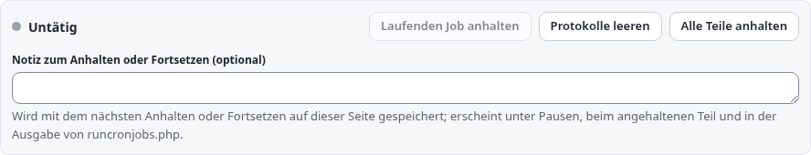
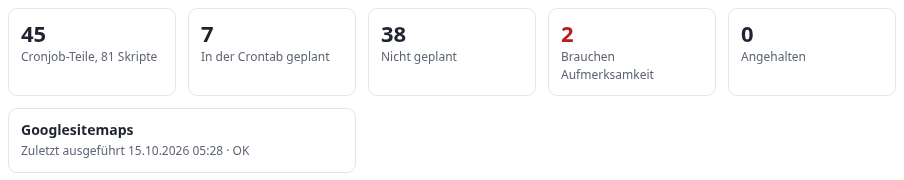
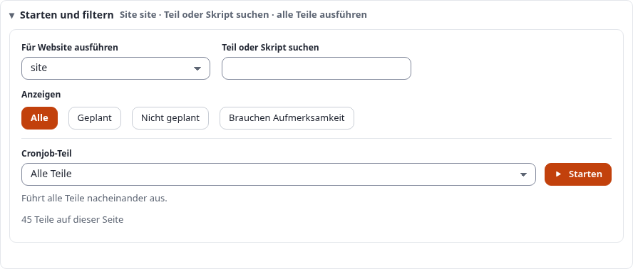
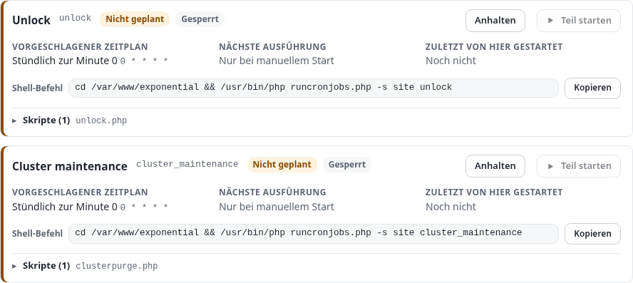
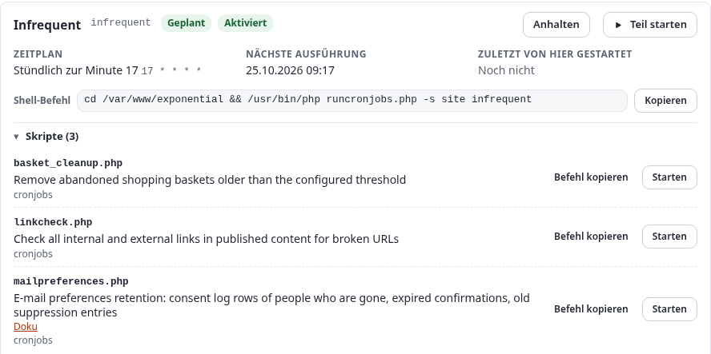
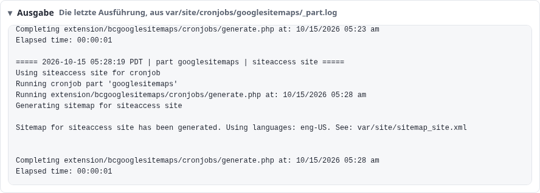
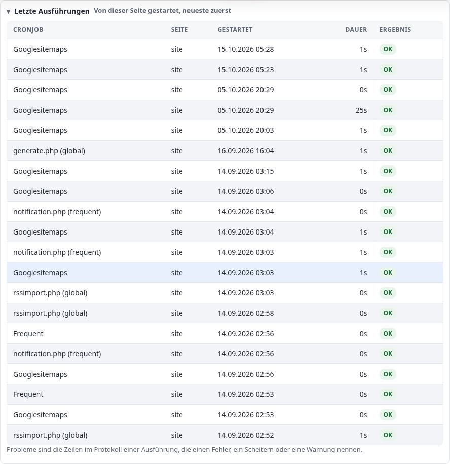
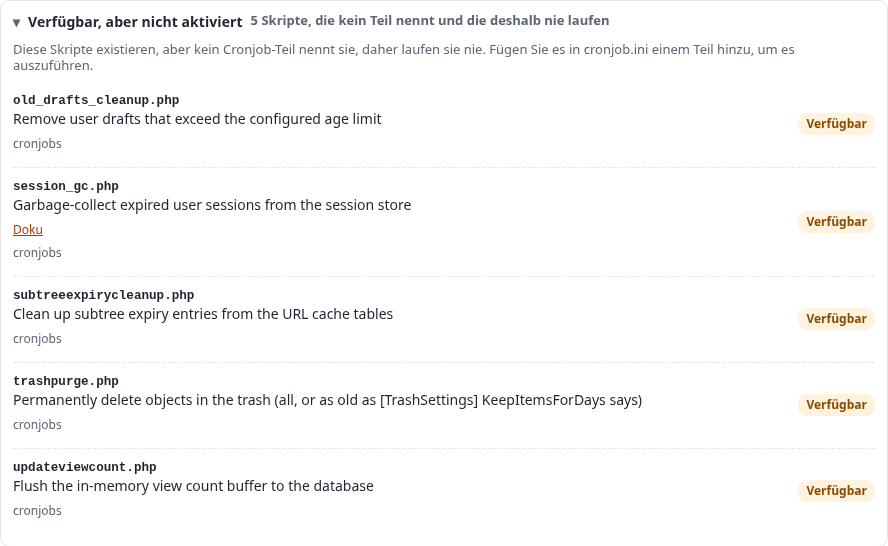

# Cronjobs: ausführen, planen und verfolgen

Diese Anleitung vermittelt alles über Cronjobs in Exponential: was ein Cronjob-Teil ist, wie Sie jeden Teil und jedes
Skript einer Installation sehen, wie Sie einen Teil oder ein einzelnes Skript über die Administrationsseite **Setup > Cronjobs**
und in einer Shell ausführen, wie Sie seine Ausgabe verfolgen, während er arbeitet, wie Sie den Zeitplan der Crontab lesen und die
Zeilen eintragen, die die Seite vorschlägt, wo die Protokolle liegen und was zu tun ist, wenn ein Job nicht startet, nicht endet oder gar nicht
geplant ist.

Sie richtet sich an Administratoren, die eine Site betreuen, und an Entwickler, die Cronjob-Skripte hinzufügen. Lesen Sie zuerst die Abschnitte 1
bis 3; danach steht jeder Abschnitt für sich. Jede Option, jede Einstellung und jeder Pfad unten wurde am Code geprüft,
und jede Ausgabe ist echt: Sie wurde am 5. Oktober 2026 auf dem Demonstrationsserver ausgegeben, rein lesend.
Die Bildschirmfotos zeigen dieselbe Seite, in einer Breite von 1500 Pixeln im hellen Modus des Designs admin4;
um sie zu erstellen, wurde nichts ausgeführt, angehalten oder geleert.

[Anleitungen](README.md) · Funktionsreferenz: [Cronjob-Konsole](../funktionen/6.0/cronjobs-in-der-konsole.md) · Im
Installationshandbuch: [10.3 Cronjobs](../installation/10-nach-der-installation.md#103-cronjobs) · Kürzere Einführung:
[Betrieb einer Site, Abschnitt 3](betrieb-einer-website.md#3-cronjobs-ausführen)

## Kurz gesagt

- Ein **Cronjob-Teil** ist eine benannte Liste von Skripten in `settings/cronjob.ini` (`[CronjobPart-<name>] Scripts[]`); die
  Skripte von `[CronjobSettings] Scripts[]` bilden den Teil, den die Seite **global** nennt und den `runcronjobs.php` ausführt, wenn
  es keinen Teilnamen erhält.
- **Setup > Cronjobs** (`/setup/cronjobs`, Richtlinie `setup/managecronjobs`) zeigt eine Karte pro Teil: ob die
  Crontab ihn ausführt, seinen Zeitplan in Worten, seine nächste und letzte Ausführung, den Shell-Befehl, der ihn ausführt, und seine Skripte
  mit dem, was jedes tut. **Teil starten** und **Starten** starten einen Teil oder ein Skript für die gewählte Site; die Ausgabe
  folgt live unter **Ausgabe**.
- **Starten** neben **Cronjob-Teil** mit *Alle Teile* führt jeden Teil, der ausgeführt werden darf, nacheinander aus, nie zwei
  gleichzeitig. **Laufenden Job anhalten** fordert den laufenden Job auf, zu enden; **Protokolle leeren** leert das gemeinsame Ausgabe- und Fehlerprotokoll.
- Die Seite liest die Crontab des Benutzers, unter dem sie läuft, und erkennt die Zeilen, die diese Installation ausführen. Für einen Teil,
  den nichts ausführt, schlägt sie eine Zeile vor (`CrontabSchedule_<part>` legt ihren Zeitplan fest); **Crontab** unten listet sie
  zum Einfügen bereit auf.
- In einer Shell: `php runcronjobs.php -s <site> <part>`, `--script=<file>` für ein Skript, `--list` für alles;
  `./console cron:<part>` ist dasselbe über die Konsole, `./console crontab:list` und `crontab:edit` zeigen und bearbeiten
  die Crontab.
- Alles funktioniert ohne JavaScript; mit JavaScript starten Ausführungen an Ort und Stelle, und die Ausgabe wird übertragen, während der Job arbeitet.
- Eine neue Installation bekommt ihre Crontab-Zeilen vom Installationsprogramm; `php bin/php/installcrontab.php --add`
  schreibt sie bei einer bestehenden ([Abschnitt 12](#12-planen-mit-der-crontab)).

## Inhalt

- [1. Teile, Skripte und der globale Teil](#1-teile-skripte-und-der-globale-teil)
- [2. Bevor Sie beginnen](#2-bevor-sie-beginnen)
- [3. Die Seite auf einen Blick](#3-die-seite-auf-einen-blick)
- [4. Die Statusleiste: Laufenden Job anhalten und Protokolle leeren](#4-die-statusleiste-laufenden-job-anhalten-und-protokolle-leeren)
- [5. Die Übersicht](#5-die-übersicht)
- [6. Die Site wählen und einen Teil finden](#6-die-site-wählen-und-einen-teil-finden)
- [7. Einen Teil, ein Skript oder jeden Teil ausführen](#7-einen-teil-ein-skript-oder-jeden-teil-ausführen)
- [8. Die Teil-Karten](#8-die-teil-karten)
- [9. Ausgabe: einen Job während der Ausführung verfolgen](#9-ausgabe-einen-job-während-der-ausführung-verfolgen)
- [10. Letzte Ausführungen und wie Probleme gezählt werden](#10-letzte-ausführungen-und-wie-probleme-gezählt-werden)
- [11. Skripte, die kein Teil ausführt, und wie Sie eines aktivieren](#11-skripte-die-kein-teil-ausführt-und-wie-sie-eines-aktivieren)
- [12. Planen mit der Crontab](#12-planen-mit-der-crontab)
- [13. Cronjobs in der Shell ausführen](#13-cronjobs-in-der-shell-ausführen)
- [14. Protokolle und die Dateien, die die Seite führt](#14-protokolle-und-die-dateien-die-die-seite-führt)
- [15. Ohne JavaScript, per Tastatur und mit einem Screenreader](#15-ohne-javascript-per-tastatur-und-mit-einem-screenreader)
- [16. Arbeitsabläufe Schritt für Schritt](#16-arbeitsabläufe-schritt-für-schritt)
- [17. Fehlerbehebung](#17-fehlerbehebung)
- [18. Alle Einstellungen](#18-alle-einstellungen)
- [Quellen](#quellen)

## 1. Teile, Skripte und der globale Teil

Ein **Skript** ist eine PHP-Datei in einem Cronjob-Verzeichnis: `cronjobs/` der Installation oder `cronjobs/` einer Extension,
die in `[CronjobSettings] ExtensionDirectories[]` genannt ist. Es erledigt eine Aufgabe: Benachrichtigungen versenden, abgelaufene Dateien löschen,
eine Sitemap erstellen.

Ein **Teil** fasst Skripte zusammen, die gemeinsam nach einem Zeitplan laufen sollen:

```ini
# settings/cronjob.ini (shipped)
[CronjobPart-frequent]
Scripts[]=notification.php
Scripts[]=workflow.php
Scripts[]=contentjobs.php
Scripts[]=audit.php
Scripts[]=mailbounces.php
```

`runcronjobs.php frequent` führt diese fünf Skripte in dieser Reihenfolge in einem Prozess aus. Extensions fügen eigene Teile
in ihrer `settings/cronjob.ini.append.php` hinzu (die Sitemap-Teile von `bcgooglesitemaps`, die Newsletter-Teile von
`cjw_newsletter`, die Oracle-Teile von `ezoracle`).

Die Skripte von `[CronjobSettings] Scripts[]` sind der **Standardteil**. `runcronjobs.php` führt sie aus, wenn es
ohne Teilnamen aufgerufen wird; die Seite zeigt sie als Teil namens **global** (Beschriftung *Global*), denn für einen Betreiber ist es
genau das. Auf dem Demonstrationsserver enthält der globale Teil die fünf Kernel-Skripte und dazu die Sitemap-Skripte, die zwei
Extensions an ihn anhängen.

Eines davon, `hide.php`, verbirgt Inhalte, deren Datum verstrichen ist: für jede Klasse in `content.ini [HideSettings]
HideDateAttributeList[]` (Klassenbezeichner und Datumsattribut) unterhalb der Knoten von `RootNodeList[]`. Es verbirgt jeden
Knoten so, wie es **Verbergen** in der Administration tut, und benachrichtigt auch die Suchmaschine, sodass verborgene Inhalte in
Suchmaschinen, die die Sichtbarkeit in ihrem Index führen (eZ Find, Solr), nicht mehr gefunden werden; die eingebaute Suchmaschine prüft die
Sichtbarkeit bei der Suche. Das Cache-Ereignis, das es sendet (`content/cache`), übergibt den Listenern die Knoten-IDs und die
Objekt-IDs, sodass ein Listener, der einen HTTP-Cache nach Objekt bereinigt, sie findet. Mit Dank an Mugo Web (LoveStack,
Commits `3298b53584`, `89a5a73877`).

Jedes Skript setzt während seiner Ausführung eine eigene Sperre (`eZMutex`, nach der Skriptdatei geschlüsselt), ob es nun als
Teil eines Teils, einzeln mit `--script`, aus der Crontab oder von der Seite gestartet wurde. Eine zweite Ausführung desselben Skripts, während
die erste die Sperre hält, gibt `Cronjob part locked by other process: <pid>` aus und überspringt es. Eine Sperre, die älter ist als
`MaxScriptExecutionTime`, wird übernommen (`Trying to steal the mutex lock`), und eine, die älter ist als das Doppelte davon, wird
gewaltsam übernommen.

## 2. Bevor Sie beginnen

**Zugriff.** Die Seite und der Datenstrom, der einen Job verfolgt, erfordern die Richtlinie `setup/managecronjobs` (beide Ansichten des
Moduls `setup` prüfen sie). In einer neuen Installation hat nur die Rolle Administrator sie. Der Menüeintrag ist
`Links[cronjobs]=setup/cronjobs` in `settings/menu.ini` und wird Benutzern mit `PolicyList_cronjobs[]=setup/managecronjobs` angezeigt.

**Ein PHP-Kommandozeilenprogramm.** Ein Job wird als eigener Prozess mit dem Kommandozeilenprogramm von PHP gestartet. Die Seite verwendet
`cronjob.ini [AdminSettings] PhpCliPath`, wenn es gesetzt ist, sonst die erste ausführbare Datei aus `PHP_BINDIR/php`,
`/usr/bin/php` und `/usr/local/bin/php`. Sie verwendet nie das Programm, das die Webanfrage beantwortet (unter PHP-FPM ist das
das FPM-Programm, das kein Skript ausführen kann). Wird keines gefunden, meldet die Seite dies oben in Rot, und jeder Knopf zum Starten
ist deaktiviert. Auf einem Host mit mehreren PHP-Versionen setzen Sie `PhpCliPath` auf die Version, mit der die Site läuft, zum Beispiel
`/opt/plesk/php/8.5/bin/php` auf dem Demonstrationsserver.

**PHP-Funktionen.** Das Starten eines Jobs erfordert `proc_open`; das Lesen der Crontab erfordert `exec`; **Laufenden Job anhalten** erfordert
`posix_kill`. Steht eine davon in `disable_functions`, öffnet sich die Seite trotzdem und nennt die fehlende Funktion.

**Die Sites.** **Für Website ausführen** bietet `site.ini [SiteAccessSettings] RelatedSiteAccessList[]` an, oder
`AvailableSiteAccessList[]`, wenn es keine Liste verwandter Siteaccesses gibt. Ein Job liest die Einstellungen des Siteaccess, unter dem er läuft,
deshalb ist die Wahl wichtig: Indizierung, Sitemaps und Benachrichtigungen wirken auf die Inhalte und URLs dieser Site.

**Wohin geschrieben wird.** Die Seite schreibt ihre Protokolle und Aufzeichnungen unter das var-Verzeichnis des Administrations-Siteaccess,
in `cronjobs/` (auf dem Demonstrationsserver `var/site/cronjobs/`). Abschnitt 14 listet jede Datei auf.

## 3. Die Seite auf einen Blick

Von oben nach unten:

| Bereich | Wofür er da ist | Abschnitt |
|---|---|---|
| Statusleiste | *Untätig* oder was läuft, für welche Site, welcher Prozess und seit wann; **Laufenden Job anhalten**, **Protokolle leeren**; die Protokolldatei und das PHP-Programm | 4 |
| Übersicht | Teile und Skripte, geplant, nicht geplant, brauchen Aufmerksamkeit, die letzte Ausführung und ihr Ergebnis | 5 |
| Starten und filtern | **Für Website ausführen**, **Teil oder Skript suchen**, **Anzeigen**, **Cronjob-Teil** mit **Starten** | 6, 7 |
| Ausgabe (aufklappbar) | Was der laufende oder der letzte Job geschrieben hat, live verfolgt | 9 |
| Cronjob-Teile | Eine Karte pro Teil, seitenweise | 8 |
| Verfügbar, aber nicht aktiviert (aufklappbar) | Skripte auf der Festplatte, die kein Teil nennt | 11 |
| Letzte Ausführungen (aufklappbar, geöffnet) | Von dieser Seite gestartete Ausführungen, neueste zuerst | 10 |
| Crontab (aufklappbar) | Was die Crontab jetzt enthält, und Zeilen für die Teile, die nichts ausführt | 12 |

Die Seite ist ein einziges Formular: Jeder Knopf, der etwas ändert, ist ein Absendeknopf dieses Formulars, daher funktioniert sie ohne
JavaScript (Abschnitt 15). Das Layout hält ab 390 Pixeln Breite und bei 200 Prozent Zoom; die aufklappbaren Abschnitte sind
`<details>`-Elemente, die mit einem Klick oder mit der Eingabetaste geöffnet und geschlossen werden.

## 4. Die Statusleiste: Laufenden Job anhalten und Protokolle leeren



Die linke Seite zeigt **Untätig** oder **Läuft: <part>** mit einem grün pulsierenden Punkt, gefolgt von **Website: <siteaccess>**,
**Prozess: <pid>** und **Verstrichen: <seconds>s**, das hochzählt, während Sie zusehen. Der Zustand stammt aus
`cronjobs/state.json`, das geschrieben wird, wenn die Seite einen Job startet, und gilt nur, solange dieser Prozess lebt und seine
Kommandozeile noch `runcronjobs.php` enthält (eine wiederverwendete Prozessnummer wird nicht mit dem Job verwechselt). Wo `/proc` nicht
lesbar ist, gilt ein Job nicht mehr als laufend, sobald er älter ist als das Doppelte von `MaxScriptExecutionTime` (ausgeliefert 43.200
Sekunden, also 24 Stunden).

Es läuft jeweils nur ein von der Seite gestarteter Job. Während einer läuft, ist jeder Knopf zum Starten deaktiviert, und ein Start wird
mit *Der Teil „<part>“ läuft noch als Prozess <pid>. Warten Sie, bis er fertig ist, oder halten Sie ihn zuerst an.* abgewiesen. Jobs, die die Crontab
startet, werden nicht mitgezählt: Sie sind eigene Prozesse, von denen die Seite nichts weiß, und die Skriptsperren aus Abschnitt 1
halten beide auseinander.

**Laufenden Job anhalten** sendet dem Job `SIGTERM` (Signal 15), nicht `SIGKILL`: Das Skript kann seine Sperre freigeben und sauber
enden. Die Antwort lautet *Prozess <pid> wurde aufgefordert anzuhalten.*; die Ausgabe zeigt dann das Ende des Jobs. Der Knopf ist deaktiviert, solange
nichts läuft. Er schlägt fehl mit *Dem Prozess <pid> konnte kein Signal gesendet werden. Er gehört möglicherweise einem anderen Benutzer.*, wenn der Job
unter einem anderen Systembenutzer läuft als der Webserver, der diese Anfrage beantwortet (siehe Abschnitt 17).

**Protokolle leeren** leert das gemeinsame Ausgabeprotokoll und das Fehlerprotokoll (`[AdminSettings] LogFile` und `ErrorFile`) und
verwirft die Zustandsdatei des letzten Jobs, wenn nichts läuft. Es löscht weder die Protokolle pro Teil aus Abschnitt 14 noch den
Ausführungsverlauf. Antwort: *Die Ausgabe- und Fehlerprotokolle der Cronjobs wurden geleert.*

Unter der Leiste nennt die Seite das Protokoll, das die Ausgabe zeigt, und das PHP-Programm, mit dem Jobs laufen, sodass ein falsches Programm sichtbar ist,
bevor irgendetwas ausgeführt wird.

## 5. Die Übersicht



| Zahl | Bedeutung |
|---|---|
| **Cronjob-Teile, n Skripte** | Jeder Teil mit mindestens einem Skript, einschließlich *global*; Skripte pro Teil gezählt |
| **In der Crontab geplant** | Teile, die eine Crontab-Zeile dieser Installation ausführt (Abschnitt 12) |
| **Nicht geplant** | Der Rest. Nicht jeder Teil muss geplant sein: Manche sind Einzelteile aus Skripten, die `frequent` bereits ausführt |
| **Brauchen Aufmerksamkeit** (rot, wenn über 0) | Teile, die gesperrt sind (`ForbiddenParts[]`), denen ein Skript fehlt oder deren letzte Ausführung von der Seite Probleme protokolliert hat |
| **Letzter Lauf** | Die neueste von der Seite gestartete Ausführung, wann, und *läuft*, *OK* oder *n Probleme*; vor der ersten *Von hier aus wurde noch nichts ausgeführt.* |

Auf dem Demonstrationsserver sind die beiden Teile, die Aufmerksamkeit brauchen, `unlock` und `cluster_maintenance`, die die ausgelieferten
Einstellungen sperren (Abschnitt 7).

## 6. Die Site wählen und einen Teil finden



**Für Website ausführen** ist der Siteaccess, den jeder Knopf zum Starten auf der Seite verwendet. Vorausgewählt ist die erste Site der Liste, die
nicht der Administrations-Siteaccess ist, den Sie gerade betrachten, denn ein Job, der auf Inhalte wirkt, soll auf die Site wirken, die
sie veröffentlicht. Eine Änderung schreibt auch den Siteaccess in jedem Shell-Befehl auf der Seite um, sodass ein kopierter Befehl
immer dem entspricht, was Starten tun würde.

**Teil oder Skript suchen** schränkt die Karten während der Eingabe ein. Es findet Teilnamen und Beschriftungen, Dateinamen von Skripten und das,
was die Skripte über sich sagen (die `@description` ihres Kopfes), alle Wörter in beliebiger Reihenfolge: `sitemap` findet jeden Sitemap-Teil,
`bounce` findet `mailbounces` über seine Beschreibung. Während ein Suchbegriff eingegeben ist, öffnen sich die Skriptlisten der passenden Teile,
sodass ein Treffer bei einem Skript sichtbar ist; sie schließen sich wieder, wenn die Suche geleert wird.

**Anzeigen** behält *Alle* Teile, nur *Geplant*, nur *Nicht geplant* oder nur die, die *Brauchen Aufmerksamkeit*. Die Zeile
unter den Bedienelementen gibt an, wie viele Karten angezeigt werden (*25 Teile auf dieser Seite* oder *3 von 25 Teilen dieser Seite angezeigt*);
*Kein Cronjob-Teil auf dieser Seite passt.*, wenn die Filter keinen übrig lassen.



Die Suche und **Anzeigen** wirken auf die Karten der aktuellen Seite. Die Liste wird nach
`admininterface.ini [PaginationSettings] ItemsPerPage[setup/cronjobs]` (ausgeliefert 25) in Seiten aufgeteilt; die Seitennavigation steht unter der Liste.

## 7. Einen Teil, ein Skript oder jeden Teil ausführen

### 7.1 Ein Teil

Klicken Sie auf der Karte auf **Teil starten**. Sein zugänglicher Name ist *Den ganzen Teil <part> jetzt ausführen*. Die Seite startet
`runcronjobs.php -s <site> --no-colors <part>` (ohne Teilnamen für *global*) als eigenen Prozess, der weiterläuft,
nachdem die Seite geschlossen wurde, und antwortet *Der Teil „<part>“ wurde für <site> als Prozess <pid> gestartet.* Die Statusleiste wechselt
zu *Läuft*, die Karte erhält einen grünen Rand, und die Ausgabe öffnet sich und verfolgt den Job.

### 7.2 Ein Skript

Öffnen Sie die Zeile **Skripte (n)** der Karte und klicken Sie neben einem Skript auf **Starten** (*<script> einzeln ausführen*). Die Seite startet
`runcronjobs.php -s <site> --no-colors --script=<file>`: nur dieses Skript, mit derselben Sperre und derselben Ausgabe wie
bei der Ausführung innerhalb seines Teils. Antwort: *<script> wurde für <site> als Prozess <pid> gestartet.* Ein Skript, das nicht gefunden wurde, oder
ein Skript eines gesperrten Teils hat keinen Knopf zum Starten, sondern *Dieses Skript kann nicht von hier aus ausgeführt werden*.

### 7.3 Jeder Teil, einer nach dem anderen

Lassen Sie **Cronjob-Teil** auf *Alle Teile* und klicken Sie daneben auf **Starten**. Der Hinweis darunter lautet *Führt alle Teile
nacheinander aus.* Die Seite sammelt jeden Teil der Liste, der ausgeführt werden darf (auf jeder Seite der Liste, nicht nur die Karten, die Sie sehen),
schreibt *n Teile werden nacheinander ausgeführt.* in die Ausgabe, startet den ersten und startet den nächsten 0,4 Sekunden,
nachdem die Ausgabe das Ende des vorherigen gemeldet hat (*Als Nächstes: <part>*). Es läuft immer nur ein Job zur Zeit.

Wählen Sie stattdessen einen Teil unter **Cronjob-Teil**, werden die Karten auf diesen Teil eingeschränkt, und **Starten** führt ihn allein aus (*Führt den
Teil <part> aus.*).

Die Warteschlange lebt in der geöffneten Seite: Sie braucht JavaScript und das Formular-Token (Abschnitt 15), und sie endet, wenn die Seite
geschlossen oder neu geladen wird, wenn **Laufenden Job anhalten** gedrückt wird oder wenn ein Start abgewiesen wird. Teile, die bereits
aus der Crontab laufen, werden nicht übersprungen: Ihre Skripte stoßen auf die Sperre und werden mit *Cronjob part locked by other
process* übergangen.

### 7.4 Was ausgeführt werden kann und was nicht

Ein Teil kann von der Seite ausgeführt werden, wenn alle folgenden Bedingungen erfüllt sind; andernfalls ist sein Knopf zum Starten deaktiviert:

| Bedingung | Meldung, wenn sie nicht erfüllt ist |
|---|---|
| Der Teil existiert und steht nicht in `[AdminSettings] ForbiddenParts[]` | *Ein Cronjob-Teil namens „<part>“ kann von hier aus nicht gestartet werden.* |
| Mindestens eines seiner Skripte wurde gefunden (ein Teil, dem einige Skripte fehlen, führt die übrigen trotzdem aus) | dieselbe |
| Das Skript gehört zu dem Teil (ein Skript) | *Der Teil „<part>“ hat kein Skript namens „<script>“.* |
| Die Site steht in der Liste | *Diese Installation bedient keinen Siteaccess namens „<site>“.* |
| Nichts, was von der Seite gestartet wurde, läuft | *Der Teil „<part>“ läuft noch als Prozess <pid>. Warten Sie, bis er fertig ist, oder halten Sie ihn zuerst an.* |
| Ein PHP-Kommandozeilenprogramm wurde gefunden | *Es wurde kein PHP-Kommandozeilenprogramm gefunden. Setzen Sie cronjob.ini [AdminSettings] PhpCliPath auf seinen vollständigen Pfad.* |
| `proc_open` ist verfügbar | *proc_open ist deaktiviert, daher kann ein Cronjob nicht über die Oberfläche gestartet werden. Führen Sie ihn in einer Shell aus.* |
| `runcronjobs.php` liegt im Wurzelverzeichnis der Installation | *runcronjobs.php liegt nicht dort, wo es sein sollte: <path>* |
| Der gestartete Prozess hat seine ID innerhalb von zwei Sekunden hinterlegt | *Der Cronjob wurde gestartet, hat aber keine Prozess-ID gemeldet und kann deshalb von hier aus weder verfolgt noch angehalten werden. Prüfen Sie <error log>.* |

`ForbiddenParts[]` wird mit `cluster_maintenance` (bereinigt den Cluster-Speicher) und `unlock` (gibt Sperren frei, die andere
Prozesse halten) ausgeliefert. Beide sind destruktiv und gehören in die Hand eines Administrators in einer Shell, nicht auf einen Knopf; ihre Karten zeigen
*Gesperrt*, und der Shell-Befehl auf der Karte zeigt trotzdem, wie sie ausgeführt werden.

Jeder Start, jedes Anhalten und jedes Leeren antwortet mit einer Weiterleitung zurück zur Seite, die die Meldung in der Sitzung mitführt. Ein
anschließendes Neuladen der Seite liest die Seite nur erneut; es kann niemals einen Job ein zweites Mal starten.

## 8. Die Teil-Karten

Die Liste der Teile hat zwei Ansichten, umschaltbar neben ihrer Überschrift: **Kompakt**, die Voreinstellung, ist eine Tabellenzeile pro Teil
mit seinen Kennzeichen, seinem Zeitplan, nächster und letzter Ausführung und den Knöpfen **Anhalten**/**Fortsetzen** und **Starten**, alle Teile auf einer Seite;
**Ausführlich** zeigt die in diesem Abschnitt beschriebenen Karten, seitenweise. Die Wahl wird für Ihren Benutzer gespeichert.



Jede Karte zeigt von oben:

- **Den Namen** (die Beschriftung, *Cache cleanup* für `cache_cleanup`) und den Schlüssel, den die Shell verwendet (`cache_cleanup`).
- **Kennzeichen.** *Geplant* (grün), wenn eine Crontab-Zeile dieser Installation den Teil ausführt, sonst *Nicht geplant* (gelb).
  Dann *Aktiviert* (grün), *Gesperrt* (grau, in `ForbiddenParts[]`) oder *n fehlen* (rot, Skripte, die in keinem Cronjob-Verzeichnis
  gefunden wurden).
- **Den Rand.** Links rot bei einem Teil, der Aufmerksamkeit braucht, grün rundum bei dem Teil, der gerade läuft.
- **Teil starten** (Abschnitt 7.1) und **Anhalten** oder **Fortsetzen**: Ein angehaltener Teil zeigt *Angehalten* sowie seit wann und von wem,
  und wird von jeder Ausführung ausgelassen – auch von der der Crontab –, bis er fortgesetzt wird (ein Teil, der während seiner Ausführung angehalten wird, beendet
  das gerade laufende Skript und lässt den Rest aus); **Alle Teile anhalten** in der Statusleiste tut
  dasselbe für jeden Teil. Eine Notiz, die in *Notiz zum Anhalten oder Fortsetzen* eingegeben wird, wird mit dem als Nächstes gedrückten Knopf gespeichert und
  erscheint beim Teil, unter **Pausen** und in der Meldung von `runcronjobs.php`. Siehe
  [Cronjob-Teile anhalten](../funktionen/6.0/cronjobs-pausieren.md).
- **Zeitplan** oder **Vorgeschlagener Zeitplan** für einen Teil, den nichts ausführt: der Zeitplan in Worten für die gängigen Formen und der
  Cron-Ausdruck daneben. *Jede Minute*, *Alle 5 Minuten*, *Stündlich zur Minute 17*, *Alle 6 Stunden zur Minute
  0* und *Täglich um 03:30* werden in Worten angegeben; alles andere (`0 8 * * 1-5`) wird als Ausdruck gezeigt, der
  trotzdem exakt ist. `@hourly`, `@daily`, `@weekly`, `@monthly`, `@yearly`, `@annually` und `@midnight` werden als ihre
  Entsprechungen mit fünf Feldern gelesen; eine Zeile mit `@reboot` hat keinen anzeigbaren Zeitplan (*Aus der Crontab-Zeile nicht lesbar*).
- **Nächste Ausführung**: wann die Crontab-Zeile den Teil als Nächstes ausführt, in der Zeit des Servers, berechnet nach den üblichen Cron-Regeln
  (Bereiche, Schrittweiten, Listen, Monats- und Wochentagsnamen, Sonntag als 0 oder 7, Tag des Monats und Wochentag passen alternativ, wenn beide
  eingeschränkt sind). *Nur bei manuellem Start* für einen Teil, den nichts plant.
- **Zuletzt von hier gestartet**: wann er zuletzt von der Seite gestartet wurde, wie lange es dauerte und *OK* oder *n Probleme*; der
  Name des Skripts, wenn ein einzelnes Skript ausgeführt wurde; sonst *Noch nicht*. Ausführungen, die die Crontab gestartet hat, werden hier nicht gezählt (ihre
  Ausgabe geht dorthin, wohin die Crontab-Zeile sie schickt).
- **Shell-Befehl**: der Befehl, der den Teil jetzt ausführt, vom Wurzelverzeichnis der Installation aus, mit dem PHP-Programm der
  Seite und der oben gewählten Site, zum Beispiel
  `cd /var/www/example && /opt/plesk/php/8.5/bin/php runcronjobs.php -s site infrequent`.
  **Kopieren** legt ihn in die Zwischenablage (*Der Befehl ist in der Zwischenablage.*). Anders als eine Crontab-Zeile leitet er die
  Ausgabe nicht nach `/dev/null`, sodass jeder, der ihn einfügt, sieht, was der Job meldet.
- **Skripte (n)**, zu einer Zeile mit Namen zusammengeklappt. Geöffnet: jedes Skript mit dem, was es tut (das `@description`-Tag seines
  Kopfes oder der Klassendatei, die sein Einstiegspunkt nennt) und **Doku**, wenn das Skript seine Dokumentation nennt (siehe unten),
  das Verzeichnis, in dem es gefunden wurde (*in keinem Cronjob-Verzeichnis gefunden* in Rot, wenn es fehlt), **Befehl kopieren** (der
  `--script=`-Befehl für dieses Skript allein) und **Starten**.

## 9. Ausgabe: einen Job während der Ausführung verfolgen



**Ausgabe** zeigt das Ende des Protokolls der neuesten von der Seite gestarteten Ausführung (die letzten 64 KB; darüber *... earlier output not
shown ...*, wenn es mehr gibt), gefolgt von allem Neuen im Fehlerprotokoll. Ihre Zusammenfassung nennt die Datei:
*Die letzte Ausführung, aus var/site/cronjobs/googlesitemaps/_part.log*. Sie ist geöffnet, während ein Job läuft, und öffnet sich von selbst, wenn
die Seite einen startet.

Jede Ausführung beginnt mit einer Kopfzeile, die die Seite schreibt:

```
===== 2026-10-05 20:29:32 PDT | part googlesitemaps | siteaccess site =====
Using siteaccess site for cronjob
Running cronjob part 'googlesitemaps'
Running extension/bcgooglesitemaps/cronjobs/generate.php at: 10/05/2026 08:29 pm
Generating sitemap for siteaccess site

Sitemap for siteaccess site has been generated. Using languages: eng-US. See: var/site/sitemap_site.xml

Completing extension/bcgooglesitemaps/cronjobs/generate.php at: 10/05/2026 08:29 pm
Elapsed time: 00:00:00
```

Mit JavaScript verfolgt die Seite, während ein Job läuft, sein Protokoll über einen Server-Sent-Events-Datenstrom
(`/setup/cronjobsstream`), beginnend dort, wo das ausgegebene Protokoll endete, sodass nichts doppelt erscheint. Kopfzeilen sind blau,
Zeilen des Fehlerprotokolls rot. Die Zeile neben der Überschrift zeigt *wird verfolgt…*, dann *fertig*, wenn der Job beendet und seine letzte
Ausgabe gelesen ist (zwei Sekunden, nachdem der Prozess verschwunden ist), oder *Datenstrom geschlossen*, wenn die Verbindung abgebrochen ist. Wenn die Warteschlange
aus Abschnitt 7.3 den nächsten Teil startet, wechselt der Datenstrom von selbst zum Protokoll dieses Teils (*Following
<part>/_part.log.*). Ein Datenstrom endet nach einer Stunde (*Stopped following after an hour. The cronjob is still running;
reopen the page to follow it again.*); der Job ist davon nicht betroffen, nur das Verfolgen.

Der Datenstrom wird nur geöffnet, während etwas läuft: Läuft nichts, zeigt die Seite das Protokoll bereits, und ein Datenstrom
würde einen PHP-Worker umsonst belegen.

## 10. Letzte Ausführungen und wie Probleme gezählt werden



**Letzte Ausführungen** listet die letzten 20 von der Seite gestarteten Ausführungen auf, neueste zuerst: den Teil oder *Skript (Teil)*; die Site;
wann sie begann; wie lange sie dauerte; und *läuft*, *OK* oder *n Probleme*. Die Seite erfasst eine Ausführung, wenn sie sie startet,
weil der Job die Anfrage überdauert; eine Ausführung, die nicht mehr lebt, wird beim nächsten Seitenaufruf abgeschlossen, ihre Dauer
ergibt sich aus dem Zeitpunkt, zu dem ihr Protokoll zuletzt geschrieben wurde.

**Probleme** sind die Zeilen im Abschnitt dieser Ausführung in ihrem Protokoll (alles nach ihrer eigenen `=====`-Kopfzeile), die eines
der Wörter *error*, *fatal*, *exception*, *failed*, *failure* oder *warning* enthalten. Das ist ein Hinweis, kein Urteil: Ein Skript, das
„0 errors“ ausgibt, zählt ein Problem. Öffnen Sie das Protokoll (Abschnitt 14), um zu sehen, was die Zeilen sagen.

`[AdminSettings] HistoryLength` (Standard 100) gibt an, wie viele Ausführungen `cronjobs/history.json` aufbewahrt; **Zuletzt von hier gestartet**
auf den Karten berücksichtigt diese, die Tabelle zeigt die neuesten 20.

Jede Ausführung eines Cronjob-Teils wird außerdem im Audit-Protokoll als `system.cronjob.run` (oder `system.cronjob.fail`) erfasst,
egal wer sie gestartet hat: siehe das [Audit-Protokoll](../funktionen/6.0/pruefprotokoll.md).

## 11. Skripte, die kein Teil ausführt, und wie Sie eines aktivieren



**Verfügbar, aber nicht aktiviert** listet jede `*.php` in den Cronjob-Verzeichnissen auf, die kein Teil nennt, mit dem, was sie tut,
und wo sie liegt. Nichts führt sie je aus. In einer neuen Installation sind das unter anderem `session_gc.php` (abgelaufene
Sitzungen), `old_drafts_cleanup.php`, `trashpurge.php` (leert den Papierkorb, oder mit `content.ini [TrashSettings]
KeepItemsForDays` nur das, was älter ist), `staticcache_cleanup.php`, `subtreeexpirycleanup.php` und
`updateviewcount.php`.

Um eines einmal auszuführen, verwenden Sie die Shell (Abschnitt 13) mit `--script=<file>`. Um es regelmäßig auszuführen, fügen Sie es einem Teil hinzu: einem
bestehenden oder einem eigenen Teil, damit es einen eigenen Zeitplan erhält:

```ini
# settings/override/cronjob.ini.append.php
[CronjobPart-sessions]
Scripts[]=session_gc.php
```

Leeren Sie den INI-Cache (`php bin/php/ezcache.php --clear-tag=ini --allow-root-user`) und laden Sie die Seite neu: Die Karte
*Sitzungen* erscheint, *Nicht geplant*, mit einem vorgeschlagenen Zeitplan von stündlich zur Minute 0. Abschnitt 12 plant sie ein.

Ein eigenes Skript gehört in `cronjobs/` Ihrer Extension, wobei die Extension in
`[CronjobSettings] ExtensionDirectories[]` genannt ist. Geben Sie seinem Kopf eine `@description`-Zeile; die Seite, die Suche und
`./console list cron` zeigen sie an:

```php
<?php
/**
 * @description Remove expired entries from the example table
 * @link https://intranet.example.com/operations/example-cleanup
 */
```

`@link` (das phpDoc-Tag für eine URL) setzt auf der Seite einen Link **Doku** neben das Skript; er öffnet sich in einem neuen Fenster. Ein
Pfad wie `doc/eng-us/guides/sessions.md` wird an `[ScriptDocumentation] DocumentationBase` angehängt (leer: die
Dokumentation von Exponential auf GitHub), sodass die Kernel-Skripte auf diese Weise ihre Anleitung nennen. Nur `http`- und `https`-Links
werden angezeigt; ein Wert, der keines von beiden ist, ergibt keinen Link. Mit der Standardbasis wird ein Pfad nur verlinkt, wenn die
Installation diese Datei mitliefert, sodass kein Link ins Leere führt, und der relative Pfad eines Extension-Skripts wird nie an die Basis von
Exponential angehängt (er nennt eine Datei der Extension): Ein solches Skript zeigt, wie eines, das nichts nennt, keinen Link **Doku**,
bis `Link[]` einen angibt. Eine Installation setzt oder ersetzt den Link jedes
Skripts, etwa ihre eigene Dokumentation für das Skript einer Extension, in `settings/override/cronjob.ini.append.php`,
anhand des Dateinamens, wie `Scripts[]` ihn führt:

```ini
[ScriptDocumentation]
Link[sitemap.php]=https://intranet.example.com/operations/sitemaps
# no link, also when the header names one
Link[session_gc.php]=none
# where paths are looked up
DocumentationBase=https://intranet.example.com/operations/
```

## 12. Planen mit der Crontab

Seit 6.0.15 schreiben die Installationsprogramme die Crontab einer neuen Installation selbst, in die Crontab des
Benutzers, dem sie gehört, zwischen die Zeilen `# BEGIN Exponential cronjobs: <Wurzel>` und
`# END Exponential cronjobs: <Wurzel>`; bei einer bestehenden Installation tut `php bin/php/installcrontab.php --add`
dasselbe (`--show`, `--remove`, `--dry-run`). Die Seite erkennt diese Zeilen wie jede andere. Der Dashboard-Block
**Cronjobs** zeigt, wann jeder Teil zuletzt lief, und warnt, wenn einer überfällig ist. Alles dazu:
[Die Installationsprogramme schreiben den Cronjob](../bc/6.0/crontab-bei-der-installation.md).

### 12.1 Was die Seite liest

Die Seite führt `crontab -l` als der Systembenutzer aus, unter dem der Webserver läuft, und wertet eine Zeile als Ausführung eines Teils dieser
Installation, wenn sie `runcronjobs.php` und den realen Pfad des Wurzelverzeichnisses der Installation enthält. Der Teil ist das erste Wort
nach `runcronjobs.php`, das keine Option ist (`-s` und `--siteaccess` nehmen das nächste Wort mit); fehlt ein solches Wort,
ist der globale Teil gemeint. Zeilen anderer Installationen auf demselben Rechner werden ignoriert.

Der Abschnitt **Crontab** unten zeigt, was jetzt in der Crontab steht (*Derzeit in der Crontab*, gelesen mit `crontab -l`),
oder, wenn es keine gibt, *Der Benutzer, unter dem diese Website läuft (<user>), hat keine Crontab, oder crontab ist nicht im Suchpfad. Die folgenden Einträge
würden hinzugefügt.*

### 12.2 Was die Seite vorschlägt

**Vorgeschlagene Einträge** enthält eine Zeile für jeden Teil, der weder geplant noch gesperrt ist, geschrieben mit dem eigenen
Wurzelverzeichnis und PHP-Programm dieser Installation, für die Site, die beim Aufbau der Seite gewählt war:

```
17 * * * * cd /var/www/example && /opt/plesk/php/8.5/bin/php runcronjobs.php -s site infrequent >/dev/null 2>&1
```

**Vorgeschlagene Einträge kopieren** kopiert sie alle. Nichts fügt sie für Sie hinzu. Der Zeitplan jeder Zeile ist
`[AdminSettings] CrontabSchedule_<part>`, wenn es gesetzt ist, sonst `*/5 * * * *` für `frequent`, `*/15 * * * *` für
den globalen Teil, `17 * * * *` für `infrequent` und `0 * * * *` für jeden anderen Teil:

```ini
# settings/override/cronjob.ini.append.php
[AdminSettings]
CrontabSchedule_sessions=50 3 * * *
CrontabSchedule_cache_cleanup=40 3 * * *
```

### 12.3 Die Zeilen eintragen

1. Entscheiden Sie, welche Teile geplant werden sollen. `frequent` alle paar Minuten ist das, was Benachrichtigungen und Inhaltsjobs erwarten;
   `infrequent` und der globale Teil stündlich; Bereinigungsteile einmal pro Nacht. Ein Einzelteil wie `notification` braucht
   nur dann eine eigene Zeile, wenn er öfter laufen soll als `frequent`, das sein Skript bereits enthält.
2. Kopieren Sie die Zeilen aus **Vorgeschlagene Einträge** oder den Shell-Befehl der Karte mit einem vorangestellten Zeitplan.
3. Öffnen Sie die Crontab des Site-Benutzers (des Benutzers, unter dem der Webserver läuft, damit ihm die Dateien gehören, die die Jobs schreiben):
   `crontab -e -u <site user>` oder `./console crontab:edit` als dieser Benutzer. Einfügen, speichern.
4. Laden Sie die Seite neu. Die Teile sind *Geplant*, die Karten zeigen den Zeitplan in Worten und die nächste Ausführung.

Verwerfen Sie die Ausgabe mit `>/dev/null 2>&1`, wie es die Seite schreibt, oder hängen Sie sie an ein eigenes Protokoll an:

```
*/5 * * * * cd /path/to/installation && php runcronjobs.php -q -s site frequent >> var/log/cron-frequent.log 2>&1
*/15 * * * * cd /path/to/installation && php runcronjobs.php -q -s site >> var/log/cron-default.log 2>&1
```

Die Seite liest das erste Wort nach den Optionen als Teilnamen und hält bei der ersten Umleitung, Pipe oder verketteten
Anweisung an, sodass beide Zeilen oben erkannt werden: Die erste plant `frequent`, die zweite den globalen Teil. Eine Zeile, die
ein einzelnes Skript ausführt (`--script=session_gc.php`), plant keinen Teil.

Die echte Crontab des root-Benutzers auf dem Demonstrationsserver enthält eine Zeile dieser Installation:

```
* * * * * cd /var/www/example && /opt/plesk/php/8.5/bin/php runcronjobs.php -q publishing >> var/log/cronjob-publishing.log 2>&1 # exponential static cache and search index after publishing (the demonstration site's own settings extension)
```

Die Seite liest sie als Teil `publishing`, *Jede Minute*.

## 13. Cronjobs in der Shell ausführen

Führen Sie jeden Befehl im Wurzelverzeichnis der Installation aus. Als `root` fügen Sie `--allow-root-user` hinzu; besser ist es, als Site-Benutzer zu arbeiten, damit
die Dateien, die ein Job schreibt, für den Webserver beschreibbar bleiben.

### 13.1 runcronjobs.php

```bash
php runcronjobs.php --help --allow-root-user
```

```
Usage: runcronjobs.php [OPTION]... [PART]
Executes Exponential cronjobs.

General options:
  -h,--help          display this help and exit 
  -q,--quiet         do not give any output except when errors occur
  -s,--siteaccess    selected siteaccess for operations, if not specified default siteaccess is used
  -d,--debug         display debug output at end of execution
  -c,--colors        display output using ANSI colors
  --sql              display sql queries (must be used in conjunction with debug option)
  --logfiles         create log files
  --no-logfiles      do not create log files (default)
  --list             list all cronjobs parts and the scripts contained by each one
  --script=<file>    run one named script instead of a whole part, for instance
                     --script=notification.php. The file is looked for in the
                     directories cronjob.ini names; only its file name is used
  --no-colors        do not use ANSI coloring (default)
```

Die üblichen Aufrufe:

```bash
php runcronjobs.php --list --allow-root-user                              # every part and its scripts
php runcronjobs.php -s site frequent --allow-root-user                    # one part
php runcronjobs.php -s site --script=notification.php --allow-root-user   # one script
php runcronjobs.php -s site --allow-root-user                             # the global part
```

`--siteaccess site` und `--siteaccess=site` funktionieren beide, ebenso `--script notification.php` und
`--script=notification.php`. Von `--script` wird nur der Dateiname verwendet, sodass ein Pfad kein Skript außerhalb der
Cronjob-Verzeichnisse erreichen kann. `--list` gibt jedes Skript einmal für jedes Cronjob-Verzeichnis aus, in dem es gefunden wird; auf dem Demonstrationsserver
nennt `ScriptDirectories[]` `cronjobs` dreimal (der Kernel und zwei Einstellungsdateien hängen es an), daher erscheint jedes Kernel-Skript
dreimal:

```
CronjobPart-frequent:
		 cronjobs/notification.php
		 cronjobs/notification.php
		 cronjobs/notification.php
		 cronjobs/workflow.php
		 ...
```

### 13.2 Die Konsole

Jeder `[CronjobPart-...]` des Kernels und der Extensions ist auch ein Konsolenbefehl, `cron:<part>`, beschrieben durch
die `@description`-Tags seiner Skripte:

```bash
./console list cron
```

```
cron       — cronjobs/*.php  (Cronjob parts via runcronjobs.php)
──────────────────────────────────────────────────────────────────
  cron:archivesitemap                        Generate the archive XML sitemaps of the configured siteaccesses
  cron:audit                                 Audit: sink spools, alert rules, rotation by day, archives, retention and checkpoints
  cron:cache_cleanup                         Remove expired and old view cache and cache-block files from disk (+1 more)
  ...
  cron:frequent                              Process and dispatch pending notification events to subscribers (+4 more)
  ...
```

`./console cron:frequent -s site --allow-root-user` führt `runcronjobs.php` mit den angegebenen Optionen und dem Teilnamen
am Ende aus. `./console help cron:frequent` listet die Beschreibung jedes Skripts auf. Der globale Teil hat keinen `cron:`-Befehl;
führen Sie ihn mit `runcronjobs.php` ohne Teil aus. `./console crontab:list` gibt die Crontab des aktuellen Benutzers aus, und
`./console crontab:edit` öffnet sie in `$EDITOR`.

### 13.3 Der Befehl von der Seite

Der **Shell-Befehl** einer Karte und **Befehl kopieren** eines Skripts sind genau die Befehle, die die Seite ausführen würde, mit dem
PHP-Programm und dem Wurzelverzeichnis, das sie verwendet (Abschnitt 8). Fügen Sie einen davon in ein Terminal ein, wenn Sie die Ausgabe eines Jobs in Ihrer eigenen
Shell sehen oder ihn in einem Debugger ausführen möchten (`-d` fügt am Ende die Debug-Ausgabe hinzu).

## 14. Protokolle und die Dateien, die die Seite führt

Alle Pfade liegen unterhalb des var-Verzeichnisses des Administrations-Siteaccess (`var/site/` auf dem Demonstrationsserver):

| Datei | Geschrieben von | Enthält |
|---|---|---|
| `cronjobs/<part>/_part.log` | jeder Ausführung eines ganzen Teils von der Seite | die Kopfzeile und alles, was der Teil ausgegeben hat, Ausführung für Ausführung angehängt |
| `cronjobs/<part>/<script>.log` | jeder Ausführung eines einzelnen Skripts von der Seite | dasselbe für dieses Skript, zum Beispiel `cronjobs/frequent/notification.log` |
| `cronjobs/error.log` (`ErrorFile`) | jeder Ausführung von der Seite | was die Prozesse auf die Standardfehlerausgabe geschrieben haben |
| `cronjobs/output.log` (`LogFile`) | älteren Versionen der Seite | das gemeinsame Protokoll; in der Ausgabe nur vor der ersten Ausführung dieser Version angezeigt |
| `cronjobs/history.json` | jedem Start von der Seite | die Ausführungen: Teil, Skript, Site, PID, Start, Ende, Probleme, Protokoll (höchstens `HistoryLength`) |
| `cronjobs/state.json` | jedem Start von der Seite | den Job, der jetzt läuft (oder zuletzt lief): PID, Teil, Skript, Site, Start, Protokoll |
| `cronjobs/run.pid` | jedem Start von der Seite | die Prozess-ID, die der Job für sich selbst schreibt, bevor er PHP startet |

Von der Crontab gestartete Ausführungen schreiben dorthin, wohin ihre Zeile sie umleitet (`>> var/log/cron-frequent.log 2>&1`, oder
nirgendwohin mit `>/dev/null`). Die Seite liest diese Dateien nicht. Rotieren Sie die Protokolle pro Teil und Ihre Crontab-Protokolle mit dem
logrotate des Systems ([10.10 Protokolle und Protokollrotation](../installation/10-nach-der-installation.md#1010-logs-und-log-rotation));
die Seite liest nur die letzten 64 KB eines Protokolls und die letzten 256 KB zum Zählen der Probleme, sodass ein großes Protokoll die
Seite nichts kostet, nur Speicherplatz.

## 15. Ohne JavaScript, per Tastatur und mit einem Screenreader

**Ohne JavaScript** behält die Seite ihren vollen Funktionsumfang. **Teil starten**, **Starten**, **Laufenden Job anhalten** und **Protokolle
leeren** senden das Formular ab; die Seite kommt mit der Meldung und dem neuen Zustand zurück. Die Ausgabe zeigt das Protokoll so, wie es war, als
die Seite aufgebaut wurde: Laden Sie neu, um mehr zu sehen. Die aufklappbaren Abschnitte sind `<details>` und öffnen sich ohne Skript. Ohne
JavaScript ausgeblendet, weil sie es brauchen: **Teil oder Skript suchen**, **Anzeigen**, **Cronjob-Teil** mit **Starten** (die Warteschlange aller
Teile), die Zählzeile und die Knöpfe zum Kopieren (die Befehle bleiben auf der Seite, um sie von Hand zu markieren).

**Mit JavaScript** senden dieselben Knöpfe ihre Anfrage im Hintergrund, mit dem Formular-Token (`ezformtoken`) im
Rumpf und in einem `X-CSRF-Token`-Header, und die Seite aktualisiert sich ohne Neuladen. Wenn die Seite kein Token zum
Senden hat oder der Browser keine `EventSource` kennt, senden die Knöpfe ersatzweise das Formular ab, und die Warteschlange aller Teile wird
ausgeblendet.

**Tastatur.** Jedes Bedienelement ist ein natives Button-, Select-, Input- oder Summary-Element, in Lesereihenfolge, mit einem sichtbaren Fokusrahmen.

**Screenreader.** Jedes Bedienelement hat eine Beschriftung; jeder Knopf zum Starten nennt seinen Teil oder sein Skript (*Den ganzen Teil Infrequent
jetzt ausführen*, *notification.php einzeln ausführen*); Meldungen stehen in Bereichen mit `role="status"` oder `role="alert"`, und die
Statusleiste ist `aria-live`, sodass ein Start, ein Anhalten und das Ende eines Jobs angesagt werden. Die Ausgabe ist ein fokussierbarer Bereich
mit einer Beschriftung.

**Kontrast und Größe.** Text hat im hellen und im dunklen Modus von admin4 einen Kontrast von mindestens 4,5:1; die Seite hält ab
390 Pixeln Breite und bei 200 Prozent Zoom. Dasselbe Template bedient das ältere Admin-Design und übernimmt die Farben von admin4, wo
es sie gibt. Die Texte der Seite sind in `ger-DE` übersetzt.

## 16. Arbeitsabläufe Schritt für Schritt

### 16.1 Ein neues Skript ausprobieren, bevor Sie es planen

1. Legen Sie das Skript mit einer `@description` in `cronjobs/` Ihrer Extension ab und nennen Sie es in einem Teil (Abschnitt 11).
2. Leeren Sie den INI-Cache und öffnen Sie **Setup > Cronjobs**. Geben Sie einen Teil seines Namens in **Teil oder Skript suchen** ein: Die Karte
   erscheint mit dem Skript und seiner Beschreibung.
3. Wählen Sie die Site, öffnen Sie **Skripte** und klicken Sie neben dem Skript auf **Starten**. Beobachten Sie die **Ausgabe**.
4. *OK* unter **Letzte Ausführungen**: Planen Sie den Teil ein (Abschnitt 12.3). *n Probleme*: Lesen Sie das Protokoll, beheben Sie den Fehler, führen Sie es erneut aus.

### 16.2 Herausfinden, warum über Nacht etwas nicht geschehen ist

1. **Anzeigen: Brauchen Aufmerksamkeit.** Ein gesperrter Teil oder ein fehlendes Skript erscheint zuerst hier.
2. Auf der Karte des Teils: *Geplant*? Wenn nicht, führt ihn nichts aus (Abschnitt 12). Wenn ja, sagt **Nächste Ausführung**, wann er das nächste Mal läuft;
   eine vergangene Zeit kann nicht erscheinen, daher zeigt ein Zeitplan, der nie fällig wird, *—*.
3. Das eigene Protokoll der Crontab (die Datei, in die ihre Zeile umleitet) zeigt, was die geplante Ausführung ausgegeben hat; die Protokolle der Seite
   enthalten nur Ausführungen, die von der Seite gestartet wurden.
4. Führen Sie den Teil von der Seite für dieselbe Site aus und lesen Sie die **Ausgabe**.

### 16.3 Einen eigenen Teil planen

1. Fügen Sie `[CronjobPart-<name>]` hinzu (Abschnitt 11) und, falls die stündliche Voreinstellung nicht passt,
   `CrontabSchedule_<name>=<schedule>` in `[AdminSettings]`.
2. Leeren Sie den INI-Cache, laden Sie die Seite neu und prüfen Sie den **Vorgeschlagenen Zeitplan** der Karte in Worten.
3. **Crontab > Vorgeschlagene Einträge kopieren**, behalten Sie die neue Zeile und tragen Sie sie ein (Abschnitt 12.3).
4. Laden Sie neu: Die Karte ist *Geplant* und zeigt ihre nächste Ausführung.

### 16.4 Alles einmal ausführen, nach einem Import oder einer Wiederherstellung

1. Wählen Sie die Site, lassen Sie **Cronjob-Teil** auf *Alle Teile* und klicken Sie auf **Starten**.
2. Die Ausgabe zeigt *n Teile werden nacheinander ausgeführt.* und dazwischen *Als Nächstes: <part>*. Lassen Sie die Seite geöffnet: Die
   Warteschlange lebt in ihr.
3. Wenn der letzte Teil beendet ist, prüfen Sie **Letzte Ausführungen** auf *n Probleme*.

## 17. Fehlerbehebung

| Symptom | Ursache | Abhilfe |
|---|---|---|
| Rote Meldung *Es wurde kein PHP-Kommandozeilenprogramm gefunden*; jeder Knopf zum Starten deaktiviert | Keiner von `PhpCliPath`, `PHP_BINDIR/php`, `/usr/bin/php`, `/usr/local/bin/php` ist eine ausführbare Datei | Setzen Sie `cronjob.ini [AdminSettings] PhpCliPath` auf das CLI-Programm der PHP-Version, die die Site verwendet |
| *proc_open ist deaktiviert, daher kann ein Cronjob nicht über die Oberfläche gestartet werden* | `proc_open` steht in `disable_functions` | Erlauben Sie es für den PHP-Pool der Site oder führen Sie den Job in einer Shell aus (Abschnitt 13) |
| *Der Cronjob wurde gestartet, hat aber keine Prozess-ID gemeldet* | Die Shell oder PHP konnte nicht starten (falsches Programm, nicht lesbares Wurzelverzeichnis, `nohup` fehlt), oder `cronjobs/` ist nicht beschreibbar | Lesen Sie das in der Meldung genannte Fehlerprotokoll; prüfen Sie das Programm unter der Statusleiste; prüfen Sie, ob das var-Verzeichnis für den Benutzer des Webservers beschreibbar ist |
| Teil starten einer Karte ist deaktiviert, obwohl nichts läuft | Der Teil ist gesperrt, alle seine Skripte fehlen, oder es gibt kein PHP-Programm | Die Kennzeichen sagen, was zutrifft: *Gesperrt* (`ForbiddenParts[]`), *n fehlen*; führen Sie gesperrte Teile in einer Shell aus |
| Jeder Knopf zum Starten ist deaktiviert, und die Statusleiste zeigt seit Stunden *Läuft* | Ein Job läuft tatsächlich so lange, oder die Zustandsdatei nennt einen Prozess, der noch ein `runcronjobs.php` ist | Sehen Sie sich den Prozess an (`ps -p <pid> -o pid,etime,cmd`); **Laufenden Job anhalten**; ein veralteter Zustand löst sich nach dem Doppelten von `MaxScriptExecutionTime` von selbst auf, wo `/proc` nicht lesbar ist |
| *Dem Prozess <pid> konnte kein Signal gesendet werden. Er gehört möglicherweise einem anderen Benutzer.* | Der Job wurde über einen Webserver gestartet (zum Beispiel Velocity, das als root läuft), und das Anhalten wird über einen anderen angefordert (Apache mit PHP-FPM, das als Site-Benutzer läuft) | Halten Sie ihn über den Server an, der ihn gestartet hat, oder mit `kill -TERM <pid>` als sein Eigentümer |
| Eine Ausführung von der Seite protokolliert *Cronjob part locked by other process: <pid>* und tut nichts | Die Crontab (oder eine andere Shell) führt gerade dasselbe Skript aus | Warten Sie darauf; das ist die Sperre aus Abschnitt 1, die ihre Arbeit tut |
| Von der Seite gestartete Jobs schreiben Dateien, die die geplanten Jobs nicht ändern können (oder umgekehrt) | Die Seite und die Crontab laufen unter verschiedenen Systembenutzern | Führen Sie die Crontab als der Benutzer aus, unter dem der Webserver läuft; starten Sie Jobs über den Server, der als dieser Benutzer läuft |
| Ein Teil, den die Crontab ausführt, zeigt *Nicht geplant* | Die Zeile enthält nicht den realen Wurzelpfad dieser Installation (ein Pfad über einen symbolischen Link), oder sie gehört zur Crontab eines anderen Benutzers als der des Webservers | Verwenden Sie `cd <real root> &&` in der Zeile, wie es die vorgeschlagenen Einträge tun; tragen Sie sie in die Crontab des Benutzers ein, unter dem der Webserver läuft (die Seite liest nur diese) |
| Der globale Teil zeigt *Nicht geplant*, obwohl eine Zeile ihn ausführt | Die Zeile endet mit einer Umleitung in ein Protokoll (`>> var/log/x.log`), die die Seite als Teilnamen liest | Beenden Sie die Zeile des globalen Teils mit `>/dev/null 2>&1` oder geben Sie seiner Ausgabe ein Protokoll über ein Wrapper-Skript |
| Apache und Velocity zeigen unterschiedliche Zahlen unter *Geplant* | Jeder liest die Crontab des Benutzers, unter dem er läuft (`crontab -l`) | Erwartet; planen Sie in der Crontab des Site-Benutzers und beurteilen Sie es über den Server, der als dieser Benutzer läuft |
| **Ausgabe** zeigt nach **Protokolle leeren** noch die alte Ausführung | Protokolle leeren leert das gemeinsame Ausgabe- und Fehlerprotokoll; die Ausgabe zeigt das eigene Protokoll der neuesten Ausführung | Erwartet. Löschen oder rotieren Sie `cronjobs/<part>/*.log`, wenn diese weg sollen |
| Die Ausgabe zeigt *Datenstrom geschlossen*, und es kommt nichts mehr an | Die Verbindung ist abgebrochen (eine Proxy-Zeitüberschreitung, ein Neustart des Webservers); der Job ist nicht betroffen | Laden Sie die Seite neu; sie nimmt den Job anhand seines Zustands wieder auf. Eine Warteschlange aller Teile geht beim Neuladen verloren: Starten Sie die restlichen Teile von Hand |
| Die Ausgabe bleibt hinter nginx leer, während ein Job läuft | Ein Proxy puffert den Ereignisstrom | Der Datenstrom sendet `X-Accel-Buffering: no`; setzen Sie bei anderen Proxys `proxy_buffering off` für `/setup/cronjobsstream` |
| *n Probleme* bei einer Ausführung, die funktioniert hat | Eine Zeile mit *error*, *warning*, *failed* ... in der normalen Ausgabe („0 errors“) | Lesen Sie die Zeilen; sie sind Hinweise, keine Urteile |
| **Nächste Ausführung** zeigt *—* für einen geplanten Teil | Der Zeitplan tritt nie ein (31. Februar) oder kann nicht gelesen werden | Korrigieren Sie die Crontab-Zeile; `scheduleOfLine()` liest fünf Felder oder ein `@`-Makro |
| Ein neuer Teil erscheint nicht | INI-Cache | `php bin/php/ezcache.php --clear-tag=ini --allow-root-user`, dann neu laden |
| *Diese Installation bedient keinen Siteaccess namens „<site>“.* | Die Site wurde aus `RelatedSiteAccessList[]` entfernt, nachdem die Seite aufgebaut wurde | Laden Sie die Seite neu und wählen Sie erneut |
| Die Seite antwortet mit *Zugriff verweigert* | Dem Benutzer fehlt `setup/managecronjobs` | Geben Sie der Rolle die Richtlinie `setup` / `managecronjobs` |

## 18. Alle Einstellungen

| Datei | Block | Einstellung | Standard | Wirkung |
|---|---|---|---|---|
| `cronjob.ini` | `CronjobSettings` | `ScriptDirectories[]` | `cronjobs` | Verzeichnisse, in denen nach Skripten gesucht wird, relativ zum Wurzelverzeichnis |
| `cronjob.ini` | `CronjobSettings` | `ExtensionDirectories[]` | leer | Extensions, deren Verzeichnis `cronjobs/` ebenfalls durchsucht wird |
| `cronjob.ini` | `CronjobSettings` | `Scripts[]` | `unpublish.php`, `rssimport.php`, `indexcontent.php`, `hide.php`, `internal_drafts_cleanup.php` | Der globale Teil |
| `cronjob.ini` | `CronjobSettings` | `MaxScriptExecutionTime` | `43200` | Sekunden, nach denen die Sperre eines Skripts übernommen werden darf (beim Doppelten: gewaltsam); beim Doppelten endet auch die Annahme der Seite, dass ein Job läuft, wo `/proc` nicht lesbar ist |
| `cronjob.ini` | `CronjobPart-<name>` | `Scripts[]` | `frequent`, `infrequent`, `contentjobs`, `audit`, `notification`, `mailpreferences`, `mailbounces`, `unlock`, `cluster_maintenance`, `cleanuprss`, `cache_cleanup` | Die Skripte eines Teils |
| `cronjob.ini` | `AdminSettings` | `ForbiddenParts[]` | `cluster_maintenance`, `unlock` | Teile, die die Seite nicht startet |
| `cronjob.ini` | `AdminSettings` | `PhpCliPath` | leer (wird gesucht) | Das PHP-Kommandozeilenprogramm für Ausführungen von der Seite und in den Befehlen, die sie zeigt |
| `cronjob.ini` | `AdminSettings` | `LogFile` | `cronjobs/output.log` | Das gemeinsame Ausgabeprotokoll, relativ zum var-Verzeichnis |
| `cronjob.ini` | `AdminSettings` | `ErrorFile` | `cronjobs/error.log` | Das Fehlerprotokoll der Ausführungen von der Seite |
| `cronjob.ini` | `AdminSettings` | `HistoryLength` | `100` (nicht in der ausgelieferten Datei) | In `cronjobs/history.json` aufbewahrte Ausführungen; Werte unter 1 bedeuten 100 |
| `cronjob.ini` | `AdminSettings` | `CrontabSchedule_<part>` | `*/5 * * * *` frequent, `*/15 * * * *` global, `17 * * * *` infrequent, `0 * * * *` andere (nicht in der ausgelieferten Datei) | Der Zeitplan der vorgeschlagenen Crontab-Zeile für einen Teil |
| `cronjob.ini` | `ScriptDocumentation` | `Link[<script>]` | leer | Der Link **Doku** eines Skripts anhand seines Dateinamens: eine URL, ein Pfad unterhalb von `DocumentationBase` oder `none`; hat Vorrang vor dem `@link` des Skripts (Abschnitt 11) |
| `cronjob.ini` | `ScriptDocumentation` | `DocumentationBase` | leer: die Dokumentation von Exponential auf GitHub | Wo ein Pfad in `Link[]` oder `@link` nachgeschlagen wird; nur `http`- und `https`-Links werden angezeigt |
| `site.ini` | `SiteAccessSettings` | `RelatedSiteAccessList[]`, sonst `AvailableSiteAccessList[]` | | Die Sites unter **Für Website ausführen** |
| `admininterface.ini` | `PaginationSettings` | `ItemsPerPage[setup/cronjobs]` | `25` | Teil-Karten pro Seite |
| `menu.ini` | `Leftmenu_setup` | `Links[cronjobs]`, `LinkNames[cronjobs]`, `PolicyList_cronjobs[]` | `setup/cronjobs`, `Cronjobs`, `setup/managecronjobs` | Der Menüeintrag und wer ihn sieht |

Ändern Sie sie mit [exp:ini](../funktionen/6.0/exp-ini-befehl.md), zum Beispiel
`./console exp:ini set cronjob.ini/AdminSettings/PhpCliPath /opt/plesk/php/8.5/bin/php global` (der Geltungsbereich `global`
schreibt nach `settings/override`), und leeren Sie danach den INI-Cache. `./console exp:ini list cronjob.ini/AdminSettings` zeigt, was gilt:

```
[AdminSettings]
ForbiddenParts[]=cluster_maintenance
ForbiddenParts[]=unlock
PhpCliPath=
LogFile=cronjobs/output.log
ErrorFile=cronjobs/error.log
4 variables in [AdminSettings] of cronjob.ini in effect
```

**Cronjobs auf einer öffentlichen Demo.** Geben Sie auf einer Demo im Demo-Modus den Cronjobs dieselbe Umgebung wie dem Webserver: Setzen Sie `EXP_DEMO_MODE=1` in eine eigene Zeile ganz oben in die Crontab (Beispiel: [`crontab-demo`](../../eng-us/examples/demo-mode/crontab-demo)). Jeder Cronjob-Prozess schreibt dann einmal `demo/mode ... sapi=cli` in `var/log/security.log`. [Demo-Modus](../bc/6.0/demomodus.md).

## Quellen

- Funktionsseite: [Cronjob-Konsole](../funktionen/6.0/cronjobs-in-der-konsole.md)
- Installationshandbuch: [10.3 Cronjobs](../installation/10-nach-der-installation.md#103-cronjobs) (die ausgelieferten Teile und Skripte, eine
  vollständige Crontab), [10.10 Protokolle und Protokollrotation](../installation/10-nach-der-installation.md#1010-logs-und-log-rotation)
- Anleitungen: [Betrieb einer Site](betrieb-einer-website.md#3-cronjobs-ausführen),
  [Benachrichtigungen: ausführen und Probleme beheben](benachrichtigungen-administrator.md),
  [E-Mail-Einstellungen: einrichten und ausführen](mail-einstellungen-administrator.md)
- Die Konsole: [Exponential-Konsole](../bc/6.0/konsole.md#cronjob-teile-und-die-crontab-hinzugefügt-im-juni-2026)
- Für Entwickler: [Befehle, Cronjob-Teile und Modulansichten als Klassen](../bc/6.0/cli-cronjob-und-view-abstraktionen.md),
  [die Spezifikation](../spezifikationen/6.0/ausfuehrbare-befehle-cronjobs-ansichten.md)
- Verwandte Funktionen: [Inhaltsjobs](../funktionen/6.0/inhaltsauftraege.md), [Velocity-Scheduler](../funktionen/6.0/velocity-zeitplaner.md),
  [Audit-Protokoll](../funktionen/6.0/pruefprotokoll.md), [Wartungsmodus](../funktionen/6.0/wartungsmodus.md),
  [Seitengrößen](../bc/6.0/einstellungen-fuer-seitengroessen.md)
- Code: `kernel/setup/expcronjobrunner.php` (Teile, Starten, Verlauf, Crontab, Zeitpläne),
  `kernel/private/classes/views/setup/cronjobs.php` und `cronjobsstream.php` (die Ansichten),
  `kernel/private/classes/commands/runcronjobs.php` (`runcronjobs.php`), `kernel/classes/ezruncronjobs.php` (die
  Skriptsperre), `design/admin4/templates/setup/cronjobs.tpl` (die Seite; dieselbe Datei in `design/admin`)
- Tests: `tests/tests/kernel/classes/expCronjobRunnerScheduleTest.php` (Zeitpläne in Worten, nächste Ausführungen, Befehle,
  Beschreibungen)

<!-- exp-partner-block:start -->
**Werden Sie Exponential-Partner.** Partner teilen ihre Informationen, stellen Mittel bereit, geben Beiträge zurück
und entwickeln die Produkte mit uns, und so wächst Exponential. Eine Partner-Website und ein Dashboard sind für Mitte
2027 geplant: Werden Sie noch heute Partner, damit wir schneller wachsen und neue Funktionen früher liefern. Beginnen
Sie mit [Partner: hier beginnen](../hilfe/partner/partner-hier-beginnen.md) und
[Wie Sie sich bewerben](../hilfe/partner/wie-sie-sich-bewerben.md).
<!-- exp-partner-block:end -->
