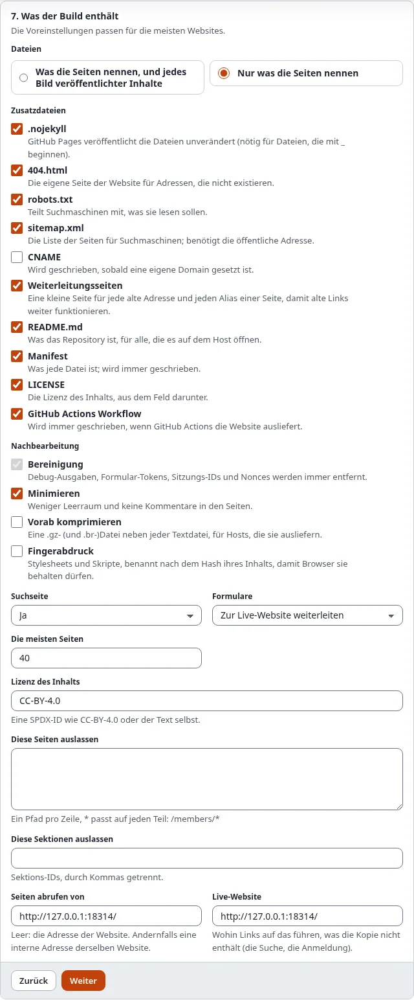
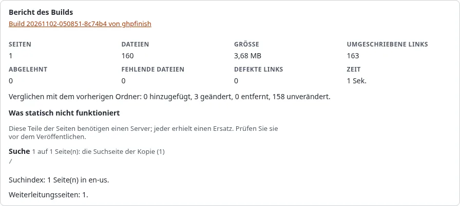

# Ein statisches Blog mit Exponential

Ein Tutorial für Bloggende und die Menschen, die Blogs für sie einrichten: Beiträge in Exponential schreiben, das Blog
als kostenlose statische Site auf GitHub Pages veröffentlichen und seine Suche und seine Archivseiten funktionsfähig
halten.

[Anleitungen](README.md) · Verwandt: [In 15 Minuten eine kostenlose Website](../hilfe/statisches-veroeffentlichen/in-15-minuten-eine-kostenlose-website.md),
[Statisches Veröffentlichen: dynamische Funktionen](statisches-veroeffentlichen-dynamische-funktionen.md)

## Was Sie am Ende haben

Ein Blog unter `https://<owner>.github.io/<repository>/` oder Ihrer eigenen Domain, mit jedem Beitrag, seinen Archiv-
und Listenseiten, einer Suche, die im Browser arbeitet, und neuen Beiträgen, die wenige Minuten nach **Veröffentlichen**
online sind.

## 1. Prüfen, was ein Blog braucht

| Teil des Blogs | In der statischen Kopie |
|---|---|
| Beiträge, Bilder, Kategorien | kopiert, wie sie sind |
| Listenseiten mit Blättern (`/blog/(offset)/10`) | kopiert: Die View-Parameter von Exponential sind Teil des Pfads |
| Seiten, die es nur mit Query gibt (`/blog?page=2`) | übersprungen und gemeldet; nutzen Sie im Design View-Parameter |
| Suche | eine Suchseite mit einem Index im Browser (`Search=enabled`) |
| Kommentare | ein kurzer Text mit Link zum Live-Beitrag, oder ausgelassen |
| Anmeldung, ein Kontaktformular | ein kurzer Text, oder das Formular sendet an die Live-Site (`Forms=endpoint`) |

Sind Ihnen Kommentare wichtig, lassen Sie sie auf der Live-Site, oder nutzen Sie einen Kommentardienst, der im Browser
läuft, und bauen ihn ins Design ein.

## 2. Das Ziel anlegen

Unter Setup > Statisches Veröffentlichen > **Neues Ziel**: der Siteaccess des Blogs, ein GitHub-Repository, ein Token
oder Deploy-Key, relative Links und der Basispfad `/<repository>/` (oder Ihre eigene Domain in Schritt 6).


In Schritt 7, **Was der Build enthält**, schalten Sie die **Suchseite** ein. Hat das Blog ein Kontaktformular, wählen
Sie, ob es an die Live-Site sendet oder ausgeblendet wird ([Suche, Formulare und Kommentare](../hilfe/statisches-veroeffentlichen/suche-formulare-und-kommentare-auf-einer-statischen-site.md)).



## 3. Auslassen, was kein Beitrag ist

Tag-Wolken, die Registrierung und andere Seiten, die für anonyme Besucher eine Session starten, lehnt der Build ab.
Lassen Sie sie aus:

```ini
ExcludePaths[]
ExcludePaths[]=/user/*
ExcludePaths[]=/tags/*
```

## 4. Bauen und ansehen

Bauen, dann **Vorschau** öffnen. Prüfen Sie einen Beitrag, eine Listenseite mit Blättern und die Suchseite. Der Bericht
listet, was ersetzt wurde (Suche, Formulare, Kommentare), als `degraded`.



## 5. Veröffentlichen

Drücken Sie **Veröffentlichen**, dann im Repository unter **Settings > Pages** aus dem Branch `gh-pages` ausliefern.
Wenige Minuten später ist das Blog online.

## 6. Neue Beiträge veröffentlichen sich selbst

In Schritt 8, **Trigger**, kreuzen Sie **Wenn Inhalte veröffentlicht werden** an. Ein neuer Beitrag markiert seine
eigene Seite und die Listenseiten, die ihn zeigen, als veraltet; wenige Minuten nach Ihrer letzten Änderung baut und
veröffentlicht der Cronjob-Teil `staticpublish` sie. Ein fehlgeschlagener Build wird erneut versucht, und Sie bekommen
eine E-Mail, wenn Sie **Benachrichtigen** für Fehler gesetzt haben.

## Nächster Schritt

[Eine statische Dokumentations-Site](eine-statische-dokumentations-site.md).
