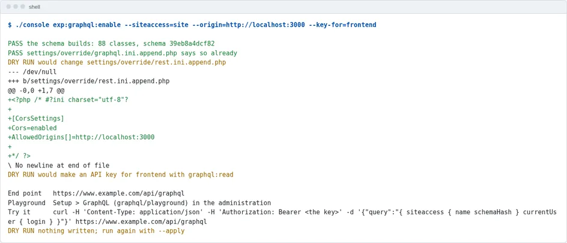
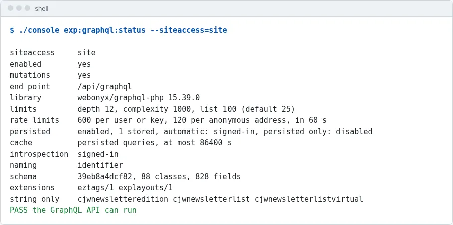
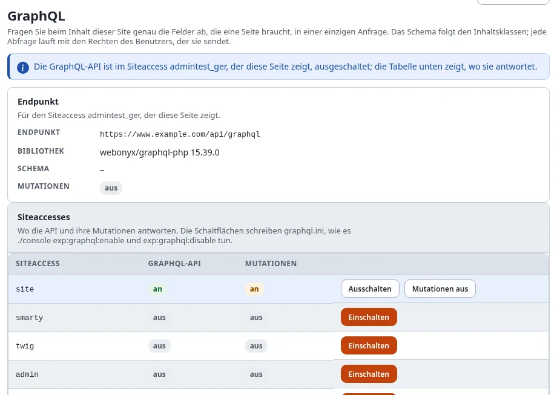
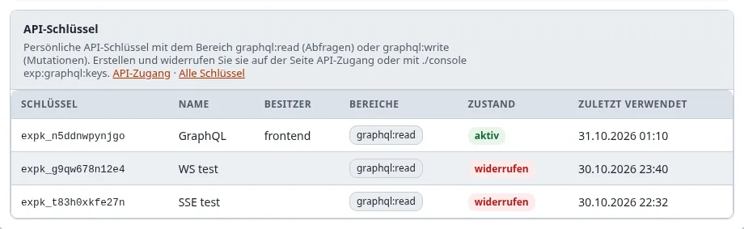
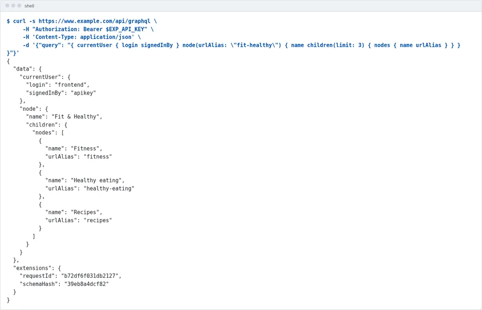
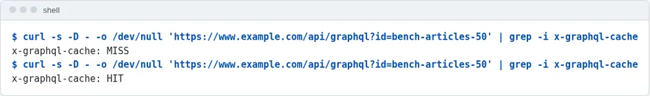
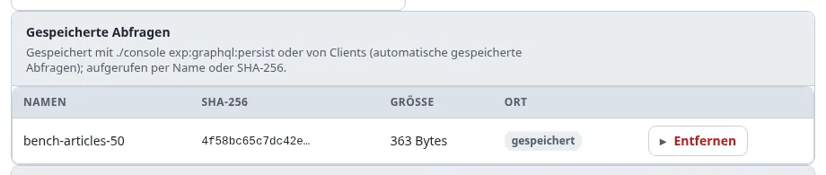
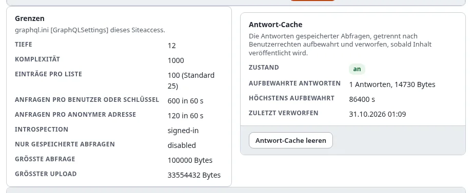

# Ein Frontend auf der GraphQL-API, Schritt für Schritt

Diese Anleitung bringt eine Site mit Exponential 6.0.15 von „GraphQL ausgeschaltet“ zu einem laufenden Frontend, das
seine Inhalte über die GraphQL-API liest: die API für einen Siteaccess eingeschaltet, ein Schlüssel für das Frontend,
ein Starter-Projekt aus dem eigenen Schema der Site erzeugt, seine Abfragen auf dem Server gespeichert und aus dem
Antwort-Cache beantwortet, und, wenn das Frontend auch schreibt, ein Schlüssel, der schreiben darf (die Mutationen
kommen mit der API). Jeder Schritt sagt, was
Sie ausführen, was Sie sehen sollten und wie Sie es prüfen.

Sie richtet sich an Entwickler mit einer Shell auf dem Server (für `./console`) und einem Administratorkonto. Die
Referenz für alles, was hier verwendet wird, ist [Die GraphQL-API](../funktionen/6.0/graphql.md); fertige Lösungen für
übliche Frontends stehen in [GraphQL-Rezepte](graphql-rezepte.md).

| | |
|---|---|
| Zeit | 20 Minuten, dazu `npm install` |
| Sie brauchen | Exponential 6.0.15, `webonyx/graphql-php` 15 (verlangt von `composer.json`), eine Shell im Wurzelverzeichnis der Installation, Node.js 20 oder neuer für die JavaScript-Kits |
| Sie bekommen | einen Endpunkt unter `https://<Ihre Site>/api/graphql`, einen persönlichen API-Schlüssel, ein Next.js-, Nuxt-, Astro-, HTML- oder Expo-Projekt, das die Site liest |

## Inhalt

1. [Prüfen, ob die API laufen kann](#1-prüfen-ob-die-api-laufen-kann)
2. [Ansehen, was das Einschalten ändert](#2-ansehen-was-das-einschalten-ändert)
3. [Einschalten](#3-einschalten)
4. [Setup > GraphQL ansehen](#4-setup--graphql-ansehen)
5. [Die erste Frage stellen](#5-die-erste-frage-stellen)
6. [Das Starter-Projekt erzeugen](#6-das-starter-projekt-erzeugen)
7. [Starten](#7-starten)
8. [Seine Abfragen auf dem Server speichern](#8-seine-abfragen-auf-dem-server-speichern)
9. [Schreiben: ein Schlüssel mit graphql:write](#9-schreiben-ein-schlüssel-mit-graphqlwrite)
10. [Vor dem Livegang](#10-vor-dem-livegang)
11. [Wenn etwas nicht funktioniert](#11-wenn-etwas-nicht-funktioniert)

## 1. Prüfen, ob die API laufen kann

```bash
./console exp:graphql:status --siteaccess=site
```

Die letzte Zeile lautet `PASS the GraphQL API can run (switched off here)`: Die Bibliothek ist installiert, und das
Schema lässt sich aus Ihren Inhaltsklassen bauen. `schema` nennt seinen Hash und die Zahl der Klassen und Felder;
`string only` listet die Datentypen ohne eigenen Typ (sie antworten mit ihrem Text). `FAIL the library is missing`
heißt, dass `composer install` nicht lief oder `[GraphQLSettings] LibraryPath` ins Leere zeigt: siehe
[Die Bibliothek](../funktionen/6.0/graphql.md#die-bibliothek).


## 2. Ansehen, was das Einschalten ändert

Nennen Sie den Siteaccess, den das Frontend liest, die Adresse, unter der das Frontend während der Entwicklung läuft,
und den Benutzer, als der das Frontend liest. Ohne `--apply` wird nichts geschrieben:

```bash
./console exp:graphql:enable --siteaccess=site --origin=http://localhost:3000 --key-for=frontend
```

Der Befehl baut zuerst das Schema (`PASS the schema builds: 88 classes, schema 00818b7ff593`) und zeigt dann für jede
Einstellungsdatei den Diff, den er schreiben würde:

```diff
DRY RUN would change settings/override/graphql.ini.append.php
+[GraphQLSettings]
+Enabled=enabled
+SiteAccessList[]=site
DRY RUN would change settings/override/rest.ini.append.php
+[CorsSettings]
+Cors=enabled
+AllowedOrigins[]=http://localhost:3000
DRY RUN would make an API key for frontend with graphql:read
```

- **Der Benutzer des Schlüssels** entscheidet, was das Frontend lesen kann: Legen Sie einen Benutzer an (hier
  `frontend`) in einer Gruppe, deren Rolle `content/read` auf das erlaubt, was die Site zeigt, und nicht mehr. Für eine
  öffentliche Site genügt der anonyme Benutzer; dann lassen Sie `--key-for` weg.
- **`--origin`** ist nur nötig, wenn ein Browser die API direkt aufruft (das HTML-Kit, eine App im Browser). Die Kits
  für Next.js, Nuxt und Astro rufen sie vom Server aus auf.



## 3. Einschalten

Derselbe Befehl mit `--apply`:

```bash
./console exp:graphql:enable --siteaccess=site --origin=http://localhost:3000 --key-for=frontend --apply
```

```text
PASS wrote settings/override/graphql.ini.append.php
PASS wrote settings/override/rest.ini.append.php
PASS API key expk_qkjdsz3uznp8 for frontend (graphql:read), shown once:

    expk_qkjdsz3uznp8_95UvceuCwfzIUjYhD8SidKTprQ756aTKC7XyjRcF
```

**Kopieren Sie den Schlüssel jetzt**: Er wird nur dieses eine Mal gezeigt und nur als Hash gespeichert. Jede Datei
wurde vorher nach `var/backup/ini/` gesichert, die Änderung steht im Audit (`system.setting.write`,
`access.apikey.create`), und der INI-Cache wurde geleert, sodass PHP-FPM und Velocity die neuen Einstellungen bei ihrer
nächsten Anfrage lesen. Prüfen:

```bash
./console exp:graphql:status --siteaccess=site      # enabled  yes
```



## 4. Setup > GraphQL ansehen

In der Administration zeigt **Setup > GraphQL** jetzt den Endpunkt, die Bibliothek, das Schema und eine Tabelle aller
Siteaccesses, mit der API an in `site` und aus anderswo. Darunter: die Grenzen des Siteaccess, der Antwort-Cache (noch
leer), die gespeicherten Abfragen (noch keine), die API-Schlüssel mit einem GraphQL-Bereich (der Schlüssel aus Schritt
3, aktiv, nie benutzt) und der Playground. Mit der Richtlinie `graphql/administrate` hat die Tabelle Schaltflächen zum
Ein- und Ausschalten der API und der Mutationen: Sie schreiben dieselben Einstellungen wie die Befehle.





Der Playground erscheint, wenn die API auch im Siteaccess der Administration eingeschaltet ist; solange sie dort aus
ist, sagt das ein Hinweis oben auf der Seite, und die Tabelle zeigt, wo die API antwortet.

Geben Sie eine Abfrage in den Playground ein und drücken Sie **Run** (Strg+Enter):

```graphql
{ node(urlAlias: "/") { name children(limit: 5) { totalCount nodes { name urlAlias classIdentifier } } } }
```

Sie läuft mit Ihren Rechten, als angemeldeter Administrator, und kann daher mehr zeigen als später das Frontend.

## 5. Die erste Frage stellen

Aus einer Shell, so wie das Frontend, mit dem Schlüssel:

```bash
curl -s https://www.example.com/api/graphql \
     -H "Authorization: Bearer $EXP_API_KEY" \
     -H 'Content-Type: application/json' \
     -d '{"query": "{ currentUser { login signedInBy } node(urlAlias: \"fit-healthy\") { name children(limit: 3) { nodes { name urlAlias } } } }"}'
```

```json
{"data":{"currentUser":{"login":"frontend","signedInBy":"apikey"},"node":{"name":"Fit & Healthy","children":{"nodes":[{"name":"Fitness","urlAlias":"fit-healthy/fitness"},{"name":"Healthy eating","urlAlias":"fit-healthy/healthy-eating"},{"name":"Recipes","urlAlias":"fit-healthy/recipes"}]}}}}
```

`signedInBy` ist `apikey`: Die Anfrage lief als Eigentümer des Schlüssels. Ohne den Header läuft sie als anonymer
Benutzer (`anonymous`), und das Schema (Introspection) bleibt ihr verschlossen.



## 6. Das Starter-Projekt erzeugen

```bash
./console exp:graphql:starter --list
./console exp:graphql:starter --kit=next --to=../shop-front                 # was er schreiben würde
./console exp:graphql:starter --kit=next --to=../shop-front --apply
```


| Kit | Für | Führt die Abfragen aus |
|---|---|---|
| `html` | eine Seite ohne Build-Schritt | im Browser (braucht `--origin` aus Schritt 2) |
| `next` | Next.js 15, App Router | auf dem Server (React Server Components) |
| `nuxt` | Nuxt 3 | auf dem Server (die eigene Route `/api/graphql` der App fügt den Schlüssel hinzu) |
| `astro` | eine statische Site | beim Build |
| `expo` | eine App für iOS, Android und das Web (React Native) | in der App |

Bevor etwas geschrieben wird, wird jede Abfrage des Kits gegen das Schema und seine Grenzen geprüft. Das Projekt hat:

- die Dateien des Kits (mitgeliefert in `share/graphql/starters/<kit>/`), mit eingesetztem Endpunkt (`--endpoint=`
  für eine andere Adresse als `site.ini [SiteSettings] SiteURL`);
- die erzeugten Abfragen: `Menu` (die Kinder der Wurzel der Site), `Node` (eine Seite nach ihrem URL-Alias: Name,
  Klasse, Eltern, Kinder) und eine Abfrage je Inhaltsklasse (`Content_ng_article` ...), die jedes Feld der Klasse
  liest: Bilder im Alias `large` mit ihrem Alternativtext, Rich Text als HTML, Relationen mit Name und URL-Alias. Sie
  stehen im Modul des Kits (`lib/queries.ts` bei Next.js) und in `graphql/*.graphql`;
- eine README mit den nächsten Schritten.

Die Abfragen folgen dem Schema des Augenblicks. Nachdem sich eine Inhaltsklasse geändert hat (`exp:graphql:status`
zeigt einen neuen Schema-Hash), erzeugen Sie das Kit erneut in ein neues Verzeichnis und kopieren `lib/queries.ts` und
`graphql/` hinüber.

## 7. Starten

```bash
cd ../shop-front
echo "EXP_GRAPHQL_KEY=$EXP_API_KEY" >> .env.local
npm install
npm run dev                  # http://localhost:3000/
```

Die Startseite zeigt das Menü der Wurzel der Site; jede Adresse der Site ist eine Seite (`/fit-healthy/fitness` ist die
Rubrik, `/fit-healthy/fitness/why-track-your-workouts` der Artikel) mit den Feldern ihrer Klasse und ihren Kindern.
Ändern Sie `components/Field.tsx` und `app/[[...path]]/page.tsx`, um Ihre Seiten zu gestalten: Die Daten sind schon da.

## 8. Seine Abfragen auf dem Server speichern

Eine gespeicherte (persisted) Abfrage wird über ihren Namen statt ihres Texts aufgerufen, kann von niemandem geändert
werden, der sie aufruft, und ist die einzige Art, die der [Antwort-Cache](../funktionen/6.0/graphql.md#geschwindigkeit)
behält:

```bash
cd -                                                   # zurück in die Installation
./console exp:graphql:persist ../shop-front/graphql/                  # prüfen: 90 Abfragen passen zum Schema
./console exp:graphql:persist ../shop-front/graphql/ --apply          # speichern
curl -s 'https://www.example.com/api/graphql?id=menu'                 # ein GET nach Name
curl -sI 'https://www.example.com/api/graphql?id=menu' | grep -i x-graphql-cache    # MISS, dann HIT
```

Der zweite Aufruf wird aus dem Cache beantwortet, gleich am Anfang von `index_rest.php`, in etwa einer Millisekunde;
das Veröffentlichen von Inhalten lässt den Cache verfallen. Mit `PersistedQueriesOnly=anonymous` lehnt die Site danach
jede Ad-hoc-Abfrage anonymer Anfragen ab: eine gute Einstellung für den Betrieb, sobald das Frontend nur noch
gespeicherte Abfragen sendet. Setup > GraphQL listet die gespeicherten Abfragen und die Größe des Caches.





## 9. Schreiben: ein Schlüssel mit graphql:write

Die Mutationen kamen in Schritt 3 mit der API (`MutationsEnabled=enabled` ist der Standard), aber noch kann nichts
schreiben: Eine Mutation braucht einen angemeldeten Benutzer, und ein Schlüssel braucht den Bereich `graphql:write`.
Wenn das Frontend Inhalte ändert (ein Kontaktformular, das Inhalte anlegt, eine App für Redakteure), geben Sie dem
schreibenden Benutzer einen solchen Schlüssel (`--mutations` schaltet die Mutationen außerdem wieder ein, falls sie für
den Siteaccess ausgeschaltet wurden):

```bash
./console exp:graphql:enable --siteaccess=site --mutations --key-for=editor --apply
```


Der Schlüssel von `editor` bekommt `graphql:read graphql:write` und tut weiterhin nur, was die Rollen von `editor`
erlauben.

```bash
curl -s https://www.example.com/api/graphql -H "Authorization: Bearer $EDITOR_KEY" -H 'Content-Type: application/json' \
     -d '{"query": "mutation { createContent(parentId: 2, classIdentifier: \"folder\", fields: [{identifier: \"name\", value: \"Aus dem Frontend\"}], publish: false) { status contentId version } }"}'
```

```json
{"data":{"createContent":{"status":"DRAFT","contentId":59338,"version":1}}}
```

Jede Mutation wird im Audit aufgezeichnet (`content.graphql.mutation`), führt die Workflows der Operationen des Kernels
aus und lässt den Antwort-Cache verfallen. Dateien gehen als Multipart-Anfragen (`uploadImage`), und ein Entwurf lässt
sich mit einem Vorschau-Token zeigen, bevor er veröffentlicht wird. Siehe [Mutationen](../funktionen/6.0/graphql.md#mutationen).

Geben Sie einen Schlüssel mit `graphql:write` nie in einen Browser oder eine App, die andere installieren: Behalten Sie
ihn auf einem Server.

## 10. Vor dem Livegang

- [ ] `--origin` nennt die Produktionsadresse eines Browser-Frontends und nicht mehr `http://localhost:3000`
      (`settings/override/rest.ini.append.php`, `AllowedOrigins[]`).
- [ ] Der Benutzer des Schlüssels liest nur, was die Site zeigt; ein Browser oder eine App bekommt keinen Schlüssel oder
      einen nur mit `graphql:read`.
- [ ] Die Abfragen des Frontends sind gespeichert (`exp:graphql:persist`), und `PersistedQueriesOnly=anonymous` (oder
      `enabled`).
- [ ] Die Ratenbegrenzungen passen zum erwarteten Verkehr (`RateLimit`, `RateLimitAnonymous`; Setup > GraphQL zeigt sie).
- [ ] Ein Siteaccess, in dem nichts schreibt, hat `MutationsEnabled=disabled` (`exp:graphql:disable
      --siteaccess=<name> --mutations --apply`), und `exp:graphql:keys` listet keinen Schlüssel, den Sie nicht kennen.
- [ ] `Debug=disabled` im Siteaccess des Betriebs.



## 11. Wenn etwas nicht funktioniert

| Sie sehen | Weil | Tun Sie |
|---|---|---|
| `404` und `DISABLED` | die API ist in dem Siteaccess aus, den die Anfrage erreichte | `exp:graphql:status --siteaccess=<ihn>`; eine Anfrage erreicht einen Siteaccess über Host, Pfad oder den Header `X-Siteaccess` |
| `403 insufficient_scope` | dem Schlüssel fehlt `graphql:read` | einen Schlüssel mit `exp:graphql:keys --create --for=<login> --apply` erzeugen |
| `null` für Inhalt, von dem Sie wissen, dass es ihn gibt | der Benutzer darf ihn nicht lesen | die Rolle des Benutzers des Schlüssels prüfen |
| ein Fehler zu CORS im Browser | der Origin des Frontends ist nicht erlaubt | `exp:graphql:enable --origin=<die Adresse> --apply` |
| `429` und `RATE_LIMITED` | über der Ratenbegrenzung | `Retry-After` abwarten oder die Grenze für den Siteaccess erhöhen |
| `FORBIDDEN` bei einer Mutation | nicht angemeldet, kein `graphql:write` oder die Richtlinien des Benutzers | die Fehlermeldung nennt, was davon |

Die Fehlercodes stehen unter [Fehler](../funktionen/6.0/graphql.md#fehler).


## Verwandte Seiten

- [Die GraphQL-API](../funktionen/6.0/graphql.md): die Referenz
- [GraphQL-Rezepte](graphql-rezepte.md): ein Blog, eine mobile App, ein statischer Build, ein KI-Agent
- [Persönliche API-Schlüssel](api-schluessel.md)
- Befehle: [exp:graphql:enable](../beispiele/befehle/expgraphqlenable.md), [exp:graphql:starter](../beispiele/befehle/expgraphqlstarter.md),
  [exp:graphql:persist](../beispiele/befehle/expgraphqlpersist.md), [exp:graphql:keys](../beispiele/befehle/expgraphqlkeys.md)
