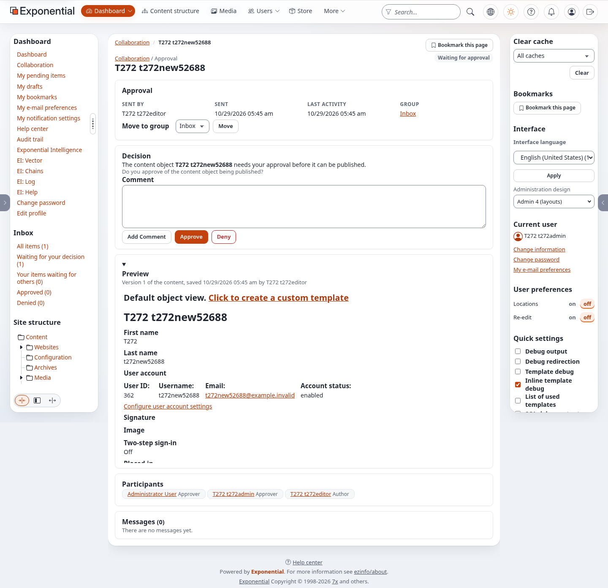

# Neue Redakteurskonten freigeben

Redakteure dürfen das Konto eines neuen Redakteurs anlegen; ein Administrator gibt es frei, bevor es sich anmelden kann.
Diese Anleitung richtet das auf einer Installation ein, verfolgt ein Konto von der Anfrage des Redakteurs bis zur
Entscheidung des Administrators und zeigt, wo jeder Schritt seine Spur hinterlässt. Sie ist für Website-Betreiber und
Administratoren.

Zeit: 15 Minuten.

Was Sie brauchen: eine Installation ab 6.0.15, die Administrator-Anmeldung, einen Test-Redakteur (ein Benutzer in
Editors) und für den Test Mails, die in Dateien geschrieben statt gesendet werden (Schritt 2).

## 1. Die Freigabe prüfen oder einrichten

Eine neue Installation hat sie. Auf einer bestehenden im Wurzelverzeichnis der Installation:

```bash
php bin/php/adduserapproval.php --allow-root-user            # Probelauf
```

Erwartet auf einer Installation ohne sie:

```
requires approval  Editors (node 14, object 13)
approves           Administrator users (node 13, object 12)
requests           Editors (node 14, object 13)
  would create workflow "Approve new editor accounts"
  would create trigger content/publish/before
  would add event "Approve user accounts"
  would create role "Editor account requests"
  would add policy content/read Node=14
  would add policy content/create Class=4 Node=14 ParentClass=3
  would assign the role to Editors (no limitation)
PASS: 7 change(s) would be made (dry run, nothing changed; --apply writes)
```

Auf einer, die sie hat: `has everything: ...` und `PASS: 0 change(s)`. Führt content/publish (vorher) schon einen anderen
Workflow aus, sagt die Zeile das, und das Ereignis kommt an die erste Stelle dieses Workflows. Mit `--apply`
ausführen; die letzte Zeile ist `PASS: the approval of new accounts is set up`. Danach:

```bash
php bin/php/ezcache.php --clear-tag=ini --allow-root-user
./console exp:velocity deploy --kernel --allow-root-user     # nur auf Velocity
```

**Setup > Workflows > Approve new editor accounts** zeigt das Ereignis mit *Accounts that need approval: Editors*,
*Approver groups: Administrator users*, *E-mail to the approvers: Yes*. **Setup > Trigger** zeigt content / publish /
before mit diesem Workflow.

## 2. Test-Mails auf dem Server behalten

Für einen Test Mails in Dateien schreiben: in `settings/override/site.ini.append.php` `[MailSettings] Transport=file`,
dann den INI-Cache leeren. Jede Mail ist eine Datei in `var/log/mail/`. Testbenutzer mit Adressen in `example.invalid`
verwenden. `[UserSettings] RegistrationAdminBaseURL` auf die Adresse Ihrer Administration setzen, damit der Link in der
Mail dorthin zeigt.

## 3. Der Redakteur fragt an

Als Test-Redakteur anmelden. **Benutzer > Editors** öffnen, unter *Hier anlegen* **Benutzerkonto** wählen, Vorname,
Nachname, Benutzername, eine E-Mail-Adresse in `example.invalid` und ein Passwort eintragen, **Zur Veröffentlichung
senden** drücken.

Erwartet: zurück auf Editors; das neue Konto steht nicht in der Liste. *Meine ausstehenden Elemente* listet es, die
Kollaboration hat die Freigabe unter *Ihre Elemente, die auf andere warten*. Die Anmeldung mit dem neuen Konto scheitert
(ein wartendes Konto ist nicht veröffentlicht).

## 4. Die Mail

`var/log/mail/` hat eine Datei je Administrator mit Adresse, Betreff *New user account waiting for approval: <Name>*.
Der Text nennt das Konto, den Benutzernamen, die Gruppe (*Editors*) und wer gefragt hat, und hat genau einen Link:
`<Administration>/collaboration/item/full/<Nummer>`. Sonst nichts: kein Schlüssel, kein Token, kein „Freigeben“-Link.

## 5. Der Administrator entscheidet

Den Link in einem Browser öffnen, in dem Sie nicht angemeldet sind. Die Administration verlangt die Anmeldung; dann
öffnet sich die Freigabeseite mit der Vorschau des Kontos und den Beteiligten.



- **Freigeben** drücken und bestätigen. Die Meldung sagt, dass das Konto freigegeben und veröffentlicht ist. Es steht in
  Benutzer > Editors und meldet sich mit dem Passwort an, das der Redakteur gesetzt hat.
- Oder **Ablehnen** drücken und bestätigen. Das Konto ist nicht veröffentlicht und kann sich nicht anmelden; der
  Redakteur findet es in *Meine Entwürfe*.

Bevor die Entscheidung ausgeführt wird, fragt **Identität bestätigen** (die Gruppe *users*, standardmäßig an): das
Passwort eingeben (oder einen Passkey oder den Code der Authenticator-App verwenden) und **Bestätigen** drücken. Ein
falsches Passwort wird abgewiesen, die Seite fragt erneut, und nichts wird entschieden; das richtige führt genau das
gedrückte Freigeben oder Ablehnen aus. In den nächsten zehn Minuten (`[ReauthSettings] Minutes`) fragt eine weitere
Entscheidung nicht erneut. Siehe [Identität bestätigen](identitaet-bestaetigen.md).


Die Entscheidung wirkt sofort; der Workflow-Cronjob wird dafür nicht gebraucht.


## 6. Was verweigert wird

Als Redakteur ein Mitglied nach Editors verschieben (Benutzer > Members > das Mitglied > Verschieben > Editors). Erwartet:
*Zugriff verweigert*; das Mitglied bleibt in Members. Einen Ort in Editors hinzuzufügen wird genauso verweigert.

Als Administrator ein Konto in Editors anlegen: es wird sofort veröffentlicht. Freigebende warten nie.

## 7. Das Prüfprotokoll

**Audit** öffnen und nach dem Ereignis `access.user.approval.*` filtern. Erwartet: `access.user.approval.request` (der
Redakteur, das Konto, das Freigabeelement), `access.user.approval.approve` oder `.deny` (der Administrator) und
`access.user.approval.refused` für das verweigerte Verschieben.

## 8. Ändern, wer was freigibt

Setup > Workflows > *Approve new editor accounts* > **Bearbeiten**: das Formular des Ereignisses hat vier Listen mit
*Hinzufügen* und *Ausgewählte entfernen* und das Kästchen für die E-Mail. Den Workflow speichern. Für eine andere Gruppe
als Editors brauchen die Anfragenden dort auch `content/create`: geben Sie ihrer Rolle eine Richtlinie wie die Rolle
*Editor account requests*, oder führen Sie `adduserapproval.php --apply --required=... --approvers=... --requesters=...` aus.

Beispiele mit demselben Mechanismus, selbst registrierte Mitglieder, die Moderatoren freigeben, und zwei Freigebende für
einen neuen Administrator, stehen unter
[Zwei Wege](../bc/6.0/freigabe-von-benutzerkonten.md#weitere-beispiele-mit-demselben-mechanismus).

## 9. Der andere Weg: Freigabe nach Abschnitt

Statt des Ereignisses *Benutzerkonten freigeben* können Sie das einfache Ereignis *Freigabe* des Kernels mit einem
Abschnitt **Staff** für Administrator users und Editors verwenden. Wählen Sie einen der beiden Wege; wann welcher passt,
steht unter [Zwei Wege](../bc/6.0/freigabe-von-benutzerkonten.md#zwei-wege-nach-gruppe-standard-oder-nach-abschnitt).

Der Befehl verweigert, solange das Ereignis nach Gruppe läuft; entfernen Sie es darum zuerst: Setup > Workflows > der
Workflow, den content/publish (vorher) ausführt > **Bearbeiten**, das Ereignis *Benutzerkonten freigeben* auswählen,
**Ausgewählte entfernen**, **Speichern**. Die Rolle *Editor account requests* bleibt: die Redakteure brauchen sie
weiterhin, um Konten in Editors anzulegen. Dann:

```bash
php bin/php/adduserapproval.php --mode=section --allow-root-user            # Probelauf
```

Erwartet:

```
section Staff     Administrator users (node 13, object 12)
section Staff     Editors (node 14, object 13)
approves          Administrator users (node 13, object 12)
no approval       Administrator users (node 13, object 12)
  would create section "Staff" (identifier staff)
  would assign the section to Administrator users and below (3 object(s))
  would assign the section to Editors and below (2 object(s))
  would add the approval event first into the workflow "Approve new editor accounts" that content/publish/before runs
PASS: 4 change(s) would be made (dry run, nothing changed; --apply writes)
```

Die Zahlen zählen die Gruppe und die Konten darin. Eine Zeile `check:` nennt jede Richtlinie, die auf den Abschnitt eingeschränkt ist, den die Konten verlassen (*Users*);
sehen Sie sich diese Rollen an. Solange das Ereignis nach Gruppe noch da ist, endet der Befehl mit `FAIL: the event
"Approve user accounts" ... runs on content/publish before` und ändert nichts. Mit `--apply` führt er die Änderungen aus
und endet mit `PASS: the section based approval of new staff accounts is set up`. Leeren Sie die Caches wie in
Schritt 1.


Ab hier sind die Schritte 3 bis 5 und 7 gleich: das neue Konto des Redakteurs wartet, jeder Freigebende bekommt die Mail
mit dem Link zum Element in der Administration, **Identität bestätigen** fragt, und Freigeben oder Ablehnen wird sofort
ausgeführt und festgehalten (mit `mode: section`). Schritt 6 ist anders: ein Verschieben nach Editors verweigert dieser
Weg nicht.

## Fehlerbehebung

| Was Sie sehen | Warum, und was zu tun ist |
| --- | --- |
| Der Redakteur kann in Editors keinen Benutzer anlegen | Die Rolle *Editor account requests* fehlt oder ist Editors nicht zugewiesen: `adduserapproval.php --apply` ausführen |
| Das Konto wurde ohne Freigabe veröffentlicht | Der Redakteur gibt selbst frei oder ist in einer Gruppe ohne Freigabe, oder das Ereignis steht nicht im Workflow, den content/publish (vorher) ausführt: Setup > Trigger und das Ereignis prüfen |
| Keine Mail | Freigebende ohne E-Mail-Adresse bekommen keine; der Transport in `[MailSettings]`; ist die E-Mail aus, gibt es keine. Das Freigabeelement ist trotzdem da |
| Der Link zeigt auf den falschen Host | `[UserSettings] RegistrationAdminBaseURL` setzen |
| Die Freigebenden werden für ein Konto zweimal gefragt | Beide Wege sind eingerichtet: behalten Sie im Workflow entweder das Ereignis *Benutzerkonten freigeben* oder das Freigabe-Ereignis des Abschnitts Staff, nicht beide |
| `--mode=section` endet mit FAIL und ändert nichts | Das Ereignis *Benutzerkonten freigeben* läuft noch an content/publish (vorher): zuerst entfernen (Schritt 9) |
| Nach *Freigeben* oder *Ablehnen* erscheint *Identität bestätigen* | So gewollt: Die Gruppe users fragt, bevor ein Konto freigegeben oder abgelehnt wird. Bestätigen, dann wird die Entscheidung ausgeführt. Ein Administrator kann die Gruppe unter Setup > Verify it's you ausschalten |
| Nach *Freigeben* wartet es weiter | Ein anderes Ereignis des Workflows wartet (zum Beispiel eine Inhaltsfreigabe); der Workflow-Cronjob setzt fort |

Mehr: [Freigabe neuer Benutzerkonten](../bc/6.0/freigabe-von-benutzerkonten.md) (die technische Notiz),
[die Funktionsseite](../funktionen/6.0/freigabe-von-redakteurskonten.md), [Workflows](workflows.md),
[Rollen, Richtlinien und nicht aktivierte Benutzer](rollen-und-richtlinien.md).
