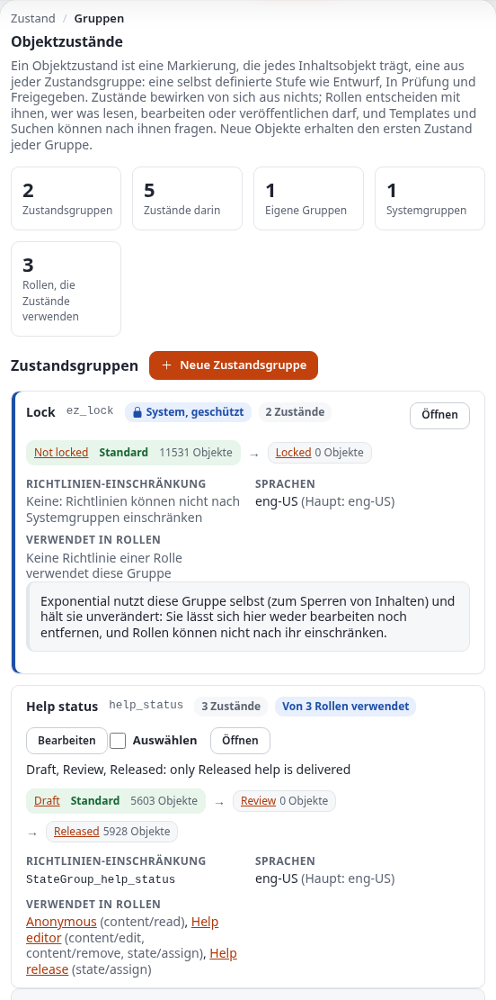
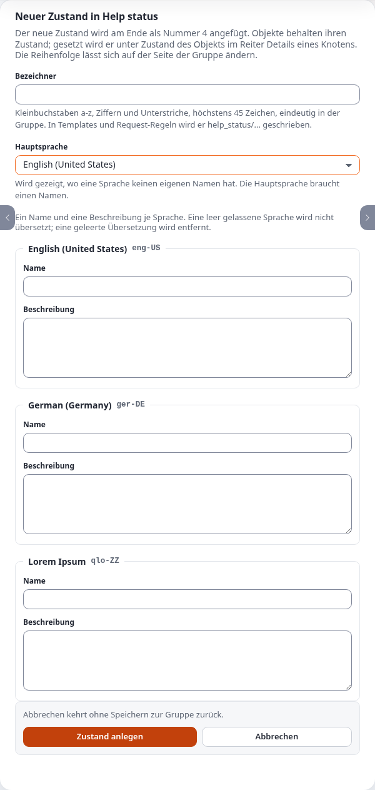

# Objektzustände: eigene Stufen für Inhalte und wer in welcher Stufe was darf

Diese Anleitung erklärt alles über Objektzustände von Inhalten in Exponential: wofür sie da sind, wie Zustandsgruppen
und Zustände zusammenhängen, wie Sie sie in der Administration anlegen, übersetzen, ordnen und entfernen, wie Inhalte
einen Zustand bekommen und wie Sie ihn ändern (im Browser, für einen ganzen Teilbaum, von einer Shell aus und über die
Remote-Dienste), und wie Rollen, Templates, Request-Regeln und Workflows sie nutzen. Am Ende stehen ein
durchgearbeiteter Prüf-Workflow (Entwurf, in Prüfung, freigegeben) und die Probleme, auf die man dabei stößt.

Sie richtet sich an Administratoren, die einen redaktionellen Ablauf einrichten, und an Site-Entwickler, die Inhalte
abhängig von ihrem Zustand zeigen oder verbergen. Lesen Sie zuerst die Abschnitte 1 und 2; danach steht jeder
Abschnitt für sich. Jede Seite, jedes Feld, jede Einstellung und jeder Befehl unten wurde am 5. Oktober 2026 gegen den
Code von Exponential 6.0 geprüft; die Bildschirme sind die des Designs admin4, und das ältere Administrationsdesign
zeigt dieselbe Seite.

[Anleitungen](README.md) · Vertiefung: [Rollen und Richtlinien in Reihenfolge](../funktionen/6.0/reihenfolge-der-richtlinien-einer-rolle.md),
[Große Operationen als Inhaltsaufträge](../funktionen/6.0/inhaltsauftraege.md),
[Backend-Dienste: Objektzustände](../bc/6.0/backend-dienste-ueber-ezjscore.md#objektzustände-expstate-23-dienste-9-schreibvorgänge)

## Kurz gesagt

- Ein **Objektzustand** ist eine Markierung, die jedes Inhaltsobjekt trägt, eine aus jeder **Zustandsgruppe**.
  Exponential liefert eine Gruppe mit, `ez_lock` (Nicht gesperrt, Gesperrt); Sie fügen eigene hinzu, zum Beispiel eine
  Gruppe `review` mit Entwurf, In Prüfung und Freigegeben.
- Zustände ändern von sich aus nichts. Erst **Rollen** geben ihnen Gewicht: Eine Richtlinie, die durch
  `StateGroup_review` eingeschränkt ist, gilt nur für Objekte in den gewählten Zuständen, und die Limitierung
  `NewState` von `state/assign` legt fest, welche Zustände ein Benutzer setzen darf.
- Der **erste Zustand** einer Gruppe ist ihr Standard: Jedes neue Objekt erhält ihn, und der erste Zustand, den Sie in
  einer neuen Gruppe anlegen, wird jedem vorhandenen Objekt gegeben.
- Gruppen und Zustände liegen unter **Setup > Zustände** (`/state/groups`). Entfernen fragt vorher nach und sagt, was
  es betrifft: Objekte eines entfernten Zustands wechseln in den ersten Zustand, der bleibt.
- Zustände setzen Sie für ein Objekt im Reiter **Details** des Knotens (Zustand des Objekts), für einen ganzen Teilbaum
  mit „Auch für alles unterhalb dieses Knotens“ (bei großen Teilbäumen als Inhaltsauftrag), von einer Shell oder einem
  Remote-Client aus mit den `expstate`-Diensten.
- Gruppen, deren Bezeichner mit `ez` beginnt, gehören zu Exponential: Sie können nicht bearbeitet oder entfernt
  werden, und Richtlinien können nicht nach ihnen einschränken.

## Inhalt

- [1. Wofür Objektzustände da sind](#1-wofür-objektzustände-da-sind)
- [2. Gruppen, Zustände und der Standardzustand](#2-gruppen-zustände-und-der-standardzustand)
- [3. Die Seiten unter Setup, Zustände](#3-die-seiten-unter-setup-zustände)
- [4. Eine Gruppe und ihre Zustände anlegen](#4-eine-gruppe-und-ihre-zustände-anlegen)
- [5. Die Reihenfolge und das Ändern des Standards](#5-die-reihenfolge-und-das-ändern-des-standards)
- [6. Übersetzungen](#6-übersetzungen)
- [7. Zustände an Inhalten setzen](#7-zustände-an-inhalten-setzen)
- [8. Zustände in Rollen und Richtlinien](#8-zustände-in-rollen-und-richtlinien)
- [9. Ein durchgearbeitetes Beispiel: ein Prüf-Workflow](#9-ein-durchgearbeitetes-beispiel-ein-prüf-workflow)
- [10. Zustände in Templates, Fetches und Request-Regeln](#10-zustände-in-templates-fetches-und-request-regeln)
- [11. Die System-Sperrgruppe ez_lock](#11-die-system-sperrgruppe-ez_lock)
- [12. Workflows, Ereignisse, Audit und Suche](#12-workflows-ereignisse-audit-und-suche)
- [13. Zustände und Gruppen entfernen](#13-zustände-und-gruppen-entfernen)
- [14. Fehlerbehebung](#14-fehlerbehebung)
- [15. Referenz](#15-referenz)
- [Quellen](#quellen)

## 1. Wofür Objektzustände da sind

Sektionen sagen, *wohin* Inhalte gehören (die Standardsektion, Medien, Benutzer), und der Inhaltsbaum sagt, *worunter
sie stehen*. Zustände sagen, *wie weit* Inhalte sind, oder jede andere Eigenschaft, die sich im Laufe ihres Lebens
ändert und die Rollen beachten sollen: eine Prüfstufe, eine rechtliche Freigabe, eine Sperrfrist, eine Markierung
„hervorgehoben“.

| Sie möchten | Mit Zuständen |
|---|---|
| Autoren schreiben frei, aber nur freigegebene Inhalte sind öffentlich | Eine Gruppe `review`; die anonyme Rolle liest nur `Approved` |
| Prüfer, nicht Autoren, entscheiden, wann etwas freigegeben ist | `state/assign` darf für Prüfer `Approved` setzen, für Autoren nur `In review` |
| Autoren hören auf zu bearbeiten, sobald ein Text in Prüfung ist | `content/edit` für Autoren, eingeschränkt auf den Zustand `Draft` |
| Eine Liste dessen, „was auf Prüfung wartet“ | Ein Fetch, gefiltert auf den Zustand `In review` |
| Ein Hinweis auf Seiten, die noch Entwürfe sind | Eine Template-Abfrage auf `state_identifier_array` des Objekts |

Was Zustände nicht tun: Sie verbergen Inhalte nicht von sich aus, sie versionieren Inhalte nicht (das Setzen eines
Zustands erzeugt keine neue Version), und sie verschieben Inhalte nicht. All das kommt von den Rollen, Templates und
Fetches, die nach ihnen fragen.

## 2. Gruppen, Zustände und der Standardzustand

Eine **Zustandsgruppe** ist eine Frage mit einer festen Menge an Antworten; ihre **Zustände** sind die Antworten.
Jedes Objekt hat in jeder Gruppe genau einen Zustand:

```
group "review"   ->  Draft (default) -> In review -> Approved
group "ez_lock"  ->  Not locked (default) -> Locked
```

| Begriff | Bedeutet | Gespeichert in |
|---|---|---|
| Zustandsgruppe | Eine Menge von Zuständen; Bezeichner, ein Name und eine Beschreibung je Sprache, eine Hauptsprache | `ezcobj_state_group`, `ezcobj_state_group_language` |
| Zustand | Eine Antwort: Bezeichner, eindeutig in seiner Gruppe, ein Name und eine Beschreibung je Sprache, eine Priorität (sein Platz in der Reihenfolge) | `ezcobj_state`, `ezcobj_state_language` |
| Der Zustand eines Objekts | Eine Zeile je Objekt und Gruppe | `ezcobj_state_link` |
| Standardzustand | Der Zustand mit Priorität 0, der erste in der Reihenfolge | (die Reihenfolge) |
| Limitierung einer Richtlinie | `StateGroup_<group identifier>`, angeboten von den Funktionen von content und state | `ezpolicy_limitation` |

Aus dem Code folgen drei Regeln, die das meiste erklären, was Sie sehen werden:

1. **Neue Objekte erhalten den Standard jeder Gruppe.** Wenn ein Objekt als Entwurf angelegt wird, verknüpft
   Exponential es mit dem Zustand mit Priorität 0 jeder Gruppe (`eZContentObject::assignDefaultStates()`).
2. **Der erste Zustand einer neuen Gruppe wird allem gegeben.** Wenn eine Gruppe ihren ersten Zustand bekommt, wird
   jedes vorhandene Objekt in derselben Transaktion mit ihm verknüpft. Eine Gruppe ohne Zustände bewirkt nichts.
3. **Gruppen, die mit `ez` beginnen, gehören dem System.** `ez_lock` und jede andere `ez...`-Gruppe kann auf den Seiten
   weder bearbeitet werden noch Zustände hinzubekommen oder verlieren, noch entfernt werden, und sie wird nie als
   Limitierung einer Richtlinie angeboten. Neue Gruppen können das Präfix nicht verwenden: Die Prüfung des
   Bezeichners lehnt es ab.

## 3. Die Seiten unter Setup, Zustände

Öffnen Sie **Setup > Zustände** oder gehen Sie auf `/state/groups`. Sie brauchen die Richtlinie `state/administrate`.



Die Seite enthält:

- **Eine Erklärung** in einem Absatz, was Zustände sind.
- **Fünf Kennzahlen**: Zustandsgruppen, die Zustände darin, Ihre eigenen Gruppen, Systemgruppen und wie viele Rollen
  Zustände in ihren Richtlinien verwenden.
- **Eine Karte je Gruppe**: ihr Name und Bezeichner, `System, protected` bei `ez...`-Gruppen, die Anzahl der Zustände
  und „Von N Rollen verwendet“, wenn Richtlinien sie nennen. Darunter ihre Zustände in Reihenfolge als Kette, mit
  `default` am ersten und der Anzahl der Objekte in jedem; die Limitierung der Richtlinie (`StateGroup_<identifier>`
  oder „Keine“ bei einer Systemgruppe), die Sprachen mit der Hauptsprache und die Rollen, deren Richtlinien sie
  verwenden, jeweils mit den Richtlinien (`content/read`, `state/assign` ...) und einem Link zur Rolle.
- **Bearbeiten** und **Auswählen** bei Ihren eigenen Gruppen, **Öffnen** bei jeder Gruppe.
- **Ausgewählte entfernen** und **Neu erstellen** unten sowie die Seitengröße (10, 25, 50; aus `admininterface.ini
  [PaginationSettings]`) mit der Seitennavigation, wenn es mehr Gruppen gibt, als auf eine Seite passen.

Das Öffnen einer Gruppe (`/state/group/<identifier>`) zeigt:


- Die Beschreibung der Gruppe, ihren Standardzustand, wie viele Objekte einen Zustand der Gruppe haben, die
  Limitierung der Richtlinie und ihre ID.
- **Zustände in ihrer Reihenfolge**: jeden Zustand mit seiner Positionsnummer, seinem Bezeichner, „Standard für neue
  Objekte“ beim ersten, seinen Objekten, seinen Sprachen und seiner Beschreibung; ein Feld **Position**, **Nach oben**
  und **Nach unten** (mit JavaScript), **Bearbeiten** und **Auswählen**.
- **Reihenfolge speichern**, **Ausgewählte entfernen** und **Neu erstellen**.
- **Übersetzungen** der Gruppe, jede mit einem Link auf die Gruppe in dieser Sprache (`/state/group/<identifier>/<locale>`),
  und **Gruppe und Übersetzungen bearbeiten**.
- **Rollen, die diese Gruppe verwenden**: je Rolle ihre Richtlinien und wie sie die Gruppe verwendet („Gilt nur für
  Objekte in bestimmten Zuständen“ bei `StateGroup_...`, „Lässt Benutzer bestimmte Zustände setzen“ bei `NewState`),
  oder, wenn keine das tut, die Limitierung, die hinzuzufügen ist.

Die eigene Seite eines Zustands (`/state/view/<group>/<state>`) zeigt seine Objekte, seine Position („1 von 3“),
Bezeichner und ID, die Kette seiner Gruppe mit dem markierten Zustand, seine Übersetzungen und die Rollen, deren
Richtlinien ihn nennen, mit **Bearbeiten** und **Zurück zur Gruppe**.

Jede Seite funktioniert ohne JavaScript: Auswählen ist ein Kontrollkästchen, jede Aktion eine Schaltfläche, eine
Bestätigung eine eigene Seite. Mit JavaScript nummerieren Nach oben und Nach unten die Positionen auf der Seite neu,
und ein Screenreader sagt an, wohin der Zustand gewandert ist.

## 4. Eine Gruppe und ihre Zustände anlegen

Das Beispiel baut die Gruppe `review` auf, die in Abschnitt 9 verwendet wird.

1. **Setup > Zustände > Neue Zustandsgruppe** (oder **Neu erstellen** unten). Das Formular ist `/state/group_edit`.
2. **Bezeichner**: `review`. Kleinbuchstaben a-z, Ziffern und Unterstriche, höchstens 45 Zeichen, eindeutig; er darf
   nicht mit `ez` beginnen. Templates, Request-Regeln und Suchen verwenden ihn, und Richtlinien nennen die Gruppe
   `StateGroup_review`.
3. **Name und Beschreibung je Sprache**: eine Feldgruppe je Sprache der Installation. Füllen Sie mindestens die
   Hauptsprache aus; eine leer gelassene Sprache wird nicht übersetzt. Name: `Review`; Beschreibung: `How far an article is in the
   editorial review.`
4. **Hauptsprache** (nur bei mehr als einer Sprache): die Sprache, die dort angezeigt wird, wo eine andere keinen Namen
   hat. Sie muss einen Namen haben.
5. **Erstellen**. Sie landen auf der neuen Gruppe, die noch keine Zustände hat.



Nun die Zustände, in der gewünschten Reihenfolge:

1. Auf der Seite der Gruppe **Neuer Zustand** (`/state/edit/review`). Die Seite sagt, welche Nummer der Zustand
   bekommt.
2. Bezeichner `draft`, Name `Draft`, Beschreibung `Being written. Only the author and editors see it.` **Zustand
   anlegen**. Als erster Zustand wird er jedem vorhandenen Objekt gegeben und zum Standard.
3. Noch einmal: `in_review`, `In review`, `Waiting for an editor to approve it.`
4. Noch einmal: `approved`, `Approved`, `Checked and ready to be published.`

Die Karte der Gruppe auf `/state/groups` lautet jetzt `Draft (default) -> In review -> Approved` mit der Anzahl der
Objekte in jedem: alles in Draft.

Lehnt der Kernel das Formular ab, listet die Seite die Gründe auf, zum Beispiel `Identifier: invalid, it can only consist of
characters in the range a-z, 0-9 and underscore.`, `Identifier: identifiers starting with "ez" are reserved.`, einen
Namen mit mehr als 45 Zeichen oder `Translations: you need to add at least one localization`. Korrigieren Sie es und
speichern Sie erneut; das Formular behält, was Sie eingegeben haben.

## 5. Die Reihenfolge und das Ändern des Standards

Die Reihenfolge der Zustände einer Gruppe ist ihre Priorität, 0 für den ersten. Sie entscheidet zweierlei:

- **Den Standard**: Priorität 0 ist der Zustand, den neue Objekte erhalten.
- **Die Reihenfolge, die Redakteure sehen**: Die Auswahllisten an einem Knoten, die Liste im Richtlinieneditor und
  `sort_by` nach Zustand (Abschnitt 10) folgen ihr.

Um sie zu ändern, öffnen Sie die Gruppe:

- **Ohne JavaScript**: Tragen Sie die gewünschten Positionen in die Felder „Position“ ein (beliebige Zahlen; nur ihre
  Reihenfolge zählt) und klicken Sie auf **Reihenfolge speichern**.
- **Mit JavaScript**: Nach oben und Nach unten verschieben einen Zustand und nummerieren jede Position neu; nichts wird
  gespeichert bis **Reihenfolge speichern**.

Die Seite bestätigt mit „Die Reihenfolge wurde gespeichert. Der erste Zustand ist der Standard für neue Objekte.“ Hat
seit dem Öffnen der Seite jemand einen Zustand der Gruppe hinzugefügt oder entfernt, lehnt der Kernel die neue
Reihenfolge ab, und die Seite bittet Sie, erneut nachzusehen.

Das Ändern des Standards ändert **kein** vorhandenes Objekt: Es entscheidet nur, was ab jetzt angelegte Objekte
erhalten. Um vorhandene Inhalte umzustellen, setzen Sie ihren Zustand (Abschnitt 7).

## 6. Übersetzungen

Gruppen und Zustände haben wie Inhalte einen Namen und eine Beschreibung je Sprache. Die Bearbeitungsformulare zeigen
eine Feldgruppe je Sprache der Installation; die Hauptsprache ist die, die dort angezeigt wird, wo eine andere Sprache
keinen Namen hat, und sie ist in der Tabelle „Übersetzungen“ mit „Haupt“ markiert.

- **Eine Übersetzung hinzufügen**: Bearbeiten Sie die Gruppe oder den Zustand und füllen Sie die Feldgruppe dieser
  Sprache aus.
- **Eine Übersetzung entfernen**: Leeren Sie ihren Namen und ihre Beschreibung und speichern Sie.
- **Eine Übersetzung ansehen**: die Sprach-Links in der Tabelle „Übersetzungen“, oder hängen Sie die Locale an die
  Adresse an: `/state/group/review/ger-DE`, `/state/view/review/approved/ger-DE`. Eine Locale, die die Installation
  nicht hat, wird ignoriert.

Welche Sprache Redakteure sehen, folgt der Sprachliste der Administration, mit der Hauptsprache als Rückfall.

## 7. Zustände an Inhalten setzen

### 7.1 Ein Objekt, im Browser

Öffnen Sie den Knoten, Reiter **Details**, Kasten **Zustand des Objekts**. Es gibt eine Auswahlliste je Gruppe, deren
Zustände Sie setzen dürfen, mit dem aktuellen Zustand des Objekts vorausgewählt; eine Gruppe, in der Sie nur den
aktuellen Zustand setzen dürfen, zeigt eine deaktivierte Auswahlliste. Wählen Sie aus und klicken Sie auf
**Zustände einstellen**. Das Objekt wird sofort mit den neuen Zuständen gespeichert; es entsteht keine neue Version,
und der View-Cache des Objekts wird geleert.

Dasselbe Formular auf einer eigenen Seite: `/state/assign/<object id>`. Ein Link kann einen Zustand direkt setzen:
`/state/assign/<object id>/<state id>` (er braucht dieselben Rechte wie das Formular).

Beim Bearbeiten eines Entwurfs hat die Bearbeitungsansicht dieselben Auswahllisten mit **Setzen** (die Schaltfläche
ist bei einem bereits veröffentlichten Objekt deaktiviert).

### 7.2 Ein ganzer Teilbaum

Kreuzen Sie im Kasten „Zustand des Objekts“ vor **Zustände einstellen** **Auch für alles unterhalb dieses Knotens** an.
Exponential setzt die Zustände am Objekt des Knotens und an jedem Objekt darunter, über dieselbe Kernel-Operation,
und überspringt Objekte, denen Sie den Zustand nicht geben dürfen:

- Ein Teilbaum mit bis zu `content.ini [ContentJobSettings] NowLimit` Knoten (standardmäßig 1000) wird in der Anfrage
  erledigt.
- Ein größerer, oder wenn Sie „Hintergrund“ wählen, wird nach einer Bestätigung, die sagt, was er betrifft, zu einem
  **Inhaltsauftrag**. Ein Hintergrundauftrag setzt einen Zustand, ändern Sie also eine Gruppe nach der anderen.
- Ein Teilbaum, an dem ein laufender Auftrag arbeitet, wird abgelehnt, bis der Auftrag fertig ist.

[Große Operationen als Inhaltsaufträge](../funktionen/6.0/inhaltsauftraege.md) erklärt die Seite der Aufträge und die
Befehle.

### 7.3 Von einer Shell oder einem Remote-Client aus

Die `expstate`-Dienste (Extension expservices) bieten für Skripte und Apps alles, was die Seiten können: Gruppen und
Zustände auflisten, Objekte in einem Zustand, anlegen, ändern, ordnen und entfernen sowie einem Objekt oder einem
Teilbaum zuweisen. Zum Beispiel mit einer angemeldeten Sitzung oder einem persönlichen API-Token:

```bash
# the groups with their states
curl -b jar https://www.example.com/ezjscore/call/expstate::groups
# the states of object 123
curl -b jar https://www.example.com/ezjscore/call/expstate::ofObject::123
# set state 74 on object 123 (a write: POST with the form token)
curl -b jar -X POST -H "X-CSRF-Token: $TOKEN" https://www.example.com/ezjscore/call/expstate::assign::123::74
```

[Backend-Dienste: Objektzustände](../bc/6.0/backend-dienste-ueber-ezjscore.md#objektzustände-expstate-23-dienste-9-schreibvorgänge)
listet alle 23 Aufrufe mit dem Zugriff auf, den jeder braucht; [Remote-Dienste und Apps](entfernte-dienste-und-apps.md)
zeigt, wie Sie sich von einer Shell oder aus Python anmelden.

In PHP (ein Skript, das mit `php bin/php/ezexec.php ... --allow-root-user` ausgeführt wird, oder eine Extension)
verwenden Sie die Kernel-Operation, die die Rechte des Benutzers prüft, den Suchindex aktualisiert und Caches leert:

```php
eZOperationHandler::execute( 'content', 'updateobjectstate',
    array( 'object_id' => $objectID, 'state_id_list' => array( $stateID ) ) );
```

`./console exp:adddefaultstates --allow-root-user` listet je Gruppe, wie vielen Objekten ein Zustand daraus fehlt (ein
Probelauf); `./console exp:adddefaultstates --apply --allow-root-user` gibt jedem davon den Standard dieser Gruppe. Es ist ein Reparaturwerkzeug: für per SQL importierte Objekte oder eine Gruppe, deren
Verknüpfungen von Hand gelöscht wurden.

## 8. Zustände in Rollen und Richtlinien

Zwei Arten von Limitierungen verwenden Zustände.

**`StateGroup_<identifier>`: Die Richtlinie gilt nur für Objekte in bestimmten Zuständen.** Sie wird von
`content/read`, `content/edit`, `content/publish`, `content/manage_locations`, `content/remove` und `state/assign`
angeboten, eine Limitierung je eigener Gruppe. Eine Richtlinie `content/read` mit `StateGroup_review = Approved` lässt
die Rolle nur freigegebene Objekte lesen; alles andere in dieser Gruppe ist für sie unsichtbar: nicht angezeigt und in
Fetches nicht aufgeführt.

**`NewState`: die Zustände, die ein Benutzer setzen darf.** Sie gehört zu `state/assign` und führt Zustände als
`group/state` auf. Eine Richtlinie `state/assign` mit `NewState = review/in_review` lässt die Rolle Inhalte nach
„In Prüfung“ verschieben und nirgendwohin sonst. Ohne `NewState` erlaubt die Richtlinie jeden Zustand Ihrer Gruppen.

Sie lassen sich miteinander und mit den anderen Limitierungen der Funktion kombinieren (Class, Section, Owner, Group,
Node, Subtree). Eine Richtlinie `state/assign` gilt für ein Objekt, wenn alle ihre Limitierungen passen, und lässt den
Benutzer dann die Zustände in ihrem `NewState` setzen; der aktuelle Zustand des Objekts ist immer erlaubt, sodass eine
Auswahlliste nie ihren Wert verliert. Richtlinien mehrerer Rollen addieren sich.

Um eine hinzuzufügen: **Benutzer > Rollen und Richtlinien**, öffnen Sie die Rolle, **Bearbeiten**, **Neue Richtlinie**,
wählen Sie Modul und Funktion, dann **Eingeschränkten Zugriff gewähren**; die Zustandsgruppen erscheinen als
`StateGroup_<identifier>` mit ihren Zuständen, `NewState` mit jedem `group/state`. Die Seite der Gruppe listet danach
die Rollen auf, die sie verwenden, und die Seite der Gruppen zählt sie.

Rollen können nicht nach `ez_lock` oder einer anderen `ez...`-Gruppe einschränken; [die eigene Anleitung des Rolleneditors](../funktionen/6.0/reihenfolge-der-richtlinien-einer-rolle.md)
erklärt, wie Richtlinien geordnet und kombiniert werden.

## 9. Ein durchgearbeitetes Beispiel: ein Prüf-Workflow

Ziel: Autoren schreiben Artikel; ein Redakteur gibt sie frei; Besucher sehen nur freigegebene Artikel.

1. Legen Sie die Gruppe `review` mit Draft, In review, Approved an (Abschnitt 4). Jedes vorhandene Objekt ist jetzt in
   Draft, setzen Sie also **zuerst** die bereits öffentlichen Inhalte auf Approved: am obersten Knoten der Site,
   Zustand des Objekts, Approved wählen, „Auch für alles unterhalb dieses Knotens“ ankreuzen, **Zustände einstellen**
   (auf einer großen Site ein Inhaltsauftrag).
2. Rolle **Anonymous**: Bearbeiten Sie ihre Richtlinie `content/read` für die Standardsektion und fügen Sie
   `StateGroup_review = Approved` hinzu. Besucher sehen jetzt nur freigegebene Inhalte; neue Artikel (Draft) bleiben
   verborgen, bis sie freigegeben sind.
3. Rolle **Author** (legen Sie sie an oder passen Sie Editor an):
   - `content/create`, `content/edit` mit `Owner = Self` und `StateGroup_review = Draft`: Autoren bearbeiten ihre
     eigenen Entwürfe und verlieren die Bearbeitungsrechte, sobald ein Text in Prüfung ist.
   - `content/read` ohne Zustandslimitierung, sodass Autoren alles sehen, woran sie arbeiten.
   - `state/assign` mit `Owner = Self`, `StateGroup_review = Draft`, `NewState = review/in_review`: Ein Autor kann
     seinen eigenen Entwurf zur Prüfung schicken, sonst nichts.
4. Rolle **Reviewer**: `content/read` und `content/edit` ohne Zustandslimitierungen und `state/assign` mit `NewState =
   review/draft, review/approved`: zurückschicken oder freigeben.
5. Weisen Sie die Rollen den Benutzergruppen zu und prüfen Sie unter **Setup > Zustände > Review**: „Rollen, die diese
   Gruppe verwenden“ listet Anonymous, Author und Reviewer mit ihren Richtlinien auf.

Ein Tag im Workflow:

| Wer | Tut | Zustand des Artikels |
|---|---|---|
| Autor | Legt den Artikel an und veröffentlicht ihn | Draft (der Standard); für Besucher unsichtbar |
| Autor | Zustand des Objekts: In review, Zustände einstellen | In review; der Autor kann ihn nicht mehr bearbeiten |
| Prüfer | Liest ihn, schickt ihn zurück | Draft; der Autor bearbeitet wieder |
| Prüfer | Gibt frei | Approved; Besucher sehen ihn |

Wie Sie auf dem Dashboard eines Redakteurs auflisten, was auf Prüfung wartet, steht in Abschnitt 10. Um benachrichtigt
zu werden, wenn etwas in die Prüfung geht, hängen Sie einen Workflow an die Zustandsänderung (Abschnitt 12).

## 10. Zustände in Templates, Fetches und Request-Regeln

**Die Zustände eines Objekts** in einem Template:

| Attribut eines Objekts | Wert |
|---|---|
| `state_id_array` | Gruppen-ID => Zustands-ID |
| `state_identifier_array` | Zeichenketten `"group/state"`, z. B. `review/approved` |
| `allowed_assign_state_list` | je Gruppe die Zustände, die der aktuelle Benutzer setzen darf: `group`, `states`, `current` |
| `allowed_assign_state_id_list` | die IDs dieser Zustände |

```
{if $node.object.state_identifier_array|contains( 'review/draft' )}
    <p class="notice">This article is a draft and not yet public.</p>
{/if}
```

**Nach Zustand fetchen**: `attribute_filter` nimmt `state` mit `=`, `!=`, `in` und `not_in` sowie Zustands-**IDs**
(angezeigt auf der Seite des Zustands):

```
{def $waiting = fetch( 'content', 'tree', hash( 'parent_node_id', 2,
                                                'class_filter_type', 'include', 'class_filter_array', array( 'article' ),
                                                'attribute_filter', array( array( 'state', '=', 74 ) ),
                                                'sort_by', array( 'modified', false() ) ) )}
```

**Nach Zustand sortieren**: `'sort_by', array( 'state', true(), 'review' )` sortiert nach der Reihenfolge der Gruppe
(aufsteigend mit `true()`); die Gruppe wird per Bezeichner oder ID angegeben.

Fetches beachten bereits `content/read`: Ein Benutzer, dessen Lesen nach Zustand eingeschränkt ist, bekommt die
anderen Objekte nie, was auch immer das Template verlangt.

**Request-Regeln** können auf den Zustand des angezeigten Knotens passen: `Conditions[state]=review/draft`, mit `*`
als Platzhalter (`ez_lock/*`). Siehe [Request-Regeln](../funktionen/6.0/anfrageregeln.md).

**Die Tabelle der Unterelemente** hat eine Spalte mit den Zuständen des Objekts und eine Spalte „Gesperrt“; siehe
[Die Tabelle der Unterelemente](../funktionen/6.0/optionen-der-unterelementtabelle.md).

## 11. Die System-Sperrgruppe ez_lock

Jede Installation hat die Gruppe `ez_lock` mit `Not locked` (Standard) und `Locked`. Sie wird mit den Startdaten der
Installation angelegt, und das Upgrade auf 4.1 hat sie älteren Sites hinzugefügt. Sie markiert Inhalte, die für die
Bearbeitung gesperrt sind; auf der Seite der Gruppen ist sie `System, protected`, und ihre Seiten bieten kein Bearbeiten, Ordnen oder Entfernen an.

- Der Cronjob-Teil **unlock** (`cronjob.ini [CronjobPart-unlock]`, Skript `unlock.php`, auch `./console cron:unlock`)
  setzt jedes gesperrte Objekt zurück auf „Nicht gesperrt“. Er gehört nicht zu den Standard-Cronjobs und ist in
  `ForbiddenParts` aufgeführt, kann also nicht von der Cronjob-Seite aus gestartet werden; führen Sie ihn von einer
  Shell aus, wenn Sperren hängen bleiben.
- Die Spalte „Gesperrt“ der Tabelle der Unterelemente und das Status-Badge lesen `ez_lock/locked`.

Geben Sie einem Zustand Ihrer eigenen Gruppen nicht den Bezeichner `locked`: Das Unlock-Skript findet gesperrte
Objekte über diesen Zustandsbezeichner (es ändert dann zwar nur die Verknüpfung mit `ez_lock`, führt die Objekte aber
als gesperrt auf).

## 12. Workflows, Ereignisse, Audit und Suche

- **Kernel-Operation**: Jede Zustandsänderung über die Seiten, die Dienste und die Inhaltsaufträge führt die Operation
  `content/updateobjectstate` aus, die nur Zustände behält, die der Benutzer setzen darf, die Änderung aufzeichnet,
  den Suchindex aktualisiert und den View-Cache des Objekts leert.
- **Workflow-Trigger**: Die Operation hat die Trigger `pre_updateobjectstate` und `post_updateobjectstate`. Sie werden
  standardmäßig nicht angeboten; fügen Sie die Operation in einem Override der `workflow.ini` der Trigger-Liste hinzu:

  ```ini
  [OperationSettings]
  AvailableOperationList[]=content_updateobjectstate
  ```

  Dann bietet **Setup > Trigger** sie an, und ein Workflow (zum Beispiel einer, der Prüfern eine E-Mail schickt) kann
  vor oder nach jeder Zustandsänderung laufen.
- **Audit**: Jede Zustandsänderung an einem Objekt ist das Audit-Ereignis `content.object.state` mit den Zuständen
  vorher und nachher; das Anlegen, Ändern und Entfernen von Gruppen und Zuständen sind `content.state.change` und
  `content.state.remove`. Siehe [Audit-Protokoll](../funktionen/6.0/pruefprotokoll.md).
- **Suche**: Die Suchmaschine erfährt vom neuen Zustand, sodass eine Suchmaschine, die Zustände indexiert, auf dem
  aktuellen Stand bleibt.

## 13. Zustände und Gruppen entfernen

**Zustände entfernen** (Seite der Gruppe, Auswählen, **Ausgewählte entfernen**): Die Seite zeigt zuerst die zu
entfernenden Zustände mit ihren Objekten und sagt, was geschehen wird; dann entfernt **Endgültig entfernen** sie.

- Objekte in einem entfernten Zustand wechseln in den **ersten Zustand, der bleibt**, in der Reihenfolge der Gruppe.
  Wenn Sie den Standard entfernen, wird der nächste Zustand zum Standard.
- Das Entfernen aller Zustände lässt die Objekte ohne Zustand in der Gruppe, und neue Objekte erhalten keinen, bis
  wieder ein Zustand hinzugefügt wird (`exp:adddefaultstates --apply` füllt die Lücken danach).
- Richtlinien, deren Limitierungen `StateGroup_...` oder `NewState` einen entfernten Zustand nennen, treffen ihn nicht
  mehr: Prüfen Sie vorher die Rollen, die auf der Seite der Gruppe aufgeführt sind.

**Gruppen entfernen** (Seite der Gruppen, Auswählen, **Ausgewählte entfernen**): Die Bestätigung listet jede Gruppe
mit ihren Zuständen und Objekten auf, die Rollen, deren Richtlinien sie verwenden, und die Systemgruppen, die zwar
ausgewählt, aber unverändert gelassen werden.

- Die Gruppe, ihre Zustände und deren Übersetzungen sind weg; jedes Objekt verliert seinen Zustand in der Gruppe.
- Eine durch `StateGroup_<identifier>` eingeschränkte Richtlinie trifft dann kein Objekt mehr und gewährt nicht mehr,
  was sie gewährt hat. Bearbeiten oder entfernen Sie diese Richtlinien, bevor Sie die Gruppe entfernen.
- Die Limitierung der Gruppe verschwindet sofort aus dem Rolleneditor.

Beides lässt sich nicht rückgängig machen. Um eine Gruppe stattdessen ruhen zu lassen, lassen Sie sie einfach stehen:
Eine Gruppe, die keine Richtlinie verwendet, ändert nichts.

## 14. Fehlerbehebung

| Symptom | Ursache | Was tun |
|---|---|---|
| Nach dem Anlegen einer Gruppe sind alle Inhalte in ihrem ersten Zustand | Das ist die Regel: Der erste Zustand einer Gruppe wird jedem Objekt gegeben | Setzen Sie den richtigen Zustand am obersten Knoten mit „Auch für alles unterhalb dieses Knotens“ |
| Besucher sehen keine Inhalte mehr, nachdem eine Limitierung `StateGroup_...` hinzugefügt wurde | Neue und vorhandene Objekte sind im Standardzustand, den die Richtlinie ausschließt | Setzen Sie den sichtbaren Zustand an den Inhalten, oder nehmen Sie den Standard in die Richtlinie auf |
| Der Kasten „Zustand des Objekts“ zeigt keine Gruppe oder nur den aktuellen Zustand | Ihre Rolle hat kein `state/assign`, oder deren `NewState`/Limitierungen schließen das Objekt aus | Sehen Sie sich die Richtlinie `state/assign` der Rolle an; die Seite der Gruppe listet die Rollen auf |
| „Es ist kein Content-Objekt-Status konfiguriert“ auf `/state/assign/<id>` | Es gibt nur Systemgruppen, die hier nie zuweisbar sind | Legen Sie eine eigene Gruppe an |
| `Identifier: identifiers starting with "ez" are reserved.` | `ez` ist das Systempräfix | Wählen Sie einen anderen Bezeichner |
| Die Gruppe lässt sich nicht bearbeiten oder entfernen, Schaltflächen fehlen | Es ist eine Systemgruppe (`ez...`) | Nichts zu tun; sie ist absichtlich geschützt |
| „Die Reihenfolge konnte nicht gespeichert werden“ | Seit dem Öffnen der Seite wurde ein Zustand hinzugefügt oder entfernt | Sehen Sie sich die Liste erneut an und speichern Sie noch einmal |
| Ein Fetch mit `attribute_filter` `state` liefert nichts | Er braucht die **ID** des Zustands, nicht seinen Bezeichner | Nehmen Sie die ID von der Seite des Zustands |
| Eine Richtlinie führt noch die Limitierung einer entfernten Gruppe | Sie wurde mit dieser Limitierung gespeichert und behält sie | Bearbeiten Sie die Richtlinie und entfernen Sie die Limitierung |
| Durch einen Import angelegte Objekte haben in einer Gruppe keinen Zustand | Sie wurden am Kernel vorbei eingefügt | `./console exp:adddefaultstates --apply --allow-root-user` |
| Inhalte bleiben gesperrt | Der Zustand von `ez_lock` wurde nicht freigegeben | `./console cron:unlock --allow-root-user` |

## 15. Referenz

### Seiten

| Adresse | Zeigt | Richtlinie |
|---|---|---|
| `/state/groups` | Jede Gruppe, mit Entfernen und Anlegen | state/administrate |
| `/state/group/<group>[/<locale>]` | Eine Gruppe: Zustände in Reihenfolge, Übersetzungen, Rollen | state/administrate |
| `/state/view/<group>/<state>[/<locale>]` | Einen Zustand | state/administrate |
| `/state/group_edit[/<group>]` | Neue Gruppe oder eine Gruppe bearbeiten | state/administrate |
| `/state/edit/<group>[/<state>]` | Neuer Zustand oder einen Zustand bearbeiten | state/administrate |
| `/state/assign/<object id>[/<state id>]` | Zustände an einem Objekt setzen | state/assign |

### Formularfelder und Schaltflächen

Diese Namen bleiben für Skripte und Tests erhalten, die an die Seiten senden.

| Seite | Felder | Schaltflächen |
|---|---|---|
| `state/groups` | `RemoveIDList[]`, `ConfirmRemove` (die Bestätigung) | `RemoveButton`, `CreateButton` |
| `state/group` | `Order[<state id>]`, `RemoveIDList[]`, `ConfirmRemove` | `UpdateOrderButton`, `RemoveButton`, `CreateButton`, `EditButton` |
| `state/view` | | `EditButton` |
| `state/group_edit` | `ContentObjectStateGroup_identifier`, `ContentObjectStateGroup_default_language_id`, `ContentObjectStateGroup_name[]`, `ContentObjectStateGroup_description[]` | `StoreButton`, `CancelButton` |
| `state/edit` | `ContentObjectState_identifier`, `ContentObjectState_default_language_id`, `ContentObjectState_name[]`, `ContentObjectState_description[]` | `StoreButton`, `CancelButton` |
| `state/assign` | `ObjectID`, `SelectedStateIDList[]`, `RedirectRelativeURI`, `StateApplyToSubtree`, `NodeID` | `AssignButton` |

Ein Senden von `RemoveButton` ohne `ConfirmRemove` zeigt die Bestätigung und entfernt nichts; mit `ConfirmRemove=1`
entfernt es, wie es die eigene Schaltfläche der Bestätigung tut.

### Funktionen und Limitierungen

| Funktion | Limitierungen |
|---|---|
| `state/administrate` | keine |
| `state/assign` | Class, Section, Owner, Group, Node, Subtree, `StateGroup_<identifier>`, `NewState` |
| `content/read`, `edit`, `publish`, `manage_locations`, `remove` | ihre eigenen, plus `StateGroup_<identifier>` |

### Befehle und Einstellungen

| Was | Wo |
|---|---|
| Objekten mit fehlenden Zuständen ihren Standard geben | `./console exp:adddefaultstates --apply` |
| Gesperrte Objekte freigeben | `./console cron:unlock`, Cronjob-Teil `unlock` |
| Teilbaumgröße, die in der Anfrage erledigt wird | `content.ini [ContentJobSettings] NowLimit` |
| Workflow-Trigger bei Zustandsänderungen | `workflow.ini [OperationSettings] AvailableOperationList[]=content_updateobjectstate` |
| Seitengrößen der Gruppenliste | `admininterface.ini [PaginationSettings]` |

## Quellen

- [Rollen und Richtlinien in Reihenfolge](../funktionen/6.0/reihenfolge-der-richtlinien-einer-rolle.md): wie der Rolleneditor Richtlinien
  ordnet und kombiniert.
- [Große Operationen als Inhaltsaufträge](../funktionen/6.0/inhaltsauftraege.md): einen Zustand an einem großen Teilbaum
  setzen.
- [Backend-Dienste: Objektzustände](../bc/6.0/backend-dienste-ueber-ezjscore.md#objektzustände-expstate-23-dienste-9-schreibvorgänge)
  und [Remote-Dienste und Apps](entfernte-dienste-und-apps.md): die `expstate`-Aufrufe.
- [Request-Regeln](../funktionen/6.0/anfrageregeln.md): `Conditions[state]`.
- [Die Tabelle der Unterelemente](../funktionen/6.0/optionen-der-unterelementtabelle.md): die Spalten für den Zustand und
  „Gesperrt“.
- [Audit-Protokoll](../funktionen/6.0/pruefprotokoll.md): das Ereignis `content.object.state`.
- [Cronjobs](cronjobs.md): der Unlock-Teil.
- [Sicherheit und Audit](sicherheit-und-audit.md): Rollen, die nur geben, was nötig ist.
- Code: `kernel/state/module.php` (Views, Funktionen, Limitierungen), `kernel/private/classes/views/state/*.php` (die
  Seiten; `groups.php` enthält auch die Helfer, die die Seiten gemeinsam nutzen), `kernel/private/classes/ezcontentobjectstategroup.php`
  und `ezcontentobjectstate.php` (das Modell), `kernel/classes/ezcontentobject.php` (`assignDefaultStates()`,
  `allowedAssignStateIDList()`), `kernel/content/ezcontentoperationcollection.php` (`updateObjectState()`),
  `design/admin4/templates/state/*.tpl` (dieselben Dateien liegen in `design/admin`); Tests in
  `tests/tests/kernel/private/views/StateViewHelpersTest.php` und `StateViewDatabaseTest.php`.

<!-- exp-partner-block:start -->
**Werden Sie Exponential-Partner.** Partner teilen ihre Informationen, stellen Mittel bereit, geben Beiträge zurück
und entwickeln die Produkte mit uns, und so wächst Exponential. Eine Partner-Website und ein Dashboard sind für Mitte
2027 geplant: Werden Sie noch heute Partner, damit wir schneller wachsen und neue Funktionen früher liefern. Beginnen
Sie mit [Partner: hier beginnen](../hilfe/partner/partner-hier-beginnen.md) und
[Wie Sie sich bewerben](../hilfe/partner/wie-sie-sich-bewerben.md).
<!-- exp-partner-block:end -->
