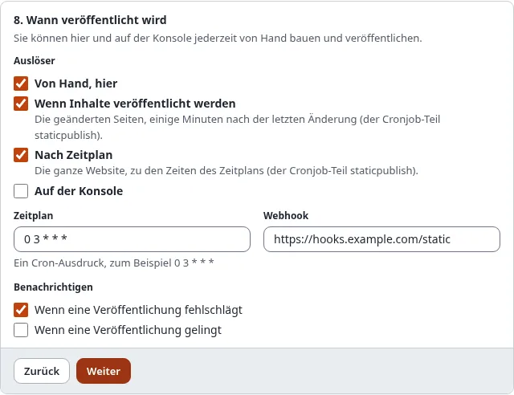

# Öffentlich entwickeln, kostenlos veröffentlichen

Ein Tutorial für Entwickler und kleine Teams: Der Code der Site liegt in einem öffentlichen GitHub-Repository,
Redakteure schreiben die Inhalte in Exponential, und die öffentliche Site ist eine statische Kopie auf GitHub Pages.
Niemand bezahlt das Hosting der öffentlichen Site, und alle können sehen, wie sie gemacht ist.

[Anleitungen](README.md) · Verwandt: [Statisches Veröffentlichen: CI und GitHub Actions](statisches-veroeffentlichen-ci-und-github-actions.md),
[Mit Git entwickeln](../hilfe/mit-git-entwickeln.md)

## Was Sie am Ende haben

- Ein Repository mit dem Design und den Erweiterungen der Site, offen für Issues und Pull Requests.
- Eine Exponential-Installation, in der Redakteure schreiben und die privat bleiben kann.
- Ein zweites Repository mit der veröffentlichten statischen Kopie, ausgeliefert unter
  `https://<owner>.github.io/<repository>/`.
- Eine Veröffentlichung, die nach Änderungen an Inhalten von selbst läuft.

## 1. Zwei Repositorys, zwei Aufgaben

| Repository | Enthält | Wer schreibt hinein |
|---|---|---|
| `example/site` (der Code) | das Design, die Erweiterungen, die Einstellungen ohne Geheimnisse | Entwickler, über Pull Requests |
| `example/site-static` (die Kopie) | die gebauten Seiten und Dateien | nur Exponential, über `exp:static:publish` |

Halten Sie sie getrennt. Der Branch der Kopie gehört dem statischen Veröffentlichen: Ein dort von Hand gemachter
Commit lässt den nächsten Push warten (`rejected (fetch first)`). Legen Sie nie `settings/override/` oder Geheimnisse
in das Code-Repository; Zugangsdaten bleiben unter Setup > Geheimnisse.

## 2. Das Ziel anlegen

Unter Setup > Statisches Veröffentlichen > **Neues Ziel** wählen Sie den Front-Siteaccess, das Repository
`example/site-static`, den Branch `gh-pages`, relative Links und den Basispfad `/site-static/`.


Für den Push wählen Sie in Schritt 3 **Ein für dieses Ziel erstellter Deploy-Key** mit der SSH-Adresse
`git@github.com:example/site-static.git`. **Speichern** öffnet die Seite **Deploy-Key**: **Schlüssel erstellen**, dann
fügen Sie seine öffentliche Hälfte mit Schreibzugriff zu `example/site-static` hinzu
([SSH-Deploy-Keys](statisches-veroeffentlichen-deploy-keys.md)). Ein Deploy-Key erreicht nur dieses eine Repository,
was gut zu einem öffentlichen Projekt passt.

## 3. Bauen, prüfen, veröffentlichen

Bauen, Bericht und Änderungen in der Vorschau lesen, dann **Veröffentlichen**. Auf der Konsole:

```bash
./console exp:static:publish site-static --build
```


Im Repository der Kopie unter **Settings > Pages**: aus dem Branch `gh-pages` ausliefern, Ordner `/ (root)`.

## 4. Inhalte sich selbst veröffentlichen lassen

In Schritt 8 des Assistenten, **Trigger**, kreuzen Sie **Wenn Inhalte veröffentlicht werden** an. Jede Veröffentlichung
in Exponential markiert ihre Seiten als veraltet; nach der Verzögerung (`PublishDebounce`, standardmäßig 120 Sekunden)
baut der Cronjob-Teil `staticpublish` genau diese Seiten und veröffentlicht sie. Nehmen Sie den Cronjob-Teil in Ihren
Plan auf, falls er dort noch fehlt.



## 5. Öffentlich arbeiten

- Entwickler ändern das Design in `example/site` und bringen es wie gewohnt in die Installation; der nächste Build trägt
  es in die Kopie. Trigger für Inhalte bauen nur geänderte Seiten, veröffentlichen Sie nach einer Designänderung also
  einen vollständigen Build.
- Jede Veröffentlichung ist ein Tag `static/site-static/<n>` im Repository der Kopie: Alle sehen, was sich wann
  geändert hat.
- Ging eine Veröffentlichung schief, nehmen Sie sie im Verlauf zurück; das Zurücknehmen ist ein neuer Commit, der
  Verlauf bleibt.

## Ohne Server: die Startvorlage

Wenn Sie lieber ganz auf GitHub bauen, beginnen Sie mit der Vorlage
[exponential-static-site-starter](https://github.com/se7enxweb/exponential-static-site-starter): Ihr Workflow installiert
Exponential, bringt Ihre Site aus einem Datenbank-Dump oder einem Seitenpaket plus Ihrem Code herein, baut und liefert
nach Pages aus. Bearbeitet wird dann in einer lokalen Installation, und der Dump wird committet. Siehe
[Statisches Veröffentlichen: CI und GitHub Actions](statisches-veroeffentlichen-ci-und-github-actions.md#auf-github-bauen-die-startvorlage).

## Nächster Schritt

[Ein statisches Blog mit Exponential](ein-statisches-blog-mit-exponential.md).
