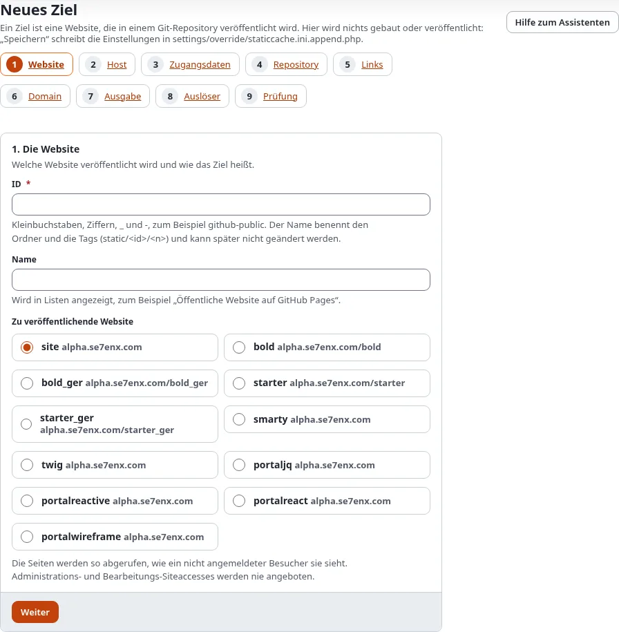
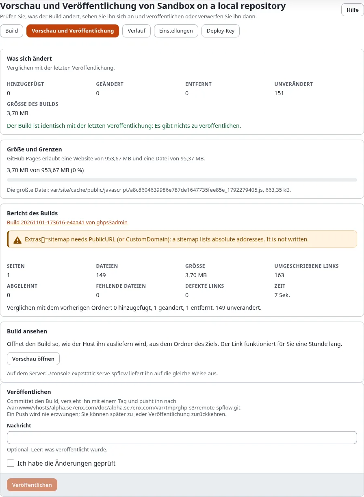

# Von einer statischen HTML-Site zu Exponential und zurück zu statisch

Ein Tutorial für Besitzer einer handgemachten HTML-Site, oft schon auf GitHub Pages, die das Bearbeiten von HTML-Dateien
leid sind: die Inhalte nach Exponential bringen, das Aussehen behalten und wieder eine statische Site veröffentlichen,
unter derselben Adresse und mit funktionierenden alten Links.

[Anleitungen](README.md) · Verwandt: [Tutorial: ein statisches HTML-Design portieren](../hilfe/designer/theme-design/tutorial-ein-statisches-html-design-portieren.md),
[Import- und Exportwerkzeuge](../hilfe/import-oder-export-werkzeug.md)

## Was Sie am Ende haben

Dieselbe Site unter derselben Adresse, nun in Exponential bearbeitet, als statische Dateien veröffentlicht, mit
Weiterleitungsseiten von den alten `.html`-Adressen zu den neuen.

## 1. Bestand aufnehmen

Listen Sie die Seiten der alten Site, ihre Seitentypen (Startseite, Artikel, Liste, Kontakt) und ihre Dateien auf.
Notieren Sie jede Adresse, auf die von außen verlinkt wird: Diese müssen weiter funktionieren.

## 2. Das Design

Portieren Sie HTML und CSS in ein Exponential-Design: Der Rahmen wird das Pagelayout, jeder Seitentyp ein
View-Template. Das [Tutorial zum Portieren eines Designs](../hilfe/designer/theme-design/tutorial-ein-statisches-html-design-portieren.md)
geht Schritt für Schritt durch.

## 3. Die Inhalte

Legen Sie die Seiten in Exponential an, von Hand für eine kleine Site oder mit den
[Importwerkzeugen](../hilfe/import-oder-export-werkzeug.md) für eine größere. Bilder kommen in die Medienbibliothek,
damit der Build sie kopieren kann.

## 4. Die alten Adressen behalten

Die alte Site hatte `about.html`; Exponential schreibt `about-us/`. Legen Sie für jede wichtige alte Adresse eine
URL-Wildcard ohne `*` an (`about.html` auf `about-us`), und fügen Sie dem Ziel `Extras[]=redirects` hinzu. Der Build
schreibt an jede solche Adresse eine kleine Weiterleitungsseite, und ebenso an die alten Adressen von Knoten, die Sie
später umbenennen oder verschieben.

## 5. Das Ziel

Legen Sie das Ziel unter Setup > Statisches Veröffentlichen > **Neues Ziel** an. Zwei Wege, die Adresse zu behalten:

- **Ein neues Repository** (`example/site-static`), und wenn es funktioniert, ziehen Sie die eigene Domain dorthin um:
  dieselbe `CustomDomain` beim Ziel setzen, dann beim alten Repository entfernen. Das alte Repository bleibt als Archiv.
- **Dasselbe Repository, ein neuer Branch** (`Branch=static`): Der alte Branch behält seinen Verlauf; stellen Sie
  **Settings > Pages** auf den neuen Branch um, wenn Sie so weit sind. Richten Sie das Ziel nie auf den Branch der alten
  Site: Seine Commits stammen nicht vom statischen Veröffentlichen, und der Push würde als `rejected (fetch first)`
  warten.



Mit eigener Domain bleibt der Basispfad leer ([eigene Domains und DNS](statisches-veroeffentlichen-eigene-domains-und-dns.md)).

## 6. Bauen und vergleichen

```bash
./console exp:static:build site-static
./console exp:static:serve site-static --base-path=/
./console exp:static:diff site-static --check-links --mount=/
```

Öffnen Sie die Vorschau neben der alten Site. Prüfen Sie jede Adresse aus Schritt 1, auch die alten `.html`-Adressen.



## 7. Umschalten

Veröffentlichen, GitHub Pages (oder die Domain) auf die neue Kopie umstellen und die Live-Adresse prüfen. Stimmt etwas
nicht, schalten Sie zurück: Die alte Site bleibt unberührt, bis Sie sie entfernen.

## Nächster Schritt

[In 15 Minuten eine kostenlose Website](../hilfe/statisches-veroeffentlichen/in-15-minuten-eine-kostenlose-website.md),
oder vor dem ersten Push [Private Inhalte privat halten](../hilfe/statisches-veroeffentlichen/private-inhalte-privat-halten.md).
