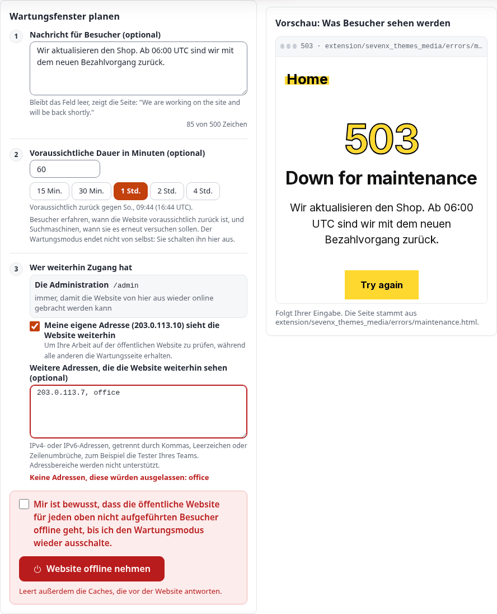
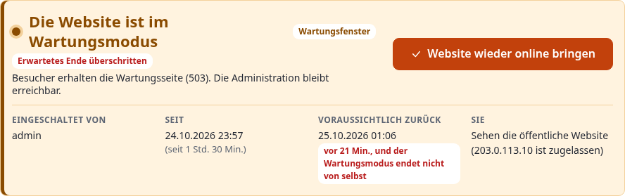
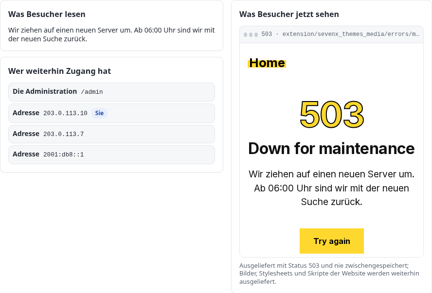
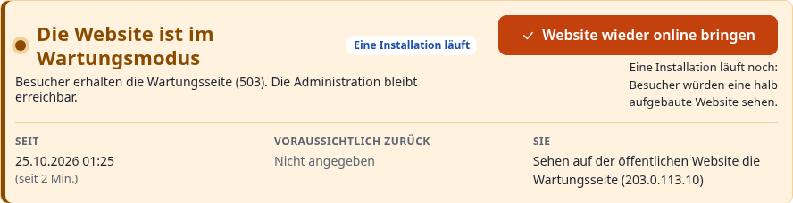
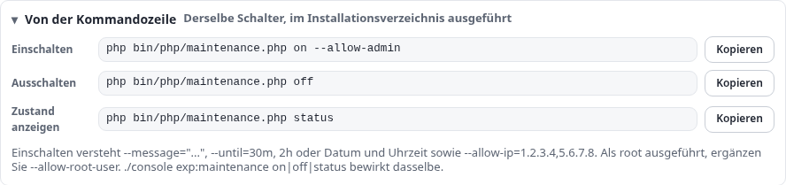
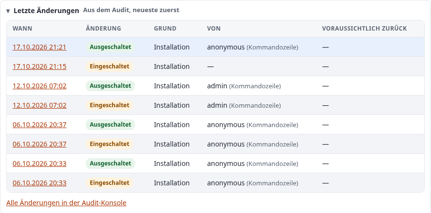

# Wartungsmodus: die Site vom Netz nehmen und zurückholen

Diese Anleitung erklärt alles über den Wartungsmodus in Exponential: was Besucher, Administratoren und zugelassene
Adressen erhalten, solange er eingeschaltet ist, wie Sie ihn auf der Administrationsseite **Setup > Wartung** und
in einer Shell ein- und ausschalten, wie Sie die Nachricht formulieren, das erwartete Ende angeben und festlegen, wer
weiterhin Zugang hat, wie Sie eine Vorschau der Seite sehen, die Besucher erhalten werden, wie er mit Velocity,
Apache, den Caches, den Cronjobs, dem Kickstarter und Bereitstellungen zusammenwirkt, was die Zustandsdatei
`var/maintenance.json` enthält und wie Sie wieder hineinkommen, wenn etwas schiefgegangen ist.

Sie richtet sich an Administratoren, die Upgrades, Importe und Reparaturen an einer laufenden Site durchführen. Lesen
Sie zuerst die Abschnitte 1 bis 3; danach steht jeder Abschnitt für sich. Jede Option, jedes Feld und jeder Pfad
unten wurde am Code geprüft (`kernel/classes/expmaintenance.php`, `kernel/private/classes/views/setup/maintenance.php`,
`kernel/private/classes/commands/maintenance.php`, die Front-Controller). Die Ausgaben sind echt: Sie wurden am
5. Oktober 2026 auf dem Demonstrationsserver von den gezeigten Befehlen ausgegeben, rein lesend. Die Bildschirmfotos
zeigen dieselbe Seite im hellen Modus des Designs admin4; die Bilder „im Wartungsmodus“ wurden aus dem Template der
Seite mit einem Beispielzustand erzeugt, weil die Demonstrationssite für diese Anleitung nie vom Netz genommen wurde.
Die Adresse des Betrachters darin ist die Dokumentationsadresse 203.0.113.10.

[Anleitungen](README.md) · Funktionsreferenz: [Wartungsmodus](../funktionen/6.0/wartungsmodus.md) · Im
Installationshandbuch: [Wartungsfenster](../installation/10-nach-der-installation.md#wartungsfenster) ·
Verwandte Anleitung: [Cronjobs](cronjobs.md)

## Kurz gesagt

- **Setup > Wartung** (`/setup/maintenance`) nimmt die öffentliche Site vom Netz: Jede Seitenanfrage erhält eine
  Wartungsseite mit dem Status `503 Service Unavailable`, `Retry-After` und `no-store`. Bilder, Stylesheets und Skripte
  werden weiterhin ausgeliefert. Die Administration unter `/admin` bleibt erreichbar, sodass dieselbe Seite die Site
  zurückholt.
- Das Formular fragt nach einer optionalen **Nachricht**, einer optionalen **voraussichtlichen Dauer** (ein Klick für
  15 Minuten bis 4 Stunden) und danach, **wer weiterhin Zugang hat**: Ihre eigene Adresse mit einem Häkchen, weitere
  Adressen in einer Liste. Eine **Vorschau** zeigt die echte Seite mit Ihrer Nachricht, während Sie tippen. Eine
  verpflichtende **Bestätigung** sichert die Schaltfläche **Website offline nehmen** ab.
- Solange die Site offline ist, beginnt die Seite mit einem bernsteinfarbenen Banner: warum, von wem, seit wann, bis
  wann, ob das erwartete Ende überschritten ist und ob **Sie** die Site oder die Wartungsseite sehen. **Website wieder
  online bringen** beendet den Wartungsmodus. Er endet nie von selbst, wenn die erwartete Zeit verstrichen ist.
- In einer Shell: `php bin/php/maintenance.php on --message="..." --until=2h --allow-admin`, `... off`,
  `... status` oder dasselbe über `./console exp:maintenance`. Ohne `--allow-admin` ist auch die Administration
  offline.
- Der gesamte Zustand ist eine Datei, `var/maintenance.json`. Solange sie existiert, antworten `index.php`,
  `index_rest.php` und `index_treemenu.php` mit der Wartungsseite, bevor die Einstellungen oder die Datenbank berührt
  werden. Das Löschen der Datei beendet den Wartungsmodus: Das ist der Weg zurück, wenn nichts anderes funktioniert
  (Abschnitt 15).
- Jedes Ein- und Ausschalten wird ins Audit geschrieben (`system.maintenance.change`); die Seite listet die letzten
  acht auf.

## Inhalt

- [1. Was der Wartungsmodus tut](#1-was-der-wartungsmodus-tut)
- [2. Bevor Sie beginnen](#2-bevor-sie-beginnen)
- [3. Die Seite auf einen Blick](#3-die-seite-auf-einen-blick)
- [4. Die Site über die Seite vom Netz nehmen](#4-die-site-über-die-seite-vom-netz-nehmen)
- [5. Während die Site offline ist](#5-während-die-site-offline-ist)
- [6. Über die Kommandozeile](#6-über-die-kommandozeile)
- [7. Wer weiterhin Zugang hat](#7-wer-weiterhin-zugang-hat)
- [8. Die Wartungsseite und ihre Vorschau](#8-die-wartungsseite-und-ihre-vorschau)
- [9. Apache, Velocity und die Caches](#9-apache-velocity-und-die-caches)
- [10. Installationen, Cronjobs und Bereitstellungen](#10-installationen-cronjobs-und-bereitstellungen)
- [11. Die Zustandsdatei var/maintenance.json](#11-die-zustandsdatei-varmaintenancejson)
- [12. Einstellungen und Berechtigungen](#12-einstellungen-und-berechtigungen)
- [13. Letzte Änderungen und das Audit](#13-letzte-änderungen-und-das-audit)
- [14. Abläufe Schritt für Schritt](#14-abläufe-schritt-für-schritt)
- [15. Fehlerbehebung](#15-fehlerbehebung)
- [16. Alle Optionen und Felder](#16-alle-optionen-und-felder)
- [Quellen](#quellen)

## 1. Was der Wartungsmodus tut

Der Wartungsmodus beantwortet jede Seitenanfrage mit einer einzigen, in sich geschlossenen HTML-Seite statt mit der
Site. Es gibt ihn für zwei Situationen:

- **Ein Fenster, das Sie bewusst öffnen**: ein Upgrade, ein Datenimport, eine Reparatur des Inhaltsbaums, eine
  Datenbankmigration. Besucher erhalten eine klare Nachricht statt Fehlern oder halb geänderter Seiten.
- **Eine Installation**: Der Kickstarter und der Web-Setup-Assistent bauen die Datenbank neu auf, während der Webserver
  weiter antwortet. Ohne Wartungsmodus trafen Anfragen in dieser Zeit auf halb aufgebaute Tabellen und schrieben
  Fehler in die Logs, die nicht von der Installation stammten. Beide schalten ihn selbst ein und aus (Abschnitt 10).

Was jede Art von Anfrage erhält, solange er eingeschaltet ist:

| Anfrage | Antwort |
|---|---|
| Eine Seite der öffentlichen Site (`/`, `/Fit-Healthy`, `/content/search`) | Die Wartungsseite, Status 503 |
| Die REST-API (`index_rest.php`) und das Baummenü der Administration (`index_treemenu.php`) | Die Wartungsseite, Status 503 |
| Ein Pfad unterhalb eines zugelassenen Präfixes (`/admin/...`, wenn die Administration offen gehalten wird) | Die Site, wie gewohnt |
| Eine Anfrage von einer zugelassenen Adresse | Die Site, wie gewohnt |
| Der Browser eines laufenden Web-Setup-Assistenten (Cookie `exp_setup_wizard`) | Die Site, wie gewohnt |
| Ein Bild, ein Stylesheet, ein Skript, eine Schrift, `favicon.ico` | Wie gewohnt ausgeliefert: Das sind Dateien, keine Seitenanfragen |
| Ein Befehl oder ein Cronjob in einer Shell | Läuft wie gewohnt: Der Wartungsmodus betrifft nur Webanfragen |

Die Wartungsseite wird von `expMaintenance::send()` mit diesen Headern gesendet:

```text
HTTP/1.1 503 Service Unavailable
Retry-After: <seconds until the expected end, or 120 when none is given>
Cache-Control: no-store, no-cache, must-revalidate, private
Pragma: no-cache
Expires: 0
Content-Type: text/html; charset=utf-8
X-Robots-Tag: noindex
```

Eine 503 mit `Retry-After` ist die Antwort, die Suchmaschinen als „kommen Sie später wieder“ verstehen: Die Seiten
behalten ihren Platz im Index. `no-store` hält jeden Cache, Proxy und Browser davon ab, die Wartungsseite nach dem
Fenster weiter vorzuhalten.

Die Prüfung läuft als Allererstes im Front-Controller, vor `autoload.php`, den Einstellungen und der Datenbank
(`index.php`, Zeilen 21 bis 29):

```php
if ( is_file( __DIR__ . '/var/maintenance.json' ) )
{
    require_once __DIR__ . '/kernel/classes/expmaintenance.php';
    if ( expMaintenance::check( __DIR__ ) )
        return;
}
```

Die Wartungsseite braucht also nichts, was während des Fensters kaputt sein könnte: kein Template, keine INI-Datei,
keine Datenbankverbindung. Solange die Datei nicht existiert, kostet das einen Aufruf von `is_file()` pro Anfrage.

## 2. Bevor Sie beginnen

- **Das Recht**: Die Seite braucht die Richtlinie `setup / administrate`, wie die anderen Setup-Seiten. Das Menü
  Setup zeigt **Wartung** nur Benutzern, die sie besitzen (`menu.ini`, `PolicyList_maintenance[]=setup/administrate`).
- **Die Adresse der Administration**: Die Seite hält Pfade unterhalb von `/admin` erreichbar. Das ist die
  Administration, wenn sie als `https://www.example.com/admin/...` erreicht wird, die übliche Einrichtung. Eine
  Administration, die über einen eigenen Hostnamen (`https://edit.example.com/setup/maintenance`) oder unter einem
  anderen Pfad (`/admintest_admin4/...`) erreicht wird, liegt **nicht** unterhalb von `/admin`: Wenn Sie den
  Wartungsmodus von dort einschalten, sperren Sie diese Adresse aus. Verwenden Sie die Adresse unter `/admin`, lassen
  Sie Ihre eigene Adresse zu (Abschnitt 7) oder halten Sie eine Shell bereit (Abschnitt 6).
- **Eine Shell, für alle Fälle**: Halten Sie für ein geplantes Fenster ein Terminal im Installationsverzeichnis offen.
  Abschnitt 15 zeigt den einen Befehl, der den Wartungsmodus beendet, egal was sonst nicht stimmt.
- **Wer betroffen ist**: jeder, der einen Front-Controller dieser Installation erreicht, über jeden Webserver, der sie
  ausliefert. Auf dem Demonstrationsserver sind das Apache auf den Ports 80 und 443 und Velocity auf 8080; die
  Zustandsdatei wird geteilt, sodass beide gemeinsam offline gehen und gemeinsam zurückkommen.

## 3. Die Seite auf einen Blick

Öffnen Sie **Setup > Wartung**. Die Seite ist in jedem Zustand gleich aufgebaut, von oben nach unten:

1. **Der Zustand**, in einem Banner: grün **Die Website ist online** oder bernsteinfarben **Die Website ist im
   Wartungsmodus** mit den zugehörigen Angaben und der Schaltfläche, die ihn beendet.
2. **Der Plan** (online) oder **was Besucher lesen und wer weiterhin Zugang hat** (offline), mit der **Vorschau** der
   Wartungsseite daneben auf einem breiten Bildschirm und darunter auf einem schmalen.
3. **Von der Kommandozeile**: die Befehle, die dasselbe tun, mit Schaltflächen zum Kopieren.
4. **Letzte Änderungen**: die letzten Schaltvorgänge aus dem Audit.
5. **So funktioniert es**: was ausgeliefert wird und wo der Zustand gespeichert ist.

Wenn die Site online ist, sagt das Banner das und verspricht, dass sich nichts ändert, bevor Sie bestätigen:


Die Seite funktioniert ohne JavaScript: Beide Schaltflächen senden das Formular ab, die Bestätigung ist ein
Pflicht-Kontrollkästchen, das der Browser selbst prüft, und die aufklappbaren Abschnitte sind einfache
`<details>`-Elemente. Mit JavaScript kommen die Vorgaben für die Dauer, die Zeile „voraussichtlich zurück“, der
Zeichenzähler, die Adressprüfung, die Live-Vorschau und die Schaltflächen zum Kopieren hinzu. Die Seite funktioniert
vom Telefon mit 390 Pixeln bis zum breiten Bildschirm und bei 200 % Zoom; ihr Text hat im hellen und im dunklen Modus
von admin4 einen Kontrast von mindestens 4,5:1.

## 4. Die Site über die Seite vom Netz nehmen

Das Formular hat drei nummerierte Schritte, eine Vorschau und eine Bestätigung. Jeder Schritt ist optional, außer der
Bestätigung.



### Schritt 1: die Nachricht für Besucher

Bis zu 500 Zeichen (Feld `MaintenanceMessage`). Sie ersetzt den Standardtext der Seite, der für ein Fenster „We are
working on the site and will be back shortly.“ lautet. Sagen Sie in Worten, die ein Besucher versteht, was gerade
geschieht und wann die Site zurück ist: „Wir aktualisieren den Shop. Zurück um 06:00 UTC mit dem neuen
Bestellvorgang.“ Der Zähler unter dem Feld zeigt, wie viel Platz noch bleibt. Der Text wird maskiert, wenn er in die
Seite eingesetzt wird, sodass HTML darin als Text angezeigt wird.

### Schritt 2: die voraussichtliche Dauer

Minuten, von 1 bis 10080 (eine Woche; Feld `MaintenanceMinutes`). Die Schaltflächen **15 Min.**, **30 Min.**,
**1 Std.**, **2 Std.** und **4 Std.** füllen das Feld mit einem Klick, und die Zeile darunter sagt, wann das in Ihrer
Zeit und in UTC ist („Voraussichtlich zurück gegen Mon 10:28 PM (05:28 UTC).“). Die Seite speichert das Ende als
Zeitpunkt (`until`, Abschnitt 11). Es wird auf drei Arten verwendet:

- Die Wartungsseite sagt „Expected back at 05:28 UTC.“ (wenn die Seite des Themes den Platzhalter `{until}` hat);
- der Header `Retry-After` trägt die verbleibenden Sekunden, sodass Suchmaschinen und Clients zur richtigen Zeit
  wiederkommen;
- die Administrationsseite zählt bis dahin herunter und warnt, wenn der Zeitpunkt überschritten ist.

Das erwartete Ende ist ein Versprechen an die Besucher, kein Zeitschalter: **Der Wartungsmodus endet nicht von
selbst**, wenn es verstrichen ist. Lassen Sie das Feld leer, wenn Sie es nicht wissen; die Seite sagt dann „Please try
again in a few minutes.“ und `Retry-After` beträgt 120 Sekunden.

### Schritt 3: wer weiterhin Zugang hat

- **Die Administration** (`/admin`) bleibt von dieser Seite aus immer erreichbar; dafür gibt es keine Einstellung.
- **Meine eigene Adresse (…) sieht die Website weiterhin** (`MaintenanceAllowMe`) fügt die Adresse hinzu, von der
  Ihre Anfrage kommt. Setzen Sie das Häkchen, wenn Sie Ihre Arbeit auf der öffentlichen Site prüfen möchten, während
  alle anderen die Wartungsseite erhalten. Lassen Sie es weg, wenn Sie die Wartungsseite selbst sehen möchten, um
  sicherzugehen, dass sie aktiv ist.
- **Weitere Adressen** (`MaintenanceAllowIPs`): IPv4- oder IPv6-Adressen, getrennt durch Kommas, Leerzeichen,
  Semikolons oder Zeilenumbrüche. Adressbereiche und Netze (`10.0.0.0/8`) werden nicht unterstützt: Jede Adresse wird
  exakt verglichen. Die Seite prüft, was Sie eingeben, und nennt, was keine Adresse ist („Keine Adressen, diese würden
  ausgelassen: office“); der Server prüft erneut, lässt solche Einträge aus und sagt nach dem Einschalten, welche:


Abschnitt 7 erklärt jeden Weg hinein im Detail.

### Die Vorschau

Neben dem Formular steht die Wartungsseite selbst, so wie sie gesendet wird: die Seite des aktiven Themes, ausgefüllt.
Mit JavaScript folgt sie der Nachricht und der Dauer, während Sie tippen. Sie wird in einem Rahmen angezeigt, der
keines der Skripte der Seite ausführt, sodass ihre Schaltflächen dort nichts tun. Die Zeile darunter nennt die Datei,
aus der die Seite stammt (Abschnitt 8).

### Die Bestätigung und die Schaltfläche

Setzen Sie das Häkchen bei **Mir ist bewusst, dass die öffentliche Website für jeden oben nicht aufgeführten Besucher
offline geht, bis ich den Wartungsmodus wieder ausschalte.** und drücken Sie **Website offline nehmen**. Der Browser
verweigert das Absenden des Formulars ohne das Häkchen, mit oder ohne JavaScript. Das Formular trägt das
Formular-Token der Administration, wie jedes Formular der Administration.

Das Einschalten schreibt `var/maintenance.json` (Abschnitt 11), verschiebt die Dateien des HTTP-Caches zur Seite,
damit keine vor dem Fenster gespeicherte Seite während des Fensters ausgeliefert wird, und hält die Änderung im Audit
fest. Die Seite antwortet „Der Wartungsmodus ist eingeschaltet: Besucher sehen die Wartungsseite.“ und zeigt den
Offline-Zustand.

## 5. Während die Site offline ist



Das Banner sagt Ihnen:

| Angabe | Woher sie stammt |
|---|---|
| **Wartungsfenster**, **Eine Installation läuft**, **Einrichtungsassistent läuft** oder **Unlesbare Markierungsdatei** | Der `reason` der Markierungsdatei (Abschnitt 11) |
| **Erwartetes Ende überschritten** und „vor 21 Min., und der Wartungsmodus endet nicht von selbst“ | `until` liegt in der Vergangenheit, und die Markierungsdatei ist noch da |
| **Eingeschaltet von** | Der Login, der die Schaltfläche gedrückt hat (`by`; nicht gesetzt für ein in einer Shell geöffnetes Fenster) |
| **Seit** und wie lange schon | `since` |
| **Voraussichtlich zurück** und wie viel Zeit bleibt | `until`; „Nicht angegeben“, wenn keines gesetzt wurde |
| **Endet, sofern der Assistent nicht wieder verwendet wird** | `lease`, nur für den Web-Setup-Assistenten |
| **Sie** | Ob Ihre Adresse auf der Liste steht: „Sehen die öffentliche Website“ oder „Sehen auf der öffentlichen Website die Wartungsseite“ |

Darunter zeigt **Was Besucher lesen** die Nachricht (oder dass der Standardtext verwendet wird), **Wer weiterhin
Zugang hat** listet die offenen Pfade und die zugelassenen Adressen auf (Ihre ist mit **Sie** markiert), und **Was
Besucher jetzt sehen** ist die Seite, die ausgeliefert wird, aus der in der Markierungsdatei genannten Datei.



**Website wieder online bringen** (`SwitchOffButton`) entfernt die Markierungsdatei, verschiebt die Dateien des
HTTP-Caches erneut zur Seite, damit während des Fensters vorgenommene Änderungen sofort sichtbar sind, und hält die
Änderung im Audit fest. Es ist keine Bestätigung nötig: Die Site zurückzuholen ist immer sicher, mit einer Ausnahme,
vor der die Seite warnt.



Wenn eine Installation den Wartungsmodus hält („Eine Installation läuft noch: Besucher würden eine halb aufgebaute
Website sehen.“), warten Sie, bis sie fertig ist: Der Kickstarter und der Assistent schalten ihn selbst aus. Wenn Sie
ihn vorzeitig beenden, sehen Besucher eine halb aufgebaute Site.

Um die Nachricht oder das Ende eines bereits offenen Fensters zu ändern, schalten Sie es aus und mit den neuen Werten
wieder ein, oder führen Sie in einer Shell erneut `bin/php/maintenance.php on` aus: Einschalten bei bereits
eingeschaltetem Wartungsmodus ersetzt die Markierungsdatei (und setzt `since` zurück).

## 6. Über die Kommandozeile

Alles, was die Seite tut, gibt es auch als Befehl. Führen Sie ihn im Installationsverzeichnis aus; als root ergänzen
Sie `--allow-root-user` (sonst verweigert das Skript die Ausführung).

```bash
php bin/php/maintenance.php on --message="Back at 06:00" --until=2h --allow-admin
php bin/php/maintenance.php status
php bin/php/maintenance.php off
./console exp:maintenance on|off|status       # the same command, through the console
```

Der Abschnitt **Von der Kommandozeile** der Seite listet die drei Befehle mit Schaltflächen zum Kopieren auf:



Die Optionen, aus `php bin/php/maintenance.php --help` auf dem Demonstrationsserver:

```text
Usage: bin/php/maintenance.php [OPTION]... [ACTION]
Maintenance mode: take the site offline and back

  maintenance.php on|off|status [options]
...
Options:
  --message=VALUE   What the page says, instead of the default text
  --until=VALUE     When the site is expected back: 30m, 2h, or a date and time
  --allow-ip=VALUE  Addresses that still see the site, comma separated
  --allow-admin     Keep the administration (/admin) reachable
```

Was sich von der Seite unterscheidet:

| | Die Seite | Der Befehl |
|---|---|---|
| Die Administration | Immer offen gehalten (`/admin`) | Nur mit `--allow-admin`; **ohne die Option ist auch `/admin` offline** |
| Erwartetes Ende | Minuten, höchstens eine Woche | `--until=30m`, `--until=2h` oder jedes Datum mit Uhrzeit, das PHPs `strtotime()` liest (`"2026-09-28 06:00"`, in der Zeitzone des Servers) |
| Adressen | Geprüft; was keine Adresse ist, wird ausgelassen und genannt | `--allow-ip` wird an Kommas getrennt und von Leerzeichen befreit, nicht geprüft: Ein Tippfehler wird gespeichert und passt einfach nie |
| Ihre eigene Adresse | Ein Häkchen | Nennen Sie sie in `--allow-ip` |
| `by` in der Markierungsdatei | Ihr Login | Nicht gesetzt |
| Ein falsches `--until` | Kann nicht vorkommen | `--until: "..." is not a time (30m, 2h, or a date and time)`, Exit-Code 1 |

`status` gibt den Zustand aus. Bei ausgeschaltetem Wartungsmodus, wie auf dem Demonstrationsserver, während diese
Anleitung geschrieben wurde:

```text
$ php bin/php/maintenance.php status --allow-root-user
Maintenance is off.
```

Bei eingeschaltetem Wartungsmodus gibt `status` `Maintenance is ON (<reason>[, setup run <id>])` aus und danach die
Zeilen `since`, `until`, `message`, `allowed` (die Adressen), `open` (die Pfade) und `page`, jede nur, wenn sie gesetzt
ist.

`off` gibt, wenn der Wartungsmodus nicht eingeschaltet war, „Maintenance was not on.“ aus und endet mit 0; der Befehl
ist also in Skripten unbedenklich.

## 7. Wer weiterhin Zugang hat

`expMaintenance::letThrough()` entscheidet für jede Anfrage, in dieser Reihenfolge:

1. **Der Browser des Web-Setup-Assistenten**: das Cookie `exp_setup_wizard`, dessen SHA-256-Hash die
   Markierungsdatei als `allow_token` enthält. Nur der Assistent setzt es.
2. **Eine zugelassene Adresse**: Die `REMOTE_ADDR` der Anfrage ist exakt eine der `allow_ips`.
3. **Ein zugelassener Pfad**: Der Pfad ist einer der `allow_paths` oder liegt darunter. Die Seite setzt immer
   `/admin`; der Befehl mit `--allow-admin`.

Alles andere erhält die Wartungsseite. Hier ist die echte Antwort der Funktion für ein Fenster mit den `allow_ips`
203.0.113.7 und 203.0.113.10 und den `allow_paths` `/admin`, wobei `REMOTE_ADDR` und `REQUEST_URI` für jede Zeile
gesetzt wurden (ausgeführt über `bin/php/ezexec.php`, ohne dass etwas geschaltet wurde):

```text
198.51.100.20   /                            the maintenance page (503)
198.51.100.20   /admin/setup/maintenance     the site
198.51.100.20   /administration              the maintenance page (503)
203.0.113.7     /                            the site
198.51.100.20   /setup/maintenance           the maintenance page (503)
```

Gut zu wissen:

- **Ein Präfix ist ein ganzes Pfadsegment.** `/admin` lässt `/admin` und `/admin/...` durch, nicht
  `/administration` und nicht `/admintest_admin4/...`.
- **Die Adresse ist diejenige, die PHP sieht.** Hinter einem Proxy oder einem Load Balancer ist `REMOTE_ADDR` die
  Adresse des Proxys, sofern der Webserver nicht die des Clients wiederherstellt (Apache `mod_remoteip`, nginx
  `real_ip`). Lassen Sie die Adresse zu, die der Server protokolliert, nicht die, die eine „Wie ist meine IP“-Site
  anzeigt, wenn beide sich unterscheiden. „Meine eigene Adresse“ auf der Seite verwendet die Vorstellung der
  Administration von Ihrer Adresse (`eZSys::clientIP()`), und diese wird gespeichert.
- **Es gibt keine Zulassungsliste nach Benutzer.** Angemeldet zu sein lässt auf der öffentlichen Site niemanden
  durch: Über den Wartungsmodus wird entschieden, bevor die Sitzung gelesen wird. Geben Sie Testern Zugang über ihre
  Adresse, oder lassen Sie sie über die Vorschau der Administration schauen.
- **Durchgelassen zu werden heißt: die vollständige Site**, mit ihren Caches. Ein zugelassener Besucher sieht
  womöglich Seiten, die vor dem Fenster gespeichert wurden (Abschnitt 9).

## 8. Die Wartungsseite und ihre Vorschau

Die Seite, die Besucher erhalten, ist eine in sich geschlossene HTML-Datei mit Platzhaltern:

- `errors/maintenance.html` der ersten aktiven Extension (ermittelt, wenn der Wartungsmodus eingeschaltet wird, und in
  der Markierungsdatei als `page` gespeichert); auf dem Demonstrationsserver ist das
  `extension/sevenx_themes_media/errors/maintenance.html`;
- andernfalls `share/maintenance.html` des Kernels.

`expMaintenance::page()` füllt diese Platzhalter:

| Platzhalter | Gefüllt mit |
|---|---|
| `{status}` | `503` |
| `{title}` | „Down for maintenance“ für ein Fenster, „The site is being set up“ für eine Installation |
| `{message}` | Der Nachricht oder dem Standardtext: „We are working on the site and will be back shortly.“ (Installation: „It is being installed right now and will be here in a few minutes.“) |
| `{until}` | „Expected back at HH:MM UTC.“, solange das erwartete Ende in der Zukunft liegt, sonst „Please try again in a few minutes.“ |
| `{home}` | `/` |
| `{reference}`, `{detail}` | Leer |

Jeder Wert wird HTML-maskiert. Das echte Ergebnis für das Fenster aus Abschnitt 11, mit der Seite des Kernels:

```text
<title>Down for maintenance</title>
<h1>Down for maintenance</h1>
<p class="message">We are upgrading the shop. Back at 03:00 UTC with the new checkout.</p>
<p class="reference">Please try again in a few minutes.</p>
```

(Das Ende des Fensters, 28. September 2026 03:00 UTC, lag bereits in der Vergangenheit, als dies ausgegeben wurde,
daher „Please try again“.)

Um die Seite an Ihre Site anzupassen, geben Sie Ihrer Theme-Extension eine `errors/maintenance.html`:

- Halten Sie sie in sich geschlossen: Inline-CSS, oder Stylesheets und Schriften als statische Dateien unter einem
  Pfad, den der Webserver direkt ausliefert (das sind keine Seitenanfragen, sie werden also während des
  Wartungsmodus ausgeliefert);
- verwenden Sie keinen Template-Code, kein PHP und nichts aus der Datenbank: Nichts davon steht zur Verfügung;
- Links zur Site führen ebenfalls zur Wartungsseite, bieten Sie also höchstens „Erneut versuchen“ an;
- schalten Sie den Wartungsmodus erneut ein, nachdem Sie die Datei hinzugefügt oder verschoben haben: Die
  Markierungsdatei merkt sich die Datei, die sie erhalten hat.

Die **Vorschau** auf der Seite ist dasselbe Ergebnis von `expMaintenance::page()` in einem Rahmen mit Sandbox, aus dem
die Skripte der Seite entfernt sind; die Live-Vorschau ersetzt die Nachricht und das Ende, während Sie tippen. Was
Sie darin sehen, ist das, was gesendet wird.

## 9. Apache, Velocity und die Caches

**Apache mit PHP-FPM** führt `index.php` für jede Seitenanfrage aus, die Prüfung greift also direkt. Statische
Dateien liefert Apache ohne PHP aus, und sie bleiben verfügbar.

**Velocity** schickt Seitenanfragen an dieselben Front-Controller (`index.php`, `index_rest.php`,
`index_treemenu.php`), die Prüfung greift also auch dort. Sein eigener Antwort-Cache würde sonst vor PHP antworten; die
generierte Site-Konfiguration nennt die Markierungsdatei als **Pausendatei** des Caches (`Q.web.cache.pauseFile`,
geschrieben von `kernel/classes/expvelocity.php`). Solange `var/maintenance.json` existiert, antwortet weder der Cache
von Velocity noch der HTTP-Cache der Anwendung; jede Anfrage erreicht `index.php` und erhält die Wartungsseite. Ein
Worker schaut höchstens zweimal pro Sekunde nach der Datei. Das erfordert Velocity 0.0.4.34 oder neuer. Auch das
Vorwärmen von Velocity überspringt seine Arbeit, solange der Wartungsmodus eingeschaltet ist
(`kernel/private/classes/commands/velocity-warmup.php`).

**Die Caches vor PHP**:

- Ein- und Ausschalten verschiebt die Verzeichnisse des HTTP-Caches (`var/<site>/cache/exphttpcache`) nach
  `var/tmp/<site>-exphttpcache-before-maintenance-<time>-<pid>`, statt sie zu löschen. Sie können später entfernt
  werden.
- Der Antwort-Cache von Velocity wird durch `./console exp:velocity cache clear --apply` geleert, wenn der Wartungsmodus über
  den Befehl ein- oder ausgeschaltet wird, oder durch die Seite, wenn Velocity die Administration ausliefert. Wenn
  Apache die Administrationsseite ausliefert, führen Sie den Befehl nach dem Ausschalten selbst aus, damit eine
  während des Fensters vorgenommene Änderung sofort sichtbar ist:

  ```bash
  ./console exp:velocity cache clear --apply --allow-root-user
  ```

- Ein CDN oder Reverse Proxy vor der Site speichert die Wartungsseite nicht (`no-store`), hält aber womöglich noch
  Seiten von vor dem Fenster vor. Leeren Sie ihn, wenn im Fenster Inhalte geändert wurden.

## 10. Installationen, Cronjobs und Bereitstellungen

**Der Kickstarter** (`php bin/php/kickstarter.php run --apply`) schaltet den Wartungsmodus für seinen Lauf mit dem Grund
`setup` und seiner Lauf-ID ein und am Ende aus, wenn die Site installiert und geprüft ist. Ist der Wartungsmodus beim
Start **bereits eingeschaltet**, behält er dieses Fenster genau so bei (`expMaintenance::beginRun()` gibt `existing`
zurück) und lässt es danach eingeschaltet; er gibt aus: „Maintenance mode was already on: kept as it is, and left on
after the installation (php bin/php/maintenance.php off ends it).“ Nach einem fehlgeschlagenen Schritt lässt er den
Wartungsmodus eingeschaltet, damit keine halb installierte Site gezeigt wird. Die Seite zeigt einen solchen Lauf als
**Eine Installation läuft**, ohne offenen Pfad: Auch die Administration ist während eines Kickstarter-Laufs offline.

**Der Web-Setup-Assistent** schaltet ihn bei seiner ersten Anfrage mit dem Grund `setup`, einer Frist (Lease) von
30 Minuten und einem Cookie für seinen eigenen Browser ein. Jede Anfrage des Assistenten verlängert die Frist; ein
Assistent, den niemand mehr bedient, hält den Wartungsmodus nach 30 Minuten nicht mehr, ohne dass jemand etwas löschen
muss. Seine letzte Seite schaltet den Wartungsmodus aus.

**Cronjobs** laufen in einer Shell und sind nicht betroffen: `runcronjobs.php` und die über **Setup > Cronjobs**
gestarteten Teile laufen während eines Fensters weiter. Halten Sie die Crontab selbst an, wenn ein Job nicht laufen
darf, während Sie die Site ändern (ein Import, ein Neuaufbau des Suchindex über einer halb migrierten Datenbank). Siehe
[Cronjobs](cronjobs.md).

**Bereitstellungen** (`./console exp:velocity deploy`) schalten den Wartungsmodus weder ein noch aus. Öffnen Sie für
eine Bereitstellung, die die Datenbank oder viele Dateien auf einmal ändert, zuerst ein Fenster und schließen Sie es
nach dem Smoke-Test (Abschnitt 14).

## 11. Die Zustandsdatei var/maintenance.json

Der Wartungsmodus ist genau so lange eingeschaltet, wie `var/maintenance.json` existiert (mit einer Ausnahme: Die
Markierungsdatei eines Web-Assistenten, deren Frist abgelaufen ist, gilt als ausgeschaltet). Sie wird vollständig in
eine temporäre Datei geschrieben und an ihren Platz umbenannt, sodass eine Anfrage nie nur die Hälfte davon liest, und
zwar mit dem Modus 0666, damit sowohl der Benutzer des Webservers als auch der der Shell sie ersetzen können.

Die Markierungsdatei, die die Seite für ein einstündiges Fenster ab 02:00 UTC mit zwei zugelassenen Adressen
schreiben würde, genau so kodiert, wie `expMaintenance::enable()` sie kodiert, mit ihren Standardwerten (ausgegeben
über `bin/php/ezexec.php`, ohne `enable()` aufzurufen, sodass nichts geschrieben wurde):

```json
{
    "reason": "manual",
    "message": "We are upgrading the shop. Back at 03:00 UTC with the new checkout.",
    "until": 1790564400,
    "allow_ips": [
        "203.0.113.7",
        "203.0.113.10"
    ],
    "allow_paths": [
        "/admin"
    ],
    "by": "admin",
    "page": "extension/sevenx_themes_media/errors/maintenance.html",
    "since": 1790560800
}
```

| Feld | Geschrieben von | Bedeutung |
|---|---|---|
| `reason` | allen | `manual` (ein Fenster), `setup` (Kickstarter oder Web-Assistent). Eine Markierungsdatei, die kein gültiges JSON ist, gilt als eingeschaltet mit dem Grund `unknown`. |
| `message` | Seite, Befehl | Die Nachricht für Besucher; leer für den Standardtext. |
| `until` | Seite, Befehl | Erwartetes Ende, Unix-Zeit; `0` für keines. Auf der Seite angezeigt, als `Retry-After` gesendet. Beendet den Wartungsmodus nie. |
| `allow_ips` | Seite, Befehl | Durchgelassene Adressen, exakt verglichen. |
| `allow_paths` | Seite (`/admin`), Befehl (`--allow-admin`) | Durchgelassene Pfadpräfixe. |
| `by` | Seite | Login des Benutzers, der ihn eingeschaltet hat. |
| `page` | `enable()` | Die Seitendatei, relativ zur Installation; leer für `share/maintenance.html`. |
| `since` | `enable()` | Wann er eingeschaltet wurde, Unix-Zeit. |
| `run` | Kickstarter, Assistent | Die ID des Setup-Laufs; ein Lauf schaltet nur eine Markierungsdatei aus, die seine eigene ID trägt. |
| `lease` | Assistent | Unix-Zeit, nach der die Markierungsdatei nicht mehr zählt. |
| `allow_token` | Assistent | SHA-256-Hash des Cookies im Browser des Assistenten. |

Eine Markierungsdatei, die nicht gelesen werden kann, bedeutet trotzdem Wartungsmodus: Eine Wartungsseite ist besser
als eine Site mitten in einer Änderung. Bearbeiten Sie die Datei nur von Hand, um den Wartungsmodus zu beenden
(löschen Sie sie); um ein Fenster zu ändern, schalten Sie ihn erneut ein.

## 12. Einstellungen und Berechtigungen

Der Wartungsmodus hat keine eigenen INI-Einstellungen: Er muss funktionieren, bevor die Einstellungen gelesen werden.
Was es gibt:

| Wo | Was |
|---|---|
| `kernel/setup/module.php` | Die View `setup/maintenance`, Funktion `administrate`, Aktionen `SwitchOnButton` und `SwitchOffButton` |
| `settings/menu.ini` | `Links[maintenance]=setup/maintenance`, `LinkNames[maintenance]=Maintenance`, `PolicyList_maintenance[]=setup/administrate` (der Eintrag im Menü Setup) |
| Rollen | `setup / administrate`, um die Seite zu verwenden; `audit / read` (Kanal `system`), um **Letzte Änderungen** zu sehen |
| Site-Konfiguration von Velocity | `Q.web.cache.pauseFile` = die `var/maintenance.json` der Installation, erzeugt von `exp:velocity` |
| Das Audit | Ereignis `system.maintenance.change`, Kanal `system`, Schweregrad `notice`, standardmäßig eingeschaltet (`kernel/classes/audit/expaudittaxonomy.php`) |
| Theme | `extension/<theme>/errors/maintenance.html`, optional (Abschnitt 8) |

Die Grenzen der Seite sind Konstanten der View-Klasse: höchstens 10080 Minuten, Vorgaben von 15, 30, 60, 120 und 240
Minuten, acht aufgelistete Änderungen, eine Nachricht von höchstens 500 Zeichen.

## 13. Letzte Änderungen und das Audit

Jedes Einschalten, Ändern und Ausschalten wird im Audit als `system.maintenance.change` festgehalten, mit dem Modus
vorher und nachher, dem Grund, dem erwarteten Ende und der **Anzahl** der zugelassenen Pfade und Adressen (nie den
Adressen selbst). Die Seite listet die letzten acht auf, neueste zuerst, aus dem Index des Audits:



- **Wann** verlinkt auf den vollständigen Audit-Eintrag (`/audit/event/<id>`).
- **Änderung** ist **Eingeschaltet**, **Ausgeschaltet** oder **Geändert** (eingeschaltet, während er bereits
  eingeschaltet war).
- **Von** ist der Login; „(Kommandozeile)“ kennzeichnet eine Änderung über die Kommandozeile, einen Cronjob oder einen
  Testlauf.
- **Alle Änderungen in der Audit-Konsole** öffnet die Konsole, gefiltert auf diese Ereignisse
  (`/audit/console/(name)/system.maintenance.change`).

Die Liste braucht `audit / read` für den Kanal `system` und den Index des Audits. Ohne sie sagt der Abschnitt das
stattdessen („Um die Änderungen zu lesen, ist das Recht audit/read für den Kanal system nötig.“, „Der Audit-Index ist
nicht verfügbar, ...“). Der Index wird von der Cronjob-Gruppe `frequent` gefüllt, sodass es einige Minuten dauern
kann, bis eine Änderung erscheint; siehe [Audit-Protokoll](../funktionen/6.0/pruefprotokoll.md).

## 14. Abläufe Schritt für Schritt

### Ein geplantes Upgrade

1. Einen Tag vorher: Informieren Sie Ihre Benutzer und prüfen Sie, dass Sie eine Shell auf dem Server und eine
   Sicherung haben ([10.9 Sicherung und Wiederherstellung](../installation/10-nach-der-installation.md#109-sicherung-und-wiederherstellung)).
2. Öffnen Sie **Setup > Wartung** unter der Adresse `/admin`. Nachricht: „Wir aktualisieren die Site. Zurück um
   06:00 UTC.“ Dauer: **2 Std.** Setzen Sie das Häkchen bei **Meine eigene Adresse sieht die Website weiterhin**.
   Prüfen Sie die Vorschau. Bestätigen Sie und drücken Sie **Website offline nehmen**.
3. Öffnen Sie die Site in einem privaten Fenster oder von Ihrem Telefon aus (eine andere Adresse): Sie erhalten die
   Wartungsseite. Mit `curl -sI https://www.example.com/ | head -1` sehen Sie `HTTP/1.1 503 Service Unavailable`.
4. Führen Sie das Upgrade durch. Prüfen Sie die öffentliche Site in Ihrem eigenen Browser: Sie sehen die echte Site.
5. **Website wieder online bringen**. Leeren Sie den Cache von Velocity, wenn Apache die Administration ausliefert
   (Abschnitt 9).
6. Prüfen Sie, dass die Site für alle mit 200 antwortet:
   `curl -s -o /dev/null -w '%{http_code}\n' https://www.example.com/`.

### Ein Notfall

Etwas zerstört vor den Augen der Besucher Seiten, und Sie brauchen eine Minute, um nachzusehen:

```bash
php bin/php/maintenance.php on --message="We are fixing a problem. Back shortly." --allow-admin --allow-ip=<your address>
```

Beheben Sie das Problem, prüfen Sie von Ihrer Adresse aus und dann `php bin/php/maintenance.php off`. Die Seite in der
Administration zeigt dasselbe Fenster und kann es ebenfalls beenden.

### Teilweiser Zugang für Tester

Tester sollen die neue Site vor allen anderen sehen:

1. Sammeln Sie ihre Adressen (die, die Ihr Webserver für sie protokolliert).
2. Öffnen Sie das Fenster mit diesen Adressen in **Weitere Adressen, die die Website weiterhin sehen**, eine pro
   Zeile.
3. Sie durchsuchen die vollständige Site; alle anderen erhalten die Wartungsseite. **Wer weiterhin Zugang hat** listet
   sie auf, solange das Fenster offen ist.

### Sicherheits-Checkliste

Vor dem Einschalten:

- [ ] Sie sind auf der Adresse unter `/admin`, oder Ihre Adresse ist zugelassen, oder Sie haben eine Shell.
- [ ] Die Nachricht sagt in den Worten der Besucher, wann die Site zurück ist.
- [ ] Cronjobs, die während des Fensters nicht laufen dürfen, sind angehalten.
- [ ] Die Vorschau zeigt die richtige Seite.

Vor dem Ausschalten:

- [ ] Es läuft keine Installation (das Banner würde es sagen).
- [ ] Die Site funktioniert von einer zugelassenen Adresse aus.

Nach dem Ausschalten:

- [ ] `curl` erhält 200 für die Startseite, über jeden Server (Apache und Velocity).
- [ ] `var/maintenance.json` ist verschwunden: `ls var/maintenance.json` antwortet „No such file or directory“.
- [ ] Caches vor der Site sind geleert, wenn Inhalte geändert wurden.

## 15. Fehlerbehebung

| Symptom | Ursache | Lösung |
|---|---|---|
| Nach dem Einschalten zeigt die Administration selbst die Wartungsseite | Die Administration liegt nicht unter `/admin` (eigener Hostname oder ein Pfad wie `/admintest_admin4`), oder der Wartungsmodus wurde in einer Shell ohne `--allow-admin` eingeschaltet | In einer Shell, im Installationsverzeichnis: `php bin/php/maintenance.php off`. Wenn PHP nicht läuft: `rm var/maintenance.json`. Verwenden Sie danach die Adresse unter `/admin`. |
| Ausgesperrt und kein PHP auf der Kommandozeile | Beliebig | Löschen Sie die Markierungsdatei: `rm /path/to/installation/var/maintenance.json`. Mehr ist der Wartungsmodus nicht. |
| „Ich habe ihn eingeschaltet, aber die Site wird weiterhin normal angezeigt“ | Ihre Adresse ist zugelassen (Sie haben „Meine eigene Adresse“ angehakt); oder Sie schauen über ein CDN, das die Seite noch vorhält | Prüfen Sie **Sie** im Banner; schauen Sie aus einem anderen Netz oder mit `curl -sI`. |
| Die Site ist lange nach dem erwarteten Ende noch offline | Das erwartete Ende ist kein Zeitschalter | Schalten Sie ihn auf der Seite oder mit `off` aus. Das Banner zeigt **Erwartetes Ende überschritten**. |
| Ein zugelassener Tester erhält trotzdem die Wartungsseite | Seine Adresse ist nicht die, die PHP sieht (Proxy, IPv6 statt IPv4, eine geänderte Adresse), oder sie wurde in `--allow-ip` falsch eingegeben | Schlagen Sie die Adresse im Zugriffslog des Webservers nach; schalten Sie mit ihr erneut ein. Die Adressprüfung der Seite nennt Einträge, die keine Adressen sind. |
| „Der Wartungsmodus konnte nicht eingeschaltet werden: var/maintenance.json ist nicht beschreibbar.“ | `var/` ist für den Benutzer des Webservers nicht beschreibbar, oder eine Markierungsdatei eines anderen Benutzers kann nicht ersetzt werden | Machen Sie `var/` für den Benutzer des Webservers beschreibbar; prüfen Sie den Eigentümer einer vorhandenen Markierungsdatei. |
| Die Site ist zurück, zeigt aber alte Seiten | Ein Cache vor PHP hat Seiten von vor dem Fenster behalten | `./console exp:velocity cache clear --apply --allow-root-user`; leeren Sie das CDN; siehe Abschnitt 9. |
| Das Banner sagt **Unlesbare Markierungsdatei** | `var/maintenance.json` ist kein gültiges JSON (von Hand bearbeitet, Festplatte beim Schreiben voll) | Ausschalten, dann mit den gewünschten Werten wieder einschalten. |
| Das Banner sagt **Eine Installation läuft**, aber nichts wird installiert | Ein Kickstarter-Lauf hat nach einem fehlgeschlagenen Schritt angehalten und den Wartungsmodus absichtlich eingeschaltet gelassen | Lesen Sie das Setup-Log, schließen Sie die Installation ab oder reparieren Sie sie, dann `php bin/php/maintenance.php off`. |
| **Einrichtungsassistent läuft**, nachdem der Assistent geschlossen wurde | Die Frist des Assistenten (30 Minuten nach seiner letzten Anfrage) ist noch nicht abgelaufen | Warten Sie die im Banner angezeigte Frist ab, oder schalten Sie aus. |
| Die REST-API antwortet mit 503 | Die API ist ebenfalls ein Front-Controller | Lassen Sie die Adressen der API-Clients zu, oder halten Sie das Fenster kurz. |
| Cronjobs sind während des Fensters fehlgeschlagen | Sie liefen weiter gegen eine Site, die gerade geändert wurde | Halten Sie die Crontab für das Fenster an (Abschnitt 10); führen Sie die Teile danach über **Setup > Cronjobs** erneut aus. |
| **Letzte Änderungen** sagt, der Audit-Index sei nicht verfügbar | Die Tabellen des Audit-Index fehlen, oder der Cronjob `frequent` läuft nicht | Siehe [Audit-Protokoll](../funktionen/6.0/pruefprotokoll.md); die Konsole listet die Ereignisse in der Zwischenzeit aus den Dateien auf. |
| Der Vorschaurahmen bleibt leer | Der Browser blockiert `srcdoc`-Rahmen, oder die Seite des Themes ist kein gültiges HTML | Öffnen Sie `errors/maintenance.html` des Themes direkt in einem Browser. |

## 16. Alle Optionen und Felder

**Die Seite** (`POST /setup/maintenance`, Formular `maintenanceform`):

| Feld | Bedeutung |
|---|---|
| `MaintenanceMessage` | Nachricht für Besucher, höchstens 500 Zeichen |
| `MaintenanceMinutes` | Voraussichtliche Dauer in Minuten, 0 oder leer für keine, höchstens 10080 |
| `MaintenanceAllowMe` | Vorhanden: Die Adresse des Anfragenden wird zu `allow_ips` hinzugefügt |
| `MaintenanceAllowIPs` | Adressen, getrennt durch Kommas, Leerzeichen, Semikolons oder Zeilenumbrüche; was keine IPv4- oder IPv6-Adresse ist, wird ausgelassen und genannt |
| `SwitchOnButton` | Schaltet ein (Grund `manual`, `allow_paths` `/admin`, `by` der Login) |
| `SwitchOffButton` | Schaltet aus und leert den HTTP-Cache |

**Der Befehl** `php bin/php/maintenance.php <action> [options]` oder `./console exp:maintenance <action> [options]`:

| Aktion oder Option | Bedeutung |
|---|---|
| `on` | Einschalten (oder das Fenster ersetzen) |
| `off` | Ausschalten; „Maintenance was not on.“, wenn er nicht eingeschaltet war |
| `status` | Den Zustand ausgeben (die Standardaktion) |
| `--message=TEXT` | Die Nachricht für Besucher |
| `--until=30m`, `--until=2h`, `--until="2026-09-28 06:00"` | Erwartetes Ende |
| `--allow-ip=A,B` | Durchgelassene Adressen, durch Kommas getrennt, nicht geprüft |
| `--allow-admin` | `/admin` erreichbar halten |
| `--allow-root-user` | Nötig, wenn als root ausgeführt |

## Quellen

- [Wartungsmodus](../funktionen/6.0/wartungsmodus.md): die Funktionsreferenz.
- [Wartungsfenster](../installation/10-nach-der-installation.md#wartungsfenster): der kurze Eintrag im
  Installationshandbuch.
- [Cronjobs](cronjobs.md): Jobs rund um ein Fenster anhalten und ausführen.
- [Audit-Protokoll](../funktionen/6.0/pruefprotokoll.md): die Konsole, der Index, der Kanal `system`.
- [Velocity: Exponential in einem Webserver mit persistenten Workern betreiben](../funktionen/6.0/velocity-server-mit-dauerhaften-workern.md):
  der Antwort-Cache und seine Pausendatei.
- [Kickstarter](../funktionen/6.0/kickstarter-cli.md) und der [Setup-Assistent](../funktionen/6.0/einrichtungsassistent-und-editor-siteaccess.md):
  Installationen, die den Wartungsmodus selbst halten.
- [Bereitstellung](bereitstellung.md): eine Änderung ausliefern.
- Code: `kernel/classes/expmaintenance.php` (die Prüfung, die Markierungsdatei, die Seite, die Caches),
  `kernel/private/classes/views/setup/maintenance.php` (die Seite), `design/admin4/templates/setup/maintenance.tpl`
  (und seine Kopie in `design/admin`), `kernel/private/classes/commands/maintenance.php` (der Befehl),
  `share/maintenance.html`, `index.php`, `index_rest.php`, `index_treemenu.php`; Tests in
  `tests/tests/kernel/classes/setup/MaintenancePageTest.php` und `MaintenanceRunTest.php`.
- RFC 9110, Abschnitt 15.6.4 (503 Service Unavailable) und Abschnitt 10.2.3 (Retry-After).

<!-- exp-partner-block:start -->
**Werden Sie Exponential-Partner.** Partner teilen ihre Informationen, stellen Mittel bereit, geben Beiträge zurück
und entwickeln die Produkte mit uns, und so wächst Exponential. Eine Partner-Website und ein Dashboard sind für Mitte
2027 geplant: Werden Sie noch heute Partner, damit wir schneller wachsen und neue Funktionen früher liefern. Beginnen
Sie mit [Partner: hier beginnen](../hilfe/partner/partner-hier-beginnen.md) und
[Wie Sie sich bewerben](../hilfe/partner/wie-sie-sich-bewerben.md).
<!-- exp-partner-block:end -->
