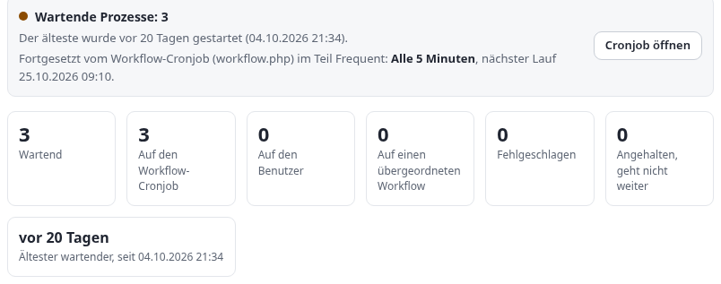
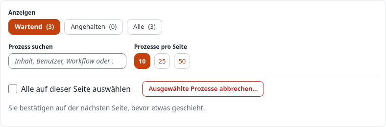
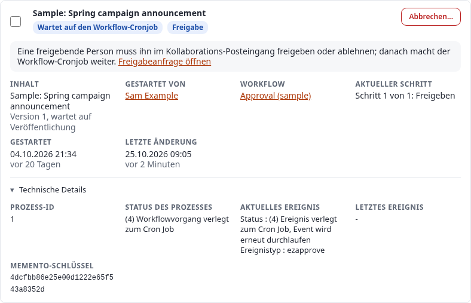
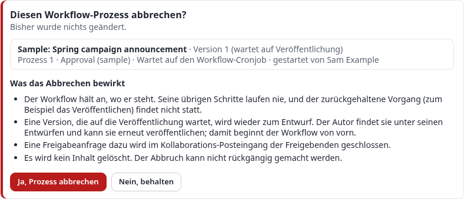

# Workflows: Freigaben, Trigger und die Prozesse, die warten

Diese Anleitung erklärt, wie Workflows in Exponential funktionieren und wie Sie sie betreiben: was Workflows,
Ereignisse und Trigger sind, wie Sie mit dem Kollaborations-Posteingang eine Freigabe vor dem Veröffentlichen
einrichten, was ein Workflow-Prozess ist und welche Zustände er durchläuft, jeden Teil der Liste der
Workflow-Prozesse (Setup > Workflow-Prozesse), wie der Workflow-Cronjob wartende Prozesse fortsetzt, wie Sie einen
hängenden Prozess sicher abbrechen, was die Shell bietet und was zu tun ist, wenn ein Prozess nicht weiterkommt.

Sie richtet sich an Administratoren, die redaktionelle Workflows einrichten, und an Betreiber, die sie am Laufen
halten. Lesen Sie zuerst die Abschnitte 1 und 4; danach steht jeder Abschnitt für sich. Jedes Feld, jeder Status und
jedes Verhalten unten wurde am Code geprüft (`kernel/classes/ezworkflowprocess.php`, `kernel/classes/eztrigger.php`,
`kernel/classes/workflowtypes/event/ezapprove/ezapprovetype.php`, `kernel/private/classes/cronjobs/workflow.php` und
`kernel/private/classes/views/workflow/processlist.php`), und die Bildschirmfotos stammen vom Demonstrationsserver
am 5. Oktober 2026, mit wartenden Beispielfreigaben aus `exp:collaborationsampledata`. Für die Aufnahmen wurde nichts
abgebrochen oder fortgesetzt.

[Anleitungen](README.md) · Verwandte Anleitung: [Cronjobs](cronjobs.md) · Funktionsreferenz:
[Die Cronjob-Konsole](../funktionen/6.0/cronjobs-in-der-konsole.md)

## Kurz gesagt

- Ein **Workflow** ist eine Liste von Schritten (**Ereignissen**: Freigeben, Bis Datum warten, Multiplexer, Zahlung
  ...). Ein **Trigger** verbindet einen Workflow mit einer Operation, vor oder nach ihrer Ausführung: „Vor dem
  Veröffentlichen von Inhalten den Freigabe-Workflow ausführen“.
- Läuft die Operation, startet ein **Workflow-Prozess** für genau diesen einen Inhalt. Ein Schritt, der nicht sofort
  abgeschlossen werden kann (eine Freigabe, über die noch niemand entschieden hat), lässt den Prozess warten, und die
  Operation wartet mit: Die Version „wartet auf Veröffentlichung“ (ausstehend).
- Der **Workflow-Cronjob** (`workflow.php`, standardmäßig im Teil *frequent*) führt jeden wartenden Prozess erneut
  aus. Ist der letzte Schritt erledigt, führt er die zurückgehaltene Operation aus, veröffentlicht also zum Beispiel
  die Version, und entfernt den Prozess. Ohne diesen Cronjob wird freigegebener Inhalt nie veröffentlicht.
- **Setup > Workflow-Prozesse** (`/workflow/processlist`) zeigt jeden wartenden Prozess: worauf er wartet, in Worten,
  Inhalt und Version, wer ihn gestartet hat, Workflow und Schritt, wann er begonnen und sich zuletzt geändert hat,
  gruppiert nach dem Trigger. Eine Statusleiste sagt, ob der Workflow-Cronjob eingeplant ist und wann er als Nächstes
  läuft.
- **Abbrechen...** bei einem Prozess fragt zuerst nach und sagt, was geschehen wird; nach der Bestätigung hält der
  Workflow an, eine ausstehende Version wird wieder zum Entwurf, eine Freigabeanfrage wird geschlossen und der
  Prozess entfernt. Es werden keine Inhalte gelöscht.
- Eine leere Liste ist normal: Ein Prozess besteht nur, solange ein Workflow wartet.
- **Setup > Trigger** zeigt jede Operation in Worten mit dem Workflow, den sie ausführt, die nicht gesetzten und die,
  die Aufmerksamkeit brauchen ([Abschnitt 11](#11-die-seite-mit-der-trigger-liste)); **Setup > Workflows** zeigt jede Gruppe mit
  ihren Workflows, deren Triggern und wartenden Prozessen und fragt nach, bevor eine Gruppe entfernt wird ([Abschnitt 12](#12-die-seite-mit-der-liste-der-workflow-gruppen)).

## Inhalt

- [1. Workflows, Ereignisse, Trigger und Prozesse](#1-workflows-ereignisse-trigger-und-prozesse)
- [2. Bevor Sie beginnen](#2-bevor-sie-beginnen)
- [3. Durchgerechnetes Beispiel: Freigabe vor dem Veröffentlichen](#3-durchgerechnetes-beispiel-freigabe-vor-dem-veröffentlichen)
- [4. Was ein Workflow-Prozess ist und seine Zustände](#4-was-ein-workflow-prozess-ist-und-seine-zustände)
- [5. Die Seite mit der Liste der Workflow-Prozesse](#5-die-seite-mit-der-liste-der-workflow-prozesse)
- [6. Der Workflow-Cronjob: wie Prozesse fortgesetzt werden](#6-der-workflow-cronjob-wie-prozesse-fortgesetzt-werden)
- [7. Prozesse sicher abbrechen und aufräumen](#7-prozesse-sicher-abbrechen-und-aufräumen)
- [8. Von der Shell aus](#8-von-der-shell-aus)
- [9. Fehlerbehebung](#9-fehlerbehebung)
- [10. Durchgerechnete Beispiele](#10-durchgerechnete-beispiele)
- [11. Die Seite mit der Trigger-Liste](#11-die-seite-mit-der-trigger-liste)
- [12. Die Seite mit der Liste der Workflow-Gruppen](#12-die-seite-mit-der-liste-der-workflow-gruppen)
- [Quellen](#quellen)

## 1. Workflows, Ereignisse, Trigger und Prozesse

| Begriff | Was es ist | Wo Sie es sehen |
|---|---|---|
| Workflow | Eine benannte, geordnete Liste von Ereignissen, abgelegt in einer Workflow-Gruppe | Setup > Workflows (`/workflow/grouplist`) |
| Ereignis | Ein Schritt eines Workflows, von einem Ereignistyp: *Freigeben*, *Bis Datum warten*, *Multiplexer*, *Zahlungsgateway*, *Einfacher Versand*, *Benutzerregistrierung abschließen* sowie die, die Extensions hinzufügen | Die Bearbeitungsseite des Workflows |
| Trigger | Die Verbindung zwischen einem Workflow und einer Operation: Modul, Operation und *davor* oder *danach*. Sein interner Name ist `pre_<operation>` oder `post_<operation>` | Setup > Trigger (`/trigger/list`) |
| Workflow-Prozess | Ein noch nicht abgeschlossener Durchlauf eines Workflows für einen Inhalt (ein Objekt und eine Version, ein Benutzer) | Setup > Workflow-Prozesse (`/workflow/processlist`) |
| Memento | Was der Kernel von der zurückgehaltenen Operation gespeichert hat, um sie später ausführen zu können: das Modul, die Operation, den Trigger-Namen und seine Parameter (Objekt-ID, Version) | Die technischen Details der Prozesskarte |
| Kollaborationseintrag | Die Freigabeanfrage, die ein Schritt *Freigeben* anlegt; Freigebende entscheiden in ihrem Kollaborations-Posteingang | Mein Konto > Zusammenarbeit (`/collaboration/view/summary`) |

Der Ablauf bei einer Freigabe vor dem Veröffentlichen:

1. Ein Redakteur klickt auf **Zur Veröffentlichung schicken**. Die Operation `content/publish` beginnt und markiert
   die Version zuerst als *ausstehend*.
2. Der Trigger `content/publish/before` findet den Freigabe-Workflow und startet einen Prozess für dieses Objekt und
   diese Version.
3. Das Ereignis *Freigeben* legt einen Kollaborationseintrag für die Freigebenden an und antwortet „Führe mich später
   erneut aus“. Der Prozess *wartet* nun *auf den Workflow-Cronjob*; die Veröffentlichungsoperation hält hier an. Der
   Redakteur sieht, dass die Version auf Freigabe wartet.
4. Eine freigebende Person öffnet die Anfrage und klickt auf **Freigeben** (oder **Ablehnen**).
5. Beim nächsten Lauf des Workflow-Cronjobs sieht das Ereignis *Freigeben* die Entscheidung. Freigegeben: Der Prozess
   ist fertig, und der Cronjob führt den Rest der Veröffentlichungsoperation aus, die Version wird also
   veröffentlicht. Abgelehnt: Die Version geht als Entwurf an den Autor zurück, und der Prozess wird abgebrochen und
   entfernt.

## 2. Bevor Sie beginnen

- Ein Administratorkonto oder eine Rolle mit dem Modul `workflow` (die Workflow-Seiten und die Prozessliste), dem
  Modul `trigger` (Trigger) und `setup/managecronjobs` (die Cronjob-Seite).
- Der Workflow-Cronjob muss laufen. Öffnen Sie Setup > Cronjobs ([die Anleitung](cronjobs.md)) und suchen Sie
  `workflow.php`: Es steht standardmäßig im Teil *Frequent* (`settings/cronjob.ini`, `[CronjobPart-frequent]`), den
  die vorgeschlagene Crontab alle 5 Minuten ausführt. Die Prozessliste sagt es ebenfalls, ganz oben (Abschnitt 5.2).
- Um Workflows auszuprobieren, ohne echte Inhalte anzufassen, legen die Kollaborations-Beispieldaten einen
  Freigabe-Workflow, drei Beispiel-Redakteure, drei ausstehende Artikel und deren Freigabeanfragen an (Abschnitt 3.6).

## 3. Durchgerechnetes Beispiel: Freigabe vor dem Veröffentlichen

Das Ziel: Jeder Artikel, den ein Redakteur der Gruppe *Editors* in der Sektion *Standard* veröffentlicht, wartet, bis
ein Mitglied der Gruppe *Chief editors* ihn freigibt.

### 3.1 Den Workflow anlegen

1. Setup > Workflows. Öffnen Sie eine Workflow-Gruppe (zum Beispiel *Standard*) oder legen Sie mit **Neue Workflow
   Gruppe** eine an.
2. **Neuer Workflow**. Geben Sie ihm einen Namen, zum Beispiel *Freigabe vor dem Veröffentlichen*.
3. Wählen Sie unter den Ereignissen **Ereignis / Freigeben** in der Liste und klicken Sie auf **Ereignis
   hinzufügen**.

### 3.2 Das Ereignis Freigeben einrichten

Das Formular des Ereignisses *Freigeben* hat diese Felder. Jedes schränkt ein, wer und was eine Freigabe braucht;
Inhalte außerhalb davon werden sofort durchgelassen (das Ereignis antwortet *angenommen*).

| Feld | Was es bewirkt |
|---|---|
| Betroffene Sektionen | Nur Inhalte in diesen Sektionen brauchen eine Freigabe (*Alle Sektionen* für jede). Inhalte, deren eigene Sektion nicht aufgeführt ist, zählen auch dann, wenn das Elternelement eines ihrer Orte in einer aufgeführten Sektion liegt. |
| Betroffene Sprachen | Nur Versionen, deren Ausgangssprache eine dieser ist (*Alle Sprachen* für jede). |
| Betroffene Versionen | *Alle Versionen*, nur *Neues Objekt publizieren* (Version 1) oder nur *Objekt aktualisieren* (Version 2 und später). |
| Benutzer, die den Inhalt bewilligen | Einzelne Freigebende. |
| Gruppen, die Content freigeben | Jeder Benutzer in diesen Gruppen ist ein Freigebender. |
| Gruppen ausschließen | Benutzer in diesen Gruppen veröffentlichen ohne Freigabe. |

Ein Freigebender muss seine eigenen Inhalte nie freigeben lassen: Ist der veröffentlichende Benutzer einer der
Freigebenden, lässt das Ereignis die Version durch. Klicken Sie auf **OK**, um den Workflow zu speichern.

### 3.3 Mit einem Trigger verbinden

Setup > Trigger listet jede Operation, die einen Workflow starten kann, mit der Verbindungsart *davor* oder *danach*.
Wählen Sie in der Zeile **Vor dem Veröffentlichen von Inhalten** (`content/publish`, davor) *Freigabe vor dem Veröffentlichen* und klicken Sie auf **Änderungen anwenden**. Ein
Workflow je Trigger: Um mehrere auszuführen, setzen Sie ein Ereignis *Multiplexer* in den ausgelösten Workflow.

*Davor* hält die Operation zurück, bis der Workflow fertig ist; *danach* führt den Workflow aus, sobald die Operation
stattgefunden hat (nützlich für Benachrichtigungen, nicht für Freigaben).

### 3.4 Sicherstellen, dass der Workflow-Cronjob läuft

Öffnen Sie Setup > Workflow-Prozesse. Die Statusleiste sagt zum Beispiel: „Fortgesetzt vom Workflow-Cronjob
(workflow.php) im Teil Frequent: **Alle 5 Minuten**, nächster Lauf 10/05/2026 10:05 pm.“ Steht dort **nicht in der
Crontab eingeplant**, installieren Sie die Zeile, die die Cronjob-Seite vorschlägt (siehe [Cronjobs, Abschnitt 12](cronjobs.md#12-planen-mit-der-crontab)), sonst
warten die freigegebenen Artikel ewig.

### 3.5 Ausprobieren

1. Melden Sie sich als Redakteur an (nicht als Freigebender) und veröffentlichen Sie einen Artikel in einer
   betroffenen Sektion. Der Artikel wird nicht veröffentlicht; seine Version wartet auf Freigabe.
2. Setup > Workflow-Prozesse listet jetzt einen Prozess unter **Vor dem Veröffentlichen von Inhalten**: „Wartet auf
   den Workflow-Cronjob“, mit der Zeile „Eine freigebende Person muss ihn im Kollaborations-Posteingang freigeben oder
   ablehnen; danach macht der Workflow-Cronjob weiter.“ und einem Link **Freigabeanfrage öffnen**.
3. Melden Sie sich als Freigebender an. Mein Konto > Zusammenarbeit listet die Anfrage. Öffnen Sie sie, sehen Sie sich
   die Vorschau an und klicken Sie auf **Freigeben** (oder **Ablehnen**, mit einem Kommentar für den Autor).
4. Warten Sie auf den Workflow-Cronjob oder führen Sie den Teil Frequent jetzt von der Cronjob-Seite aus. Freigegeben:
   Der Artikel ist veröffentlicht, und der Prozess ist aus der Liste verschwunden. Abgelehnt: Die Version ist wieder
   ein Entwurf für den Autor, und der Prozess ist ebenfalls verschwunden.

### 3.6 Die Beispielfreigaben

```bash
./console exp:collaborationsampledata --dry-run --allow-root-user   # what it would create; nothing is written
./console exp:collaborationsampledata --apply --allow-root-user             # create it
./console exp:collaborationsampledata --apply --remove --allow-root-user    # remove all of it again
```

Der Befehl legt den Workflow *Approval (sample)* auf `content/publish/before` an, dazu Beispiel-Redakteure und
-Freigebende, auf Freigabe wartende Artikel und deren Kollaborationseinträge, sodass die Prozessliste drei wartende
Prozesse zeigt. `--remove` entfernt auch die Prozesse des Beispiel-Workflows, seinen Trigger und den Workflow selbst.

## 4. Was ein Workflow-Prozess ist und seine Zustände

Ein Prozess ist eine Zeile von `ezworkflow_process`. Sie enthält den Workflow, den Benutzer, der ihn gestartet hat, die
Parameter der Operation (bei `content/publish`: `object_id` und `version`), das Ereignis, bei dem er steht
(`event_id`, `event_position`, ab 1 gezählt), den Status des zuletzt gelaufenen Ereignisses, den Zeitpunkt der
Erstellung und der letzten Änderung sowie den `memento_key`, der die gespeicherte Operation benennt.

### 4.1 Prozessstatus

Die Seite gruppiert die Prozessstatus in **Wartend** (sie gehen weiter) und **Angehalten** (nichts führt sie erneut
aus). Die Nummer ist der in `ezworkflow_process.status` gespeicherte Wert.

| Nr. | Status auf der Seite | Gruppe | Was ihn weiterbringt |
|---|---|---|---|
| 4 | Wartet auf den Workflow-Cronjob | Wartend | Der Workflow-Cronjob, bei jedem Lauf |
| 6, 10 | Wartet auf den Benutzer | Wartend | Der Benutzer, der die Seite beantwortet, die ein Ereignis ihm gezeigt hat (dieselbe Anfrage setzt den Workflow fort) |
| 7 | Wartet auf die Rückkehr des Benutzers | Wartend | Die Rückkehr des Benutzers von dort, wohin ein Ereignis ihn geschickt hat, zum Beispiel von einem Zahlungsanbieter |
| 9 | Wartet auf seinen übergeordneten Workflow | Wartend | Der übergeordnete Prozess, dessen Ereignis *Multiplexer* ihn gestartet hat |
| 3 | Fehlgeschlagen | Angehalten | Nichts. Ein Ereignis hat den Inhalt abgelehnt oder ist fehlgeschlagen |
| 1 | Als laufend markiert | Angehalten | Nichts. Stimmt nur, solange eine Anfrage oder der Cronjob ihn ausführt; Stunden später wurde der Lauf abgebrochen |
| 5 | Abgebrochen | Angehalten | Der Workflow-Cronjob entfernt ihn, wenn er auf ihn trifft |
| 8 | Zurückgesetzt | Angehalten | Nichts |
| 2 | Fertig | Angehalten | Wird sofort entfernt, wenn die Operation abgeschlossen ist |
| 0 | Nicht gestartet | Angehalten | Nichts |

### 4.2 Ereignisstatus

Jedes Ereignis antwortet bei seiner Ausführung mit einem Status; der Prozess speichert die Antwort, und die Seite
zeigt sie in den technischen Details mit ihrer Nummer (`eZWorkflowType::STATUS_*`).

| Nr. | Ereignisstatus | Was der Prozess als Nächstes tut |
|---|---|---|
| 1 | Angenommenes Ereignis | Geht zum nächsten Ereignis weiter; nach dem letzten ist der Prozess fertig |
| 2 | Zurückgewiesenes Ereignis | Schlägt fehl (Prozessstatus 3) |
| 3, 4 | Ereignis verlegt zum Cron Job (4: das Ereignis wird erneut durchlaufen) | Wartet auf den Workflow-Cronjob (Prozessstatus 4) |
| 5 | Ereignis startet ein Unter-Ereignis | Wartet auf seine Kindprozesse (Multiplexer) |
| 6 | Abbruch des gesamten Workflows | Abgebrochen (Prozessstatus 5) |
| 7, 8 | Ereignis zeigt dem Benutzer eine Seite | Wartet auf den Benutzer (6, 10) |
| 9 | Workflow abgeschlossen | Fertig (2) |
| 10, 11 | Ereignis leitet den Benutzer weiter | Wartet auf die Rückkehr des Benutzers (7) |
| 12 | Workflow wurde zurückgesetzt zur Wiederverwendung | Zurückgesetzt (8) |

### 4.3 Mementos

Wird eine Operation zurückgehalten, speichert der Kernel unter dem `memento_key` des Prozesses zwei Mementos in
`ezoperation_memento`: Das *Kind*-Memento nennt das Modul, die Operation und den Trigger (`content`, `publish`,
`pre_publish`) mit den Parametern der Operation; das *Haupt*-Memento gehört zu der Anfrage, die sie gestartet hat. Die
Seite liest das Kind-Memento, um den Trigger zu finden, zu dem ein Prozess gehört. Der Cronjob liest es, um die
Operation auszuführen, wenn der Prozess fertig ist. Ein Prozess, dessen Kind-Memento fehlt, kann nicht über seine
Operation fortgesetzt werden; die Seite listet ihn unter **Auslöser nicht vermerkt**.

### 4.4 Dieselbe Version erneut veröffentlichen

Der Prozessschlüssel wird aus den Schlüsseln der Operation gebildet (bei `content/publish`: das Objekt, die Version,
der Workflow und der Benutzer). Existiert ein Prozess mit demselben Schlüssel und ist er fehlgeschlagen, abgebrochen,
als laufend markiert oder ohne Zustand, entfernt ein erneuter Start der Operation diesen Prozess und **hält die
Operation einmal an**; der nächste Versuch startet einen neuen Prozess. Ein wartender Prozess mit demselben Schlüssel
wird stattdessen erneut ausgeführt. Deshalb kann ein fehlgeschlagener Freigabeprozess dazu führen, dass „Zur
Veröffentlichung schicken“ beim ersten Mal scheinbar nichts tut: Brechen Sie zuerst den fehlgeschlagenen Prozess in
der Liste ab (Abschnitt 7).

## 5. Die Seite mit der Liste der Workflow-Prozesse

### 5.1 Aufrufen

Setup > **Workflow-Prozesse** oder `/workflow/processlist` in der Administrationsoberfläche. Die Filter sind Teil der
Adresse: `/workflow/processlist/(status)/stopped` und `/workflow/processlist/(status)/all`. Das Blättern fügt wie
bisher `/(offset)/<n>` hinzu.



### 5.2 Die Statusleiste

Der erste Kasten sagt, was gerade wartet und wer es weiterbringen wird:

- **Wartende Prozesse: N** und „Der älteste wurde vor *1 Tag* gestartet (*Zeit*).“ oder **Nichts wartet**. Der Punkt
  ist blau, oder bernsteinfarben, sobald der älteste wartende Prozess älter als einen Tag ist.
- **Fortgesetzt vom Workflow-Cronjob (workflow.php) im Teil *Frequent*:** mit dem Zeitplan in Worten und dem nächsten
  Lauf, aus der installierten Crontab gelesen, so wie die Cronjob-Seite sie liest; oder **nicht in der Crontab
  eingeplant**.
- **Cronjob öffnen** führt zur Karte dieses Teils auf der Cronjob-Seite (`/setup/cronjobs#cronjob-part-frequent`), wo
  er sofort ausgeführt werden kann.

Warten Prozesse auf den Cronjob, aber die Crontab führt seinen Teil nicht aus, sagt eine bernsteinfarbene Meldung das
und verlinkt auf die Cronjob-Seite. Führt überhaupt kein Teil `workflow.php` aus, sagt eine rote Meldung, wie Sie es
hinzufügen.

### 5.3 Die Übersicht

Sieben Kennzahlen, gezählt über alle Prozesse in der Datenbank (nicht nur die Seite, auf der Sie sind):

| Kennzahl | Zählt |
|---|---|
| Wartend | Jeden Prozess mit wartendem Status (4, 6, 7, 9, 10) |
| Auf den Workflow-Cronjob | Status 4 |
| Auf den Benutzer | Status 6, 7 und 10 |
| Auf einen übergeordneten Workflow | Status 9 |
| Fehlgeschlagen | Status 3, rot, wenn es welche gibt |
| Angehalten, geht nicht weiter | Jeden angehaltenen Status (0, 1, 2, 3, 5, 8), rot, wenn es mehr sind als die fehlgeschlagenen |
| Ältester wartender | Wie lange es her ist, dass der älteste wartende Prozess begonnen hat, und wann |

### 5.4 Filter, Suche und Seitengröße



- **Anzeigen**: *Wartend* (die Vorgabe und alles, was diese Seite früher zeigte), *Angehalten* oder *Alle*, jeweils mit
  ihrer Anzahl. Es sind Links, sie funktionieren also ohne JavaScript und lassen sich als Lesezeichen speichern. Die
  Liste *Wartend* lässt Prozesse ohne Memento-Schlüssel aus, wie es die Seite immer getan hat, da nichts sie fortsetzen
  kann; *Angehalten* und *Alle* listen jeden Prozess.
- **Prozess suchen** grenzt die Karten auf der Seite beim Tippen ein: Inhaltsname, Version (`v3`), Prozess (`#12`),
  Benutzer, Workflow, Status oder Schritt. Durchsucht wird nur die aktuelle Seite; die Zeile darunter sagt, wie viele
  passen.
- **Prozesse pro Seite**: 10, 25 oder 50 (aus `admininterface.ini [PaginationSettings]`); die Auswahl wird wie bisher
  als Ihre Einstellung `admin_workflow_processlist_limit` gespeichert.
- **Alle auf dieser Seite auswählen** setzt bei jeder angezeigten Karte ein Häkchen, und **Ausgewählte Prozesse
  abbrechen...** fragt für die angehakten nach einer Bestätigung (Abschnitt 7).

### 5.5 Die Gruppen

Die Prozesse sind nach dem Trigger gruppiert, der sie gestartet hat, mit dem Trigger in Worten (*Vor dem
Veröffentlichen von Inhalten*), seinem internen Namen (`content/publish/pre_publish`) und der Zahl der Prozesse.
Prozesse, deren Trigger nicht gefunden werden kann, kommen zuletzt unter **Auslöser nicht vermerkt**, mit einem
Hinweis auf den Grund.

### 5.6 Eine Prozesskarte



| Teil | Zeigt |
|---|---|
| Titel | Den Namen des Inhalts mit Link auf die Version, für die der Prozess läuft (`/content/versionview/<object>/<version>`); „Prozess N“, wenn es keinen Inhalt gibt |
| Plaketten | Den Status in Worten; **Seit N Tagen unverändert**, wenn sich ein nicht abgeschlossener Prozess seit mehr als einem Tag nicht geändert hat; **Freigabe**, wenn eine Freigabeanfrage dazugehört |
| Die graue Zeile | Worauf er wartet, als Satz, nach dem man handeln kann; bei einer Freigabe ein Link **Freigabeanfrage öffnen** auf ihren Kollaborationseintrag |
| Inhalt | Den Namen, die Version und ihren Zustand (*wartet auf Veröffentlichung* bei einer ausstehenden Version) oder „Das Objekt existiert nicht mehr.“ |
| Gestartet von | Den Benutzer, mit Link auf seine Benutzerseite |
| Workflow | Seinen Namen, mit Link auf den Workflow (`/workflow/view/<id>`) |
| Aktueller Schritt | „Schritt 1 von 2: Freigeben“ und die Beschreibung des Ereignisses |
| Gestartet, Letzte Änderung | Datum und Uhrzeit und wie lange es her ist |
| Technische Details | Prozess-ID, Nummer und Name des Prozessstatus, das aktuelle und das letzte Ereignis (Statusnummer und -name, Ereignistyp, Beschreibung, Information) und den Memento-Schlüssel: alles, was die alte Tabelle zeigte |
| Abbrechen... | Fragt nach, bevor dieser Prozess abgebrochen wird (Abschnitt 7) |

Eine Karte hat einen roten Rand, wenn der Prozess fehlgeschlagen ist, und einen bernsteinfarbenen, wenn er auf den
Benutzer wartet oder sich seit mehr als einem Tag nicht geändert hat.

### 5.7 Wenn die Liste leer ist

„Es warten keine Prozesse. Das ist normal: Ein Prozess besteht nur, solange ein Workflow auf jemanden oder etwas
wartet, und wird entfernt, wenn er fertig ist.“ Gibt es angehaltene Prozesse, zeigt ein Link sie an. Der Filter
*Angehalten* sagt „Nichts ist fehlgeschlagen oder liegen geblieben.“, wenn er leer ist.

### 5.8 Ohne JavaScript, mit der Tastatur, im alten Design

- Alles funktioniert ohne JavaScript: Die Filter sind Links, **Abbrechen...** und **Ausgewählte Prozesse
  abbrechen...** senden das Formular ab, die technischen Details und *Was die Status bedeuten* sind
  `<details>`-Abschnitte. Nur die Suche und *Alle auswählen* brauchen ein Skript und sind ohne es ausgeblendet.
- Jedes Kontrollkästchen und jede Schaltfläche **Abbrechen...** trägt für Screenreader die Prozessnummer und den Namen
  des Inhalts („Prozess 1 (Sample: Spring campaign announcement) abbrechen...“). Text hat im hellen und im dunklen
  Modus von admin4 mindestens einen Kontrast von 4,5:1, und die Seite funktioniert ab 390 Pixel Breite.
- Dasselbe Template bedient das Design admin4 und das ältere Design admin.

## 6. Der Workflow-Cronjob: wie Prozesse fortgesetzt werden

`cronjobs/workflow.php` (der Code steht in `kernel/private/classes/cronjobs/workflow.php`) tut bei jedem Lauf
Folgendes:

1. Er holt jeden Prozess, der **auf den Workflow-Cronjob wartet** (Status 4). Prozesse, die auf den Benutzer oder auf
   einen übergeordneten Prozess warten, werden nicht angefasst.
2. Für jeden führt er in einer eigenen Transaktion das aktuelle Ereignis erneut aus (`eZWorkflowProcess::run()`) und
   die folgenden Ereignisse, so weit sie kommen.
3. Ist der Prozess jetzt **fertig**, liest er das Kind-Memento, führt den Rest der zurückgehaltenen Operation unter
   Überspringen des Triggers aus (bei `content/publish`: das eigentliche Veröffentlichen) und entfernt den Prozess.
4. Ist er **fehlgeschlagen**, **abgebrochen**, **zurückgesetzt**, **beschäftigt** oder **ohne Zustand**, entfernt er
   die Mementos des Prozesses. Ein abgebrochener Prozess wird ebenfalls entfernt; die anderen bleiben, sodass Sie sie
   unter *Angehalten* sehen.
5. Alles andere (noch wartend) wird gespeichert und beim nächsten Mal erneut versucht.

Seine Ausgabe ist, sofern der Cronjob nicht still läuft, eine Statusliste und eine Summe, zum Beispiel:

```text
Checking for workflow processes
Status list
Workflow event deferred to cron job(4): 3

0 out of 3 processes was finished
```

„Status list“ zählt die Prozesse nach dem Status, den sie nach diesem Lauf hatten; „0 out of 3“ bedeutet, dass keiner
fertig wurde. Die Beispielfreigaben oben bleiben auf Status 4, bis ein Freigebender entscheidet.

**Wo er konfiguriert wird.** `settings/cronjob.ini`:

```ini
[CronjobPart-frequent]
Scripts[]=notification.php
Scripts[]=workflow.php
...
```

Eine Extension oder ein Siteaccess kann ihn in einen anderen Teil verschieben; die Prozessliste findet den Teil, wo
immer er ist, und bevorzugt einen, den die Crontab ausführt.

**Jetzt ausführen.** Im Browser: Setup > Cronjobs, die Karte *Frequent*, **Teil starten**, oder öffnen Sie die Skripte
der Karte und führen Sie `workflow.php` allein aus. Von einer Shell aus siehe Abschnitt 8 und [Cronjobs, Abschnitt 13](cronjobs.md#13-cronjobs-in-der-shell-ausführen).

## 7. Prozesse sicher abbrechen und aufräumen

### 7.1 Wann abbrechen

- Eine Freigabe, über die nie entschieden werden wird (der Freigebende ist gegangen, der Artikel ist überholt).
- Ein Prozess, der **auf den Benutzer wartet**, dessen Benutzer weg ist (ein beim Zahlungsanbieter abgebrochener
  Bestellvorgang, eine nie beantwortete Seite).
- Ein **fehlgeschlagener** Prozess: Nichts führt ihn erneut aus, und er hält die nächste Veröffentlichung derselben
  Version einmal zurück (Abschnitt 4.4).
- Ein seit Stunden **als laufend markierter** Prozess: Sein Lauf wurde abgebrochen.
- Prozesse unter **Auslöser nicht vermerkt**: Sie können nicht über ihre Operation fortgesetzt werden.

Brechen Sie einen Prozess nicht nur deshalb ab, weil er alt ist: Eine Freigabe kann berechtigterweise tagelang warten.
Sehen Sie sich zuerst die graue Zeile an und bei Freigaben die Anfrage im Kollaborations-Posteingang.

### 7.2 Was das Abbrechen bewirkt

Klicken Sie auf einer Karte auf **Abbrechen...** oder haken Sie mehrere an und klicken Sie auf **Ausgewählte Prozesse
abbrechen...**. Noch ist nichts geschehen: Eine Seite listet die Prozesse auf und sagt, was das Abbrechen bewirkt.



Klicken Sie auf **Ja, Prozess abbrechen**, um fortzufahren, oder auf **Nein, behalten**, um zurückzugehen. Nach der
Bestätigung geschieht für jeden Prozess in einer Transaktion Folgendes:

1. Ist seine Version noch *ausstehend* (wartet auf Veröffentlichung), wird sie wieder zum **Entwurf**, so wie eine
   abgelehnte Freigabe sie hinterlässt. Der Autor findet sie unter seinen Entwürfen und kann sie erneut
   veröffentlichen; damit beginnt der Workflow von vorn.
2. Gehört eine Freigabeanfrage dazu, wird die Anfrage inaktiv gesetzt, sodass sie aus dem Posteingang der
   Freigebenden verschwindet, und ihre Verknüpfung mit dem Prozess (`ezapprove_items`) wird entfernt.
3. Seine Mementos werden entfernt, dann der Prozess selbst (`eZWorkflowProcess::removeThis()`, das auch das Aufräumen
   der Ereignisse ausführt, die es angefordert haben).

Nichts wird veröffentlicht und keine Inhalte werden gelöscht. Die Liste kommt mit einer Meldung je Prozess zurück, zum
Beispiel „Prozess 12 wurde abgebrochen. Version 3 von Objekt 77 ist wieder ein Entwurf; nichts wurde veröffentlicht.“
Ein Prozess, der inzwischen beendet wurde, wird als nicht mehr vorhanden gemeldet. Ein Abbruch kann nicht rückgängig
gemacht werden; der Weg zurück ist, den Entwurf erneut zu veröffentlichen.

### 7.3 Was es nicht tut

- Es bricht die *Kind*prozesse nicht ab, die ein Multiplexer gestartet hat (Status 9); brechen Sie diese ebenfalls ab.
- Es macht nicht rückgängig, was frühere Ereignisse bereits getan haben (eine bereits versandte E-Mail, eine bereits
  eingezogene Zahlung).
- Es ändert keine Version, die nicht ausstehend ist (eine veröffentlichte oder archivierte bleibt, wie sie ist).

## 8. Von der Shell aus

Es gibt keinen Konsolenbefehl, der Prozesse auflistet oder abbricht; dafür ist die Seite das Werkzeug. Die Shell dient
dazu, den Cronjob auszuführen und die Beispieldaten zu verwalten:

```bash
# run the whole part that holds workflow.php, for the site's siteaccess
php runcronjobs.php -s <siteaccess> frequent

# run only the workflow cronjob
php runcronjobs.php -s <siteaccess> --script=workflow.php

# the sample approvals: show, create, remove
./console exp:collaborationsampledata --dry-run --allow-root-user
./console exp:collaborationsampledata --apply --allow-root-user
./console exp:collaborationsampledata --apply --remove --allow-root-user
```

Die Cronjob-Seite zeigt jeden dieser Befehle mit dem Pfad und dem PHP Ihrer Installation und mit einer Schaltfläche
**Kopieren**. Führen Sie den Cronjob als der Benutzer aus, unter dem der Webserver läuft, damit die Dateien, die er
schreibt, für die Site beschreibbar bleiben.

Um sich die Prozesse in einem Datenbank-Client anzusehen, nur lesend:

```sql
SELECT id, workflow_id, status, event_position, event_status, user_id, created, modified, memento_key
  FROM ezworkflow_process
 ORDER BY created;
```

`./console exp:flatten workflow` entfernt *temporäre Workflows* (ungespeicherte Workflow-Bearbeitungen), keine
Prozesse.

## 9. Fehlerbehebung

| Symptom | Ursache | Was zu tun ist |
|---|---|---|
| Freigegebene Artikel werden nicht veröffentlicht | Der Workflow-Cronjob läuft nicht: Die Statusleiste sagt *nicht in der Crontab eingeplant*, oder kein Teil führt `workflow.php` aus | Installieren Sie die Crontab-Zeile für den Teil (Cronjob-Seite) oder führen Sie den Teil jetzt aus. Der Artikel wird beim nächsten Lauf veröffentlicht. |
| Ein Prozess wartet tagelang auf den Cronjob, obwohl der Cronjob läuft | Niemand hat über die Freigabe entschieden; oder es gibt keinen Freigebenden (leere Freigabegruppen) | Öffnen Sie die Freigabeanfrage über die Karte. Kann niemand freigeben, fügen Sie dem Ereignis Freigebende hinzu; eine bereits gestellte Anfrage behält ihre Beteiligten, brechen Sie also den Prozess ab und schicken Sie den Inhalt erneut zur Veröffentlichung. |
| Ein Prozess *Wartet auf den Benutzer* kommt nie weiter | Der Benutzer hat die Seite oder den Zahlungsanbieter verlassen | Brechen Sie ihn ab, sobald Sie sicher sind, dass der Benutzer nicht zurückkommt. |
| *Fehlgeschlagene* Prozesse häufen sich | Ein Ereignis hat den Inhalt abgelehnt, oder das Objekt, seine Version oder ein übergeordneter Ort fehlte, als der Cronjob lief (ein Ereignis *Freigeben* bricht dann ab) | Lesen Sie die technischen Details zum Ereignis; brechen Sie den Prozess ab. |
| „Zur Veröffentlichung schicken“ tat einmal nichts und funktionierte dann | Ein fehlgeschlagener oder abgebrochener Prozess mit demselben Schlüssel wurde beim ersten Versuch entfernt (Abschnitt 4.4) | Brechen Sie fehlgeschlagene Prozesse zuerst in der Liste ab. |
| Ein Prozess ist *Als laufend markiert* | Eine Anfrage oder ein Cronjob-Lauf ist während seiner Ausführung abgestürzt | Brechen Sie ihn ab; prüfen Sie das PHP-Fehlerprotokoll auf den abgestürzten Lauf. |
| Ausstehende Inhalte, aber die Warteliste ist leer | Der Prozess hat keinen Memento-Schlüssel, oder er ist angehalten | Sehen Sie unter *Angehalten* und *Alle* nach. |
| Prozesse unter *Auslöser nicht vermerkt* | Das Kind-Memento fehlt, oder der Trigger wurde inzwischen geändert oder entfernt | Sie können nicht über ihre Operation fortgesetzt werden: Brechen Sie sie ab und veröffentlichen Sie den Inhalt dann erneut. |
| Der Schritt zeigt „Keiner“ und keine Schrittzahl | Der Prozess hat noch kein Ereignis erreicht, oder sein Workflow wurde gelöscht („Workflow N (fehlt)“) | Brechen Sie ihn ab. |

## 10. Durchgerechnete Beispiele

### 10.1 Herausfinden, warum ein Artikel nicht veröffentlicht ist

1. Öffnen Sie Setup > Workflow-Prozesse und geben Sie den Namen des Artikels in **Prozess suchen** ein.
2. Seine Karte sagt, worauf er wartet. „Eine freigebende Person muss ihn ... freigeben oder ablehnen“ mit
   **Freigabeanfrage öffnen**: Folgen Sie dem Link und sehen Sie nach, ob entschieden wurde.
3. Entschieden, aber der Prozess ist noch da: Sehen Sie sich die Statusleiste an. *nicht in der Crontab eingeplant*
   bedeutet, dass der Cronjob nie gelaufen ist; **Cronjob öffnen** und **Teil starten**.
4. Laden Sie die Prozessliste neu: Der Prozess ist verschwunden, und der Artikel ist veröffentlicht.

### 10.2 Aufräumen nach einem entfernten Freigebenden

1. **Anzeigen: Wartend**, suchen Sie nach dem Namen des Workflows.
2. Haken Sie die Prozesse an, über deren Freigabeanfragen niemand mehr entscheiden kann, dann **Ausgewählte Prozesse
   abbrechen...**.
3. Lesen Sie die Bestätigung und klicken Sie auf **Ja, N Prozesse abbrechen**.
4. Informieren Sie die Autoren: Ihre Versionen sind wieder Entwürfe und können zur Veröffentlichung geschickt werden,
   sobald der Freigabe-Workflow einen existierenden Freigebenden nennt.

### 10.3 Die Workflow-Einrichtung einer frischen Installation prüfen

1. Setup > Trigger: Notieren Sie, welche Operationen einen Workflow starten.
2. Setup > Workflow-Prozesse: Die Statusleiste muss den Teil mit `workflow.php` nennen und sagen, dass er eingeplant
   ist.
3. Mit `exp:collaborationsampledata` erscheinen drei wartende Prozesse; `--remove` entfernt sie wieder.

## 11. Die Seite mit der Trigger-Liste

Setup > Trigger (`/trigger/list`) sagt, welcher Workflow bei welcher Operation läuft, und ändert das.

- **Die Übersicht** zählt die möglichen Trigger (jede Operation aus `workflow.ini [OperationSettings]
  AvailableOperationList`, davor und danach), die, die einen Workflow ausführen, die nicht gesetzten, die in den
  ausgelösten Workflows wartenden Prozesse und die, die Aufmerksamkeit brauchen.
- **Trigger finden** und **Anzeigen** (Alle, Führen einen Workflow aus, Nicht gesetzt, Brauchen Aufmerksamkeit)
  filtern die Zeilen.
- Die Zeilen sind nach Modul gruppiert. Jede sagt in Worten, wann sie läuft („Vor dem Veröffentlichen von Inhalten“),
  mit `content/publish` und davor oder danach, hat die Auswahl, die ihren Workflow bestimmt, und unter **Läuft jetzt**
  den Workflow (ein Link), die Zahl seiner Ereignisse, *Deaktiviert*, wenn er es ist, und seine wartenden Prozesse
  (ein Link auf Workflow-Prozesse). Ein Trigger ohne Workflow zeigt **Nicht gesetzt**; eine Zeile mit leerer Auswahl
  sagt, dass dort noch kein Workflow laufen kann (ein Workflow wird nur angeboten, wenn alle seine Ereignisse die
  Operation erlauben).
- **Brauchen Aufmerksamkeit**: ein Trigger, dessen Workflow entfernt wurde (*Entfernter Workflow*), oder dessen
  Workflow die Auswahl nicht mehr anbietet (ein Ereignis erlaubt die Operation nicht mehr). Die Auswahl behält diesen
  Workflow dann als zusätzliche Wahl „(hier nicht angeboten)“, sodass **Änderungen anwenden** ihn nicht verwirft,
  solange Sie keinen anderen wählen.
- **Änderungen anwenden** speichert jede Auswahl. Eine geänderte Auswahl wird hervorgehoben und gezählt, bevor Sie
  klicken; danach sagt die Seite, wie viele Trigger sich geändert haben oder dass sich nichts geändert hatte. Eine
  Änderung gilt ab der nächsten Operation; wartende Prozesse behalten ihren Workflow.
- **Trigger, die diese Liste nicht mehr anbietet** (nur angezeigt, wenn es welche gibt): Trigger, die für eine
  Operation gespeichert sind, die nicht mehr in AvailableOperationList steht. Sie laufen nicht. Fügen Sie die
  Operation wieder hinzu, um sie zu nutzen, oder haken Sie sie an und wählen Sie **Ausgewählte entfernen**; der
  Workflow bleibt.

## 12. Die Seite mit der Liste der Workflow-Gruppen

Setup > Workflows (`/workflow/grouplist`) listet die Workflow-Gruppen. Eine Gruppe hält Workflows nur zusammen; wann
ein Workflow läuft, entscheiden die Trigger.

- **Die Übersicht** zählt Gruppen, Workflows, aktivierte Workflows, von einem Trigger ausgeführte Workflows, wartende
  Prozesse und Workflows in keiner Gruppe.
- Jede Gruppe ist eine Karte mit ihren Workflows in einer Tabelle: der Workflow (ein Link), *Deaktiviert*, die anderen
  Gruppen, in denen er ebenfalls ist, die Trigger, die ihn ausführen, in Worten, seine wartenden Prozesse, die Zahl
  seiner Ereignisse und wann er zuletzt geändert wurde. **Letzte Änderung** ist die jüngste Änderung der Gruppe oder
  ihrer Workflows. **Beim Entfernen** sagt, was das Entfernen der Gruppe bewirkt.
- **Ausgewählte entfernen** fragt zuerst nach. Die Bestätigung listet je Gruppe jeden Workflow und was mit ihm
  geschieht: **Entfernt** (er ist in keiner anderen Gruppe; seine Ereignisse, beide Versionen und sein Trigger gehen
  mit) oder **Bleibt** (er verbleibt in den genannten Gruppen). Sie warnt, wenn entfernte Workflows von Triggern
  ausgeführt werden, die dann ebenfalls entfernt werden, und wenn in ihnen Prozesse warten; brechen Sie diese zuerst
  unter Workflow-Prozesse ab. **N Gruppen entfernen** entfernt sie; **Abbrechen** ändert nichts.
- Geändert am 6. Oktober 2026: Ein Workflow, der auch in einer anderen Gruppe ist, wird nicht mehr mit der Gruppe
  entfernt, ein deaktivierter Workflow bleibt nicht mehr ohne Gruppe zurück, und die Ereignisse eines entfernten
  Workflows werden mit entfernt. Dasselbe tut Entfernen auch in der Workflow-Liste einer Gruppe.

## Quellen

- Die Trigger-Liste: `kernel/private/classes/views/trigger/list.php` (`ListView::rows()`, `orphans()`, `summary()`),
  `design/admin4/templates/trigger/list.tpl`; die Liste der Workflow-Gruppen:
  `kernel/private/classes/views/workflow/grouplist.php` (`Grouplist::removalPlan()`, `overview()`, `removeGroups()`),
  `design/admin4/templates/workflow/grouplist.tpl` und `confirmremovegroup.tpl` (dieselben Dateien in `design/admin`);
  Test `tests/tests/kernel/classes/expAdminListsRedesignTest.php` (ohne Datenbank).
- Die Seite: `design/admin4/templates/workflow/processlist.tpl` (dieselbe Datei in `design/admin`) und
  `kernel/private/classes/views/workflow/processlist.php`; Tests `tests/tests/kernel/classes/eZWorkflowProcessListPageTest.php`
  (ohne Datenbank), `eZWorkflowProcessGroupingTest.php` und `eZWorkflowProcessListLiveTest.php`.
- Prozesse und Trigger: `kernel/classes/ezworkflowprocess.php`, `kernel/classes/eztrigger.php`,
  `kernel/classes/ezworkflow.php`, `kernel/classes/ezworkflowtype.php`, `lib/ezutils/classes/ezoperationmemento.php`.
- Die Freigabe: `kernel/classes/workflowtypes/event/ezapprove/ezapprovetype.php` und
  `kernel/classes/collaborationhandlers/ezapprove/ezapprovecollaborationhandler.php`.
- Der Cronjob: `kernel/private/classes/cronjobs/workflow.php`, `settings/cronjob.ini`; die Anleitung [Cronjobs](cronjobs.md)
  und die Funktionsseite [Die Cronjob-Konsole](../funktionen/6.0/cronjobs-in-der-konsole.md).
- Modul-Views als Klassen: [Befehle, Cronjob-Teile und Modul-Views](../bc/6.0/cli-cronjob-und-view-abstraktionen.md).

<!-- exp-partner-block:start -->
**Werden Sie Exponential-Partner.** Partner teilen ihre Informationen, stellen Mittel bereit, geben Beiträge zurück
und entwickeln die Produkte mit uns, und so wächst Exponential. Eine Partner-Website und ein Dashboard sind für Mitte
2027 geplant: Werden Sie noch heute Partner, damit wir schneller wachsen und neue Funktionen früher liefern. Beginnen
Sie mit [Partner: hier beginnen](../hilfe/partner/partner-hier-beginnen.md) und
[Wie Sie sich bewerben](../hilfe/partner/wie-sie-sich-bewerben.md).
<!-- exp-partner-block:end -->
