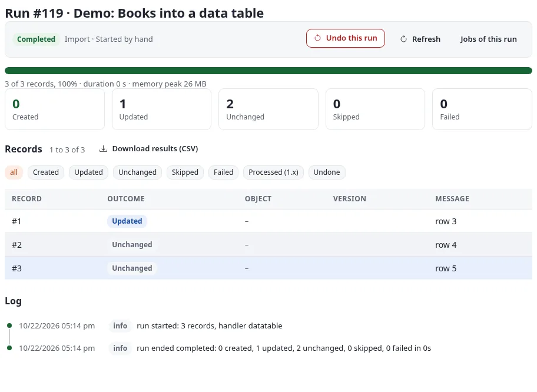
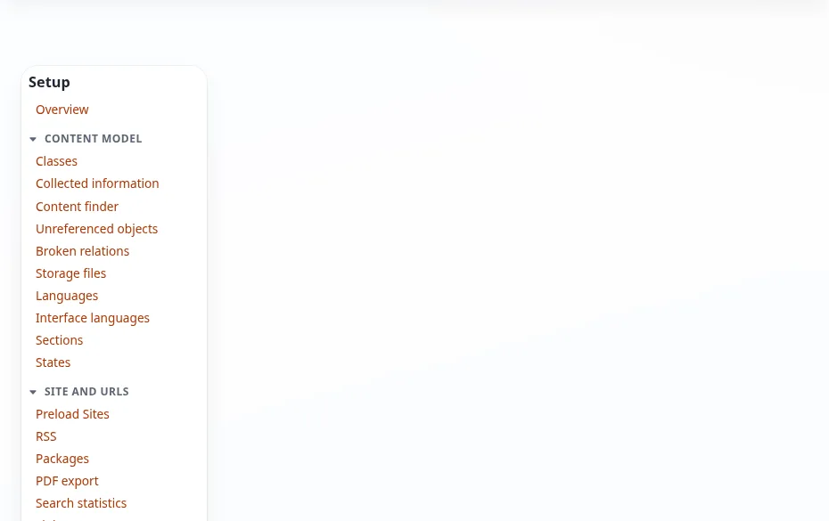

# Datentabellen: die Tabellen der Module als Teil des Systems (6.0.15)

Lesen Sie diese Seite, wenn Sie eine Extension mit eigenen Tabellen schreiben oder pflegen (eine persistente Klasse,
ein Modul darüber), wenn Sie eine solche Tabelle in einer anderen Datenbank als der der Installation führen wollen,
oder wenn Sie die Datenbanken verwalten, mit denen eine Installation spricht. Die Passwörter dieser Datenbanken liegen
im [Geheimnisspeicher](geheimnisspeicher.md).

## Kurz gesagt

| | |
|---|---|
| Was eine Datentabelle ist | Die Tabelle einer persistenten Klasse: eine PHP-Klasse, die `eZPersistentObject` erweitert und ihre Tabelle in `definition()` beschreibt (Felder, Schlüssel, Tabellenname). Der Kernel hat Hunderte davon, die meisten Extensions bringen eigene mit. |
| Was 6.0.15 hinzufügt | Einen Katalog aller dieser Klassen mit Tabelle, Feldern, Schlüsseln und Beziehungen zu Inhalten; eine Beschreibung jeder Tabelle, wie ihre Datenbank sie führt, und wo sie von der Definition abweicht; benannte Datenbankverbindungen (eine SQLite-Datei, MySQL/MariaDB, PostgreSQL, Oracle, SQL Server, MongoDB, lokal oder entfernt); und persistente Klassen, die auf einer solchen Verbindung lesen und schreiben statt in der Datenbank der Installation. Dazu: das Schema einer Tabelle auf jeder Verbindung aus der Administration anlegen oder aktualisieren, ihre Zeilen ansehen, die Zeilen, die auf ein Objekt verweisen, in der Inhaltsansicht zeigen, ein Schreiber für jedes Werkzeug, das Zeilen in eine Tabelle bringt, und Fetch-Funktionen für Templates. Und ein Assistent, der eine neue Tabelle mit Klasse, Schema, Administration, Richtlinien, Fetch-Funktionen und JSON-Endpunkt erstellt und im Browser installiert. Und die Synchronisation zwischen Tabellen und Inhalten: einmal, nach Zeitplan oder live (beim Veröffentlichen, Verschieben und Entfernen), in eine oder beide Richtungen, mit Konfliktregeln und einer Warteschlange von Konflikten zum Auflösen. |
| Wo | **Setup > Datentabellen** (Modul `datatable`): Datentabellen, Verbindungen, Synchronisationen. **Setup > Geheimnisse** (Modul `secrets`) für ihre Passwörter. **Setup > RAD > Modultabelle** (`setup/moduletable`) für eine neue Tabelle. |
| Kein Befehl nötig | Die Kernel-Tabellen werden auf der Seite Datentabellen angelegt, der Katalog entsteht beim ersten Aufruf der Seite, Verbindungen werden im Browser angelegt und getestet. |
| Klassen | `expDataTableCatalogue`, `expDataTableDescriber`, `expDataConnections`, `expDataConnection`, `expKernelTableSchema`, `expDataTableSchema`, `expDataTableWriter`, `expDataTableRelation`, `expDataTableFunctionCollection`, `expPDODB`; `eZPersistentObject::dbFor()`; `expModuleTableWizard`, `expModuleTableCode`, `expDataTableFieldSource`, `expDataTableFieldSources`; `expDataSync`, `expDataSyncDefinition`, `expDataSyncLink`, `expDataSyncConflict`, `expDataSyncTask`, `expDataSyncListener`, `expDataTableMirrorType` |
| Einstellungen | `datatable.ini` (`[DataTableSettings]`, `[ConnectionSettings]`, `[Connection_<id>]`, `[ClassSettings]`, `[Relation_<klasse>_<spalte>]`); `cronjob.ini` (der Teil `datatable` und `datatablesync.php` in `frequent`); `workflow.ini` (`event_expdatatablemirror`) |

## Der Katalog

`expDataTableCatalogue` führt jede persistente Klasse der Installation:

1. Er liest die Klassenlisten des Autoloaders, die des Kernels (`autoload/ezp_kernel.php`) und die der Extensions
   (`var/autoload/ezp_extension.php`). Testklassen und Klassen mit Namensraum bleiben außen vor.
2. Er liest jede Datei als Text und behält nur die Dateien, die eine Methode `definition()` deklarieren und eine
   Klasse, die eine andere erweitert (`extends`). Dafür wird keine Datei geladen.
3. Er lädt die übrigen Klassen und behält die, die von `eZPersistentObject` erben, nicht abstrakt sind, `definition()`
   selbst deklarieren (eine Klasse, die die Definition ihrer Elternklasse erbt, ist deren Tabelle und wird einmal
   geführt) und deren Definition eine Tabelle und Felder nennt.
4. Eine Klasse, deren `definition()` scheitert, erscheint mit der Fehlermeldung, statt die Seite abzubrechen.

Jeder Eintrag enthält die Klasse, die Tabelle, die Datei, die Herkunft (`kernel` oder den Namen der Extension), die
Felder (Typ, Vorgabewert, Pflicht, Kurzname, fremde Klasse und fremdes Attribut), die Schlüssel, den hochgezählten
Schlüssel, die Standardsortierung, die Funktionsattribute, die Verbindung (leer für die Datenbank der Installation) und
die Beziehungen.

Der Katalog liegt im Cache-Verzeichnis (`<cache>/datatable/catalogue.json`, der Verzeichnisname ist
`[DataTableSettings] CatalogueCacheDir`) und wird neu erstellt, wenn sich eines der Autoload-Arrays oder
`settings/datatable.ini` ändert. **Katalog neu erstellen** auf der Seite Datentabellen (Richtlinie `datatable/manage`)
tut es sofort. `[DataTableSettings] IgnoreClasses[]` lässt Klassen weg, etwa eine, deren `definition()` einen Request
braucht.

```php
$catalogue = expDataTableCatalogue::instance();
$catalogue->classes();                    // Klasse => Eintrag
$catalogue->entry( 'eZViewCounter' );     // ein Eintrag oder null
$catalogue->byTable( 'ezview_counter' );  // die Klassen einer Tabelle
$catalogue->byOrigin();                   // zuerst der Kernel, dann jede Extension
$catalogue->pointingAt( 'node' );         // Klassen mit einer Spalte, die eine Knoten-ID enthält
```

### Beziehungen

Eine Beziehung sagt, dass eine Spalte die ID von etwas anderem enthält: eines Inhaltsobjekts, eines Knotens, einer
Inhaltsklasse, eines Benutzers, einer Sektion oder einer Zeile einer anderen Tabelle. Sie kommen aus diesen Quellen, in
dieser Reihenfolge (die erste für eine Spalte gilt):

| Quelle | Wie sie geschrieben wird | Angezeigt als |
|---|---|---|
| Der Schlüssel `relations` der Definition | `'relations' => array( 'node_id' => array( 'class' => 'eZContentObjectTreeNode', 'field' => 'node_id' ) )`; optional `'kind'` (`object`, `node`, `class`, `user`, `section`, `table`) | die Definition |
| Der Fremdschlüssel eines Felds | `'foreign_class' => 'eZUser', 'foreign_attribute' => 'contentobject_id'` im Feld | ein Fremdschlüssel eines Felds |
| `datatable.ini` | ein Block `[Relation_<klasse>_<spalte>]` mit `Kind=`, `Class=` und `Field=` | datatable.ini |
| Der Name der Spalte | `contentobject_id`, `object_id`, `*_object_id` (Objekt); `node_id`, `main_node_id`, `parent_node_id`, `*_node_id` (Knoten); `contentclass_id`, `class_id` (Klasse); `user_id`, `creator_id`, `owner_id`, `modifier_id`, und `creator_`, `modifier_`, `owner_`, `author_` oder `editor_` gefolgt von `contentobject_id` oder `object_id` (Benutzer); `section_id` (Sektion) | aus dem Namen erschlossen |

Die Art ergibt sich aus der Zielklasse: `eZContentObject` ist ein Objekt, `eZContentObjectTreeNode` ein Knoten,
`eZContentClass` eine Klasse, `eZUser` ein Benutzer, `eZSection` eine Sektion, jede andere Klasse eine Tabelle. Der
eigene hochgezählte Schlüssel einer Tabelle gilt nie als Beziehung. `[DataTableSettings] InferRelations=disabled`
schaltet das Erschließen aus dem Namen ab.

```ini
[Relation_myArchiveRow_contentobject_id]
Kind=object
Class=eZContentObject
Field=id
```

Der Schlüssel `relations` gehörte schon vorher zum Format der Definition (`eZViewCounter` und `eZTipafriendCounter`
nutzen ihn), und `eZPersistentObject::storeObject()` liest ihn wie bisher.

## Beschreiben: die Tabelle, wie ihre Datenbank sie führt

Die Seite einer Klasse (**Datentabellen**, dann die Klasse) zeigt die Definition neben der Tabelle:
`expDataTableDescriber::describe( $entry )` fragt die eigene Verbindung der Tabelle

- ob die Tabelle existiert, aus dem Katalog der Datenbank (`information_schema` bei MySQL, PostgreSQL und SQL Server,
  `sqlite_master` und `PRAGMA table_info` bei SQLite, `user_tables` und `user_tab_columns` bei Oracle,
  `listCollectionNames()` bei MongoDB). Das Vorhandensein wird nie aus einem Abfrageergebnis geschlossen: MongoDB
  antwortet für eine fehlende Collection mit einer leeren Liste, MySQL wirft einen Fehler;
- ihre Spalten mit Typ, ob sie leer sein dürfen, und ihrem Vorgabewert; bei MongoDB die Felder einer Stichprobe von
  Dokumenten (`[DataTableSettings] MongoSampleSize`, 50);
- die Zahl der Zeilen;
- wo Tabelle und Definition voneinander abweichen:

| Abweichung | Bedeutung |
|---|---|
| `missing_table` | Die Tabelle der Definition fehlt in der Datenbank |
| `missing_column` | Ein Feld der Definition hat keine Spalte (bei MongoDB nicht gemeldet, wo eine Stichprobe nur die Felder ihrer Dokumente kennt) |
| `extra_column` | Eine Spalte, die die Definition nicht kennt: harmlos, aufgeführt, damit man sie sieht |
| `type_mismatch` | Ein Ganzzahlfeld über einer Textspalte oder ein Textfeld über einer Zahlenspalte (bei SQLite nicht gemeldet, das jeden Typ in jeder Spalte speichert) |

Ein Feld mit Kurznamen wird über diesen zugeordnet, wenn der lange Name keine Spalte hat. Die Seite zeigt außerdem die
Beziehungen und die ersten 20 Zeilen; Spalten, deren Name auf ein Geheimnis deutet (`password`, `hash`, `token`,
`secret`, `salt`, `ciphertext`, `private_key`, `api_key`, `key`), werden nicht gezeigt.

## Verbindungen

Eine Verbindung ist eine Datenbank, die die Installation neben ihrer eigenen benutzen kann. Es gibt drei Arten, die
**Setup > Datentabellen > Verbindungen** gemeinsam auflistet:

| Art | Woher sie kommt | In der Administration |
|---|---|---|
| `site` | Die eigene Datenbank der Installation (`site.ini [DatabaseSettings]`) | immer vorhanden, testbar |
| Angemeldet | Ein Block `[Connection_<bezeichner>]` in `datatable.ini`, in den Einstellungen oder einer Extension | nur lesbar, testbar |
| In der Administration angelegt | Eine Zeile der Tabelle `exp_data_connection` | dort angelegt, geändert, getestet und entfernt (Richtlinie `datatable/connections`) |

Eine angemeldete Verbindung lässt sich nicht durch eine Zeile mit demselben Bezeichner ersetzen. Ein Bezeichner besteht
aus Kleinbuchstaben, Ziffern und `_`, beginnt mit einem Buchstaben und hat höchstens 64 Zeichen; `site` ist vergeben.

```ini
[Connection_archive]
Name=Archive database
Engine=mysql
Server=db2.example.com
Port=3306
Database=archive
User=archive
Secret=env:ARCHIVE_DB_PASSWORD
Charset=utf8mb4
ReadOnly=false
```

Weitere Schlüssel einer angemeldeten Verbindung: `Socket`, `DSN` (ein PDO-Data-Source-Name), `Dialect`, `Driver`,
`Description`.

### Datenbanksysteme

| System | Über | Hinweise |
|---|---|---|
| `sqlite` | den SQLite-Treiber des Kernels (`sqlite3`) | `Database` ist die Datei, relativ zur Installation; sie endet auf `.db`, `.sqlite` oder `.sqlite3` und liegt in einem der Verzeichnisse von `[ConnectionSettings] SQLiteDirectories[]` (Vorgabe `var/datatable`, wird bei Bedarf angelegt). Ein Pfad, der sie verlässt (`..`, ein Link nach außen), wird abgelehnt. Die Datei entsteht bei der ersten Benutzung. |
| `mysql` | den MySQL/MariaDB-Treiber des Kernels | `mariadb` gilt als dasselbe System |
| `postgresql` | den PostgreSQL-Treiber des Kernels | |
| `oracle` | den Treiber von ezoracle, wenn die Extension aktiv ist und PHP oci8 hat, sonst PDO `oci` | `Database` ist der Service-Name |
| `sqlserver` | PDO `sqlsrv`, `dblib` oder `odbc` (der erste, den PHP hat, oder der als Treiber genannte) | hier nicht getestet: der Server, auf dem dies entstand, hat keinen SQL-Server-Treiber |
| `mongodb` | den MongoDB-Treiber des Kernels (`expMongoDB`) | |

Ein System, für das der Kernel keinen Treiber hat, läuft über `expPDODB`, einen allgemeinen Datenbanktreiber über PDO:
Abfragen, Limit und Offset im Dialekt des Systems, Transaktionen, die zuletzt vergebene ID, Maskierung, die
Tabellenliste. So ist jede Verbindung ein Datenbankobjekt derselben Art wie das der Installation, welches System auch
dahintersteht. `[ConnectionSettings] Engines[]` begrenzt die wählbaren Systeme; die Seite Verbindungen nennt jedes
System mit der Angabe, ob dieser Server es benutzen kann, und wenn nicht, warum (die fehlende PHP-Erweiterung oder der
fehlende Treiber).

`[ConnectionSettings] AllowedHosts[]` begrenzt die Server, die eine Verbindung nennen darf (leer oder `*`: jeder).
`[ConnectionSettings] ConnectTimeout` (5 Sekunden, höchstens 60) ist die Zeit, die eine Verbindung auf ihren Server
wartet.

### Das Passwort ist der Name eines Geheimnisses

Eine Verbindung enthält nie ein Passwort. Ihr `Secret` (das Feld „Passwort: der Name eines Geheimnisses") nennt ein
Geheimnis des [Geheimnisspeichers](geheimnisspeicher.md): ein dort verschlüsselt gespeichertes Geheimnis oder
`env:VARIABLE` für eine Umgebungsvariable des PHP-Prozesses. Auf der Seite einer Verbindung lässt sich ein Passwort nur
für einen Test eintippen; mit **Beim Speichern im Geheimnisspeicher ablegen** (zusätzlich Richtlinie `secrets/manage`)
wird es verschlüsselt unter dem angegebenen Namen gespeichert, ohne Namen unter `datatable.<bezeichner>`, und die
Verbindung behält diesen Namen. Ein DSN, der ein Passwort enthält, wird abgelehnt.

### Verbindung testen

**Testen** in der Liste und **Verbindung testen** auf der Seite einer Verbindung öffnen die Verbindung, fragen die
Version des Servers und seine Tabellen ab und schließen sie wieder. Das Ergebnis nennt den Treiber (`ez` für den des
Kernels, `pdo`), die Zeit in Millisekunden, die Version und die Zahl der Tabellen, oder den Fehler. Ein Server, der auf
seinem Port nicht innerhalb der Wartezeit antwortet, wird als solcher gemeldet, bevor der Treiber gefragt wird (ein
Treiber kann sonst eine Minute warten). Jede Meldung ist maskiert: der Wert des Geheimnisses der Verbindung und eines
für den Test eingetippten Passworts erscheint nie.

```php
$result = expDataConnections::test( 'archive' );
// ok, engine, via, version, tables, ms, error
```

### Eine Verbindung im Code benutzen

```php
$db = expDataConnections::db( 'archive' );     // die Datenbank der Verbindung, ein eZDBInterface
$rows = $db->arrayQuery( 'SELECT id, title FROM archive_item', array( 'limit' => 10 ) );
```

`db()` öffnet jede Verbindung einmal je Request und behält sie für dessen Rest; `db( 'site' )` und `db( '' )` liefern
die Datenbank der Installation. Eine Verbindung, die es nicht gibt oder die sich nicht öffnen lässt, wirft eine
`RuntimeException`, deren Meldung die Verbindung nennt und nie den Wert eines Geheimnisses enthält.

Unter Exponential Velocity bedient ein Worker einen Request nach dem anderen: Die Verbindungen eines Requests werden
geschlossen, wenn der nächste beginnt. Ein Worker behält also nie einen Socket von einem Request zum nächsten, und auch
keinen, den sein Elternprozess vor dem Fork geöffnet hat.

## Persistente Klassen auf einer Verbindung

Eine persistente Klasse nennt ihre Verbindung in ihrer Definition:

```php
public static function definition()
{
    return array(
        'fields' => array( ... ),
        'keys' => array( 'id' ),
        'increment_key' => 'id',
        'class_name' => 'myArchiveItem',
        'name' => 'archive_item',
        'connection' => 'archive',
    );
}
```

oder die Einstellungen nennen sie für eine Klasse, die es nicht tut (die Klasse einer Extension, ohne sie zu ändern):

```ini
[ClassSettings]
Connection[myArchiveItem]=archive
```

`eZPersistentObject` liest und schreibt die Zeilen der Klasse dann dort: `fetchObject()`, `fetchObjectList()`,
`count()`, `store()`, `remove()`, `removeObject()`, `updateObjectList()`, `newObjectOrder()` und `reorderObject()`
fragen alle `eZPersistentObject::dbFor( $definition )`. Alles, was der Aufruf zusammensetzt, wird für diese Verbindung
maskiert, nicht für die Datenbank der Installation (MySQL und SQLite maskieren ein Hochkomma verschieden): die
Bedingungen, die Wertelisten, das Umsortieren und die Kurznamen der Felder. Eine Klasse der Datenbank der Installation,
die mitten in einem solchen Aufruf gelesen wird (ein Funktionsattribut, eine Beziehung), geht für dieses Lesen zurück
in die Datenbank der Installation.

Eine Klasse ohne Verbindung kostet zwei `isset()`-Prüfungen und ein Nachschlagen mehr als vorher; sonst ändert sich für
sie nichts.

Die Einstellungen in `[ClassSettings]` werden einmal je Prozess gelesen. Unter Velocity erreicht eine Änderung die
Worker mit dem nächsten Neustart.

## Schema: Tabellen auf einer Verbindung anlegen und aktualisieren

`expDataTableSchema` bringt ein Schema auf eine Verbindung. Das Schema stammt aus:

- der `definition()` einer persistenten Klasse (`expDataTableSchema::fromDefinition()`): `integer` wird `int(11)`,
  `float` eine Gleitkommazahl, `text` ein langer Text, alles andere `varchar(255)` (andere Längen über das zweite
  Argument); der hochgezählte Schlüssel wird eine Auto-Increment-Spalte, die Schlüssel der Primärschlüssel, jede
  Beziehungsspalte bekommt einen Index (die Inhaltsansicht fragt „welche Zeilen verweisen auf dieses Objekt"), und das
  optionale `'unique' => array( '<index>' => array( spalten ) )` der Definition ergibt eindeutige Indizes. Indexnamen
  haben höchstens 30 Zeichen (die Grenze von Oracle);
- der `share/db_schema.dba` einer Extension (`expKernelTableSchema::read()`).

`plan()` sagt Tabelle für Tabelle, was das Anwenden des Schemas täte, mit dem SQL, und führt nichts aus:

| Aktion | Wann |
|---|---|
| `create` | die Tabelle fehlt |
| `upgrade` | Spalten oder Indizes fehlen (sie werden ergänzt) |
| `none` | die Tabelle entspricht dem Schema, oder weicht nur in Zurückgehaltenem ab |
| `unknown` | die Verbindung zeigt diesem Benutzer ihre Tabellen nicht |

Eine Spalte oder einen Index löschen, die das Schema nicht hat, und eine abweichende Spalte oder einen abweichenden
Index ändern, wird **zurückgehalten**: aufgelistet, aber nicht ausgeführt, außer auf Wunsch (`'drop' => true`,
`'alter' => true`; die beiden Kästchen der Seite). `apply()` führt den Plan aus und hält bei einer Tabelle an der
ersten Anweisung an, die scheitert.

```php
$schema = expDataTableSchema::fromDefinition( myArchiveRow::definition() );
$db = expDataConnections::db( 'archive' );
$plan = expDataTableSchema::plan( $schema, $db );             // action, statements, held, notes je Tabelle
$result = expDataTableSchema::apply( $schema, $db );          // ok, tables => action, ok, done, errors
$sql = expDataTableSchema::installSql( $schema );             // System => SQL, für sql/<system>/schema.sql
```

| System | Anlegen | Aktualisieren |
|---|---|---|
| MySQL/MariaDB, PostgreSQL, SQLite | die Schema-Handler des Kernels (`eZMysqlSchema`, `eZPgsqlSchema`, `eZSQLiteSchema`) | `eZDbSchemaChecker::diff()` gegen die bestehende Tabelle und das Upgrade-SQL des Handlers |
| Oracle | der Schema-Handler von ezoracle, wenn die Extension aktiv ist; sonst (PDO oci) die Anweisungen von `oracleCreate()`: `VARCHAR2(n CHAR)`, `CLOB`, `BINARY_DOUBLE`, und für den hochgezählten Schlüssel eine Sequenz mit einem `BEFORE INSERT`-Trigger, benannt, wie `expPDODB::oracleSequence()` sie liest | über ezoracle wie oben; über PDO werden die fehlenden Spalten ergänzt |
| SQL Server | `sqlServerCreate()`: `INT IDENTITY(1,1)`, `NVARCHAR(n)`, `NVARCHAR(MAX)`, Namen in eckigen Klammern | die fehlenden Spalten werden ergänzt |
| MongoDB | die Collection entsteht beim ersten Schreiben; die Indizes legt der Schema-Handler an (`expMongoSchema`) | fehlende Indizes werden neu angelegt; Dokumente brauchen keine Spalten |

Die Seite **Setup > Datentabellen > Schema** (`datatable/schema`, Richtlinie `datatable/manage`) nimmt eine Klasse
(einer Extension) oder die Schemadatei einer Extension und eine Verbindung (vorgegeben die der Klasse; eine
schreibgeschützte Verbindung ist nicht wählbar). **Anzeigen, was ausgeführt würde** listet den Plan mit seinem SQL;
**Ausführen** führt ihn aus und meldet jede Tabelle. Darunter steht das Installations-SQL jedes Systems (MySQL,
PostgreSQL, SQLite, Oracle, SQL Server), zum Übernehmen in `sql/<system>/schema.sql` einer Extension. Die Seite einer
Klasse verlinkt dorthin als **Tabelle anlegen** oder **Tabelle aktualisieren**.

## Zeilen

`datatable/rows/<klasse>` (Richtlinie `datatable/read`) listet die Zeilen der Tabelle einer Klasse, 25 je Seite, auf der
Verbindung der Klasse. `/(<feld>)/<wert>` behält die Zeilen, in denen ein Feld einen Wert hat (dorthin verlinkt der
Reiter der Inhaltsansicht). Ein Wert einer Beziehungsspalte verlinkt auf das, worauf er verweist: die Seite des Knotens
oder Objekts, die Klasse, die Sektion oder die Zeilen der anderen Tabelle. Spalten, deren Name ein Geheimnis vermuten
lässt (`password`, `hash`, `token`, `secret`, `salt`, `ciphertext`, `private_key`, `api_key`, `key`), werden
weggelassen, hier und in den ersten Zeilen auf der Seite einer Klasse. Die Seite liest nur.

## Beziehungen in der Inhaltsansicht

Die Knotenansicht der Administration hat einen Reiter **Datentabellen** (`admininterface.ini
[AdditionalTab_datatable]`) für Benutzer mit `datatable/read`, nur sichtbar, wenn eine Zeile auf den Knoten oder sein
Objekt verweist. Er listet je Tabelle und Spalte, wie viele Zeilen dorthin verweisen, und die ersten zehn, mit einem
Link auf alle (`expDataTableRelation::pointingAt()`, die Fetch-Funktion `pointing_at`).

Gefragt werden nur die Tabellen von Extensions und benannten Verbindungen: die eigenen Tabellen des Kernels beziehen
sich überall auf Inhalte, und auch die Klasse einer Extension über einer Kernel-Tabelle bleibt außen vor. Gefragt werden
nur erklärte Beziehungen (`relations` der Definition, `foreign_class` eines Felds, ein Block `[Relation_*]`), eine
Zählung je Beziehung und Knotenansicht; `datatable.ini [DataTableSettings] ContentTabInferred=enabled` fragt auch die
aus Spaltennamen erschlossenen.

`expDataTableRelation::target( $relation, $value )` liefert, worauf ein Wert verweist (ein `eZContentObject`,
`eZContentObjectTreeNode`, `eZContentClass`, `eZUser`, `eZSection` oder die Zeile der anderen Tabelle), und `url()`
dessen Adresse in der Administration.

## Zeilen schreiben

Jedes Werkzeug, das Zeilen in eine Datentabelle bringt (ein Import, die Synchronisation, ein eigenes Modul), geht über
`expDataTableWriter`, nie über rohes SQL: er prüft die Zeilen gegen die Definition der Klasse und schreibt auf der
Verbindung der Klasse.

```php
$writer = new expDataTableWriter( 'myArchiveRow', array( 'keys' => array( 'remote_id' ), 'mode' => 'upsert' ) );
$result = $writer->write( array(
    array( 'remote_id' => 'a-1', 'title' => 'Erste', 'node_id' => '@node:4f9c2e…' ),
    array( 'remote_id' => 'a-2', 'title' => 'Zweite', 'contentobject_id' => '@path:news/zweite' ),
) );
// inserted, updated, unchanged, skipped, failed, errors (Liste), ids (Zeilennummer => Schlüssel)
```

| Option | Bedeutung |
|---|---|
| `keys` | die Felder, über die eine Zeile gefunden wird; ohne Angabe die Schlüssel der Klasse (bei mehreren ohne den hochgezählten) |
| `mode` | `insert` (nur neue Zeilen), `update` (nur vorhandene), `upsert` (beides, die Vorgabe), `replace` (eine vorhandene Zeile wird entfernt und neu geschrieben) |
| `dry_run` | prüfen und zählen, nichts schreiben |
| `chunk` | Zeilen je Transaktion (Vorgabe 200) |
| `unknown` | `refuse` (ein unbekanntes Feld lässt die Zeile scheitern, die Vorgabe) oder `ignore` |

Die Werte werden nach der Definition typisiert (`integer`, `float`; ein Datum in einem Ganzzahlfeld wird ein
Zeitstempel; ein Array in einem Textfeld wird JSON). Eine Zeile, die nichts ändert, zählt als unverändert und wird nicht
geschrieben. Eine Beziehungsspalte darf statt einer ID einen Verweis enthalten: `@object:<remote id>`,
`@node:<remote id>` oder `@path:<url-alias>`; ein Verweis, den nichts hat, lässt die Zeile scheitern. Jeder Block ist
eine Transaktion; lehnt die Datenbank eine Zeile ab, wird der Block zurückgerollt und Zeile für Zeile neu geschrieben,
jede in einer eigenen Transaktion, sodass die fehlerhafte Zeile allein scheitert und die anderen geschrieben werden.
Ein Fehler nennt die Nummer der Zeile und das Feld, nie einen Wert.

Auf SQLite schreibt `eZPersistentObject` eine neue Zeile mit `INSERT OR REPLACE`: eine Zeile, deren eindeutige Spalte
schon eine andere Zeile hat, ersetzt diese, statt zu scheitern (MySQL und PostgreSQL lehnen sie ab). Über die eindeutige
Spalte zuordnen (`keys`), um stattdessen die vorhandene Zeile zu ändern.

Eine Klasse, die der Katalog noch nicht kennt (nach dem Erstellen des Katalogs angelegt), wird aus ihrer eigenen
Definition gelesen.

## Zeilen mit 7x SQLI Import importieren

Die Erweiterung 7x SQLI Import (2.0) füllt eine Datentabelle aus jedem ihrer Formate (einer CSV-Datei, einer
Tabelle, einem Feed, einer API, einer anderen Datenbank), mit demselben Editor, Probelauf, denselben Zeitplänen und
Laufseiten wie ein Inhaltsimport. Ihre Zeilen gehen wie oben durch `expDataTableWriter`. Die Gruppe **Data tables**
ihres **Catalogue** (`sqliimport/catalogue`) bietet die drei Wege an:


**In eine Datentabelle importieren.** Beispiel: drei Bücher aus einer CSV-Datei in die Tabelle `datatabledemo_book`
des Demo-Moduls `datatabledemo` (Klasse `datatableDemoBook`):

```text
title,isbn,price,in_print,summary
The test garden (second edition),SQ688-0001,12.50,1,An invented book for the check
Tea for testers,SQ688-0002,9.90,1,Another invented book
Old test notes,SQ688-0003,4.00,0,Out of print
```

1. **Imports > New import**, Quelle **CSV and delimited text**, die Datei hochladen.
2. Schritt **Verarbeitung**: **Rows of a data table (a persistent class)** wählen, die Klasse `datatableDemoBook`, den
   Modus `upsert` (neue Zeilen anlegen, bestehende aktualisieren) und den Schlüssel `isbn`. *columns* leer lassen:
   Jedes Feld, dessen Name eine Spalte ist, wird geschrieben. Zum Umbenennen oder Umwandeln eine Zeile pro Spalte
   schreiben, etwa `price = price | number`.
3. **Dry run**: 3 würden angelegt, nichts wird geschrieben. **Save and run**: 3 angelegt.
4. Einen Titel in der Datei ändern und erneut laufen lassen: 1 aktualisiert, 2 unverändert.



Die Zeilen stehen dann in der Tabelle, hier auf der eigenen Listenseite des Moduls (`datatabledemo/list`) und unter
**Setup > Datentabellen**, `datatable/rows/datatableDemoBook`:



Eine Beziehungsspalte (Objekt, Knoten, Benutzer) nimmt statt einer ID einen Verweis: `@object:<remote id>`,
`@node:<remote id>` oder `@path:<url alias>`.

**Eine neue Tabelle aus einem Import.** Auf der Übersicht von Imports öffnet **More > New data table from its
fields** (Richtlinie `setup/setup`) [den Assistenten für Modultabellen](#der-assistent-für-modultabellen) mit der
Quelle `sqliimport` und der ID des Imports. Der Assistent schätzt jede Spalte aus einer Stichprobe der Quelle (Name,
Typ, Länge, Pflicht, eindeutig); **Copy its fields into the list** macht daraus die bearbeitbare Liste, in der Sie die
Schätzungen korrigieren, bevor der Assistent Klasse, Tabelle und Seiten schreibt:


**Inhalte und Tabellen abgleichen.** Die dritte Karte öffnet [eine Synchronisation](#synchronisation) mit der
Datentabelle und der Inhaltsklasse ausgefüllt. Imports kopiert hier selbst nichts; der Kernel führt die
Synchronisation aus.

Die eigene Seite der Erweiterung dazu, mit weiteren Beispielen: `/exphelp/viewer/ext/sqliimport/ger-de/datatables.md`.
Wie Importe allgemein arbeiten: [7x SQLI Import: hier beginnen](../../hilfe/sqli-import/README.md).

## In Templates

Das Modul `datatable` hat fünf Fetch-Funktionen (`kernel/datatable/function_definition.php`,
`expDataTableFunctionCollection`):

```
{def $rows = fetch( 'datatable', 'list', hash( 'class', 'myArchiveRow',
                                             'conditions', hash( 'state', 'open' ),
                                             'sort', array( 'created', false() ),
                                             'offset', 0, 'limit', 20 ) )}
{fetch( 'datatable', 'count', hash( 'class', 'myArchiveRow', 'conditions', hash( 'state', 'open' ) ) )}
{def $row = fetch( 'datatable', 'row', hash( 'class', 'myArchiveRow', 'key', hash( 'id', 42 ) ) )}
{def $found = fetch( 'datatable', 'pointing_at', hash( 'object_id', $node.contentobject_id, 'node_id', $node.node_id ) )}
{if fetch( 'datatable', 'can', hash( 'function', 'read' ) )}…{/if}
```

`list`, `count` und `row` lesen die Klassen von Extensions und benannten Verbindungen für jeden, der das Template sehen
darf; eine Klasse der eigenen Datenbank des Kernels nur für Benutzer mit `datatable/read`. Bedingungen sind Gleichheit
auf Feldern der Klasse (andere Schlüssel werden übergangen), `sort` ist ein Feld und aufsteigend (`true()`) oder
absteigend, `limit` liegt zwischen 1 und 500. Bei `row` muss jeder übergebene Schlüssel ein Feld sein. `pointing_at`
braucht `datatable/read`; `can` antwortet für `read`, `manage`, `connections` und `sync`.

## Im Register

Die Datentabellen sind ein Werkzeug des Transfer-Registers ([transfer-register.md](transfer-register.md)):
`[Service_transfer.datatable]` in `kernelservices.ini`, genannt **Data tables** (Datentabellen), Richtung beide,
Bereiche Daten, Klasse und Unterbaum, Einstiegsseite `datatable/dashboard` (Richtlinie `datatable/read`), mit dem
Modul `secrets`, zwei Einträgen im Setup („Eine Tabelle auf einer Datenbankverbindung anlegen oder aktualisieren …" mit
`datatable/manage`, „Die Tabellen der persistenten Klassen ansehen …") und 7x SQLI Import als Partner für Hin- und
Rückweg, sodass jedes im Kasten „Suchen Sie …?" des anderen erscheint.

## Die Administration

| Seite | Adresse | Richtlinie |
|---|---|---|
| Datentabellen: der Katalog, nach Kernel und Extension, gefiltert nach Wörtern und Herkunft | `datatable/dashboard` | `datatable/read` |
| Eine Klasse: Definition, Verbindung, Tabelle, Abweichungen, Beziehungen, erste Zeilen | `datatable/table/<klasse>` | `datatable/read` |
| Verbindungen und die Datenbanksysteme dieses Servers | `datatable/connections` | `datatable/connections` |
| Eine Verbindung: neu, ändern, testen, entfernen | `datatable/connection/<bezeichner>` (`new` für eine neue) | `datatable/connections` |
| Die Zeilen einer Tabelle, 25 je Seite, nach einem Feld gefiltert | `datatable/rows/<klasse>`, `datatable/rows/<klasse>/(<feld>)/<wert>` | `datatable/read` |
| Tabellen auf einer Verbindung anlegen oder aktualisieren | `datatable/schema`, `datatable/schema/(class)/<klasse>`, `datatable/schema/(extension)/<name>` | `datatable/manage` |
| Synchronisationen, ihre Läufe, Jetzt ausführen; ihre Tabellen anlegen | `datatable/syncs` | `datatable/sync` |
| Eine Synchronisation: neu, ändern, ausführen, entfernen | `datatable/sync/<id>` (`new` für eine neue, `new/(class)/<klasse>/(content_class)/<bezeichner>` aus einem anderen Werkzeug) | `datatable/sync` |
| Die offenen Konflikte der Regel „ask" | `datatable/conflicts`, `datatable/conflicts/(sync)/<id>` | `datatable/sync` |
| Geheimnisse | `secrets/list` | `secrets/manage` |

| Richtlinie | Erlaubt |
|---|---|
| `datatable/read` | den Katalog, die Seite und die Zeilen jeder Klasse, den Reiter **Datentabellen** der Inhaltsansicht, die Fetch-Funktionen auf den Tabellen des Kernels |
| `datatable/manage` | die Kernel-Tabellen anlegen, den Katalog neu erstellen, Tabellen auf einer Verbindung anlegen und aktualisieren |
| `datatable/connections` | Verbindungen anlegen, ändern, testen und entfernen |
| `datatable/sync` | die Synchronisationen zwischen Tabellen und Inhalten: anlegen, ändern, ausführen und entfernen, ihre Konflikte auflösen |

In einer neuen Installation hat nur die Rolle Administrator sie. Das Setup-Menü hat eine Gruppe **Datentabellen** mit
**Datentabellen**, **Verbindungen**, **Geheimnisse** und **Synchronisationen**.

## Die Kernel-Tabellen

| Tabelle | Enthält |
|---|---|
| `exp_data_connection` | die in der Administration angelegten Verbindungen: Bezeichner (eindeutig), Name, System, Server, Port, Datenbank, Benutzer, den Namen des Geheimnisses, Optionen (JSON: Zeichensatz, Socket, Treiber, DSN), Beschreibung, nur lesbar, wer sie wann angelegt und geändert hat |
| `exp_secret` | den [Geheimnisspeicher](geheimnisspeicher.md) |
| `exp_data_sync` | die Synchronisationen: Name, Richtung, Laufmodus (`run_mode`: once, scheduled, live), Klasse, Inhaltsklasse, Knoten, Zuordnung (JSON), Schlüsselspalten, Konfliktregel, Intervall, letzter und nächster Lauf, die Verlaufszeile des letzten Laufs, Zustand, Optionen (JSON) |
| `exp_data_sync_link` | die Paare aus einer Zeile (ihrem Schlüssel) und einem Objekt einer Synchronisation, mit den Prüfsummen und Zeiten beider Seiten beim letzten Lauf; der Schlüssel ist je Synchronisation eindeutig |
| `exp_data_sync_conflict` | die Konflikte der Regel „ask": das Paar, die Werte beider Seiten (JSON), wann er gefunden wurde, sein Zustand (offen, aufgelöst), wie und von wem er aufgelöst wurde |

Eine neue Installation hat sie aus dem Kernel-Schema. Eine Installation von vor 6.0.15 bekommt sie aus den
Update-Dateien für MySQL, PostgreSQL und SQLite (`update/database/<system>/6.0/dbupdate-6.0.0-6.0.15.sql`, die sie nur
anlegen, wenn sie fehlen), oder aus der Administration: Solange eine von ihnen fehlt, sagt die Seite das, und
**Tabellen anlegen** legt sie in der Datenbank der Installation über den Schema-Handler des Systems an, auf jedem
System, das der Kernel unterstützt, MongoDB eingeschlossen: die Verbindungen und den Geheimnisspeicher auf der Seite
Datentabellen (Richtlinie `datatable/manage`), die drei Tabellen der Synchronisation auf der Seite Synchronisationen
(Richtlinie `datatable/sync`).
`expKernelTableSchema` tut das für jede Tabelle eines `.dba`-Schemas:

```php
expKernelTableSchema::exists( 'exp_secret' );          // true, false oder null, wenn es sich nicht sagen lässt
expKernelTableSchema::install( array( 'exp_data_connection', 'exp_secret' ), null, null, $messages );
expKernelTableSchema::tables( $db );                   // alle Tabellen einer Verbindung, aus ihrem Katalog
```

## Beispiel: eine Klasse in ihrer eigenen SQLite-Datei

1. **Setup > Datentabellen**: Wenn die Seite meldet, dass die Tabellen fehlen, **Tabellen anlegen**.
2. **Verbindungen > Neue Verbindung**: Bezeichner `archive`, System SQLite, Datenbank `var/datatable/archive.sqlite`.
   **Verbindung testen** meldet die SQLite-Version und 0 Tabellen; **Speichern**.
3. Die Klasse der Extension nennt die Verbindung in ihrer Definition (`'connection' => 'archive'`), oder die
   Einstellungen tun es (`[ClassSettings] Connection[myArchiveItem]=archive`).
4. Die Tabelle wird auf dieser Verbindung angelegt, etwa aus der `share/db_schema.dba` der Extension:

   ```php
   $db = expDataConnections::db( 'archive' );
   expKernelTableSchema::install( array( 'archive_item' ), $db, 'extension/myarchive/share/db_schema.dba' );
   ```

5. Von da an arbeitet die Klasse wie jede andere:

   ```php
   $item = new myArchiveItem( array( 'title' => "O'Briens Notizen", 'node_id' => 42 ) );
   $item->store();
   $items = myArchiveItem::fetchObjectList( myArchiveItem::definition(), null, array( 'node_id' => 42 ) );
   ```

6. **Datentabellen** führt `myArchiveItem` mit der Verbindung `archive`; ihre Seite zeigt die Tabelle in der
   SQLite-Datei, ihre Zeilen und `node_id` als Beziehung zu einem Knoten.

## Der Assistent für Modultabellen

**Setup > RAD > Modultabelle** (`setup/moduletable`, Richtlinie `setup/setup`) erstellt eine NEUE Datentabelle mit
allem, was dazugehört, als neue Extension oder ergänzt in einer vorhandenen. Das sind `expModuleTableWizard` (die Seite)
und `expModuleTableCode` (der Code, den er schreibt), neben dem Assistenten für Modul-Extensions, der dasselbe für
Tabellen tut, die es schon gibt.

### Woher die Felder kommen

| Quelle | Verweis | Was sie liefert |
|---|---|---|
| Eine Liste, auf der Seite eingegeben | (keiner) | Ein Feld pro Zeile: `name typ[(länge)] [required] [unique]`, `#` beginnt einen Kommentar |
| Eine Inhaltsklasse | der Bezeichner der Klasse | `contentobject_id` (eindeutig), `node_id`, `remote_id`, `name`, `published`, `modified`, dann eine Spalte je Attribut, typisiert nach seinem Datentyp |
| Eine vorhandene Tabelle | `verbindung:tabelle`, z. B. `site:my_table` | die Spalten, wie die Datenbank sie beschreibt |
| Eine Feldquelle einer Extension | was die Quelle verlangt (die ID eines Imports ...) | die Felder der Quelle |

Die Typen sind `string` (mit Länge, Vorgabe 255), `text`, `integer`, `float`, `boolean`, `date`, `datetime`, `json`
und die Beziehungen zu Inhalten `object` (die ID eines Inhaltsobjekts), `node` (die ID eines Knotens) und `user` (die
Objekt-ID eines Benutzers). Jede Tabelle bekommt außerdem `id`, einen Schlüssel, den die Datenbank hochzählt. Die Seite
kann `contentobject_id` und/oder `node_id` ergänzen, um jede Zeile mit Inhalt zu verknüpfen, sowie `created` und
`modified`. **Ihre Felder in die Liste übernehmen** macht aus den Feldern einer Klasse, einer Tabelle oder einer Quelle
die bearbeitbare Liste.

```
title string(120) required
remote_id string(64) unique
price float
published date
article object
notes text
```

Ein Link kann den Assistenten mit schon gewählter Quelle öffnen: `setup/moduletable/(source)/<quell-id>/(ref)/<verweis>`,
oder `setup/moduletable/(class)/<klassenbezeichner>` für eine Inhaltsklasse. So öffnet ihn eine Karte des Katalogs von
7x SQLI Import für die Felder eines Imports.

Eine Extension bietet eine eigene Quelle als Kernel-Dienst mit dem Tag `datatable.field_source` an, eine Klasse, die
`expDataTableFieldSource` implementiert: `dataTableFields( array( 'ref' => ... ) )` (die Felder wie oben: name, label,
type, length, required, unique) und `dataTableSourceLabel()`; dazu kann sie `dataTableSourceName()` (der Name in der
Liste der Quellen des Assistenten; ohne die Methode die ID) und `dataTableReferences()` (eine Liste zur Auswahl; ohne
sie tippt man die Referenz ein) haben. Die ID der Quelle ist die Dienst-ID ohne `datatable.field_source.`.

```ini
[Service_datatable.field_source.myimport]
Class=myImportFieldSource
Scope=worker
Tags[]=datatable.field_source
Description=The fields of an import of my tool.
```

### Was er schreibt

| Bestandteil | Dateien |
|---|---|
| Persistente Klasse | `classes/<klasse>.php`: `definition()` mit der Verbindung (wenn es nicht die Datenbank der Site ist), den Beziehungen der Felder `object`, `node` und `user` und den eindeutigen Schlüsseln; `fields()`, `create()`, `fetch()`, `fetchList()`, `fetchListCount()`, `target( <feld> )` und je Beziehung ein `<feld>Target()` (Funktionsattribut `<feld>_target`), `toArray()` und `fromInput()`, das die Werte eines Formulars oder eines JSON-Körpers typisiert und Pflichtfelder, Eindeutigkeit, Zahlen, JSON und Längen prüft |
| Schema und Installations-SQL | `share/db_schema.dba`, `sql/<system>/schema.sql` für MySQL, PostgreSQL, SQLite, Oracle und SQL Server |
| Modul | `modules/<modul>/module.php` mit den Ansichten `list`, `edit`, `remove` und `json` und den Richtlinien `read` und `edit` |
| Templates der Administration | `design/admin4/templates/<modul>/{list,edit,remove}.tpl` und dieselben Dateien in `design/admin`: nur admin4-Komponenten, kein `<style>`-Block und kein `style`-Attribut |
| Fetch-Funktionen | `modules/<modul>/function_definition.php` und `classes/<klasse>functioncollection.php`: `fetch( <modul>, 'list'|'count'|'row' )` |
| Einstellungen | `module.ini.append.php` (das Modul), `design.ini.append.php` (die Design-Extension), `menu.ini.append.php` (ein Link in der Gruppe **Datentabellen** des Setup-Menüs für Benutzer mit `<modul>/read`) |
| Nur neue Extension | `ezinfo.php`, `extension.xml`, `composer.json`, `LICENSE` |
| README | `README.md` einer neuen Extension, `doc/<tabelle>.md` in einer vorhandenen |

Die Seite zeigt jede Datei, bevor etwas geschrieben wird. Ein Tabellenname, der mit `ez` oder `exp_` beginnt, wird auf
der Datenbank der Site abgelehnt; auf einer benannten Verbindung ist der Name frei.

### Neue oder vorhandene Extension

Gibt es die Extension nicht, schreibt **Extension schreiben** alle Dateien unter `extension/<name>`. Gibt es sie,
ergänzt **Der Extension hinzufügen**, was fehlt, und ändert nichts, was schon da ist:

- eine Datei, die die Extension schon hat, bleibt, wie sie ist, und wird auf der Seite genannt;
- `settings/module.ini.append.php`, `design.ini.append.php` und `menu.ini.append.php` bekommen den Block des
  Assistenten einmal angehängt (markiert mit `# module table wizard: <modul>`), innerhalb der PHP-Hülle der Datei;
- `share/db_schema.dba` bekommt die neue Tabelle neben den Tabellen, die sie schon hat;
- `sql/<system>/schema.sql` bekommt die Anweisungen der Tabelle einmal angehängt.

**Als ZIP herunterladen** liefert stattdessen dieselben Dateien, für einen Server, auf dem der Webserver nicht in
`extension/` schreiben darf.

### Installieren von der Seite aus

| Schaltfläche | Was sie tut |
|---|---|
| **Tabelle anlegen** / **Tabelle auf den neuesten Stand bringen** | Legt die Tabelle auf ihrer Verbindung aus dem Schema an oder ergänzt, was fehlt (siehe [Schema](#schema-tabellen-auf-einer-verbindung-anlegen-und-aktualisieren)) |
| **Extension aktivieren** | Die Aktivierung des Kernels: `ActiveExtensions[]=<name>` kommt in `settings/override/site.ini.append.php`, vorher wird eine Kopie der Datei in `var/<site>/backups/settings-override/` abgelegt; danach werden die Caches geleert und die Autoload-Arrays neu erzeugt |
| **Auffrischen: Autoloads und Caches** | Für eine schon aktive Extension: erzeugt die Autoload-Arrays neu und leert die INI-, Template-, Override- und Benutzer-Caches |

Kein Schritt braucht die Kommandozeile. Die Rollen, die die Zeilen sehen oder ändern sollen, bekommen `<modul>/read` und
`<modul>/edit`.

### Der JSON-Endpunkt

`<modul>/json` antwortet in JSON (`{"data": ...}` oder `{"error": ..., "problems": [...]}`) mit dem HTTP-Status:

| Anfrage | Antwort |
|---|---|
| `GET <modul>/json?offset=0&limit=50&<feld>=<wert>` | Die Zeilen (höchstens 500), nach Feldern gefiltert: `data`, `total`, `offset`, `limit` |
| `GET <modul>/json/<id>` | Eine Zeile, 404, wenn es sie nicht gibt |
| `POST <modul>/json` | Eine neue Zeile aus einem JSON-Objekt (`Content-Type: application/json`) oder Formularfeldern: 201 |
| `PUT <modul>/json/<id>` | Eine Änderung: 200; auch `POST` mit `_method=PUT` |
| `DELETE <modul>/json/<id>` | Ein Entfernen: 200; auch `POST` mit `_method=DELETE` |

Lesen braucht `<modul>/read` (die Richtlinie der Ansicht), Schreiben `<modul>/edit` (sonst 403). Eine Zeile, die nicht
gespeichert werden kann, ergibt 422 mit den Problemen von `fromInput()`. Ein Schreiben aus einer Seite der Site trägt
wie jeder POST den Formular-Token (den Header `X-CSRF-Token`).

## Synchronisation

Eine Synchronisation hält eine Datentabelle und Inhalte einer Klasse im Gleichschritt (**Setup > Datentabellen >
Synchronisationen**, `datatable/syncs`, Richtlinie `datatable/sync`). Sie nennt:

| | |
|---|---|
| Die Datentabelle | eine persistente Klasse des Katalogs (ihre Verbindung wird verwendet) |
| Die Inhalte | eine Inhaltsklasse und einen Knoten: den Teilbaum, der für die Tabelle gelesen wird, und den übergeordneten Knoten der Objekte, die aus Zeilen entstehen |
| Die Zuordnung | eine Zeile je Spalte, `spalte = quelle` |
| Den Schlüssel | die zugeordnete(n) Spalte(n), über die eine Zeile gefunden wird, z. B. `contentobject_id` oder `remote_id` |
| Die Richtung | `content_to_table`, `table_to_content` oder `two_way` |
| Wie sie läuft | `once` (wenn gestartet), `scheduled` (alle `interval` Sekunden), `live` (sofort bei jeder Veröffentlichung, Verschiebung und Entfernung, und zusätzlich nach Zeitplan) |
| Die Konfliktregel | was ein Lauf in beide Richtungen tut, wenn sich beide Seiten geändert haben: `newest`, `content`, `table` oder `ask` |
| Optionen | die Zeile eines Objekts entfernen, das entfernt wird oder den Teilbaum verlässt (`remove_missing`); die Sprache der Objekte, die aus Zeilen entstehen (`language`) |

Eine Quelle ist der Bezeichner eines Attributs der Inhaltsklasse oder eine von `@object_id`, `@node_id`,
`@parent_node_id`, `@remote_id`, `@node_remote_id`, `@name`, `@published`, `@modified`, `@class`, `@section`, `@owner`
und `@path` (der URL-Alias des Knotens). Ein Attribut wird mit `toString()` seines Datentyps gelesen und mit
`fromString()` geschrieben; die `@`-Quellen werden nur in die Tabelle geschrieben, nie in Inhalte. **Zuordnung
vorschlagen** füllt die Zuordnung mit den Spalten, die wie ein Attribut heißen (oder `attr_<bezeichner>`, wie der
Assistent für Modultabellen sie nennt) oder wie eine bekannte Quelle (`contentobject_id`, `node_id`, `remote_id`,
`name`, `published`, `modified` ...).

```text
contentobject_id = @object_id
node_id = @node_id
remote_id = @remote_id
name = @name
modified = @modified
title = title
intro = intro
```

Was ein Lauf tut:

| Richtung | |
|---|---|
| Inhalte in die Tabelle | Jedes Objekt der Klasse unter dem Knoten (sein Hauptort, versteckte eingeschlossen) wird eine Zeile, über den Schlüssel mit `expDataTableWriter` eingefügt oder aktualisiert. Eine Zeile mit den Werten ihres Objekts bleibt unverändert. Mit `remove_missing` wird die Zeile eines Objekts entfernt, das nicht mehr da ist (entfernt, aus dem Teilbaum verschoben). |
| Die Tabelle in Inhalte | Jede Zeile wird ein Objekt unter dem Knoten: Eine Zeile, die schon mit einem Objekt gepaart ist oder deren Spalte `@object_id` oder `@remote_id` eines nennt, aktualisiert es (eine neue Version, veröffentlicht); jede andere Zeile erstellt ein neues Objekt (mit der Remote-ID der Zeile, wenn eine zugeordnet ist). Die Zeile erfährt dann ihr Objekt: Die Spalten, die `@object_id`, `@node_id` und den anderen `@`-Quellen zugeordnet sind, werden zurückgeschrieben. |
| In beide Richtungen | Jedes Paar aus Zeile und Objekt wird mit dem letzten Lauf verglichen (die Prüfsummen beider Seiten, `exp_data_sync_link`): Hat sich nur der Inhalt geändert, folgt die Zeile; hat sich nur die Zeile geändert, folgt der Inhalt; haben sich beide geändert, entscheidet die Konfliktregel. Eine Zeile oder ein Objekt ohne Partner wird über den Schlüssel gepaart oder auf der anderen Seite erstellt. Inhalte werden von einer Synchronisation nie entfernt. |

Werte werden so verglichen, wie die Felder der Tabelle sie typisieren: Eine leere Beziehung ist `0` in einer
Ganzzahlspalte und `''` als Zeichenkette eines Attributs, und beides bedeutet dasselbe. Nur die Attribute, deren Wert
sich unterscheidet, werden in ein Objekt geschrieben, so wird ein Bild oder eine Beziehungsliste nie aus ihrer eigenen
Zeichenkette neu geschrieben. Inhalte, die eine Synchronisation schreibt, spiegelt der Live-Spiegel nicht zurück.

Jeder Lauf geht über den Transfer-Runner (die Job-Warteschlange, die Inhalts-Jobs oder die Anfrage selbst) und steht im
Verlauf der Läufe der Import- und Export-Werkzeuge (Werkzeug `transfer.datatable`); die Seite einer Synchronisation
zeigt ihre letzten Läufe. **Jetzt ausführen** (in der Liste) und **Speichern und jetzt ausführen** (auf ihrer Seite)
starten einen. Der Cronjob-Teil `datatable` (`cronjobs/datatablesync.php`, auch in der Gruppe `frequent`) startet jede
eingeschaltete geplante oder Live-Synchronisation, deren Intervall abgelaufen ist: `php runcronjobs.php datatable`.

```php
$sync = expDataSync::define( array( 'name' => 'Artikel ins Archiv', 'direction' => 'content_to_table', 'mode' => 'scheduled',
                                    'class' => 'myArchiveRow', 'content_class' => 'article', 'subtree' => 2,
                                    'map' => "contentobject_id = @object_id\ntitle = title", 'keys' => 'contentobject_id',
                                    'conflict' => 'newest', 'interval' => 3600 ), $problems );
$run = expDataSync::start( $sync );     // über den Transfer-Runner; $run['engine'], $run['run_id']
$counts = expDataSync::run( $sync );    // dieselbe Arbeit in diesem Prozess
```

## Live-Spiegel

Der Kernel meldet drei Ereignisse (`ezpEvent`), die jeder Listener übernehmen kann (`site.ini [Event] Listeners[]`):

| Ereignis | Argumente | Wann |
|---|---|---|
| `content/publish` | Objekt-ID, Version | eine Version wurde veröffentlicht |
| `content/move` | Knoten-ID, Objekt-ID, alter und neuer übergeordneter Knoten | ein Knoten wurde verschoben |
| `content/remove` | Objekt-IDs, Knoten-IDs | Orte wurden entfernt |

Für den Live-Spiegel ruft der Kernel `expDataSyncListener` selbst auf, in jedem Prozess (eine Webanfrage, ein Befehl,
ein Worker der Warteschlange), beim Veröffentlichen, Verschieben, Entfernen eines Ortes, endgültigen Löschen und beim
Verschieben in den Papierkorb. Der Listener merkt sich die Objekte und erledigt die Arbeit am Ende der Anfrage, nach der
Transaktion der Veröffentlichung, und nur, wenn es eine Live-Synchronisation gibt: Jedes Objekt wird in die Tabellen der
Live-Synchronisationen seiner Klasse geschrieben, deren Teilbaum es enthält. Ein Objekt, das den Teilbaum verlassen hat,
in den Papierkorb kam, endgültig gelöscht wurde oder seinen letzten Ort verloren hat, verliert seine Zeilen (außer die
Synchronisation behält sie). Ein Fehler wird protokolliert und erreicht nie den Redakteur. Ein langer Prozess spiegelt
alle 50 Objekte.

Das Workflow-Ereignis **In Datentabellen spiegeln** (`expdatatablemirror`, bei content publish after) tut dasselbe als
Schritt eines Workflows, für die im Ereignis angekreuzten Synchronisationen (oder jede Synchronisation der Klasse des
Objekts, wenn keine angekreuzt ist), gleich welcher Modus: für eine Site, die den Spiegel nach einer Freigabe oder vor
einer Benachrichtigung will. Es hält nie einen Workflow an.

## Konflikte

Ein Lauf in beide Richtungen findet einen Konflikt, wenn sich seit dem letzten Lauf sowohl der Inhalt als auch die Zeile
geändert haben. Die Konfliktregel entscheidet:

| Regel | |
|---|---|
| `newest` | die spätere Änderung gewinnt: die Änderungszeit des Objekts gegen die der Zeile (eine Spalte, die `@modified` zugeordnet ist, oder eine Spalte namens `modified`); eine Tabelle ohne Zeit verliert |
| `content` | der Inhalt gewinnt: die Zeile wird überschrieben |
| `table` | die Tabelle gewinnt: das Objekt bekommt eine neue Version mit den Werten der Zeile |
| `ask` | nichts wird geschrieben; der Konflikt wartet in der Warteschlange |

**Setup > Datentabellen > Synchronisationen > Konflikte** (`datatable/conflicts`) zeigt die offenen Konflikte mit den
Werten, die sich unterscheiden, und **Den Inhalt übernehmen** oder **Die Tabelle übernehmen** löst einen auf: Die
andere Seite wird überschrieben, das Paar merkt sich beide Seiten, und der Konflikt wird mit dem, der ihn aufgelöst hat,
und der Art der Auflösung geschlossen.

## Tests

In `tests/tests/kernel/classes/datatable/` (Testsuite kernel-classes, ohne Installation): der Katalog, die Beschreibung
und ihre Abweichungen, die Verbindungen (Werte, Prüfungen, Pläne, Data-Source-Names, der Test auf SQLite), persistente
Klassen auf einer SQLite-Verbindung (speichern, lesen, ändern, entfernen, Maskierung), und die beiden Kernel-Tabellen,
die in `share/db_schema.dba`, den persistenten Klassen, den drei Kernel-Schemas und den drei Update-Dateien gleich sein
müssen. Ebenda geprüft: das Schema (Definitionen als `.dba`, das SQL jedes Systems, Plan und Ausführung auf SQLite:
anlegen, eine Spalte ergänzen, zurückgehaltenes Löschen), der Schreiber (Typen, Modi, Probelauf, eine abgelehnte Zeile
scheitert allein, Verweise, die Klassenzuordnung), die Beziehungen und die Fetch-Funktionen, sowie der Eintrag im
Register mit dem Reiter der Inhaltsansicht, auf einer SQLite-Verbindung mit einer SQLite-Datenbank im Speicher als
Datenbank der Site. Ebenda geprüft ist der Assistent für Modultabellen: die Feldliste und die Feldquellen, die
Einstellungen und ihre Probleme, jede Datei, die er schreibt (jede PHP-Datei besteht `php -l`, kein Template enthält
Inline-Stile), die Definition, die er erstellt, das Ergänzen einer vorhandenen Extension (Dateien bleiben unverändert,
Einstellungs- und Schemadateien werden einmal erweitert) und die erzeugte Klasse, die auf einer SQLite-Verbindung Zeilen
speichert, liest und prüft. Ebenda geprüft ist die Synchronisation: ihre Definitionen (Werte, die Zuordnung und ihr
Text, die Probleme), die Prüfsummen, Schlüssel, Konfliktregeln und typisierten Werte, die Definitionen, Paare und
Konflikte auf einer SQLite-Datenbank (mit den Werten, die sich unterscheiden), der Listener des Live-Spiegels (was er
sich merkt und wann er schreibt), der Cronjob-Teil, der Typ des Workflow-Ereignisses und die Aufrufe des Listeners im
Kernel; ihre drei Tabellen müssen überall gleich sein wie die anderen. Was Inhalte liest oder veröffentlicht (ein Lauf
in jede Richtung, ein aufgelöster Konflikt, der Live-Spiegel nach einer Veröffentlichung und einer Entfernung), wird in
einer Wegwerf-Installation geprüft. `tests/tests/lib/ezdb/expPDODBTest.php` prüft den PDO-Treiber auf pdo_sqlite und das SQL der anderen Dialekte.
